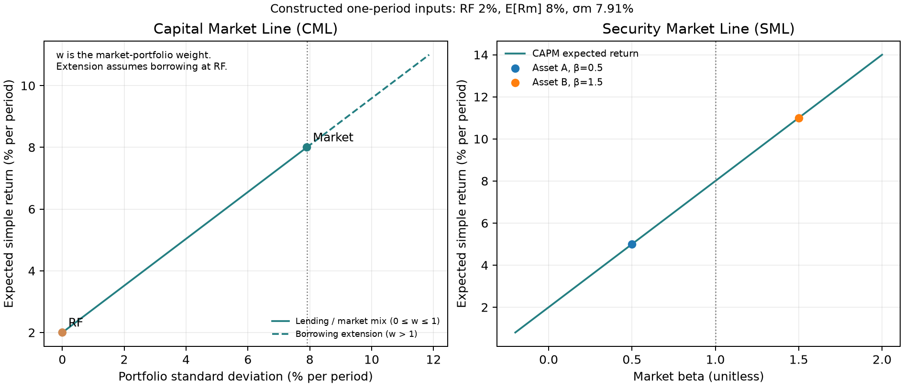
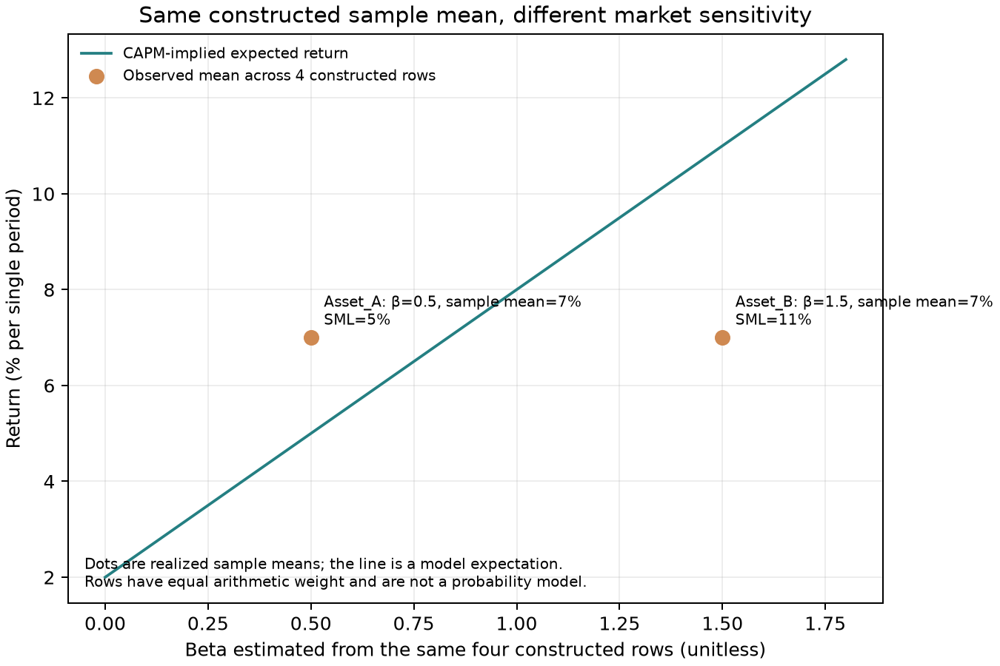
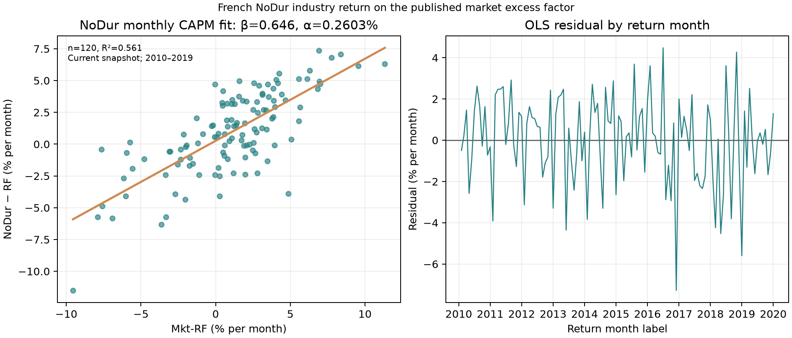

# 第14章 — 资本资产定价模型与资产定价（CAPM and Asset Pricing）

> 主线：资产价格要把未来支付（payoff）按风险调整后的贴现（discounting）因子折回今天；CAPM 在一组严格的均值—方差（mean–variance）均衡假设下，把这种风险调整压缩为对市场组合（market portfolio）的协方差暴露。模型给出可检验的期望收益关系，不直接给出下一期收益预测或交易指令。
> 先修：第 5 章协方差与线性代数、第 8 章回归与稳健推断、第 10 章市场契约、第 11 章收益率与复利。完成后，你应能解释无套利（no-arbitrage）和均衡（equilibrium）的边界，从有效市场组合的可行扰动推导 CAPM，手算 beta 与残差，复用代码估计月频市场回归，并判断一项实证偏离能支持到什么程度。

## 1. 本章目标

学完后，你应能从一期未来支付写出随机贴现因子定价式，解释风险溢价（risk premium）为什么会改变价格；说明无套利约束与均衡模型回答的是不同问题；用协方差除以市场方差计算 beta，并从均值—方差有效市场组合的局部扰动推导资本资产定价模型（Capital Asset Pricing Model，CAPM）。你还应能区分资本市场线（Capital Market Line，CML）与证券市场线（Security Market Line，SML），解释 beta 为零并不表示总风险为零。

实践目标是：用一个明确标为构造的四行样例，独立核对均值、协方差矩阵、beta 和回归残差；运行 `src/quant_course/asset_pricing.py` 对应的薄脚本，复现一项来源、SHA-256、频率和样本窗均固定的 French 月度 CAPM 回归；读图时不把样本回归截距称为可交易 alpha。通过条件是公式量纲一致、例子可手算复核、图与脚本输出一致，并能指出这项案例没有检验什么。

## 2. 为什么 Quant 需要它

量化研究先要回答“今天的价格与未来支付之间是什么关系”，再问某个信号是否能预测或赚取收益。若忽略贴现，现金流相同但在不同状态支付的资产会被当作同价；若只看总波动，完全可分散的波动也会被误当成市场必须补偿的风险。资产定价把价格、风险暴露和要求的期望收益接在一起，给后续的基准、风险调整和异常收益检验提供一个明确的零假设。

无套利只排除可构造的免费午餐，并不自动指定所有资产唯一的风险溢价。CAPM 再加入投资者选择、共同预期、无风险借贷和市场出清等条件，才得到具体的市场 beta 定价关系。这个区分在研究中很实用：一个模型的回归拟合好，不等于市场已满足模型假设；某个历史截距不为零，也不等于研究者已经找到了可融资、可成交、扣除成本仍赚钱的策略。

本章案例用两项构造资产贯穿：四行样例里的平均总收益相同，市场 beta 却分别为 0.5 和 1.5。这个反差让读者看到，beta 描述的是与市场共同变化的方向和尺度，而不是把某段已实现的平均收益改名为期望收益。第 15 章才展开多因子模型；这里的真实案例只做单因子市场回归。

## 3. 直觉：先问支付发生在哪个状态

设一项证券下一期支付 100 欧元。若它在多数人收入充足、消费价值较低时支付，和在大家收入紧张、现金最值钱时支付，虽然金额相同，今天的价格也可能不同。要比较这两项证券，不能只把支付乘一个与状态无关的“平均折扣”；需要一个状态权重：越是在边际价值高的状态收到钱，越值得今天付出价格。

CAPM 把这个一般想法作了很强的简化。它假设在单期均值—方差世界中，投资者可以通过持有市场组合和无风险资产（risk-free asset）调节风险；一个资产若在市场组合不利时也下跌，不能靠分散轻易消除，均衡就要求更高的期望超额收益。beta 把这种共同变化写成单一数值。它没有测量所有坏状态风险，更不表示“beta 高，下一期一定涨得多”。

构造样例里的 Asset A 与 Asset B 都有 7% 的四行平均总收益，但对市场超额收益的 beta 分别为 0.5 与 1.5。若把这 4 行当作完整的概率分布，它们不同时满足以 2% 无风险收益、8% 市场期望收益为输入的 CAPM 横截面期望收益（分别为 5% 与 11%）。然而，这 4 行在本章只是等权教学记录，不是对长期状态概率的声明；样本均值与模型期望量不同，差异本身说明为什么预测或定价必须依赖假设和证据。

## 4. 数学基础：支付、收益和风险的单位

用一期时间线表示今天为 \(t\)，下一期为 \(t+1\)。\(X_{t+1}\) 是期末支付，单位为货币；\(P_t\) 是今天价格，单位也是货币。单期简单总回报率为 \(R_{t+1}=(X_{t+1}-P_t)/P_t=X_{t+1}/P_t-1\)，无量纲；相应的毛收益因子（gross return factor）为 \(G_{t+1}=X_{t+1}/P_t=1+R_{t+1}\)。若用百分数展示简单收益，要先确认内部十进制值如 0.02 表示 2%，而不是再除一次 100。

本文的 CAPM 是同一持有区间、同一币种和同一收益定义下的期望简单收益关系。\(R_f\) 是该区间无风险资产的简单收益率，\(\mathbb E[R_m]\) 是市场组合简单总回报率的期望；二者都不是毛收益因子。月收益只能与月度 \(R_f\) 和月度市场溢价搭配；月 beta 虽然无量纲，仍依赖所用的收益频率和市场代理。公式里的期望是关于模型或总体状态分布的量，不能替换成下一期实现值。

对一组等权观察 \(x_1,\ldots,x_n\)，样本均值为 \(\bar{x}=n^{-1}\sum_j x_j\)，样本方差为 \(s_x^2=(n-1)^{-1}\sum_j(x_j-\bar{x})^2\)，样本协方差类似。一个收益率的方差、协方差单位是“每期收益比例的平方”；协方差除以方差后得到无量纲的 beta。若向量收益 \(R\) 有 \(k\) 项，均值向量 \(\mu\) 是 \(k\) 维，协方差矩阵 \(\Sigma\) 是 \(k\times k\)，描述所有成对共同变化。

## 5. 正式定义：从一般定价到市场 beta

一期随机贴现因子（stochastic discount factor，SDF）\(m_{t+1}\) 是把期末支付按状态转换为今天价值的随机权重。若没有套利、状态覆盖等条件满足，可写

\[
P_t=\mathbb E_t[m_{t+1}X_{t+1}].
\]

这里 \(m\) 的单位是“今天货币 / 期末货币”；\(mX\) 的单位和 \(P\) 相同。它把未来支付 \(X\) 带入定价，输出今天价格。高 \(m\) 的状态是边际价值较高的状态：在那些状态支付更多，价格会更高。这个表示比 CAPM 一般；它不会单独告诉我们市场风险溢价等于多少。

无套利（no-arbitrage）是指不存在初始成本不正、未来每个有正概率状态的支付不负，且初始成本严格为负或至少一个未来状态支付严格为正的可行组合。这里采用允许现金借贷的有限状态、无摩擦、可线性组合交易设置；状态概率均为正，价格是组合支付上的一致线性泛函。在这个设置中，无套利等价于存在一组严格正的状态价格，从而存在严格正SDF；这不要求市场完备。它约束价格彼此一致；但通常容许多个正 SDF，所以单靠无套利不能推出 CAPM 的市场 beta 关系。均衡（equilibrium）还要求家庭或投资者在预算和偏好下选择资产、市场供需出清；均衡假设把价格和期望收益具体化。CAPM 是有明确均衡假设的资产定价模型，不是无套利的同义词。

先把概率与价格权重拆开。在有限状态 $s=1,\ldots,S$ 中，$p_s>0$ 是发生概率，$m_s$ 是该状态的SDF，状态价格（state price）$q_s=p_sm_s$ 表示“只在状态s支付1单位期末货币”的今天价格；若这项状态证券不可单独交易，$q_s$ 是支持已交易资产价格的隐含权重。于是

\[
P=\sum_{s=1}^S p_sm_sX_s=\sum_{s=1}^S q_sX_s.
\]

$p_s$ 无量纲且加总为1；$m_s$ 和 $q_s$ 都按今天货币/期末货币计量，$q_s$ 不必加总为1。市场完备（complete market）指可交易支付张成全部状态支付空间：此时无套利状态价格唯一；不完备时可能有多组正权重，对已交易支付都给相同价格，对未被张成的支付却未必给同一个价格。正SDF是存在性条件，不能从中读出所有资产的唯一预期风险溢价。

本章其余公式用简单收益 \(R\)（第4节记作 \(R_{t+1}\)）；为展示 SDF 恒等式，用毛收益因子 \(G=1+R\)，无风险简单收益记作 \(r_f\)（即 \(R_f\)），相应毛收益因子为 \(G_f=1+r_f\)。把资产价格归一为 1，有 \(1=\mathbb E[mG]\)；确定支付 1 单位的无风险资产价格为 \(\mathbb E[m]\)，故 \(G_f=1/\mathbb E[m]\)。利用 \(\mathbb E[mG]=\mathbb E[m]\mathbb E[G]+\operatorname{Cov}(m,G)\)，得到

\[
\mathbb E[G]-G_f=-\frac{\operatorname{Cov}(m,G)}{\mathbb E[m]}.
\]

因为 \(G=1+R\)，毛收益因子与简单收益率仅相差常数 1，故 \(\operatorname{Cov}(m,G)=\operatorname{Cov}(m,R)\)，且 \(\mathbb E[G]-G_f=\mathbb E[R]-r_f\)。所以同一个式子也可写作 \(\mathbb E[R]-r_f=-\operatorname{Cov}(m,R)/\mathbb E[m]\)。它说明资产若在高贴现因子、边际价值高的状态支付得少，就需要较高期望收益补偿。右侧协方差按同一单期概率分布计算。这个 SDF 风险解释可以承接一般定价，再由 CAPM 对 \(m\) 和市场组合施加额外结构，得到单一 beta。

系统风险（systematic risk）是无法仅靠持仓分散掉的共同风险；特质风险（idiosyncratic risk）是相对市场或给定因子模型的剩余变化。单因子回归可写为

\[
R_i-R_f=\alpha_i+\beta_i(R_m-R_f)+\varepsilon_i,
\qquad \beta_i=\frac{\operatorname{Cov}(R_i-R_f,R_m-R_f)}{\operatorname{Var}(R_m-R_f)}.
\]

beta 是单期超额收益对市场超额收益的线性暴露，取决于样本、频率、代理和估计方法；它不是一种资产的固有常数。若线性投影成立，残差与市场超额收益样本内正交，但残差可以有显著方差。beta 为零只表示线性协方差为零，不表示资产没有总风险。

CAPM 对任何资产 \(i\) 的期望收益要求为

\[
\mathbb E[R_i]-R_f=\beta_i\bigl(\mathbb E[R_m]-R_f\bigr).
\]

两侧都是相同区间的期望简单超额收益，单位为每期收益率；beta 无量纲。对 \(\beta_i=1\) 的市场组合，这个式子回到市场风险溢价；对 beta 为零的资产，CAPM 给出的期望超额收益为零；市场组合本身的风险溢价仍可非零，而该资产也可能有非零特质风险。等式是 CAPM 假设下的横截面期望关系，不是下一期实现收益恒等式。

资本市场线（CML）描述无风险资产与有效市场组合混合后，均值—标准差平面上的期望收益：

\[
\mathbb E[R_p]=R_f+\frac{\mathbb E[R_m]-R_f}{\sigma_m}\sigma_p.
\]

斜率为市场组合的 Sharpe 比率（每单位波动的期望风险溢价）。CML 只适用于由无风险资产和切点市场组合构成的有效组合。SML 则是期望收益对 beta 的关系，适用于 CAPM 均衡下的资产或组合。CML 横轴是总标准差，SML 横轴是市场 beta；二者对象不同，不能把一条图线当成另一条。

::: {.body-pitfall title="分支条件：负市场权重与绝对值"}

为什么CML必须限定分支？令市场权重为 $w$、无风险权重为 $1-w$，在本期 $R_f$ 已知且固定时，

\[
R_p=R_f+w(R_m-R_f),\quad
\mathbb E[R_p]=R_f+w(\mu_m-R_f),\quad
\sigma_p=|w|\sigma_m.
\]

方差中的 $w^2$ 开方成为绝对值，不能直接写成 $w$。当市场溢价为正且 $w\ge0$，才得到上方有效CML的正斜率；$w>1$ 对应按同一 $R_f$ 融资。若 $w<0$，同样的标准差对应下方负斜率分支，并非有效CML。仍用 $R_f=2\%$、$\mu_m=8\%$、$\sigma_m=10\%$：$w=0.5$ 与 $w=-0.5$ 的波动都为5%，期望收益却分别为5%与−1%；它们的beta分别为0.5与−0.5，在SML上能区分。CML公式把总波动转换为期望收益时，实际已经选择了 $w\ge0$ 的有效分支。

:::

上述总收益与超额收益协方差相等，是对一个期初已知 $R_f$ 的条件单期分布而言。跨很多历史月份的RF列可能变化；此时 $\operatorname{Cov}(R_i-R_f,R_m-R_f)$ 与 $\operatorname{Cov}(R_i,R_m)$ 不必相等。实证接口因此逐月扣同月RF、用超额收益定义回归beta，不能把单期“减常数不改变协方差”推广为整列时变RF也可随意删去。

CAPM 的 alpha 需要区分目标量与估计量。理论期望 alpha 可定义为 \(\alpha_i^{\ast}=\mathbb E[R_i-R_f]-\beta_i\mathbb E[R_m-R_f]\)，CAPM 要求它为零。时间序列回归截距 \(\hat\alpha\) 是指定样本、指定市场代理和模型下估出来的数；即使统计上不同于零，也不是未来已实现收益，更不是扣除交易成本后的可执行策略收益。

## 6. 推导：从有效组合到局部扰动

推导采用单期均值—方差设置。每个风险资产可交易且可分割，期初已知的无风险收益在该期各状态间固定，组合权重按财富计量并满足预算约束 \(\sum_j w_j=1\)；投资者可按同一个已知的 \(R_f\) 借入或贷出；投资者对资产的期望收益向量与协方差矩阵有相同看法；效用只依赖期望收益和方差（或收益联合正态使该简化适当）；市场出清使所有投资者持有的风险资产加总为市场组合。还要求市场组合方差为正、其期望溢价为正，并且在考虑的点附近，对任一风险资产都能小幅增加或减少权重。删掉这些条件，结论就不再由本推导保证。

共同预期使投资者面对同一个均值—方差机会集；可以按相同无风险利率借贷时，他们选择同一个切点风险组合，风险厌恶差异只改变该组合与无风险资产的配置比例。风险资产市场出清再把切点组合识别为总市场组合。这里“市场组合”是所有可投资风险资产按市场价值加权的理论对象；实际研究者用的指数或 French 市场因子都只是代理。无风险资产允许按 \(R_f\) 放大或缩小切点组合，因而等价于选择风险资产中 Sharpe 比率最高的组合。

先把市场组合 \(M\) 写作期望总收益 \(\mu_m\)、标准差 \(\sigma_m>0\)，超额收益 \(a=\mu_m-R_f>0\)。再把一个小权重 \(\varepsilon\) 从市场组合重新分配给资产 \(i\)，总权重仍为 1：

\[
R_p(\varepsilon)=(1-\varepsilon)R_m+\varepsilon R_i.
\]

预算约束通过系数和为一保持。令组合的 Sharpe 比率为 \(S(\varepsilon)=[\mu_p(\varepsilon)-R_f]/\sigma_p(\varepsilon)\)。因为 M 是共同机会集中的切点组合，\(\varepsilon=0\) 在所有风险资产权重和为一的组合中局部最大化 Sharpe；增加或减少少量该资产都可行，故导数为零。组合期望收益导数是 \(\mu_i-\mu_m\)，方差导数在 0 处是 \(2[\operatorname{Cov}(R_i,R_m)-\sigma_m^2]\)，标准差导数为方差导数除以 \(2\sigma_m\)。先按商法则展开，而不是直接跳到 beta 关系：

\[
S'(0)=\frac{(\mu_i-\mu_m)\sigma_m-a\sigma_p'(0)}{\sigma_m^2},\qquad
\sigma_p'(0)=\frac{\operatorname{Cov}(R_i,R_m)-\sigma_m^2}{\sigma_m}.
\]

其中 \(S'(0)\) 是重新配置一小份财富时 Sharpe 比率的边际变化，\(\sigma_p'(0)\) 是组合标准差的边际变化。将第二式代入第一式，令 \(S'(0)=0\)，再乘正数 \(\sigma_m\)，得到

\[
0=(\mu_i-\mu_m)-\frac{a}{\sigma_m^2}\{\operatorname{Cov}(R_i,R_m)-\sigma_m^2\}.
\]

这里的协方差是总收益协方差；同一期的无风险收益是常数，减掉它不改变协方差。系数 \(a/\sigma_m^2\) 来自市场切点的 Sharpe 最优性，而不是人为指定某个资产的历史回归系数。

将 \(a=\mu_m-R_f\) 代入并整理：

\[
\begin{aligned}
\mu_i-\mu_m&=\frac{\mu_m-R_f}{\sigma_m^2}
\{\operatorname{Cov}(R_i,R_m)-\sigma_m^2\},\\
\mu_i-R_f&=\frac{\operatorname{Cov}(R_i,R_m)}{\sigma_m^2}(\mu_m-R_f),\\
\mathbb E[R_i]-R_f&=\beta_i\{\mathbb E[R_m]-R_f\}.
\end{aligned}
\]

中间的比值就是相对市场的 beta。第一行说明切点最优性约束边际期望收益与边际共同风险；第二行消去市场自身那一份风险；第三行把总收益改写成超额收益，因为常数 \(R_f\) 不影响协方差。推导解释 CAPM 关系为何由均衡和有效性产生，却没有证明现实市场一定满足它。若存在借贷利率差、空头约束、异质预期、非均值—方差偏好或不完整市场，公共切点组合或局部一阶条件可能失效。

## 7. 金融解释：补偿的是边际共同风险

分散化减少的是证券之间不共同变化的部分。若一个投资者持有许多低相关资产，单只证券的正负残差会相互抵消；市场整体下跌时共同下跌的暴露则不会因为多买几只相似证券而消失。因此 CAPM 把期望风险溢价系在 beta，而不是总标准差。这个结论有条件：若系统性风险被遗漏的因子更好地描述，市场 beta 可能只是一个不完整的风险刻画。

beta 大于 1 表示该资产历史线性超额收益对市场超额收益的响应幅度高于市场自身；beta 小于 0 表示样本线性共变方向相反。它们都不保证特定期间的收益方向。提高杠杆通常会扩大股东权益对底层资产变化的敏感度，也可能带来融资约束和破产风险；把 beta 放大不等于保证更高实际收益或风险调整后收益。

零 beta 资产可能仍有很高的方差。CAPM 在均衡关系上为它给出零期望市场超额收益（即要求收益为 RF），不表示市场风险溢价为零，也不表示该资产没有总风险、亏损概率或持有成本。CML 的标准差涉及总波动；SML 的 beta 只涉及市场协方差，正是这两个风险概念不同的结果。

## 8. Numerical Example

### 8.1 把随机贴现因子拆成两个状态

::: {.body-example title="完整例题：两状态价格、收益与协方差核对"}

以下是教学构造的一期欧元模型，不是市场数据。未来只有“收入充足”与“收入紧张”两种状态，各概率1/2。给定正SDF分别为0.9与1.1；高SDF表示收入紧张状态中一单位支付的当前价值较高。证券X在两状态支付110、90欧元，证券Y两状态都支付100欧元。

| 未来状态 | 概率p | SDF m | 状态价格q=p×m | X支付（欧元） | q×X（今天欧元） |
|---|---:|---:|---:|---:|---:|
| 收入充足 | 0.5 | 0.9 | 0.45 | 110 | 49.5 |
| 收入紧张 | 0.5 | 1.1 | 0.55 | 90 | 49.5 |

表中概率负责“发生多常”，SDF负责“该状态支付多值钱”，最后一列才进入价格加总。这里状态价格和为1只是本例无风险收益为0的结果。

先算期望SDF：\(\mathbb E[m]=(0.9+1.1)/2=1\)，所以无风险总收益因子\(G_f=1\)，简单无风险收益为0。这是构造输入推出的价格关系，并非现实欧元利率假设。

再逐状态乘权重：X今天价格为\(P_X=(0.9\times110+1.1\times90)/2=99\)欧元；Y为\(P_Y=(0.9\times100+1.1\times100)/2=100\)欧元。二者未来期望支付都为100，价格却不同，因为X在现金更值钱的状态只付90。只折现“平均支付”会把这层风险丢掉。

于是X期望简单收益为\(100/99-1\approx1.0101\%\)，Y为0；X的高期望收益补偿其在收入紧张时少付钱，并不是保证收益。实际X收益两状态为\(110/99-1\approx11.1111\%\)与\(90/99-1\approx-9.0909\%\)。期望与实现值的区别在这个小表里已经可见。

最后用第5节恒等式核对：\(\operatorname{Cov}(m,X)=99-1\times100=-1\)欧元，故\(\operatorname{Cov}(m,G_X)=-1/99\)，代入\(-\operatorname{Cov}(m,G_X)/\mathbb E[m]=1/99\)恰是期望溢价。所有概率、支付和正SDF都是给定的示范输入；它展示定价权重怎样运算，没有从现实数据估出投资者偏好。

```python
import numpy as np
probability = np.array([0.5, 0.5])
discount = np.array([0.9, 1.1])
payoff = np.array([110.0, 90.0])
price = float(probability @ (discount*payoff))
mean_m = float(probability @ discount)
gross = payoff/price
mean_g = float(probability @ gross)
cov_m_g = float(probability @ ((discount-mean_m)*(gross-mean_g)))
assert np.isclose(price, 99.0)
assert np.isclose(mean_g-1/mean_m, -cov_m_g/mean_m)
print(price, mean_g-1/mean_m, gross-1)
```

:::

### 8.2 从四行收益手算 beta 与残差

::: {.body-example title="完整例题：四行beta、残差与期望收益"}

以下 4 行是人为构造，等权仅为方便手算；不是市场记录，也没有声称它们是从某个总体随机抽样。所有数值为单期十进制简单收益。无风险收益每行都是 2%，市场超额收益依次为 \(-4\%,1\%,11\%,16\%\)。设中心化后的市场超额收益为 \((-10\%,-5\%,5\%,10\%)\)，构造残差为 \((1\%,-2\%,2\%,-1\%)\)，它与市场中心化收益的内积为零。

资产的超额收益定义为

\[
R_A-R_f=5\%+0.5(R_m-R_f-6\%)+\varepsilon,
\quad
R_B-R_f=5\%+1.5(R_m-R_f-6\%)+\varepsilon.
\]

由此得到总收益表：

| 构造行 | RF | Mkt−RF | Asset A 总收益 | Asset B 总收益 | 构造残差 |
|---|---:|---:|---:|---:|---:|
| 1 | 2% | −4% | 3.0% | −7.0% | 1% |
| 2 | 2% | 1% | 2.5% | −2.5% | −2% |
| 3 | 2% | 11% | 11.5% | 16.5% | 2% |
| 4 | 2% | 16% | 11.0% | 21.0% | −1% |

按四行等权，超额收益均值向量按顺序 \((Mkt-RF,A-RF,B-RF)\) 为 \(\mu=(6\%,5\%,5\%)\)。用样本协方差分母 \(n-1=3\)，协方差矩阵约为

\[
\Sigma=\begin{bmatrix}
0.008333&0.004167&0.012500\\
0.004167&0.002417&0.006583\\
0.012500&0.006583&0.019083
\end{bmatrix}.
\]

这些数是收益比例平方。由未舍入的交叉乘积可得 \(\beta_A=(0.0125/3)/(0.0250/3)=0.5\)，\(\beta_B=(0.0375/3)/(0.0250/3)=1.5\)；上表六位小数仅供展示。普通最小二乘回归（ordinary least squares，OLS）直线分别是 \(\widehat{R_A-R_f}=2\%+0.5(Mkt-RF)\) 和 \(\widehat{R_B-R_f}=-4\%+1.5(Mkt-RF)\)。两者拟合残差都是 \((1\%,-2\%,2\%,-1\%)\)，残差并没有因为 beta 定义而消失。

若再把构造的 \(R_f=2\%\) 和市场期望简单总回报率 \(\mathbb E[R_m]=8\%\) 作为 CAPM 输入，SML 给出 beta 0.5 的模型期望收益 5%，beta 1.5 的模型期望收益 11%。表中四行样本平均总收益却都为 7%。这不是计算矛盾：有限实现的样本均值不是模型期望值；而此例并未把四行声明为精确状态概率。它提醒我们，不能从“过去均值相同”直接推断未来定价关系。

:::

## 9. Python Implementation

### 本读者版的默认运行入口

从[接受I3读者包](../../qa/a10/ACCEPTED_COMPLETE_LOCAL_READER_I3.md)根目录，按其[环境说明](../../editions/zh/README.md)建立环境后运行：

```bash
.venv/bin/python run_notebook.py notebooks/ch14_asset_pricing.ipynb
```

默认运行先核四行构造收益、beta与残差，再用给定RF=2%、市场期望收益8%绘制新的CML/SML图和beta散点图。两张新PNG写入`runs/ch14_asset_pricing_<uuid>/`。历史French回归及历史残差图分支由`RUN_FRENCH=False`关闭，不在默认运行中读取或下载市场快照；本章第10–11节的NoDur图表是已有历史读物。

运行器另在唯一`runs/execution_*`目录保存内核执行记录；它与Notebook打印的本章UUID方法目录用途不同。构造运行核对计算接口，不形成市场研究结果、PIT预测或扣费策略收益。第14章历史NoDur使用HAC5，第15章和项目2历史主表使用HAC6，点估计与推断设置须分别识别，不能为表面一致改写区间。本批仅核实际源代码，未执行这些Notebook或重跑历史回归。

第14章Notebook英文Markdown归BIL23，本批不改章Notebook。 下方CLI与旧制作测试按课程工作根理解；未随读者包提供的制作测试不要求补回。

### 历史课程工作根与原实现

核心计算封装在 [`asset_pricing.py`](../../src/quant_course/asset_pricing.py)：`beta_from_covariance` 实施协方差除以方差，`fit_capm_excess` 用单解释变量 OLS 恒等式返回点估计、拟合值、残差和 (R^2)，`capm_expected_return` 应用期望收益关系。异方差与自相关稳健推断（heteroskedasticity and autocorrelation consistent，HAC）由共享月频函数 `fit_monthly_factor_model` 负责；本章不另写第二套月度 HAC 引擎。所有输入缺失或不有限时都明确报错，不静默删行。

脚本 [`ch14_asset_pricing.py`](../../code/ch14_asset_pricing.py) 是数据装载、报告和作图薄层；从课程根目录运行：

```bash
.venv/bin/python code/ch14_asset_pricing.py
```

真实数据先按 manifest 对处理后文件做 SHA-256 校验，再检查 NoDur、Mkt-RF、RF 为连续 `PeriodIndex('M')` 月份。因子表中 Mkt-RF 已经扣掉 RF，因此被解释变量只做一次 `NoDur - RF`。以收益月份作标签，代码没有建立当时信息可得、发信号或成交的时间戳，所以它不是回测。月度 HAC 的 maxlags=5 是 5 个相邻月度观察行；月末间隔有 28、30、31 天，不转造成假的等秒 DatetimeIndex。统计显著性依赖时间序列近似假设与带宽选择，不能单独确认 alpha。

上方CLI属于历史课程工作根制作流程，不是接受I3读者包的默认入口。第14-P01–P03可在已按环境说明安装本课程的工作根独立粘贴运行；本地`.venv/bin/python`已能直接导入`quant_course`，无需另加路径修补。

## 10. Visualization



左图横轴是组合标准差（每期百分比），纵轴是期望简单收益（每期百分比）；0 到 1 的市场权重段是无风险资产与市场组合的组合，虚线是权重大于 1、假设能按 RF 借入后的延伸。示例的 RF=2%、市场期望收益=8%、市场标准差约 7.91% 均为构造输入。图中7.91%取四行构造值的ddof=0数值作为期望模型的假定风险参数，不是第8节ddof=1样本协方差所对应的风险估计；四行数据也不因此变成真实总体状态分布。右图横轴为无量纲 beta，纵轴为模型期望收益；两线端点按同组假设计算。图展示的是条件模型关系，不是市场观测。



横轴是由四行构造记录估出的 beta，纵轴是四行等权总收益均值。橙点 A 与 B 都落在 7%，而 SML 上 beta 0.5 和 1.5 对应 5% 与 11%。散点是实现样本均值，线是构造的期望收益模型，故二者距离不是 alpha 交易证据。



左图横轴是 Mkt-RF（% 每月），纵轴是 NoDur−RF（% 每月），点是 2010–2019 的 120 个已发布月收益行；线是同一窗内 OLS 拟合。右图横轴是收益月份，纵轴是回归残差（% 每月）。图表可用于看线性关联和残差时间结构，不能从一张残差图证明模型正确。

## 11. Real Market Example

真实案例只估单因子市场回归，不提前讨论 FF3/FF5。NoDur 是 French 月度十行业组合中的非耐用品行业价值加权组合总收益；Mkt-RF 是发布的市场超额收益；RF 是同频一个月国库券代理收益。样本固定为 2010-01 至 2019-12 的连续 120 个月，计算前由已处理十进制月收益文件 SHA 校验。快照见 [`french_industries_2026-10-05.json`](../../data/manifests/french_industries_2026-10-05.json) 和 [`french_factors_2026-10-05.json`](../../data/manifests/french_factors_2026-10-05.json)：行业文件 SHA-256 `3b097d810c295d64eedfa1ece7067ff2a0707f5ca90e33935df9949251f70950`；因子文件 SHA-256 `c19770a19a0ac47ad1c29074f57234570aeaa9725212cb4fa8146a2846c52814`。FF 数据来源声明 CRSP 数据库版本月份为 202608；二者均是 2026 年当前发布快照，而不是各历史月当时可见的点时（point-in-time，PIT）数据。

估计式是 \(NoDur_t-RF_t=\alpha+\beta(Mkt-RF)_t+\varepsilon_t\)，单位均为月度十进制简单收益，beta 无量纲。估计的月 beta 为 0.6456，样本 \(R^2=0.5608\)；月截距为 0.2603%，Bartlett HAC 标准误为 0.1926%，参考 95% 区间为 [−0.1210%, 0.6417%]，参考双侧 \(p=0.179\)。固定 HAC maxlags=5，单位为连续月度行。这里的区间和 p 值是给定估计设定下的近似推断，不构成 beta 或 alpha 的确定性判决。

结果记录在 [`ch14_french_capm_2010_2019.json`](../../qa/a4/ch14_french_capm_2010_2019.json)。NoDur 超额收益与市场超额收益的样本内回归描述共同变化；它不是市场全部财富的完整组合检验，也没有无风险融资、费用、冲击、容量或成交时点。虽然截距参考区间包含零，不能据此证明 CAPM 正确；即使不包含零，也不能仅凭本回归断言存在可交易机会。对真实总收益，NoDur 月平均为 1.0099%，RF 为 0.0427%，月超额均值为 0.9673%；这些都是该固定样本的描述统计，不是下一月预期。

## 12. Common Mistakes

第一种常见错误是对市场因子再次减 RF。Mkt-RF 已经是市场超额收益，再做一次差会令解释变量成为 \(R_m-2R_f\)，beta 就不再是对标准市场风险溢价的暴露。第二种错误是用原始资产总收益而非超额收益回归，却把截距直接称为 CAPM alpha；RF 会改变截距和可能的斜率。下面脚本按本章冻结数据重复正确与错误设定，先按 SHA 校验输入，输出月度 beta、截距对比：

```python
from pathlib import Path
import json
import sys
import statsmodels.api as sm

ROOT = Path.cwd()
sys.path.insert(0, str(ROOT / "src"))
from quant_course.factor_models import fit_monthly_factor_model
from quant_course.market_data import load_monthly_snapshot

industry_manifest = json.loads(
    (ROOT / "data/manifests/french_industries_2026-10-05.json").read_text()
)
factor_manifest = json.loads(
    (ROOT / "data/manifests/french_factors_2026-10-05.json").read_text()
)["datasets"]["ff3"]
industry = load_monthly_snapshot(
    ROOT / industry_manifest["processed_path"],
    industry_manifest["processed_sha256"], ["NoDur"]
)
factors = load_monthly_snapshot(
    ROOT / factor_manifest["processed_path"],
    factor_manifest["processed_sha256"], ["Mkt-RF", "RF"]
)
sample = industry.join(factors).loc["2010-01":"2019-12"]
correct = fit_monthly_factor_model(
    sample["NoDur"], sample[["Mkt-RF", "RF"]],
    factor_columns=("Mkt-RF",), hac_maxlags=5
)
wrong_factors = sample[["Mkt-RF", "RF"]].copy()
wrong_factors["Mkt-RF"] -= wrong_factors["RF"]
double_subtracted = fit_monthly_factor_model(
    sample["NoDur"], wrong_factors,
    factor_columns=("Mkt-RF",), hac_maxlags=5
)
raw_return_fit = sm.OLS(
    sample["NoDur"], sm.add_constant(sample["Mkt-RF"])
).fit()
print("correct beta:", correct.coefficient_table.loc["Mkt-RF", "estimate"])
print("beta after subtracting RF twice:", double_subtracted.coefficient_table.loc["Mkt-RF", "estimate"])
print("correct excess-return intercept:", correct.coefficient_table.loc["const", "estimate"])
print("raw-return intercept (not CAPM alpha):", raw_return_fit.params["const"])
assert round(correct.coefficient_table.loc["Mkt-RF", "estimate"], 6) == 0.645630
assert round(double_subtracted.coefficient_table.loc["Mkt-RF", "estimate"], 6) == 0.646460
```

在冻结样本中，正确 beta 为 0.645630，重复扣 RF 后为 0.646460；正确的月超额收益截距为 0.2603%，而原始总收益回归截距为 0.3036%。后一数值不是 CAPM 的超额收益回归截距。修复办法是被解释变量用同月 `NoDur - RF`，解释变量直接用已扣 RF 的 `Mkt-RF`。

第三种错误是把 \(\hat\alpha\) 或样本平均超额收益当成 \(\mathbb E[R_i]-R_f\)。前者是估计截距，后者是实现路径的平均；都可能受有限样本、修订数据、市场代理、结构变化和残差影响。式中期望值是目标总体或均衡对象，不能承诺下一期实现值。

第四种错误是把 beta 当作全部风险。beta 为零的资产仍可以有很大的残差方差；验证时同时看协方差、beta、总方差和残差，而不是只看 beta。第五种错误是从一条显著截距宣布策略。统计估计没有自动加入事后选择、多重检验、融资、税费、冲击和成交约束，也没有给策略一个真实可得的信号时间。

最后，不要把相关性回归误读为因果效应，也不要把由 10 行业或常见市场代理做的检验称为对“完整市场组合”无争议的检验。代理资产覆盖和是否均值—方差有效是联合问题，正是 Roll 对可检验性的关键提醒；它不是一句“CAPM 所有检验都无效”。

## 13. Quant Research Application

一个严谨的研究流程先把目标说清：若研究“市场 beta 是否解释横截面平均收益”，这是定价检验；若研究“过去 beta 能否预测资产下月收益”，这是预测检验；若研究“策略能否赚到可投资的净收益”，这是组合和交易检验。三者的因变量、估计窗、时间可得性和反证条件不同。

先注册理论限制、市场组合代理、频率、样本窗和缺失值规则。估 beta 时只使用估计时点之前的收益；预测检验需做滚动或扩展窗，并让参数估计和信号可得时间先于交易；策略检验再加入再平衡、成交价、借贷、费用、冲击、空头可得性和容量。使用留出期或滚动样本外评估，报告所有尝试的模型和资产，保留未显著结果。

一个可反驳的 CAPM 命题是：在指定可交易资产集合和预先选定的市场代理下，横截面平均超额收益对 beta 的斜率与市场风险溢价相符，截距偏差在采样误差范围内。证据不符可能来自 CAPM 假设不适用、代理无效、期望收益估计噪声、样本选择或遗漏风险结构；不能自动识别哪一种原因。数据能支持什么结论，必须与研究设计的 estimand 一致。

## 14. Chapter Summary

一期价格是未来支付按随机贴现因子加权后的期望。无套利限制允许的一般定价表示比 CAPM 宽；CAPM 由均值—方差投资者、共同无风险借贷和预期、市场有效性及出清等条件，把风险补偿简化为市场协方差 beta。局部扰动导数说明 beta 关系从何而来，假设清单也说明它不是自然定律。

beta 是系统性线性共变暴露，不是总风险或未来收益保证。SML 画期望收益—beta，CML 画有效组合的期望收益—标准差。构造例的样本均值、beta 和残差可从四行手算；French 案例展示月频回归与 HAC 参考推断，但一个代理、一段历史和一个截距都不能独自确认理论或交易机会。

## 15. Exercises

以下题目答案在第 18 节。变量均为同区间简单收益；没有特别说明时均使用十进制。

**14-E01｜定价与预测。** 用一句话区分一期 SDF 定价式与 CAPM 期望收益关系，并说明它们都不能单独保证什么。

**14-E02｜手算 SDF。** 两状态等概率，贴现因子为 1.1 和 0.9。一项证券支付分别为 0 和 2。求今天价格、无风险 gross return 与无风险简单收益，并分别给出该证券的期望 gross return 和期望简单收益；解释风险溢价方向。

**14-E03｜风险和 beta。** 假设某资产与市场超额收益协方差为 0，市场方差为正，但资产超额收益方差为 0.04。CAPM 对该资产给出什么期望超额收益？资产总风险是否为零？

**14-E04｜SML 与 CML。** 在 \(R_f=2\%\)、\(\mathbb E[R_m]=8\%\)、\(\sigma_m=10\%\) 下（\(\sigma_m\) 是本题独立给定的参数，不由第8.2节四行样本估计），求 beta=1.5 资产的 CAPM 期望收益；再求标准差为 5% 的有效市场/RF 组合期望收益。指出两个结果各属于哪条线。

**14-E05｜概率与状态价格。** 沿用第8.1节，写出两项状态价格，解释为什么不是只用概率给X定价。若只交易两状态都支付100欧元的Y，价格100欧元，能否唯一识别两项状态价格？给出两组严格正权重。

**14-E06｜同波动的两条分支。** 第5节的RF=2%、市场期望收益8%、波动10%保持不变，市场权重为−0.5。求组合期望收益、标准差、beta，解释为何不能代入正斜率CML得到5%。

## 16. Programming Exercises

**14-P01｜复现构造例。** 调用核心构造函数，计算顺序为市场、A 超额、B 超额的样本均值和样本协方差矩阵；用协方差比计算两项 beta；拟合 A 和 B 的残差。验收：均值为 6%、5%、5%；beta 为 0.5 和 1.5；残差为 1%、−2%、2%、−1%。

**14-P02｜缺失值边界。** 将 P01 的某个收益观察改为 `NaN`，调用 `fit_capm_excess`。写测试确认程序拒绝非有限值，不得静默删行；再恢复数据并确认结果不变。

**14-P03｜月度共享估计。** 对月度 `PeriodIndex('M')` 上生成的 60 期数据构造 \(y_t=0.001+1.2x_t+e_t\)，通过 `fit_monthly_factor_model` 用一列因子估计。要求 RF 全零、因子表含 RF 列，使用 HAC maxlags=5。断言样本数为 60、beta 接近 1.2、残差均值近零，并打印滞后单位“月度行”。

**14-P04｜真实数据审计。** 运行本章脚本并读取 [`ch14_french_capm_2010_2019.json`](../../qa/a4/ch14_french_capm_2010_2019.json)。自动核对样本起止、120 行、月频、两个文件哈希和 CAPM 单因子标签；报告不能把其 `alpha_monthly` 改名为“策略净收益”。

## 17. Challenge Problems

**14-C01｜局部扰动推导。** 从市场组合切点 Sharpe 比率最大化和可行局部扰动推出 CAPM。列明预算约束、均值与方差的导数、无风险资产如何支持共同切点组合，以及市场出清在哪一步识别出市场组合。

**14-C02｜零 beta 高风险。** 构造一个与市场超额收益不相关、但方差严格为正的收益例子。说明 CAPM 期望超额收益条件、SML 图示含义和不能推出的风险结论。

**14-C03｜估计 alpha 和交易机会。** 月回归截距为 0.3%，HAC 标准误为 0.1%，参考 (t=3)。写出至少四项仍需检查的证据，才能从“回归截距估计较大”走向“可实施的净交易机会”。

**14-C04｜Roll critique 边界。** 用文字解释为何以代理市场组合检验线性收益—beta 关系时，也在检验代理的均值—方差有效性。指出这个结论不支持哪种过度概括，并写出一项能增强检验解释的设计改进。

## 18. Solutions / Solution Hints

**14-E01 答案。** SDF 式把一个随机支付按状态价格权重折成今天的价格，属于 payoffs 到 prices 的估值关系；CAPM 式在特定均衡假设下把资产期望超额收益写成市场 beta 乘市场期望风险溢价。两者都不单独预测某个未来月的实现收益，也不证明包含融资与交易成本的策略可盈利。

**14-E02 答案。** 等概率下 \(\mathbb E[m]=0.5(1.1+0.9)=1\)，所以无风险 gross return 为 \(G_f=1/\mathbb E[m]=1\)，对应无风险简单收益 \(r_f=G_f-1=0\)。证券价格为 \(P=\mathbb E[mX]=0.5(1.1\cdot0+0.9\cdot2)=0.9\)。它的 gross return 为 0 或 \(2/0.9=2.2222\)，期望 gross return 为 \(1.1111\)；相应的简单收益是 -100% 或 122.22%，期望简单收益为 11.11%。相对 \(r_f=0\) 的期望简单风险溢价为 11.11 个百分点。该证券只在贴现因子较低的状态支付，因此与 \(m\) 负协方差；这个两状态例子没有增加 CAPM 的市场状态假设。

**14-E03 答案。** beta 为 \(0/\operatorname{Var}(R_m-R_f)=0\)，该资产的 CAPM 期望超额收益为 0；市场风险溢价本身并未因此确定为 0。资产自己的方差为 0.04，标准差为 \(\sqrt{0.04}=0.2\)，即 20%（单期收益单位），所以它的总风险不为零。CAPM 只把这项方差解释为不与该市场代理线性共变的风险。

**14-E04 答案。** SML 给 \(2\%+1.5(8\%-2\%)=11\%\)。有效市场/RF 组合的市场权重为 \(w=\sigma_p/\sigma_m=5\%/10\%=0.5\)，所以 CML 期望收益为 \(2\%+0.5(8\%-2\%)=5\%\)。前者是 beta 1.5 资产的 CAPM 期望收益，后者只适用于该有效组合的标准差关系。

**14-E05 答案。** $q=(0.45,0.55)$，$P_X=0.45\times110+0.55\times90=99$欧元。只用概率会得到100欧元，它是期望支付而非风险调整价格。只交易Y时，价格约束仅为 $100(q_1+q_2)=100$；$(0.45,0.55)$ 和 $(0.5,0.5)$ 都严格正且满足约束，但给未被Y张成的X定价分别为99和100欧元。故Y的无套利价格不唯一识别全部状态价格；不能把未交易X的这两个价格差直接当成可套利交易。

**14-E06 答案。** $\mathbb E[R_p]=2\%-0.5\times6\%=-1\%$；$\sigma_p=|-0.5|\times10\%=5\%$；因RF为常数，$\beta_p=w=-0.5$。SML给 $2\%-0.5\times6\%=-1\%$，一致。正斜率CML用了 $w\ge0$，本组合在下方分支；只报总标准差会丢掉敞口方向。

**14-P01 参考实现。**

```python
import numpy as np
from quant_course.asset_pricing import (
    constructed_two_asset_sample,
    fit_capm_excess,
)

sample = constructed_two_asset_sample()
returns = np.column_stack([
    sample["Mkt-RF"],
    sample["Asset_A"] - sample["RF"],
    sample["Asset_B"] - sample["RF"],
])
mean_vector = returns.mean(axis=0)
covariance = np.cov(returns, rowvar=False, ddof=1)
fit_a = fit_capm_excess(returns[:, 1], returns[:, 0])
fit_b = fit_capm_excess(returns[:, 2], returns[:, 0])
assert np.allclose(mean_vector, [0.06, 0.05, 0.05])
assert np.allclose(covariance[1:, 0] / covariance[0, 0], [0.5, 1.5])
assert np.allclose(fit_a.residuals, [0.01, -0.02, 0.02, -0.01])
assert np.allclose(fit_b.residuals, fit_a.residuals)
```

小数收益平方单位下的样本协方差矩阵为 \(\begin{bmatrix}.008333&.004167&.012500\\.004167&.002417&.006583\\.012500&.006583&.019083\end{bmatrix}\). 代码使用同样的排列顺序 `[Mkt-RF, Asset_A_excess, Asset_B_excess]`；协方差与方差均用 `ddof=1`，其比值计算beta。

**14-P02 参考测试。**

```python
import numpy as np
import pytest
from quant_course.asset_pricing import constructed_two_asset_sample, fit_capm_excess

sample = constructed_two_asset_sample()
market = sample["Mkt-RF"].to_numpy()
asset = (sample["Asset_A"] - sample["RF"]).to_numpy(copy=True)
asset[1] = np.nan
with pytest.raises(ValueError, match="must be finite"):
    fit_capm_excess(asset, market)
asset[1] = 0.005
restored = fit_capm_excess(asset, market)
assert np.isclose(restored.beta, 0.5)
assert np.allclose(restored.residuals, [0.01, -0.02, 0.02, -0.01])
```

该测试验证函数对坏观察显式失败。恢复第二个观察为 0.005 超额收益后，beta 应为 0.5、残差仍为 `[.01, -.02, .02, -.01]`；缺失不是缩短样本的许可。

**14-P03 参考实现。**

```python
import numpy as np
import pandas as pd
from quant_course.factor_models import fit_monthly_factor_model

month = pd.period_range("2015-01", periods=60, freq="M", name="month")
x = pd.Series(np.linspace(-0.08, 0.08, 60), index=month, name="Mkt-RF")
e = pd.Series(0.002 * np.sin(np.arange(60)), index=month)
rf = pd.Series(0.0, index=month, name="RF")
y = pd.Series(0.001 + 1.2 * x.to_numpy() + e.to_numpy(), index=month, name="asset")
fit = fit_monthly_factor_model(
    y,
    pd.concat([x, rf], axis=1),
    factor_columns=("Mkt-RF",),
    hac_maxlags=5,
)
assert fit.nobs == 60
assert abs(fit.coefficient_table.loc["Mkt-RF", "estimate"] - 1.2) < 0.01
assert abs(float(fit.residuals.mean())) < 1e-12
assert fit.hac_maxlags == 5  # five adjacent monthly observation rows
```

确定性正弦误差与 \(x\) 不完全正交，所以 beta 只要求接近 1.2，而不是恰好等于它。相邻 index 是连续月 Period，不构造等秒时间戳；HAC lag=5 的单位是月度行。RF 在目标资产收益里按 helper 约定减一次，因子 Mkt-RF 已经是超额收益，不再减 RF。

**14-P04 参考验收。** 命令 `.venv/bin/python code/ch14_asset_pricing.py` 会先校验 manifest 哈希，再写两份 QA JSON 和三张图。真实French冻结案例记录 `2010-01`、`2019-12`、`n_months=120`、`frequency=monthly`、Mkt-RF 单因子。哈希须与第 11 节一致；如果不一致，应先找出快照或处理文件变化，不能修改期望值掩盖差异。JSON 的 alpha 字段是时间序列回归截距，报告和练习中不命名为策略净收益。

**14-C01 参考推导。** 权重 \((1-\varepsilon,\varepsilon)\) 相加为 1，因此把一个小仓位从 M 调到 i 时预算保持平衡。市场组合切点的 Sharpe 比率在这一组权重下局部最大。扰动组合均值导数是 \(\mu_i-\mu_m\)，方差导数是 \(2[\operatorname{Cov}(R_i,R_m)-\sigma_m^2]\)，标准差导数为后者除以 \(2\sigma_m\)。对 \(S(\varepsilon)=[\mu_p(\varepsilon)-R_f]/\sigma_p(\varepsilon)\) 求导并令零，得到 \(0=(\mu_i-\mu_m)-[(\mu_m-R_f)/\sigma_m^2][\operatorname{Cov}(R_i,R_m)-\sigma_m^2]\)。移项后 \(\mu_i-R_f=[\operatorname{Cov}(R_i,R_m)/\sigma_m^2]\cdot(\mu_m-R_f)\)，定义比值为 beta 即得 CAPM。权重之和保证预算；相同均值—方差预期和同一 RF 使投资者拥有共同切点组合；市场出清才把该组合识别为市场组合。若局部正负扰动不可行、资产集合不完整或投资者预期不同，推导不再足以识别该等式。

**14-C02 参考构造。** 取 4 个等概率状态，市场超额收益 \(X=(-1\%,-1\%,1\%,1\%)\)，资产超额收益 \(Y=(1\%,-1\%,1\%,-1\%)\)。两者均值为 0，逐状态乘积为 \((-0.0001,0.0001,0.0001,-0.0001)\)，所以协方差为 0；资产方差为 \(0.0001\)，标准差为 1%，严格大于零。因市场方差为正，beta 为 \(0/\operatorname{Var}(X)=0\)。若 CAPM 成立，该资产的期望超额收益为零；SML 在 beta=0 处给出 RF，而市场风险溢价仍可非零。该资产总标准差仍为 1%。这个例子不代表无波动、无下行尾部或本金确定。

**14-C03 参考答案。** 至少还需检查：（1）市场和资产收益单位、时区、频率、RF 对齐以及市场因子是否已扣 RF；（2）市场代理是否覆盖目标机会集，是否有遗漏共同风险或参数不稳定；（3）样本是否事后挑选、试验过多少资产/频率/窗口，是否做留出期或多重检验控制；（4）HAC 滞后、残差依赖、结构变化和小样本近似是否可信；（5）信号在何时可得，成交是否可实现；（6）费用、点差、冲击、融资、借券、税费与容量后的净收益；（7）相对简单可投资基准的增量风险调整结果。即使这些检查后仍存在稳定的期望 alpha，也需先定义可执行组合和风险预算；\(t=3\) 只是在给定回归设定下的参考统计量，不是免费的套利证明。

**14-C04 参考答案。** Roll 的原始批评指出，在线性均值—beta关系中用作“市场”的组合若不在均值—方差有效集合，测试的偏离既可能来自资产定价关系，也可能来自代理组合无效。因为精确理论市场组合不可完整观测，实证检验实际上对其代理施加联合限制。它不支持“所有 CAPM 检验必然无效”或“任何代理结果都没有信息”这样的过度结论。改进可明确界定投资者可投资资产集合，说明市场代理覆盖，并同时测试代理组合效率和横截面定价限制；还可跨预先声明的合理代理做敏感性分析，报告差异而非挑选最有利结果。

## 19. Further Reading

- **Must Know：** Sharpe (1964) 阅读均值—方差偏好、无风险借贷与共同预期假设、有效组合以及收益—beta关系相关段落；本章在来源笔记中说明实际读取边界。它支撑理论结构，不证明假设在现实数据中成立。
- **Should Know：** Princeton FIN501 one-period pricing 讲义 slides 43–66，用于理解 SDF、状态价格、无套利和进一步得到 beta 定价所需的限制。MIT OCW 15.401 CAPM 讲义 slides 3–10、15–16、18–27 用于复习分散化、SML/CML 和 CAPM 实证问题。
- **Advanced：** Roll (1977) 原文摘要与市场组合可检验性论证，用于理解代理组合的联合检验边界。若要完整掌握论证，应阅读原文，而非仅依赖本章摘要。
- **Optional：** Markowitz (1952) 出版元数据确认均值—方差组合理论历史来源；本次章节准备未逐页读取全文。Fama and French (2004) 官方摘要适合作为后续经验综述导读，本章没有复述其完整论文。

\clearpage

## 20. References

1. Sharpe, W. F. (1964). “Capital Asset Prices: A Theory of Market Equilibrium under Conditions of Risk.” *The Journal of Finance*, 19(3), 425–442. [Sharpe原文与出版元数据](https://doi.org/10.1111/j.1540-6261.1964.tb02865.x)。支持均值—方差假设、有效组合与市场风险关系；实际阅读边界见 [`source_notes.md`](source_notes.md)。
2. Markowitz, H. (1952). “Portfolio Selection.” *The Journal of Finance*, 7(1), 77–91. [Wiley 元数据与 DOI](https://doi.org/10.1111/j.1540-6261.1952.tb01525.x)。本章仅核出版元数据，未逐页阅读全文。
3. Princeton FIN501. [Lecture 02: One-Period Asset Pricing](https://swh.princeton.edu/~markus/teaching/Fin501/02Lecture.pdf), slides 43–66. 支持一般定价核和 SDF 层次，未在本文展开基本定理全部技术条件。
4. Lo, A. W. MIT OCW 15.401. [The CAPM and APT](https://live.ocw.mit.edu/courses/15-401-finance-theory-i-fall-2008/411d7d9df37d4d0440b18e17e8cea3a9_MIT15_401F08_lec15.pdf), 指定 slides。读取范围与公式重写边界见source_notes。
5. Roll, R. (1977). “A Critique of the Asset Pricing Theory’s Tests Part I: On Past and Potential Testability of the Theory.” *Journal of Financial Economics*, 4(2), 129–176. [DOI](https://doi.org/10.1016/0304-405X(77)90009-5)，[UCLA 原文扫描](https://www.anderson.ucla.edu/documents/areas/fac/finance/1977-2.pdf)。本文仅依据元数据和原文首页摘要解释市场代理的联合检验边界。
6. Fama, E. F., and K. R. French (2004). “The Capital Asset Pricing Model: Theory and Evidence.” *Journal of Economic Perspectives*, 18(3), 25–46. [AEA 官方页面与摘要](https://www.aeaweb.org/articles?id=10.1257/0895330042162430)。本次只核对元数据与摘要。
7. statsmodels. [OLS](https://www.statsmodels.org/stable/generated/statsmodels.regression.linear_model.OLS.html) 与 [robust covariance results](https://www.statsmodels.org/stable/generated/statsmodels.regression.linear_model.OLSResults.get_robustcov_results.html) 官方文档。支持软件调用；不替本研究选择模型、HAC 窗口或经济解释。
8. Kenneth R. French Data Library. [10 Industry Portfolios](https://mba.tuck.dartmouth.edu/pages/faculty/ken.french/Data_Library/det_10_ind_port.html), [Fama/French Factors](https://mba.tuck.dartmouth.edu/pages/faculty/ken.french/Data_Library/f-f_factors.html)。数据和快照边界见本章第 11 节、source notes 与 manifests。官方方法说明不等于历史PIT数据资格。
