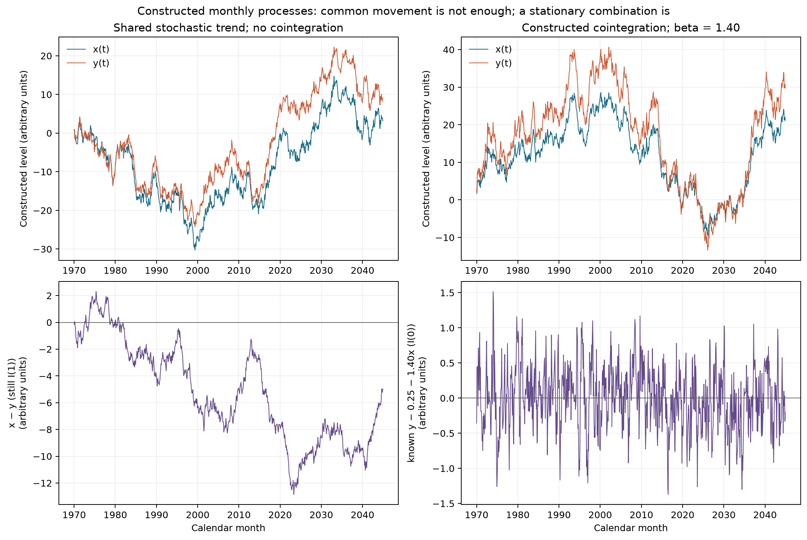
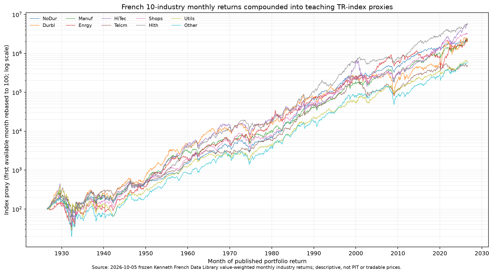

# 第17章 — 时间序列 II：单位根、协整与预测（Time Series II: Unit Roots, Cointegration, and Prediction）

> 主线：两条序列可以高度同向，却不共享稳定的长期关系；检验、预测与交易是三个不同的问题。
> 先修：第16章。完成后你能：推导并解释增广 Dickey–Fuller 检验（Augmented Dickey–Fuller test, ADF）回归，区别确定性趋势（deterministic trend）与随机趋势；估计和递归预测二维向量自回归（Vector Autoregression, VAR）；正确解释 Granger 预测检验（Granger-causality test）；用 Engle–Granger 两步检验（Engle–Granger two-step test）的专用临界值评估协整（cointegration）；设计不泄漏未来信息的配对交易（pairs trading）研究。

## 1. 本章目标

学完后，读者应能从一组带月份标签的序列回答四个不同问题：它是否含单位根（unit root）？两条 I(1) 序列是否存在平稳线性组合？某变量的滞后项是否改善另一个变量的预测？统计关系能否转成时间戳明确、风险和成本可计算的交易规则？这四问有先后联系，却不能互相替代。

本章的计算要求包括：从 $y_t=\phi y_{t-1}+\varepsilon_t$ 推出 ADF 中的 $\gamma=\phi-1$；用小型数值例手算两期二维 VAR 预测；从 6 个观测值手算 Engle–Granger 第一阶段回归；在模拟和真实描述数据上复用同一组严格月频接口。完成标准不是得到小 p 值，而是知道每个统计量的原假设、样本边界、单位、假设和下一步用途。

## 2. 为什么 Quant 需要它

第16章先问一条序列的均值、方差和自相关是否能由稳定模型描述。本章把问题扩展到多条长期走势相似的金融序列。若把两条共同上升的指数直接做水平回归，趋势会制造很高的相关和 $R^2$；若把差分后 VAR 的预测关系称作“因果”，又会把给定信息集里的预测增量误说成干预效果。两类错误都可能让研究者把共同风险误认成套利关系。

这里的逻辑链是：先描述趋势来自确定性项还是随机冲击，再检验单位根；若多条变量各自非平稳，再问是否存在平稳组合；对平稳变量或差分变量才按适当形式使用 VAR 与预测检验；最后才把冻结的模型转成滞后执行、计量每条腿风险和成本的研究设计。单位根检验不证明协整，协整检验不证明预测因果，预测关系也不证明交易有正净收益。

## 3. 直觉

想象两条每月都可能被新冲击推高的行业总回报指数。它们可以因为共有市场冲击而长期同涨同跌；但若两者各自还带有独立的随机累积误差，它们的差仍会越来越漂移。相关系数高，只说明同一段样本内的线性共动强，不说明差会回到某个长期水平。

另一个过程可以写成 $Y_t=0.25+1.4X_t+S_t$，其中 $X_t$ 是随机游走，而 $S_t$ 是均值回归的平稳过程。$X_t$ 和 $Y_t$ 的水平都会漂移，但 $Y_t-0.25-1.4X_t=S_t$ 不会积累随机趋势。这种“各自非平稳、组合平稳”才是协整。这个例子说明了概念，不代表两只股票能按该比率交易；还需估计误差、结构稳定、可交易价格和成本证据。

### 3.1 同一窗口的高相关，可以来自两种机制

令 $W_t,U_t,V_t$ 为相互独立、由零起点累积的零均值随机游走，创新方差分别为9、0.25、0.25。非协整组为 $X_t=W_t+U_t,Y_t=W_t+V_t$。在同一个 $t>0$，

\[
\operatorname{Corr}(X_t,Y_t)=\frac{9t}{\sqrt{(9.25t)(9.25t)}}=\frac9{9.25}\approx0.9730,
\qquad \operatorname{Var}(Y_t-X_t)=0.5t.
\]

即使每个时点的总体相关很高，差仍积累独立冲击。更一般地，$Y_t-\beta X_t=(1-\beta)W_t+V_t-\beta U_t$ 的方差为 $t[9(1-\beta)^2+0.25+0.25\beta^2]$，任意 $\beta$ 都不能消除全部随机趋势。

协整组保留同一个 $X_t$，另令 $Y_t^*=2X_t+S_t$，$S_t$ 是与$X$独立的平稳AR(1)，方差为0.04。此时 $Y_t^*-2X_t=S_t$ 的方差始终0.04；水平仍可共同漂移。下面给同一个六时点窗口的具体可能实现，作为读表练习，不用六点证明协整：

| $t$ | $X_t$ | 累积差 $V_t-U_t$ | $Y_t=X_t+(V_t-U_t)$ | 平稳偏离 $S_t$ | $Y_t^*=2X_t+S_t$ |
|---|---:|---:|---:|---:|---:|
| 0 | 0 | 0 | 0 | 0.0 | 0.0 |
| 1 | 1 | 0.1 | 1.1 | 0.2 | 2.2 |
| 2 | 3 | 0.2 | 3.2 | −0.1 | 5.9 |
| 3 | 2 | 0.3 | 2.3 | 0.1 | 4.1 |
| 4 | 4 | 0.4 | 4.4 | −0.2 | 7.8 |
| 5 | 6 | 0.5 | 6.5 | 0.0 | 12.0 |

同窗样本相关两组都超过0.99。决定概念差异的是生成机制中误差是否继续累积，不是这六点里哪个相关更大；图17-1的长样本则展示有限样本检验怎样区分两种构造。

## 4. 数学基础

本章用 $t$ 表示整数月份，不用等间隔秒数或交易日替代日历月。$y_t$ 可以是收益率（无量纲小数）、收益指数水平（指数点）或对数指数（对数点）；一个公式中不能把这些单位混在一起。差分 $\Delta y_t=y_t-y_{t-1}$ 与 $y_t$ 单位相同。

对 $k$ 维向量 $z_t=(z_{1t},\ldots,z_{kt})'$，协方差矩阵是 $k\times k$，VAR 的每个滞后系数矩阵也是 $k\times k$。普通最小二乘（Ordinary Least Squares, OLS）把因变量投影到常数、趋势或解释变量张成的空间；残差与样本解释变量正交是估计性质，不等于残差在总体上独立。

白噪声（white noise）不自动等于独立同分布；弱平稳（weak stationarity）要求均值、方差恒定且协方差只依赖滞后。单位根过程通常不弱平稳，冲击的累计和会让方差随样本时间改变。统计检验的临界值还取决于回归里的确定性项、变量数、样本和原假设；本章不会把普通 Student-$t$ 或单序列 ADF 临界值错用到协整残差。

## 5. 正式定义

**单位根（unit root）**：若自回归滞后多项式 $1-\phi_1 z-\cdots-\phi_p z^p$ 在单位圆 $|z|=1$ 上有根，就称序列有单位根；单位圆上不同位置的根代表的动态并不相同。本章的普通 ADF 主要检验非季节性 $+1$ 根：例如 $y_t=y_{t-1}+\varepsilon_t$ 是随机游走（random walk），每个冲击在未来水平中永久保留；若创新互不相关、方差为 $\sigma^2$，从固定初值出发有 $\operatorname{Var}(y_t)=t\sigma^2$。$-1$ 根会产生正负交替的持久动态，其他单位圆根可对应季节性振荡，需要针对相应频率的检验；一个普通 ADF 的 $\phi=1$ 原假设不等于检验所有单位圆根。因此不能把所有单位圆根都解释成同一种随机趋势。普通 ADF 未拒绝 $+1$ 根也只是“样本不足以拒绝原假设”，不是证明该根必定存在。

**确定性趋势（deterministic trend）**：$y_t=\alpha+\beta t+u_t$。$u_t$ 弱平稳只约束均值、方差和自协方差，不保证完整分布不随时间变化，也不能单独保证一次冲击的响应会消失。若进一步假设 $u_t$ 来自稳定因果短记忆过程，例如 MA 系数绝对可和的因果 ARMA 过程，那么单次冲击对偏离项的响应会衰减；不要把这个更强结论仅归因于弱平稳。若 $\beta\ne0$，$y_t$ 的均值随时间变化，水平本身不弱平稳。ADF 可在辅助回归中加入无确定项（`n`）、常数（`c`）、常数和线性趋势（`ct`）或常数、线性及二次趋势（`ctt`）。选项表达建模假设，不是供研究者反复搜索小 p 值的旋钮。

**增广 Dickey–Fuller 检验（Augmented Dickey–Fuller test, ADF）**：检验单位根的单序列检验。原假设为水平包含单位根；备择是给定确定项后拒绝单位根。为吸收差分回归残差的序列相关，加入若干滞后差分。统计量的零假设分布非标准，必须按相同确定项对应的 Dickey–Fuller/MacKinnon 临界分布解释。

**向量自回归（Vector Autoregression, VAR）**：$k$ 个变量各自都由自身和其余 $k-1$ 个变量过去的值线性预测。平稳 VAR($p$) 形式为 $z_t=c+A_1z_{t-1}+\cdots+A_pz_{t-p}+u_t$。此处 $z_t,c,u_t\in\mathbb R^k$，$A_j\in\mathbb R^{k\times k}$，滞后以月计。该形式提供联立的预测方程，但普通稳定 VAR 的估计推断要求序列满足适用的稳定条件。

**Granger 预测检验（Granger-causality test）**：在指定样本、滞后阶数和信息集下，检验变量 $x$ 的过去值是否给预测 $y$ 提供额外线性信息。常见原假设是 $y$ 方程里所有 $x$ 滞后系数都为零。它不等于结构因果：遗漏变量、采样频率、共同冲击和变量定义都会影响结果。

**差分阶数与协整（integration order and cointegration）**：本章把 $I(0)$ 定义为弱平稳且短记忆的序列（自协方差绝对可和）；对整数 $d\ge1$，若对序列作 $d$ 次常规一阶差分后得到 $I(0)$，而少于 $d$ 次仍未达到 $I(0)$，称原序列为 $I(d)$。这是本章使用的短记忆约定；弱平稳本身不等于短记忆。若向量 $z_t$ 的各分量均为 $I(d)$，且存在非零向量 $b$，使 $b'z_t$ 降为 $I(d-r)$（正整数 $r$，且 $d-r\ge0$），就称它们协整。常见情形是两条 $I(1)$ 序列有一个 $I(0)$ 线性组合。该组合称协整关系或长期误差，承接单序列阶数判断，给后续误差修正模型（error-correction model, ECM）提供长期项。

**Engle–Granger 两步检验（Engle–Granger two-step test）**：对两个候选 $I(1)$ 序列，第一步回归 $y_t=\alpha+\beta x_t+u_t$ 并取得估计残差；第二步检验残差是否有单位根。因残差来自估计的长期关系，第二步统计量的原假设分布不是普通单序列 ADF 分布；要用协整专用临界值或经校准的 p 值。statsmodels 的 `coint` 实现这一检验。

**误差修正模型（error-correction model, ECM）**：把短期差分动态与上期长期协整偏离同时放入方程的表示。若变量协整，它说明偏离怎样通过后续变化调整；仅对差分会丢失这项长期信息。本章只在第17-C02讨论其形式，不拟合 ECM。

**配对交易（pairs trading）**：把可能存在稳定价差的两条资产序列组合为多空头寸的策略家族。统计协整只是研究入口。策略仍需在训练样本内估计关系、固定信号规则、将信号时间与可成交时间分开、计算每条腿收益与风险、扣成本并做样本外检验。

## 6. 推导

### 6.1 从 AR(1) 到 ADF 系数

从第16章的 AR(1) 写起：$y_t=\phi y_{t-1}+\varepsilon_t$。左、右两边同时减去 $y_{t-1}$，得到

\[
\Delta y_t=(\phi-1)y_{t-1}+\varepsilon_t
  =\gamma y_{t-1}+\varepsilon_t,\qquad \gamma=\phi-1.
\]

这一步把“水平是否带单位根”转成“水平对下一期变化是否提供均值回复”：单位根原假设 $\phi=1$ 等价于 $\gamma=0$；平稳 AR(1) 的 $|\phi|<1$ 对应 $\gamma<0$（简单 AR(1)）。加入常数或趋势后，辅助回归写作

\[
\Delta y_t=\alpha+\beta t+\gamma y_{t-1}
 +\sum_{i=1}^{p}\psi_i\Delta y_{t-i}+\varepsilon_t.
\]

在 ADF 设计中，滞后差分项是为减轻 $\varepsilon_t$ 的序列相关，让检验回归的短期误差结构可处理；它们不会把 “单位根原假设” 改成 “系数是否普通显著”。若 $\hat\gamma$ 对应的 ADF 统计量比同一确定项的临界值更负，才在该显著性水平拒绝单位根。

为什么不查普通 t 表？在 $H_0:\gamma=0$ 下，解释变量 $y_{t-1}$ 是累积随机冲击，随着样本量缩放会收敛到布朗运动路径而非固定方差的平稳变量。残差平方和、斜率分母因此具有非标准极限分布。Dickey–Fuller 推导了相应分布；MacKinnon 用响应面近似有限样本的临界值与 p 值。ADF p 值大，严格解释为当前规格和样本没有拒绝 $H_0$，不解释成“已证明非平稳”。

### 6.2 趋势平稳与差分平稳

若 $y_t=\alpha+\beta t+u_t$，且 $u_t$ 弱平稳，去除确定性均值后，前二阶矩不随日历时间改变；这本身不保证分布恒定，也不充分推出冲击响应消失。若再假定 $u_t$ 是稳定因果短记忆过程，则冲击响应可衰减到零。例如 $u_t=0.5u_{t-1}+\eta_t$ 中，一个单位创新在第 $h$ 期的响应是 $0.5^h$。相反，$y_t=y_{t-1}+\mu+\varepsilon_t$ 含 $+1$ 单位根，当前冲击通过求和永久留在以后水平中；

\[
y_t=y_0+t\mu+\sum_{j=1}^{t}\varepsilon_j,\qquad
\operatorname{Var}(y_t)=t\sigma_\varepsilon^2
\]

（假定冲击独立同分布、方差有限）。差分令 $+1$ 随机趋势变成 $\Delta y_t=\mu+\varepsilon_t$，但会丢失水平关系。过度差分会让已平稳的趋势偏差被再次差分，增加噪声与移动平均结构；所以先问哪个数据生成机制合理，再定回归项与差分，而非机械差一次。若疑似的是 $-1$ 或季节单位根，普通一阶差分未必是对应的变换，不能用这段 $+1$ 根推导代替季节单位根诊断。

#### 一次新冲击怎样进入以后的水平

在随机游走 $y_t=y_{t-1}+\mu+\varepsilon_t$ 中，每次代入前期都再加一个创新。例如 $y_0=100,\mu=0$，三个创新为 $2,-1,3$，则水平为 $102,101,104$。若仅把第一个创新增加1，三个水平都增加1，变为$103,102,105$；差分则只在第一期多1。固定初值下，前三期方差为$\sigma^2,2\sigma^2,3\sigma^2$，因为每期水平又多承接一项独立冲击。这正是“积累”的可计算含义。

对趋势平稳例 $y_t=100+0.4t+u_t,u_t=0.5u_{t-1}+\eta_t$，第一个创新增加1，则第一、二、三期偏离分别增加$1,0.5,0.25$；确定趋势仍是原来的线。去趋势和差分针对不同对象，不能仅凭两条都在上涨的折线选择处理。

### 6.3 为什么残差 ADF 有另一套临界值

设 $x_t,y_t\sim I(1)$。第一阶段 OLS 选择 $\hat\alpha,\hat\beta$ 最小化 $\sum_t(y_t-\alpha-\beta x_t)^2$，得到 $\hat u_t=y_t-\hat\alpha-\hat\beta x_t$。第二阶段考察 $\Delta\hat u_t=\rho\hat u_{t-1}+\sum_i\psi_i\Delta\hat u_{t-i}+v_t$。对于未利用本检验样本估计系数、事先规定的序列或组合，在相应确定项与误差假设成立时，可按单位根原假设使用普通 ADF 参考分布；这里的 $\hat u_t$ 却被第一阶段特意选成对 $y$ 拟合最好的组合。

在“无协整”原假设下，长期系数 $\beta$ 并未被一个真实平衡关系识别；从很多水平组合中估出的残差也已利用样本筛低了平方和。这个估计步骤改变了第二阶段统计量的零假设分布。Engle–Granger 与后续 MacKinnon 通过专门推导/模拟给出了按趋势项和回归变量个数校准的临界值。操作上用 `coint(y, x)`，不能把第一阶段残差交给普通 `adf_test` 后直接按它的 p 值下结论。

#### 预给系数与同样本估计残差：要查哪张表

| 要检验的对象 | 系数从哪里来 | 零假设与参考分布 |
|---|---|---|
| 预先固定 $u_t=y_t-\alpha_0-\beta_0x_t$ | 与本检验样本无关，且作为固定已知常数 | 对这个给定序列检验单位根；在ADF的误差与确定项条件下用普通ADF分布 |
| $\hat u_t=y_t-\hat\alpha-\hat\beta x_t$ | 同一训练样本OLS拟合 | 候选$I(1)$序列无协整；用EG专用分布 |
| 新窗口残差 $y_t-\hat\alpha_{train}-\hat\beta_{train}x_t$ | 过去训练窗估计，后冻结 | 是关系稳定性诊断；冻结不消除训练参数误差，不能自动宣称普通ADF有限样本校准正确 |

第一行是“给定组合是否有单位根”，第二行是“估计出来的长期关系是否协整”，问题与取样步骤不同。第一行不能先看本样本再声称系数预给，也不能把普通ADF对某个组合的结果等同于完整的联合协整研究。

确定项、滞后和训练窗也进入检验设计。截距描述非零位置，线性趋势描述确定性增长；ADF滞后差分吸收短期相关。滞后过少可能留下误差相关，过多消耗有效观测和检验力。应在训练窗内固定候选上限、准则与残差检查，EG的确定项属于第一阶段长期方程；第二阶段估计残差的检验不能自行换普通ADF口径。若短窗口中$\phi=0.99$，它仍满足$|\phi|<1$，但与单位根非常接近，ADF不拒绝也可能是检验力不足。报告规格、窗口、有效样本数和不拒绝的含义，才能说明证据到底检验了什么。

### 6.4 VAR 与 Granger 检验

对二维 VAR(1)，令 $z_t=(x_t,y_t)'$，$c=(c_x,c_y)'$，$A_1=(a_{ij})$。条件均值预测把未知未来创新 $u_{T+1}$ 的条件期望设为零；将预测值递归送回同一方程即可得到第二期。若用数据估参数，滞后阶数与系数都只能由训练区间估计；若 $z_t$ 是非平稳水平，应先判断差分或 VECM 等相应模型，而不是把常规平稳 VAR 的显著性直接套上去；若保留长期协整误差，应评估向量误差修正模型（vector error-correction model, VECM）。

在 $y_t$ 方程中，假定共有 $p$ 期 $x$ 滞后系数 $b_1,\ldots,b_p$。Granger 原假设是 $H_0:b_1=\cdots=b_p=0$。联合 F 检验问这些过去值在控制 $y$ 自身滞后和其他已放入的信息后，是否改善样本内线性预测。换列顺序就换了问题：statsmodels 约定输入的第二列 Granger 导致第一列。

例如遗漏的发布变量 $q_{t-1}$ 同时进入 $x_{t-1}$ 和 $y_t$，$x$ 的滞后可能只是其代理。加入当时可见的$q$后，$x$的预测增量可能消失；对$x$做干预也未必改变$q$或$y$。同一检验若改变采样时钟、变量顺序或控制信息集，问的就是另一个预测问题。

### 6.5 从协整关系到可交易价差

若两个正值指数 $P^A_t,P^B_t$ 的对数 $a_t=\log P^A_t,b_t=\log P^B_t$ 是 $I(1)$，且存在 $s_t=a_t-\alpha-\beta b_t\sim I(0)$，那么 $s_t$ 是“长 A、按 $\beta$ 对冲 B”的统计偏离。先在训练集估 $\alpha,\beta$，再用训练集均值、标准差计算 $z_t=(s_t-\bar s_{train})/\hat\sigma_{s,train}$。不能用未来样本重估再声称历史信号当时可见。

在概念规则中，若月末已可观察的 $z_t>2$，下一可执行时点才考虑做空价差；$z_t<-2$ 时方向相反；回到零附近退出。此处阈值仅是规则示范。对数价差系数不是自动美元中性头寸：须规定每条腿的名义金额/波动率风险、杠杆、总敞口上限、调仓时间、融资、卖空借券、股息与交易成本。任何信号应标注其可用时间 $available\_at$、生成时点 $signal\_time$ 和实际成交时点 $trade\_time$，满足 $available\_at\le signal\_time<trade\_time$。

### 6.6 对数系数怎样变成名义金额和股数

$s_t=\log P^A_t-\alpha-\beta\log P^B_t$ 的微小变化为 $\mathrm ds=\mathrm dP^A/P^A-\beta\,\mathrm dP^B/P^B$。因此用美元损益近似追踪价差变化时，取方向 $d\in\{+1,-1\}$（$+1$为做多价差）、尺度 $K>0$ 美元，令有符号名义为

\[
N_A=dK,\qquad N_B=-d\beta K,\qquad
q_A=\frac{N_A}{P^A_{entry}},\quad q_B=\frac{N_B}{P^B_{entry}}.
\]

$q$单位为股，正值做多、负值做空。冻结股数后的单区间价格损益为 $q_A(P^A_{exit}-P^A_{entry})+q_B(P^B_{exit}-P^B_{entry})$，即 $dK R_A-d\beta K R_B$；$R$是该持有区间的简单价格收益。小收益时近似$dK\Delta s$，有限变动时不精确等于对数价差变化。若股息和融资另计，须加入相应现金流；采用总回报时不得再重复记股息。

| $\beta$与方向 | A腿名义 | B腿名义 | 组合含义 |
|---|---:|---:|---|
| $\beta=1.5,d=+1$ | $+K$ | $-1.5K$ | 多A、空B；毛敞口$2.5K$，净敞口$-0.5K$ |
| $\beta=1.5,d=-1$ | $-K$ | $+1.5K$ | 空A、多B |
| $\beta=-0.5,d=+1$ | $+K$ | $+0.5K$ | 两腿同为多头 |
| $\beta=-0.5,d=-1$ | $-K$ | $-0.5K$ | 两腿同为空头 |

一般协整不要求$\beta>0$；Project5预注册却只选入$\beta>0$，使项目的价差方向对应一多一空。这是策略入选规则，不能改写成协整的定义。即使$\beta>0$，只有$\beta=1$的上述名义转换才美元中性；$\beta$不是股数比，截距$\alpha$也不是一条可交易现金腿。

手算例：$\beta=1.5,d=+1,K=100$，成交价A为20、B为50美元/股。名义为$+100,-150$美元，股数$+5,-3$；退出价A为20.6、B为50.5，则损益$5(0.6)-3(0.5)=1.50$美元。毛敞口250，初始有符号净名义−50；若以250为明确的毛敞口分母，区间损益比为0.6%，它不是未定义资本账户的NAV收益。交易成本还须按开仓及平仓实际成交名义扣除。

固定初始名义不是每期自动维持相同名义：持仓后价格漂移，需要调仓才恢复目标比例，调仓又有成本。若$K=110$，目标股数$5.5,-3.3$，使用本例约定“朝零取整”后为$5,-3$，实际名义$100,-150$、实际对冲比$1.5$恰巧没变，但毛敞口变为250；一般取整会改变比例。例如$K=100,\beta=1.4$目标$5,-2.8$，朝零取整为$5,-2$，实际对冲比从1.4变为1.0。按实际股数记账并重新核风险，不能继续用理想目标权重代替实际成交。

## 7. 金融解释

单位根代表水平中的冲击可能持续影响估值或累计财富，影响风险区间、长期回归和预测不确定性。趋势平稳过程受到冲击后倾向回归趋势；随机趋势过程的路径会随每次冲击永久改道。两种经济机制会导向不同的模型和对冲期限。

协整关系可被理解为经验上不随时间发散的线性误差，但其来源可能是现金流、共同贴现率、政策、行业结构或指数构造。结构变化、并购/行业重分类、危机制度转换都可能打破关系。Granger 预测检验只能说明指定预测系统里，历史 $x$ 是否增加对 $y$ 的线性预测内容；不能指出若干预 $x$ 会如何改变 $y$。

配对研究把可能的长期约束变为一个信号，但不能把“协整”直接等同“价差会在我的持有期内回归”。短期流动性风险、借券召回、融资和交易冲击可以在统计回归之前触发亏损。月度行业组合收益形成的累计指数又不是任何投资者可直接成交的两只股票。本章真实数据例只做统计描述，不报告策略收益。

## 8. 数值例：逐步看清每一步

### 8.1 手算 ADF 系数

设 $y_t=0.7y_{t-1}+\varepsilon_t$。两边减去 $y_{t-1}$：

\[
\Delta y_t=(0.7-1)y_{t-1}+\varepsilon_t=-0.3y_{t-1}+\varepsilon_t.
\]

所以 $\gamma=-0.3$。若 $y_{t-1}=10$，该项给下一期变化的条件贡献为 $-3$ 个 $y$ 单位；它不是完整预测，因为还需常数、趋势、滞后差分和创新项。原假设 $\gamma=0$ 对应 $\phi=1$，不是检验 $\gamma$ 是否按普通 t 分布显著。

### 8.2 Engle–Granger 第一阶段 OLS 的手算

::: {.body-example title="完整例题：六点OLS与残差检验边界"}

教学构造六点：$x=(1,2,3,4,5,6)'$，令 $y=2x+u$，其中 $u=(1,-2,1,1,-2,1)'$。检查 $\sum u_i=0$ 且 $\sum (x_i-\bar x)u_i=0$，因此含截距 OLS 截距 $\hat\alpha=0$，斜率 $\hat\beta=2$，残差逐点就是 $u$。第一步输出的是长期系数和残差序列，不是交易信号。

第二步要问该残差是否有单位根。六个观测不足以提供有力检验；更关键的是残差系数用同样六点估出，不能查普通 ADF 表。实作会使用 Engle–Granger/MacKinnon 校准。例子演示运算，不把这六个故意正交的数称为市场协整。

```python
import numpy as np
x = np.arange(1.0, 7.0)
u = np.array([1.0, -2.0, 1.0, 1.0, -2.0, 1.0])
y = 2.0 * x + u
design = np.column_stack([np.ones(len(x)), x])
alpha_hat, beta_hat = np.linalg.lstsq(design, y, rcond=None)[0]
residual = y - design @ np.array([alpha_hat, beta_hat])
print(alpha_hat, beta_hat, residual.tolist())
assert np.allclose([alpha_hat, beta_hat], [0.0, 2.0])
assert np.allclose(residual, u)
```

输出依次为截距约 0、斜率约 2、残差 `[1, -2, 1, 1, -2, 1]`。这些 OLS 数值可手算复核；正式检验仍需要长而有时间顺序的样本。

:::

### 8.3 二维 VAR 两期预测

::: {.body-example title="完整例题：VAR两期递归预测"}

单位设为月收益百分点，训练末值 $z_T=(2,-1)'$，系数和常数均为教学构造：

\[
c=\begin{bmatrix}0.5\\-0.2\end{bmatrix},\qquad
A=\begin{bmatrix}0.4&0.2\\0.1&0.3\end{bmatrix}.
\]

第一期：
\[
\widehat z_{T+1|T}=c+Az_T
=\begin{bmatrix}0.5\\-0.2\end{bmatrix}
+\begin{bmatrix}0.4(2)+0.2(-1)\\0.1(2)+0.3(-1)\end{bmatrix}
=\begin{bmatrix}1.1\\-0.3\end{bmatrix}.
\]

第二期把第一期条件均值（不是事后真实值）代回：
\[
\widehat z_{T+2|T}=c+A\widehat z_{T+1|T}
=\begin{bmatrix}0.5+0.4(1.1)+0.2(-0.3)\\-0.2+0.1(1.1)+0.3(-0.3)\end{bmatrix}
=\begin{bmatrix}0.88\\-0.18\end{bmatrix}.
\]

因此两期条件预测为第一个变量 1.10、0.88 个百分点，第二个变量 −0.30、−0.18 个百分点。未来随机冲击的条件均值为零，所以递归中不加新冲击；实际实现值会围绕这些条件均值波动。代码的 VAR 预测需按估计系数计算，并把训练段最后一个滞后状态传给 forecast。

```python
import numpy as np
c = np.array([0.5, -0.2])
A = np.array([[0.4, 0.2], [0.1, 0.3]])
z_t = np.array([2.0, -1.0])
z_t1 = c + A @ z_t
z_t2 = c + A @ z_t1
print(z_t1, z_t2)
assert np.allclose(z_t1, [1.1, -0.3])
assert np.allclose(z_t2, [0.88, -0.18])
```

这个程序把纸面矩阵乘法按同一顺序计算，并断言两期结果；未来创新的实现值没有放进预测。

:::

### 8.4 一次收益区间和两条腿

::: {.body-example title="完整例题：固定名义双腿费用"}

假定某策略在月末 $t$ 形成信号，下一可执行时间 $t+1$ 建仓，等美元名义多头 100、空头 100，并持有到 $t+2$ 再平衡。若 $t+1$ 至 $t+2$ 这一持有区间内多头总回报 $r^A=3\%$、空头标的总回报 $r^B=1\%$，忽略费用的美元损益为 $100(0.03)-100(0.01)=2$。按一个月持有区间核对：两腿开仓、两腿平仓各收费 10bp，并在此例中统一按各腿 100 美元名义估算，共四笔 $0.10$，交易成本合计 $0.40$。空头月借券费 20bp、融资费 5bp 也均按 100 美元名义计算，分别是 $0.20$ 与 $0.05$。本段净损益为

\[
2-4(0.10)-0.20-0.05=1.35.
\]

实际账本应按每次成交名义、准确持有天数和费率计费；这里固定名义只是手算约定。这只是单位核对例；月度 French 数据不能分解“月末生成”到“次月实际成交”区间，也不支持估出这些成本。

:::

## 9. Python Implementation

### 本读者版的默认运行入口

从[接受I3读者包](../../qa/a10/ACCEPTED_COMPLETE_LOCAL_READER_I3.md)根目录，按其[环境说明](../../editions/zh/README.md)建立独立环境后运行：

```bash
.venv/bin/python run_notebook.py notebooks/ch17_time_series_ii.ipynb
```

默认以种子20261017/20261018各构造900个月。非协整模拟的共同创新标准差1、独立创新标准差0.2，与§3.1手算方差9/0.25/0.25是两个不同输入的教学对象。协整构造beta=1.4、价差AR系数0.65、创新标准差0.35、截距0.25，初始价差按稳态分布初始化。已知价差用普通ADF；同窗估计关系用EG专用校准。二维VAR另用种子1704构造1990-01起120行，前100月截至1998-04训练，预测1998-05和1998-06；生成系数A=[[0.35,0.12],[0.05,0.30]]、c=[0.25,−0.10]，创新标准差0.10。此Notebook不运行Granger检验。

Notebook显示`fixtures/figures/a4/ch17_cointegration_simulation.png`随包既有图；显示不等于本次重新生成。`RUN_FRENCH=False`关闭历史市场分支。虽然创建并打印`runs/ch17_time_series_ii_<uuid>/`，本Notebook不向它写CSV或PNG。运行器另在唯一`runs/execution_*`目录保存执行副本与状态；两个目录用途不同。构造计算不形成市场预测或策略净收益证据；第10–11节的French历史图表与数字保留原有身份。

下方CLI与制作测试属于历史课程工作根流程，不是本包默认路线；未随包提供的制作测试不要求读者补回。I3 CLI第16章仍无条件读取French，CLI第17章历史分支需`--french-data`，均不替代上述默认命令。

### 历史课程工作根与原实现

本章核心位于 [`cointegration.py`](../../src/quant_course/cointegration.py)，复用第16章的 `validate_monthly_series`，另外严格验证多列月度表。它要求升序、唯一、连续的 `PeriodIndex(freq="M")`，把数值转换为有限 `float64`；缺月、NaN、无穷、布尔和复数均报错，不自动填补。接口如下：

| 函数 | 输入 | 输出与边界 |
|---|---|---|
| `adf_test` | 单条完整月频序列；`regression` 确定项与可选滞后规格 | ADF 统计量、近似 p 值、使用滞后、样本数、对应临界值 |
| `engle_granger_test` | 同月对齐、至少 24 个观测的两条序列；可选趋势和滞后规格 | Engle–Granger 统计量、专用 p 值和临界值 |
| 共同趋势非协整模拟 | 长度 `n` 与 `seed` | 共享随机趋势叠加两条独立随机游走 |
| `simulate_cointegrated_pair` | `seed`、非零有限实数 `beta` 与 $|\phi|<1$ | $x\sim I(1)$，$y=0.25+\beta x+s$，$s\sim I(0)$；拒绝 `beta=0` 和布尔值 |
| `fit_var_forecast` | 训练面板 `training`、固定滞后 `lags`、预测步数 `steps` | 按未来月份标记的递归预测；平稳性仍需研究者验证 |
| `granger_test` | 有名、同月对齐的 `caused` 与 `causing` 序列；最大滞后 `max_lag` | 明确方向的联合 F 统计量和 p 值 |
| `screen_cointegration_pairs` | 多列水平表 `levels`、训练截止月 `training_end` | 截止月前所有无序列对的 Engle–Granger p 值与 BH 调整 p 值（常称 q 值）；作为探索性 FDR 调整，不读取截止月后的数值估计 |
| `total_return_index_proxy` | 小数月简单收益 `returns` | 由 100 起算的累计总回报指数（total-return index, TR index）教学代理 |

运行复现实验、图和样本统计：

```bash
.venv/bin/python code/ch17_time_series_ii.py
.venv/bin/python -m pytest tests/test_ch17_cointegration.py -q
```

脚本中的两条模拟种子固定为 20261017 和 20261018；不按收益或 p 值筛 seed。Engle–Granger 包装器明确调用 statsmodels 0.15.0 的 `coint`，不从普通 ADF 包装器拼接错误临界值；完全或近乎完全共线的输入会被拒绝。对 `trend="n"`，若 statsmodels 返回的临界值为 NaN，接口保留该缺失值，但仍单独检查检验统计量与 p 值有限。所有实证预测/筛查仅传入训练段。月度数据只按月标签处理，不把月长伪装成等秒日频。Notebook 只调用核心模块，不复制统计实现。

## 10. Visualization

**图 17-1：共同随机趋势和协整组合的模拟对照。** 两列分别是 seed 20261017 的非协整共同趋势构造和 seed 20261018 的 $\beta=1.40$ 协整构造，样本均为 900 个月。上排横轴是日历月、纵轴是构造水平任意单位；两种情形的 $x,y$ 都同向，单看上排不能判定协整。下排纵轴分别是 $x-y$ 与已知的 $y-0.25-1.40x$：左侧差值仍漂移，右侧已知平稳价差围绕零波动。它是机制演示，不是市场结果。



**图 17-2：French 10 行业月收益累计指数代理。** 横轴为收益所属月份，纵轴为先把 10 个行业发布月收益按 $100\prod(1+r_t)$ 复利、再将首月显示基准设为 100 的对数纵轴。样本覆盖 1926-07 至 2026-08。行业走势有共同的长期上升和不同回撤，但这幅图既非单一股票价格也非样本外策略净值；对数刻度用于同时显示长期复利和历史回撤。



两幅 PNG 由 `code/ch17_time_series_ii.py` 实际生成。代码读取固定哈希的本地 French CSV，并验证图例、周期与数据范围；它们不是手绘示意图。

## 11. Real Market Example

本章沿用 [Kenneth R. French Data Library 的 10 Industry Portfolios](https://mba.tuck.dartmouth.edu/pages/faculty/ken.french/Data_Library/det_10_ind_port.html) 当前缓存：2026-10-05 下载的 ZIP，选择 `Average Value Weighted Returns -- Monthly` 月区块，源单位百分比除以 100。原始 ZIP SHA-256 为 `ebd937a4b995d821867aeb956a96f09a666386f38fa82516b7d1767ee4a49ae5`；处理后 CSV SHA-256 为 `3b097d810c295d64eedfa1ece7067ff2a0707f5ca90e33935df9949251f70950`；缓存 1,202 个月，1926-07—2026-08。来源转换细节见 [`source_notes.md`](source_notes.md) 与 [数据清单](../../data/manifests/french_industries_2026-10-05.json)。公开可下载不等于可任意再分发许可。

把每个行业已发布的小数简单收益复利成教学用 `TR Index proxy`，在 1926-07 至 2000-12 训练区间对全部 $\binom{10}{2}=45$ 对使用常数项 Engle–Granger 检验，之后不根据测试结果挑选交易对。脚本实际记录：最小名义 p 值 $3.85848\times10^{-9}$，中位数 0.0516444，45 对中 22 对名义 p<0.05，Benjamini–Hochberg（BH）调整后 15 对 q<0.05。错误发现率（false discovery rate, FDR）是被拒绝假设中错误发现比例的期望；BH step-up 方法旨在控制 FDR，不是家族错误率（family-wise error rate, FWER，即至少出现一个假阳性的概率）控制。其 FDR 控制保证通常要求检验独立，或满足正回归依赖于真零假设子集（positive regression dependence on a subset, PRDS）等适用条件。这里配对共享行业序列，依赖结构及 PRDS 条件未验证；所以 15 个 BH 调整后小于 0.05 的结果只是探索性校正统计，不代表已保证该家族的 FDR。小 p 值不验证未来稳定，也不代表可获利；各单条 I(1) 阶数、关系跨制度稳定性、数据实时可得性和交易成本均未被这一步确证，因此这些数字不作协整成立或交易结论。

这 10 列是行业组合回报，不是 10 只股票；累计值是为本章建模用而构造的指数代理，不是一个实际基金的可成交复权价格，也不是点时（point-in-time, PIT）数据。当前发布版本覆盖至 2026-08，不能重建 1926 年各月当时投资者实际看见的数据版本。本章不声称历史信号有效，不报告策略 Sharpe 或收益。

## 12. Common Mistakes

**错误一：水平相关 0.95，所以两条序列可配对。** 共同随机趋势足以造成高相关，须检验线性组合是否平稳。下面输出约为 0.9552 和 0.457541；相关不是协整检验。

```python
from quant_course.cointegration import simulate_noncointegrated_common_trend, engle_granger_test
pair = simulate_noncointegrated_common_trend(n=900, seed=20261017)
test = engle_granger_test(pair["x"], pair["y"])
print(pair["x"].corr(pair["y"]), test.pvalue)
```

\clearpage

**错误二：对第一阶段 OLS 残差跑普通 ADF，并按普通 p 值宣布协整。** 残差使用同一段 I(1) 数据估计，零假设分布不同。固定模拟中普通 ADF $p\approx0.23056$，正确 EG $p\approx0.45754$；两者数值不同，关键是只有后者按无协整原假设校准。用本章 Engle–Granger 接口或 statsmodels `coint`。

```python
import numpy as np
import statsmodels.api as sm
from statsmodels.tsa.stattools import adfuller
from quant_course.cointegration import simulate_noncointegrated_common_trend, engle_granger_test
pair = simulate_noncointegrated_common_trend(n=900, seed=20261017)
design = sm.add_constant(pair["y"].to_numpy())
residual = pair["x"].to_numpy() - design @ sm.OLS(pair["x"].to_numpy(), design).fit().params
ordinary = adfuller(residual, regression="c", autolag="AIC", result_object=True)
correct = engle_granger_test(pair["x"], pair["y"])
print(ordinary.pvalue, correct.pvalue)  # 约 0.23056 与 0.45754
```

**错误三：Granger 显著，所以 x 结构性导致 y。** 反向列顺序会换成另一个预测问题；结果只谈指定样本与滞后下的增量预测信息。函数参数将方向写明，并以已知生成方向做校验：

```python
import numpy as np
import pandas as pd
from quant_course.cointegration import granger_test
rng = np.random.default_rng(23)
x = rng.normal(size=1000)
y = np.zeros(1000)
for t in range(1, len(y)):
    y[t] = 0.75 * x[t - 1] + rng.normal(scale=0.5)
index = pd.period_range("1950-01", periods=len(y), freq="M", name="month")
x_series = pd.Series(x, index=index, name="x")
y_series = pd.Series(y, index=index, name="y")
print(granger_test(caused=y_series, causing=x_series, max_lag=1).pvalue)
print(granger_test(caused=x_series, causing=y_series, max_lag=1).pvalue)
```

**错误四：全样本估计关系，再把旧 z-score 当实时信号。** 未来样本改变估计的截距和斜率。应先切分并只用训练期估计；本章的 `screen_cointegration_pairs` 只接收 `training_end` 前缀，测试将未来观测改动后验证筛查结果不变。真实下单还需记录数据的可用时间。

```python
import numpy as np
import pandas as pd
from quant_course.cointegration import simulate_cointegrated_pair
pair = simulate_cointegrated_pair(n=900, seed=20261018)
train = pair.loc[:pd.Period("2000-12", freq="M")]
design = np.column_stack([np.ones(len(train)), train["x"]])
alpha_hat, beta_hat = np.linalg.lstsq(design, train["y"], rcond=None)[0]
spread_train = train["y"] - alpha_hat - beta_hat * train["x"]
print(len(train), alpha_hat, beta_hat, spread_train.std(ddof=1))
```

**错误五：`dropna()` 后默认相邻行仍相隔一个月。** 缺失月被删掉后会把跨月差误当成一期变化。下面展示核心接口拒绝这种压缩；应追查来源或设计明确的缺测模型，不在检验函数里补值。

```python
import numpy as np
import pandas as pd
from quant_course.cointegration import validate_monthly_frame
index = pd.period_range("2000-01", periods=4, freq="M", name="month")
series = pd.Series([0.01, np.nan, 0.02, 0.03], index=index, name="return")
try:
    validate_monthly_frame(series.dropna().to_frame())
except ValueError as error:
    print(type(error).__name__, error)
```

## 13. Quant Research Application

一个可信的配对研究至少按以下顺序形成可审计链条。

1. **写假设与否证条件。** 例如“预先选定的两个资产在指定制度下均为 I(1)，对数价差在多个训练/验证窗口均平稳，并且信号收益覆盖全成本”。可能的反证包括差分阶数不符、残差单位根不拒绝、关系在制度切换后漂移、样本外无均值回复，或成本后不优于朴素基准。
2. **锁定数据和时钟。** 保存原文件哈希、单位、公司行动、价格/收益定义和 `available_at`。本章行业缓存只支持当前版本的月度组合收益描述；不足以给策略历史信号打 PIT 时间戳。
3. **按时间切分。** 在训练区间内单独核对两条序列的阶数、设定确定项、估计长期系数、检验特殊 EG 统计量并控制 45 对等家族的多重比较。若要做组合筛选，预先写明候选集合和修正方法；不要看验证期再换对象。
4. **冻结信号和头寸。** 在训练内固定 $\hat\alpha,\hat\beta$、价差归一化参数、入场/退出/停损、重估频率、两腿美元名义或风险预算。协整回归的 $\hat\beta$ 不等同于风险中性权重，需定义每腿目标波动、总毛敞口和单腿限额。
5. **逐条腿对齐收益区间。** 若用月末 t 收盘后可得信号，不能再按整个月 t 的收益记账；应把首次可成交时间放在 t 后的下一个可交易时间，并用两腿相同的成交起止时刻计量下一持有区间回报。月度 French 发布收益无法还原此执行区间，因此本章不计算回测损益。
6. **扣每条腿成本并比较基准。** 记录两侧佣金、点差和冲击、借券可得率与费率、融资、再平衡换手、停牌/退市、股息和税务；与零交易、朴素持有/对冲基准比较。策略验证还需按时间滚动或扩展窗口、记录每次可用训练前缀与下一期目标，报告区间不确定性及危机压力。
7. **做稳定性和失效审计。** 检查残差 ACF/结构突变、窗口内 $\hat\beta$ 漂移、行业定义变化、危机下价差尾部和借券召回。对训练中筛出的多对，修正 p 值不能替代独立样本外验证。

这是一份研究设计，不是 Project 5 完成记录。本章没有逐时点数据、执行价、借券记录和净值序列，不能宣称一项配对策略通过了样本外和成本检验。

### Project5：把统计训练输出接到执行接口

Project5当前接受入口为 `projects/project05/ACCEPTED_VERSION.md`，主规格是预注册v2；其接受的是实现和构造教学验证，真实价格实证仍blocked。训练输出至少区分长期回归的截距/斜率、EG筛选结果、训练价差均值/标准差和后续执行规则。后续每个时点应用这些冻结输出，不能用整段未来价差重新归一化；若训练窗口变化，按预先规定的重估时点生成下一组关系，而不是用未来拟合覆盖历史。

两章的接口分工是：第16章说明时间索引、有效观测数与条件预测，第17章说明筛选关系和持仓对象；Project5再按它的日频交易时钟、成本模型和episode定义计算。EG通过且$\beta>0$只是项目候选入口，交易仍可能不入场或亏损；c5主规格构造结果“证据不支持该策略”必须保留。不能用本章100美元固定名义算例替代项目的逐期股数、实际成交名义和累计账本，也不能把月频French代理升级为日频真实交易价格。

## 14. Chapter Summary

先用包含相应确定项的 ADF 问序列是否拒绝单位根，再考虑多条 I(1) 变量是否存在平稳线性组合。普通 ADF 与估计残差的 Engle–Granger 检验有不同的零分布；后者应使用协整专用临界值。VAR 把多个变量滞后联结成条件预测，Granger 联合检验只针对指定信息集里的增量预测力。协整、预测和结构因果各自回答不同问题，任何一种都不等于交易可行。

配对应用的关键转折是从样本内的长期误差切到实时可执行规则：只用过去数据估系数，只在信号可得后下单，统一定义两腿收益区间，并把风险和成本带入验证。模拟帮助读者认识机制；当前 French 行业缓存帮助核对真实发布收益的复利和筛查数量，但不支持历史实时交易结论。

## 15. Exercises

请先独立作答。答案与推导在第18节。

- **17-E01（概念）**：两条随机游走的样本相关为 0.97，是否足以判为协整？指出还缺少什么检验条件。
- **17-E02（单位根）**：若 ADF 回归中 $\hat\gamma=-0.08$，能否单看符号拒绝单位根？解释所需统计量和规格。
- **17-E03（趋势）**：区分 $y_t=1+0.4t+u_t$（$u_t\sim I(0)$）与 $y_t=y_{t-1}+0.4+\varepsilon_t$ 中冲击的持续性。
- **17-E04（EG 临界值）**：为什么对第一阶段 OLS 残差使用普通 `adfuller` 临界值会错？
- **17-E05（因果措辞）**：在 `grangercausalitytests([y,x])` 中显著结果检验什么？它不支持哪种更强主张？
- **17-E06（模型选择）**：把 ADF 从 `c`、`ct`、`ctt` 三种规格全跑一遍，只汇报最小 p 值有什么问题？
- **17-E07（多重比较）**：对 45 个配对各跑一次 5% 检验，为什么 22 个名义显著结果不能当成 22 个已验证的长期关系？
- **17-E08（时间）**：月末 t 的信号使用了该月完整收益；若按 t 月整月收益计算这笔信号的盈亏，错在哪里？

## 16. Programming Exercises

- **17-P01（模拟与检验）**：固定种子生成 900 个月的共同趋势非协整样本和协整样本；输出水平相关与 `engle_granger_test` 的 p 值。验收：同一 seed 可复现；前者相关大于 0.9 且不在 5% 拒绝无协整原假设，后者在 1% 拒绝；结果必须标成模拟。
- **17-P02（VAR 时间边界）**：构造两维平稳月序列，只用前 80 个月拟合 VAR(1)，预测两个月。将后 20 个月改成任意大值后，前 80 个月模型输入及预测必须不变；输出列序、预测月份和单位须明确。
- **17-P03（多对筛选）**：加载 French 10 行业缓存，复利出 10 条 TRI proxy，只用 2000-12 及以前对 45 对执行 EG 检验，输出 p 与 BH q。把 cutoff 后观测整体加常数后，训练期结果须不变；禁止按回测收益选 pair。
- **17-P04（Granger 方向）**：生成 $x_t$ 白噪声、$y_t=0.75x_{t-1}+e_t$，分别测 $x\to y$ 与 $y\to x$。检查列顺序和含义，不能写成结构因果结论。

## 17. Challenge Problems

- **17-C01（多重检验和筛选偏差）**：说明在 10 个序列的 45 个配对中挑出最小 p 值关系，会怎样扭曲显著性；提出一种在每个滚动训练窗口可复现、样本外不回头改选对象的验证方案。额外先修：多重比较与时间序列交叉验证。评分 10 分：45 对全量记录 2 分；训练内选择 2 分；校正/置换或家族定义 2 分；独立后续窗口 2 分；否证条件 2 分。
- **17-C02（误差修正）**：从两个 I(1) 序列的协整误差 $s_t=y_t-\alpha-\beta x_t$ 出发，写一个带滞后差分的 $\Delta y_t$ 方程并解释调整系数。指出普通差分 VAR 与 VECM 的长期信息差异，以及结构变化如何使误差修正项失效。额外先修：线性回归与 VAR。评分 10 分：写出滞后差分与误差项 3 分；调整方向解释 2 分；长期/短期项区分 2 分；给出结构变化反例 2 分；说明本章并未估该模型 1 分。

### 补充练习（独立编号）

- **17-N01（机制与手算；§3.1、§6.2）**：共同随机游走创新方差9、各独立趋势创新方差0.25。求同一$t$的两水平相关和$Y-X$方差，证明任意$\beta$不能消除全部趋势。若固定起点100，创新2、−1、3，第一冲击多1后水平怎样改变？
- **17-N02（检验诊断；§6.3）**：分别给预先固定组合、同样本OLS残差、冻结训练系数的新窗残差选择检验解释。为什么$\phi=0.99$的短窗ADF不拒绝不能证明单位根？说明确定项/滞后的选择时点。
- **17-N03（两腿账本与判断；§6.6）**：$K=100,d=+1,\beta=1.5$，A/B成交价20/50、退出价20.6/50.5。求股数、毛敞口、净名义、价格损益；开平各按每腿实际成交名义收10bp，求净损益（无股息、借券、融资）。若$\beta=-0.5$，做多价差是什么方向？若$\beta=1.4$且朝零取整，实际对冲比是多少？说明Project5排除负beta的含义。

## 18. Solutions / Solution Hints

### Exercises

- **17-E01**：不足。高相关可由共同随机趋势导致而不存在平稳线性组合。本例应先按适当规格评估各序列是否为同阶 I(1)，再用 Engle–Granger 等协整专用程序检验组合；样本相关不提供临界值，也不说明关系未来稳定。
- **17-E02**：不能。统计量通常是针对 $\gamma=0$ 的 ADF t 型统计量，其有限样本参照是非标准 Dickey–Fuller 分布；还需确定性项（`n/c/ct/ctt`）、滞后选取和相应临界值。只知道斜率为负不够。
- **17-E03**：第一式中，$u_t\sim I(0)$ 按本章定义只给出弱平稳短记忆性质；仅凭这几个矩条件，不能推出完整分布固定或单次冲击响应消失。若再具体假设 $u_t=0.5u_{t-1}+\eta_t$，一个单位创新在第 $h$ 期使偏离项增加 $0.5^h$，所以其影响衰减，而趋势 $1+0.4t$ 不被永久改写。第二式含 $+1$ 单位根，$t$ 期创新以系数 1 保留在其后每个水平中，方差在独立同分布、有限方差创新下随 $t$ 增长。两个式子的 0.4 分别是确定性斜率和每期漂移；第一式的“冲击暂时”依赖额外的稳定因果假设，不是弱平稳的定义本身自动给出的结论。
- **17-E04**：第一阶段从同一组非平稳水平中估了长期系数，让残差平方和尽可能小；无协整时系数在原假设下没有稳定真实的长期参数，估计残差单位根统计量的零分布不同于预先给定序列的单变量 ADF。用 `coint` 返回的专用临界值。
- **17-E05**：statsmodels 将第二列 $x$ 作为原因变量、第一列 $y$ 作为被解释序列，检验 $y$ 方程中指定滞后 $x$ 系数联合为零。拒绝表示该样本、滞后、控制变量下的增量线性预测信息；不能据此声称干预 $x$ 会造成 $y$ 改变。
- **17-E06**：反复选择最小 p 值等于把规格选择也纳入隐含多重搜索，名义 p 值不再有原先的检验含义；确定项应由数据生成假设预设，并报告敏感性而非只报最显著版本。
- **17-E07**：45 次检验会产生假阳性；配对之间共享行业序列，检验结果也相关。22 个名义显著数只能描述这组探索检验。BH 调整针对 FDR，理论保证需要独立或合适的 PRDS 正依赖等条件；此处共享序列造成的依赖条件未验证，所以 15 个 BH q<0.05 是调整结果，不能声称 FDR 已被保证，也不能把它说成 FWER 控制。还需独立后续窗口检验；任何校正都不能保证关系稳定或可交易。
- **17-E08**：信号需要等该月收益完整形成并可得时才存在，再按同一月的起止收益记账会用形成信号之前的路径获利，时间顺序倒置。应设下一个可执行时点，按两腿从成交后至下一结算时点的共同区间计收益；月度组合文件并未提供该细粒度数据。

### Programming Exercises

- **17-P01**：可直接运行本章核心接口：

```python
from quant_course.cointegration import (
    engle_granger_test, simulate_cointegrated_pair,
    simulate_noncointegrated_common_trend,
)
noncointegrated = simulate_noncointegrated_common_trend(n=900, seed=20261017)
cointegrated = simulate_cointegrated_pair(n=900, seed=20261018)
a = engle_granger_test(noncointegrated["x"], noncointegrated["y"])
b = engle_granger_test(cointegrated["y"], cointegrated["x"])
assert noncointegrated["x"].corr(noncointegrated["y"]) > .9
assert a.pvalue > .05 and b.pvalue < .01
print(a.pvalue, b.pvalue)  # 约 0.457541 和 8.69312e-26
```

- **17-P02**：以下代码可独立运行，先造出平稳二维 VAR(1)，只把前 80 个月传入拟合/预测；再把原始面板的后 20 个月改成大值，并以同一训练前缀重算。两次预测必须逐项相同，月份紧接训练截止月，列顺序不变。

```python
import numpy as np
import pandas as pd
from pandas.testing import assert_frame_equal
from quant_course.cointegration import fit_var_forecast

rng = np.random.default_rng(29)
values = np.zeros((100, 2))
for t in range(1, 100):
    values[t] = np.array([0.25, -0.10]) + np.array(
        [[0.35, 0.12], [0.05, 0.30]]
    ) @ values[t - 1] + rng.normal(0.0, 0.1, size=2)
index = pd.period_range("2000-01", periods=100, freq="M", name="month")
panel = pd.DataFrame(values, index=index, columns=["A", "B"])
training = panel.iloc[:80].copy()
forecast = fit_var_forecast(training, lags=1, steps=2)

changed = panel.copy()
changed.iloc[80:] += 500.0
forecast_again = fit_var_forecast(changed.iloc[:80], lags=1, steps=2)
assert_frame_equal(forecast, forecast_again)
assert forecast.index.tolist() == [training.index[-1] + 1, training.index[-1] + 2]
assert forecast.columns.tolist() == ["A", "B"]
print(forecast)
```

- **17-P03**：参考实现位于 `code/ch17_time_series_ii.py` 的 `main()`：哈希验证冻结 CSV、将百分数已经除过 100 的缓存月收益复利、训练截止设成 2000-12、遍历 45 个无序配对并计算 BH 调整 p 值，打印所有配对的未校正 p 与 BH 调整值。核心 `screen_cointegration_pairs` 只切 `training_end` 前缀；测试把截止后数据整体加 10,000，结果逐字段保持相同。复现统计是名义显著 22/45、BH 调整 p<0.05 为 15/45；BH 的 FDR 控制条件在该共享序列家族中未验证，结果不代表 15 个可交易关系。
- **17-P04**：以下代码可独立运行。过程让 $x_t$ 为白噪声、$y_t=0.75x_{t-1}+e_t$；同一月对齐后分别检验预测方向，并断言正确方向强显著、反方向不显著。拒绝零假设只表示给定模型和样本下有增量预测信息，不构成结构因果结论。

```python
import numpy as np
import pandas as pd
from quant_course.cointegration import granger_test

rng = np.random.default_rng(23)
n = 1000
x = rng.normal(size=n)
y = np.zeros(n)
for t in range(1, n):
    y[t] = 0.75 * x[t - 1] + rng.normal(scale=0.5)
index = pd.period_range("1950-01", periods=n, freq="M", name="month")
x_series = pd.Series(x, index=index, name="x")
y_series = pd.Series(y, index=index, name="y")

x_predicts_y = granger_test(caused=y_series, causing=x_series, max_lag=1)
y_predicts_x = granger_test(caused=x_series, causing=y_series, max_lag=1)
assert x_predicts_y.pvalue < 1e-8
assert y_predicts_x.pvalue > 0.05
print("x -> y p-value:", x_predicts_y.pvalue)
print("y -> x p-value:", y_predicts_x.pvalue)
```

### Challenge Problems

- **17-C01 参考论证**：在每个外层训练窗里先冻结 10 个列名、45 对集合、确定项、ADF 滞后规则和多重比较方法（例如按训练窗对 p 值做 BH，同时报告未校正的全量分布）；可用内层时间序列滚动窗比较候选，但每个外层测试窗只评估在其起点以前选出的单一冻结模型。外层期不重选 pair、不回算训练系数；下一期滚动重训时明确记下新旧对象。保留失败关系，报告关系符号与半衰期漂移、样本外价差 ACF、两腿成本后收益和置信区间。若关系只在某个制度、某一极短窗口或成本前存在，研究假设被否证。按题面 5 项评分。
- **17-C02 参考形式**：

  \[
  \Delta y_t=\lambda (y_{t-1}-\alpha-\beta x_{t-1})
  +\sum_{i=1}^{p-1}\Gamma_{yy,i}\Delta y_{t-i}
  +\sum_{i=1}^{p-1}\Gamma_{yx,i}\Delta x_{t-i}
  +\varepsilon_t.
  \]

  括号项是上期长期误差；若 $y$ 高于长期组合且 $\lambda<0$，调整项会压低下一期 $\Delta y$，但平稳性、符号和参数稳定都需实证确认。差分 VAR 保留短期差分动态却丢掉水平误差，VECM 将协整误差重新放回；若制度变化令旧 $\alpha,\beta$ 不再平衡，调整项会误导方向。题面要求的是形式与研究边界，本章核心代码没有估 VECM。按评分标准逐项给分。

### 补充练习答案

**17-N01。** 水平相关为$9/9.25\approx0.9730$，差的方差为$0.5t$。一般误差方差为$t[9(1-\beta)^2+0.25+0.25\beta^2]$，其中$0.25$使任意$\beta$下仍严格为正并随$t$增长。原水平102、101、104，改第一创新后为103、102、105，后续每期多1；差分仅第一期多1。

**17-N02。** 预先给定固定组合可在单序列ADF条件下用普通ADF参考；同窗OLS残差要用EG无协整专用分布。训练系数冻结后的新窗残差是稳定性诊断，训练误差仍在，不自动获得普通ADF精确校准。$0.99<1$的稳定AR与单位根接近，小样本检验力有限；不拒绝只说明当前证据不够。确定项、最大滞后/选阶准则和训练边界须预先限定，不能搜索未来窗口后只汇报小p值。

**17-N03。** $q_A=5,q_B=-3$，毛敞口250、净名义−50美元。价格损益$5(20.6-20)-3(50.5-50)=1.50$。开仓成交名义100+150=250，平仓103+151.5=254.5，总成交504.5，费用$504.5(0.001)=0.5045$，净损益0.9955美元。负$\beta=-0.5$时$N_A=100,N_B=50$，两腿同多；Project5的$\beta>0$是策略筛选限制，不否认负系数的一般协整关系。$\beta=1.4$时目标股数$5,-2.8$，取整为$5,-2$，实际对冲比$100/100=1$，应按实际持仓重新核风险。

## 19. Further Reading

- **Must Know**：Dickey & Fuller (1979), pp. 427–431，重点读 §1–2，理解单位根下估计量分布与确定项规格；本章来源笔记标注其实际读取页。
- **Must Know**：Engle & Granger (1987), pp. 251–255 与 260–269，读协整/误差修正定义、两步估计及“残差检验不能使用普通 DF 临界值”的说明。
- **Must Know**：MacKinnon (2010), §§1–3 与 2010 Appendix，读不同回归维数、趋势项和样本的协整检验临界值如何校准。
- **Must Know**：Benjamini & Hochberg (1995), pp. 289–300，重点读 FDR 定义及独立检验下 BH step-up 程序；Benjamini & Yekutieli (2001), pp. 1165–1188，了解正回归依赖于子集（positive regression dependence on a subset, PRDS）下的扩展，并注意共享行业配对不能未经证明就当作满足条件。
- **Should Know**：Granger (1969), §§4–5，阅读预测意义下“因果”定义和二变量模型，同时留意作者对遗漏变量、样本频率与非平稳的限制。
- **Should Know**：statsmodels 0.15.0 官方 `adfuller`、`coint`、VAR 与 `grangercausalitytests` 文档，核对代码 API 与返回方向；软件文档是实现说明，不代替理论原文。
- **Advanced**：Said & Dickey (1984), Biometrika 71(3), 599–607，关于未知 ARMA 阶数时单位根检验的渐近理论。此次只核到 OUP 书目信息与摘要，未读全文，见来源笔记。

## 20. References

- Dickey, D. A., & Fuller, W. A. (1979). “Distribution of the Estimators for Autoregressive Time Series with a Unit Root.” *Journal of the American Statistical Association*, 74(366), 427–431. [DOI](https://doi.org/10.1080/01621459.1979.10482531)。支持 §6.1 单位根原假设下的非标准分布。
- Engle, R. F., & Granger, C. W. J. (1987). “Co-Integration and Error Correction: Representation, Estimation, and Testing.” *Econometrica*, 55(2), 251–276. [官方文章页与摘要](https://www.econometricsociety.org/publications/econometrica/1987/03/01/co-integration-and-error-correction-representation-estimation)。支持 §§5、6.3 的两步估计和协整残差检验。
- Granger, C. W. J. (1969). “Investigating Causal Relations by Econometric Models and Cross-Spectral Methods.” *Econometrica*, 37(3), 424–438. [DOI](https://doi.org/10.2307/1912791)。支持 §§5、6.4 的预测因果定义与限制。
- MacKinnon, J. G. (2010). “Critical Values for Cointegration Tests.” Queen’s Economics Department Working Paper No. 1227. [PDF](https://www.econ.queensu.ca/sites/econ.queensu.ca/files/qed_wp_1227.pdf)。支持 §6.3 的协整临界值校准。
- Benjamini, Y., & Hochberg, Y. (1995). “Controlling the False Discovery Rate: A Practical and Powerful Approach to Multiple Testing.” *Journal of the Royal Statistical Society: Series B*, 57(1), 289–300. [DOI](https://doi.org/10.1111/j.2517-6161.1995.tb02031.x)。引入并讨论错误发现率，BH 方法在独立检验假设下控制 FDR；不是家族错误率控制方法。
- Benjamini, Y., & Yekutieli, D. (2001). “The Control of the False Discovery Rate in Multiple Testing under Dependency.” *The Annals of Statistics*, 29(4), 1165–1188. [DOI](https://doi.org/10.1214/aos/1013699998)。讨论 BH 在正回归依赖（PRDS）条件下的 FDR 控制；不能由“检验相关”本身推出这些条件成立。
- Statsmodels 0.15.0 官方文档：[ADF](https://www.statsmodels.org/stable/generated/statsmodels.tsa.stattools.adfuller.html)、[Engle–Granger `coint`](https://www.statsmodels.org/stable/generated/statsmodels.tsa.stattools.coint.html)、[VAR](https://www.statsmodels.org/stable/vector_ar.html)、[Granger 检验](https://www.statsmodels.org/stable/generated/statsmodels.tsa.stattools.grangercausalitytests.html)。仅支持代码行为。
- Kenneth R. French Data Library. [10 Industry Portfolios](https://mba.tuck.dartmouth.edu/pages/faculty/ken.french/Data_Library/det_10_ind_port.html)。支持 §11 行业月收益来源与数据区块定位；缓存修订、哈希和使用限制见 [`source_notes.md`](source_notes.md)。
