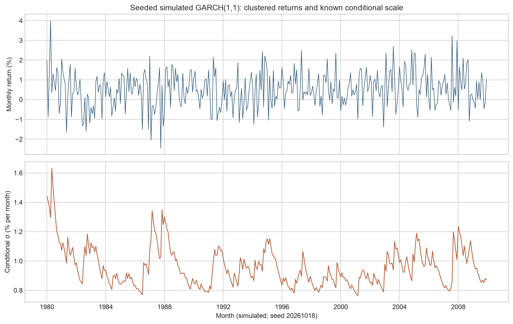
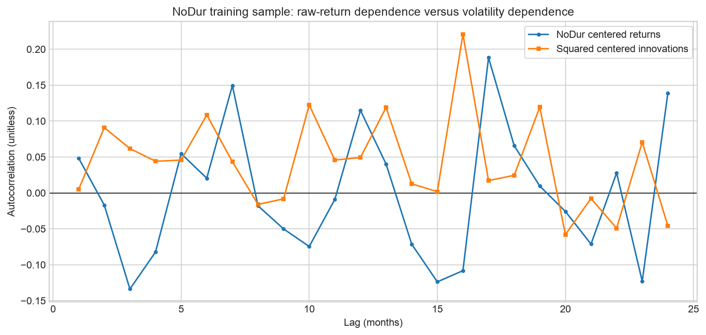
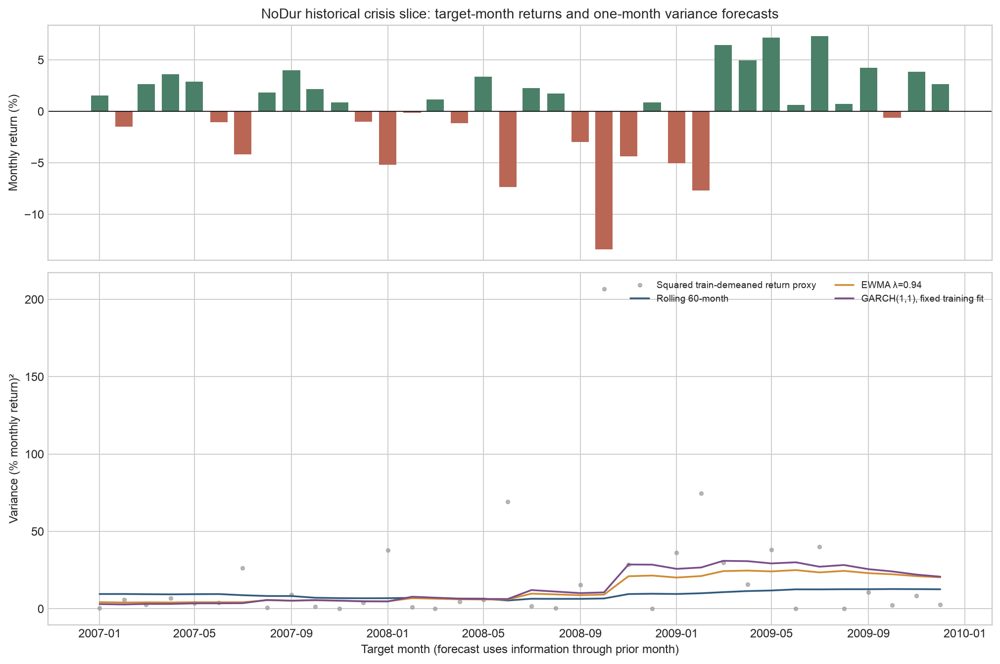
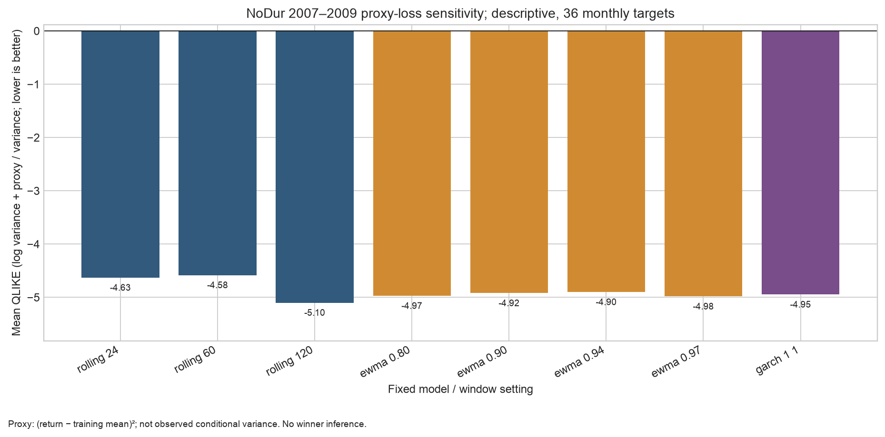

# 第18章 — 波动率建模与预测（Volatility Modeling and Forecasting）

> 主线：先区分一段路径已经实现的变动与时点条件方差，再用只读取过去信息的递推把风险估计转成下一期预测。先修：第6章概率、第7章统计、第16章时间序列；第17章作为背景，本章不调用单位根、协整或VAR结果。完成后，你能核对单位和时间戳，手算已实现方差、EWMA、ARCH/GARCH 与多步预测，辨别持续性与矩条件，解释高频采样误差，并审慎阅读一次危机窗口的历史预测对照。

## 1. 本章目标

学习结束后，读者应能：

1. 说明实现波动率（realized volatility）是路径的事后度量，条件波动率（conditional volatility）是给定信息集的预测对象，两者不因都带有“波动率”一词就相等。
2. 从平方收益自相关（autocorrelation of squared returns）理解波动聚集（volatility clustering），并解释收益本身可以几乎不相关而平方收益明显相关。
3. 按时钟无泄漏地计算滚动方差（rolling variance）、指数加权移动平均（exponentially weighted moving average, EWMA）、自回归条件异方差（autoregressive conditional heteroskedasticity, ARCH）和广义 ARCH（generalized ARCH, GARCH）。
4. 推导 \(\alpha +\beta\) 的有限无条件方差含义、GARCH 多步期望方差递推，以及高斯假设下的四阶矩条件；不把这些条件混为一个“平稳性”指标。
5. 解释高斯条件准极大似然（Gaussian conditional quasi-maximum likelihood, QML）目标的来历、课内拟合的边界和收敛不等于全局最优的事实。
6. 从图、冻结数据、数值表和输出文件复核研究结论；不把样本内拟合或代理损失排名升级为统计显著、交易优势或未来保证。

## 2. 为什么 Quant 需要它

收益预测和风险预测不是同一个任务。即使明天收益均值很难预测，今天的市场状态仍可能帮助判断明天收益的条件离散程度。波动率聚集就是这种差别的直观动机：大幅变动常在某些时期集中出现，平静时期也往往连续。

如果把风险固定成全样本标准差，极端时期和安静时期会被平均成一个数字；如果用当月收益平方估计“当月条件方差”，则把目标月的事后结果泄漏进了预测。滚动、EWMA、ARCH 和 GARCH 的用途，是明确规定信息集、给出随时间更新的方差估计，并把目标月份与可用历史分开。

它们不回答“该买什么”。波动率只是风险输入之一；要声称一个仓位规则有预测收益或可交易价值，还需要真实可用时间、信号到下单的延迟、持仓规则、成交、换手、融资、借券、点差、冲击、容量和净收益记录。本章没有交易账本，所以成本后策略收益不适用。

## 3. 直觉

设一个区间内三个子区间的对数收益依次为 +1%、−2%、+3%。对数收益可相加，净对数收益为 +2%，其平方为 0.0004；三个增量的平方和则为 \(0.01^2+(-0.02)^2+0.03^2=0.0014\)。相反方向不会在平方和中抵消。前一个量回答“这段净走了多少”，后一个量回答“路径在区间内有多少平方变动”。简单收益须先复利，不能把它们的和当作精确净收益。

条件方差则像一个逐期更新的风险状态。较大的昨日冲击会令下一期风险估计抬高；若估计具有高持续性，风险便缓慢回落。EWMA只让新冲击与旧方差按权重混合；GARCH再把长期风险水平显式放进模型。

一个反例有助于限制直觉：若仅观察到今天一笔巨大月收益，平方收益很大，并不能证明明天的条件方差一定大。还需要一个关于动态的模型，而且估计关系须能在目标环境中复现。聚集是一种可检验的时间依赖模式，不是每次大跌后都必然继续大跌的定律。

### 从区间路径走到预测时钟

同一组数字只有连同区间和信息集才有意义。先固定对象，再选择运算：

| 对象 | 输入与运算 | 三个数的结果 | 可得时点与用途 |
|---|---|---:|---|
| 区间 RV | 同一区间三段对数收益逐项平方相加 | 0.0014 | 区间结束后；描述路径平方变动 |
| 净对数收益平方 | 先相加再平方 | 0.0004 | 区间结束后；描述净变化平方 |
| 三段样本方差 | 均值为 0.0066667，离均差平方和除以2 | 0.0006333333 | 三段结束后；描述子区间收益的样本离散度 |
| 月度创新平方 | 把三个数改视为三个月创新 | 0.0001、0.0004、0.0009 | 每个月末分别到达；评价本月或更新下月 |
| 月度条件方差 \(h_t\) | 过去信息和模型递推 | 见§8的三期预测 | 目标月开始前；预测该月条件风险 |

RV 的区间可以是一日，也可以是一月，必须写清子区间覆盖范围。本章高频定义不把月度 CSV 的三行改称日内 RV。样本方差虽也有收益平方单位，目标却是子区间离散度；不能只凭单位相同替换对象。

| 月度时钟 | 已知量 | 允许动作 |
|---|---|---|
| 月 \(t\) 开始前 | \(\mathcal F_{t-1}\)、\(h_t\)、预先确定的均值规则 | 保存目标月 \(t\) 的预测 |
| 月 \(t\) 结束后 | \(r_t\)、按原均值规则计算的 \(\epsilon_t\) | 算平方创新代理，评价已保存的 \(h_t\) |
| 更新下一月 | \(h_t\)、\(\epsilon_t^2\) | 递推 \(h_{t+1}\)，不倒改本月预测 |

转换单位时先把收益小数乘100，再把方差乘10,000，最后开平方得到百分数波动。顺序保证 \(\sqrt{10,000h}=100\sqrt h\)，而不是将方差乘100。

## 4. 数学基础

设 \(r_t\) 是第 t 个日历月的简单收益，单位为无量纲小数，频率为月，如 0.02=2%。在均值固定为 \(\mu\) 的教学模型中，\(\epsilon_t=r_t-\mu\) 是收益创新，仍以月收益小数计。令 \(\mathcal F_{t-1}\) 为目标月开始前可用的信息，则条件方差

\[
h_t=\operatorname{Var}(r_t\mid\mathcal F_{t-1})
     =\operatorname{Var}(\epsilon_t\mid\mathcal F_{t-1})
\]

单位为“月收益小数的平方”。条件标准差 \(\sigma_t=\sqrt{h_t}\) 才回到收益小数（对应一个月）。若把收益乘100改成百分数，方差就乘 \(100^2\)=10,000。计算、损失与图轴必须统一单位。

标准化创新 \(z_t=\epsilon_t/\sqrt{h_t}\) 在经典设定下满足 \(E(z_t\mid\mathcal F_{t-1})=0\)、\(E(z_t^2\mid\mathcal F_{t-1})=1\)。条件正态是一个额外分布假设，不由这两个条件推出。下面的 QML 拟合使用条件高斯目标，但均值固定为训练样本均值；它不是同时估计均值和方差参数的联合最大似然。

已实现方差常由一个日内区间的对数收益 \(x_{t,i}\) 的平方和计算，量纲为该区间对数收益平方。它是已发生路径的事后量；\(h_t\) 是月开始前对整个月条件变动的预测。没有日内价格时，不可能从月收益 CSV 还原一个真实的日内已实现方差。

## 5. 正式定义

### 5.1 实现风险：已实现方差和波动率

在一个明确的区间 ([t-1,t]) 内，把区间分成 \(M\) 个相邻子区间，令 \(x_{t,i}\) 为第 \(i\) 个子区间的对数收益。已实现方差（realized variance, RV）和实现波动率定义为

\[
RV_t=\sum_{i=1}^{M}x_{t,i}^{2},\qquad RVOL_t=\sqrt{RV_t}.
\]

RV 不去均值、不除以 (M-1)，也不自动年化。它既不是样本方差，也不是整段净收益的平方。高频极限下 RV 与二次变差（quadratic variation, QV）的联系依赖价格过程、采样网格、跳跃和市场微观结构条件；有限网格上的 RV 不会逐样本等于潜在连续时间积分方差。

### 5.2 条件异方差与聚集

条件异方差（conditional heteroskedasticity）指 \(h_t\) 随 \(F_{t-1}\) 改变。聚集通常表现为 \(r_t\) 的自相关弱，而 \(r_t^2\) 或中心化创新平方 \(\epsilon _t^2\) 的自相关较强。样本平方自相关是诊断信号，不是“未来必然高波动”的因果定理。

### 5.3 滚动方差、EWMA、ARCH 与 GARCH

给定窗口 \(W\)，一个按目标月 \(t\) 标记的滚动预测可写成

\[
\widehat h_{t|t-1}^{(W)}=\frac{1}{W-1}\sum_{j=1}^{W}(r_{t-j}-\bar r_{t-W:t-1})^2.
\]

分母 (W-1) 是滚动样本方差约定，目标月 \(r_t\) 被排除。它是历史局部离散度基准，不保证等于条件方差。

EWMA 的一阶递推为

\[
h_{t+1}=\lambda h_t+(1-\lambda)\epsilon_t^2,\quad 0<\lambda<1.
\]

等价地它是 ARCH(\(\infty\)) 指数衰减权重：旧冲击权重按 \((1-\lambda )\lambda ^j\) 下降，但递推第一期的 \(h_1\) 必须由调用者提供。它对应 GARCH(1,1) 参数边界 \(\alpha =1-\lambda ,\beta =\lambda\)，故 \(\alpha +\beta =1\)，且没有正的常数项提供单独的长期方差锚；不能用标准 GARCH 的长期方差公式描述其均值回归。

初始化也属于预测规则。展开有限递推得
\[
h_{t+1}=\lambda^t h_1+(1-\lambda)\sum_{j=1}^{t}\lambda^{t-j}\epsilon_j^2.
\]
因此 \(h_1\) 的影响按 \(\lambda^t\) 留存，初值与 \(\lambda\) 都必须在预测起点前固定。若两次运行只把初值由 0.0004 改为 0.0009，\(\lambda=0.9\) 时下一期预测相差 \(0.9(0.0005)=0.00045\)，两次更新后相差 0.000405。用完整测试期样本方差初始化会让早期预测读到未来；用训练段或事先指定值则能明确输入边界。

ARCH\(q\) 用有限个滞后创新平方：

\[
h_t=\omega+\sum_{i=1}^{q}\alpha_i\epsilon_{t-i}^{2}.
\]

GARCH(p,q) 再加入滞后条件方差；本章约定 \(p\) 是滞后条件方差项数，\(q\) 是滞后创新平方项数（不同软件可能采用不同参数顺序，应核对定义）：

\[
h_t=\omega+\sum_{i=1}^{q}\alpha_i\epsilon_{t-i}^{2}
       +\sum_{j=1}^{p}\beta_jh_{t-j}.
\]

本章重点 GARCH(1,1)：

\[
h_t=\omega+\alpha\epsilon_{t-1}^{2}+\beta h_{t-1},
\quad \omega>0,\;\alpha,\beta\ge0.
\]

条件方差的单位由 \(\omega\)、创新平方和 \(h\) 共同决定，均为月收益小数平方；\(\alpha ,\beta\) 无量纲。ARCH(1) 是令 \(\beta =0\) 的特例。正系数使冲击平方与历史风险状态对当前方差的贡献非负。

### 5.4 持续性、矩和严格平稳

记 \(\rho =\alpha +\beta\)。若标准化冲击方差为1、过程在有限二阶矩意义下平稳，并且 \(\rho <1\)，则无条件方差为

\[
\bar h=E(h_t)=\frac{\omega}{1-\alpha-\beta}.
\]

这只讨论有限二阶矩。它不同于严格平稳，即整个过程联合分布随时间平移不变。对标量 GARCH(1,1)，在常规随机递推假设下，严格平稳解的对数收缩条件写作 \(E\log(\alpha  z_t^2+\beta )<0\)。当 \(E(\alpha  z^2+\beta )=\alpha +\beta <1\) 时 Jensen 不等式给出该对数期望小于0，所以有限方差条件足以推出此类解；反向不成立。举例 \(\alpha =0.1,\beta =0.9\) 时 \(E A=1\)，但若 \(z^2\) 非退化且对数期望存在，严格 Jensen 可令 \(E\log A<0\)，而无条件二阶矩并不存在。课内核心主动限制在有限二阶矩范围，因此不估计这个边界情形。

有限二阶矩仍不保证四阶矩。若 \(z_t\sim N(0,1)\)，标准 GARCH(1,1) 的有限四阶矩条件为

\[
E[(\alpha z_t^2+\beta)^2]
=3\alpha^2+2\alpha\beta+\beta^2<1.
\]

因此“\(\rho <1\)”不能替代四阶矩检验；平方收益的渐近标准误或基于高阶矩的结论可能需要更强条件。

### 5.5 QML、预测与 QLIKE

高斯条件 QML 在每期使用条件均值与方差形成的密度目标来估计参数。课内实现把训练样本均值固定，再对方差递推做缩放后的平均目标优化。它省略常数，回报尺度改变时仅将 \(\omega\) 换算回原单位。三组初始点和数值约束提高可用性，但不能证明全局最优，也不提供参数标准误。

QLIKE 损失（quasi-likelihood loss）对正方差预测 \(\widehat h_t\) 与非负方差代理 \(q_t\) 定义为

\[
L(q_t,\widehat h_t)=\log\widehat h_t+\frac{q_t}{\widehat h_t}.
\]

常见“代理无偏下稳健排序”需要例如 \(E(q_t\mid F_{t-1})=h_t\) 等条件与正则条件。若代理平方收益有均值误差、条件偏差或时间对齐错误，这个保证不能直接套用。QLIKE 可以为负，因为单位小于1时 \(\log h\) 常为负；同一目标期、同单位上低分较好，但分数不是效用、显著性或净收益。

## 6. 推导

### 6.1 为什么细网格平方和联系 QV

对一个不含测量噪声的离散价格对数 \(X\)，把 \([0,T]\) 划分为网格 \(0=t_0<\dots<t_M=T\)，区间增量是 \(\Delta _iX=X_{t_i}-X_{t_{i-1}}\)。定义分割二次和 \(Q_M=\sum _i(\Delta _iX)^2\)。在连续半鞅的细网格极限下，它依概率趋于连续部分的积分方差；若有跳跃，还要加上跳跃幅度平方总和。这里的关键前提是无测量噪声、网格变细及所需过程条件。它不是有限样本逐点相等，更不是给定过去的信息条件方差 \(h_t\)。

### 6.2 微观结构噪声如何使“更高频”变差

观测对数价格写为 \(Y_i=X_i+u_i\)，其中 \(X_i\) 是有效价格，\(u_i\) 是独立、均值零、方差 \(\tau ^2\) 的测量噪声。于是

\[
\Delta_iY=\Delta_iX+(u_i-u_{i-1}).
\]

平方求和，若噪声与有效价格增量独立且噪声独立同分布，则交叉项期望为零，噪声增量方差为

\[
E[(u_i-u_{i-1})^2]=E(u_i^2)+E(u_{i-1}^2)-2E(u_iu_{i-1})=2\tau^2.
\]

因此 \(E[\sum_{i=1}^{M}(\Delta_iY)^2]\) 约等于有效价格二次和再加 \(2M\tau^2\)。固定区间后，采样数 M 越大，简单 RV 中积累的噪声项可能越大。现实噪声可能序列相关，也可能与有效价格变化相关；这个简化推导不能给所有市场选出统一最佳频率。频率选择需要市场、资产、采样方案和估计目标的实证检查。

### 6.3 EWMA 和 GARCH 的逐步更新

EWMA 在 \(t\) 月结束后观测到 \(\epsilon _t\)，才更新下一月风险：先取旧预测 \(h_t\)，乘以 \(\lambda\)；再取本月新信息 \(\epsilon _t^2\)，乘以 \(1-\lambda\)，相加成为 \(h_{t+1}\)。权重之和为1。在模型满足标准化冲击条件方差为1时，下一期方差的条件期望等于当前方差，没有单独的长期锚。若已实现冲击恰为零，实际更新是 \(h_{t+1}=\lambda h_t\)，会下降；不能把条件期望不变误读成每条路径不变。

GARCH 也是先用过去的 \(h_t\)，并把新冲击放入 \(\epsilon _t^2\)：

\[
h_{t+1}=\omega+\alpha\epsilon_t^2+\beta h_t.
\]

取期望并在有限二阶矩与标准冲击方差为1条件下，\(E(\epsilon _t^2)=E(h_t)=\bar h\)。所以

\[
\bar h=\omega+(\alpha+\beta)\bar h
\quad\Longrightarrow\quad
\bar h=\frac{\omega}{1-\alpha-\beta},
\]

解需要 \(\alpha +\beta <1\)。\(\alpha\) 衡量新冲击平方贡献，\(\beta\) 衡量旧方差状态贡献；同样的 \(\rho\) 可以有不同冲击响应，因此不能只看持续性就断言模型行为完全相同。

### 6.4 多步预测不是多期累计方差

在时点 \(T\) 已知 \(h_{T+1|T}\) 后，下一目标期的方差预测是已知量。之后的冲击尚未实现，利用 \(E_T(\epsilon _{T+1}^2)=h_{T+1|T}\)：

\[
h_{T+2|T}=\omega+(\alpha+\beta)h_{T+1|T}.
\]

以无条件水平 (\(\bar h\)) 替换 \(\omega =(1-\rho )\bar h\)，可得

\[
h_{T+k|T}=\bar h+\rho^{k-1}(h_{T+1|T}-\bar h),\quad k\ge1.
\]

每一个 \(k\) 输出的是那一个未来月的期望条件方差。若目标是若干月累计对数收益方差，在给定预测起点信息的跨期创新条件协方差为零、且均值已知的额外条件下（如适当的鞅差序列），需把各月期望方差相加；并非直接把末期 forecast 当成累计量。核心函数 `garch_variance_forecast` 返回前一种量。

### 6.5 从密度到高斯 QML 目标

条件正态假设给出 \(\epsilon _t\mid F_{t-1}\sim N(0,h_t)\)，故对数密度

\[
\ell_t=-\tfrac12\{\log(2\pi)+\log h_t+\epsilon_t^2/h_t\}.
\]

最大化 \(\sum _t\ell_t\) 等价于最小化 \(1/2\sum _t[\log h_t+\epsilon _t^2/h_t]\)，因为 \(log(2\pi )\) 不依赖参数。核心先令训练标准差 \(s\) 缩放残差 \(\tilde\epsilon =\epsilon /s\)、方差 \(\tilde h =h/s^2\)，优化平均目标

\[
\frac12\operatorname{mean}(\log\tilde h_t+\tilde\epsilon_t^2/\tilde h_t),
\]

再把拟合 \(\tilde\omega\) 乘以 \(s^2\) 回到原方差单位，\(\alpha ,\beta\) 不变。省去常数的平均目标便于优化，但不是跨不同样本或不同尺度可直接比较的完整原尺度对数似然。

当均值/方差动态正确、过程满足所需平稳遍历、识别、可积性等条件时，条件正态 QML 可能对方差参数有一致性；在非正态情形，方差参数推断还需要匹配的稳健协方差或更强分布条件。课内函数没有稳健标准误，也不是所有非正态误差都自动有效的证明。

### 6.6 评价表先确认代理资格

设真实条件均值为 \(\mu_t\)，事先固定的训练均值为 \(\mu_0\)。由条件方差定义，
\[
E[(r_t-\mu_0)^2\mid\mathcal F_{t-1}]
=h_t+(\mu_t-\mu_0)^2.
\]
交叉项为零，因为 \(E(r_t-\mu_t\mid\mathcal F_{t-1})=0\)。这说明平方创新代理的噪声与均值误差是两件事：即使样本很多，错误中心也会增加条件偏差。高频月内 RV 使用更多路径信息，却仍需检查采样噪声、跳跃、覆盖区间及其与预测目标的匹配，不能仅凭“高频”认定条件无偏。

| 检查 | 平方收益／固定均值平方创新 | 高频 RV |
|---|---|---|
| 信息范围 | 每月一个净变化 | 目标区间内多个路径增量 |
| 是否事后可得 | 月末后 | 完成目标区间采样后 |
| 代理资格 | 核条件均值、中心和条件无偏性 | 核采样噪声、区间覆盖与条件目标 |
| 公平损失比较 | 相同目标月、相同有效样本、相同收益平方单位 | 同左，并核是否与月度预测匹配 |

若收益统一乘 \(c\)，则 \(q'=c^2q\)、\(\widehat h'=c^2\widehat h\)，QLIKE 变为原损失加 \(\log(c^2)\)。统一换单位会平移所有模型分数，保留同样本排序；只换预测或只换代理则破坏比较。负分数来自此损失的尺度与省略常数约定，不代表负风险。

## 7. 金融解释

条件波动率描述“在这个时点的信息下，下一期收益离条件均值多远”的风险尺度，不描述收益方向。假设 \(h_t\) 上升，策略仓位可以根据风险预算调整，但那是组合规则的另一个假设。历史估计如果延迟、修订、不同市场状态结构变化或交易成本较大，波动率模型的数值预测就不等于可实现的风险控制效果。

高 \(\rho\) 表示冲击后的预测方差更缓慢地向 (\(\bar h\)) 收敛。在当前 NoDur 训练样本里拟合到 \(\rho \approx 0.9953\)，但训练样本只有204个月，函数有边界约束，且当前快照不是当时真实可用数据；这个估计不应解读成自然常数、长期不变参数或稳定预报能力。

EWMA 便于解释，快速、少参数，但边界 \(\alpha +\beta =1\) 造成不回归长期方差的行为；滚动基准易复核但窗口长短影响反应速度；GARCH 显式分开新冲击与旧方差，但依赖模型设定与数值估计。比较它们是研究诊断，不是排行榜自动变成交易决策。

## 8. 数值例题

::: {.body-example title="完整例题：路径平方和、递推与逐月风险"}

以下全是可手算的教学构造数据，均不是市场观测。RV 行把这组三个数解释为同一区间的子区间对数收益；其余行把它们解释为三个月的收益创新，用于不同目标的手算。给定三期创新 \([0.01,-0.02,0.03]\)（小数月收益）且起始方差 \(h_1=0.0004\)：

| 算法 / 期 | 代入 | 方差量（RV 或 h） | 平方根量（RVOL 或条件标准差） |
|---|---|---:|---:|
| RV | \(0.01^2+(-0.02)^2+0.03^2\) | 0.001400 | 0.037417 |
| EWMA 1 | 给定 \(h_1\) | 0.000400 | 0.020000 |
| EWMA 2 | \(0.9(0.0004)+0.1(0.01^2)\) | 0.000370 | 0.019235 |
| EWMA 3 | \(0.9(0.00037)+0.1((-0.02)^2)\) | 0.000373 | 0.019313 |
| GARCH 1 | 初始 \(h_1\) | 0.000400 | 0.020000 |
| GARCH 2 | \(0.00001+0.1(0.01^2)+0.8(0.0004)\) | 0.000340 | 0.018439 |
| GARCH 3 | \(0.00001+0.1((-0.02)^2)+0.8(0.00034)\) | 0.000322 | 0.017944 |

若把 GARCH 改成 ARCH(1)（令 \(\beta =0\)），第二与第三个方差分别是 \(0.00001+0.1(0.01^2)=0.00002\) 和 \(0.00001+0.1(0.02^2)=0.00005\)：过去方差不再直接传播。对于 \(\omega =0.00001,\alpha =0.1,\beta =0.8\)，长期水平 \(\bar h =0.00001/(1-0.9)=0.0001\)。若下一期方差是 (0.0004)，已知 \(\rho =0.9\)，后续三期各月期望方差为 \([0.0004,0.00037,0.000343]\)，不是三个月的总方差；若给定预测起点的跨期创新条件协方差为零且均值已知，前三期之和才是该区间的方差预测。

最后做百分数单位检查：\(h=0.0004\) 对应 \(\sigma=0.02=2\%\)，方差用百分数表示是 4 (%月收益)\(^2\)；因此小数方差乘 10,000 才能画为“百分数收益平方”。不要把 0.0004 误读成 0.04% 波动率。

:::

## 9. Python 实现

### 默认独立运行入口

从[随书读者包](../../qa/a10/ACCEPTED_COMPLETE_LOCAL_READER_I3.md)根目录，按其[环境说明](../../editions/zh/README.md)建立独立环境后运行：

```bash
.venv/bin/python run_notebook.py notebooks/ch18_volatility.ipynb
```

先把同一区间的三段对数收益用于RV核验，再把相同数值解释为三个月创新，核对EWMA、ARCH和GARCH。多步预测另用手动构造的 `GARCHFit`：下一月方差0.0004、训练终点2000-03和观测数60都是玩具输入，不是对三个观测拟合的结果，也不是刚算出的第三月方差0.000322的延续。该独立例得到逐月方差0.0004、0.00037、0.000343；60不代表本次实际拟合样本量。

随后以种子20261018构造1980-01起360个月，均值0.005、omega=0.00001、alpha=0.1、beta=0.8，预热500期；有限预热不等于精确平稳初始抽样。前240个月用于拟合，后120个月评价。训练均值先固定，再用训练段拟合GARCH；同一评价期分别按已知真方差和平方创新代理报告QLIKE。损失函数的数组形状检查不能替代调用方按目标月对齐。

默认仅向 `runs/ch18_volatility_<uuid>/` 写入 `constructed_simulation.csv`：360行保留真方差和 `sample_role`，预测列仅在后120行有值，训练前缀保留NaN。它不写历史预测CSV、结果JSON或四张PNG，历史图集明确跳过。第10–11节四图及NoDur数字是冻结的独立读物，不能当作这次运行产物。

`RUN_FRENCH=False`，默认不读取或下载French数据。导入章节workflow不等于执行其中的历史市场分析。章运行目录与运行器另建的 `runs/execution_<uuid>/` 不同：后者保存执行副本及状态。包内断言供读者核对构造计算，未随包提供的制作测试不要求补回。构造结果不证明市场预测或成本后交易优势。

下方CLI属于历史课程工作根路线，需另有合适且获授权的数据输入与环境；它不替代上述默认命令。

### 共享实现与历史工作根路线

工作流只调用 [`src/quant_course/volatility.py`](../../src/quant_course/volatility.py) 的共享实现；章节脚本负责冻结数据读取、样本切分、输出和绘图。它不另写拟合器。脚本 [`code/ch18_volatility.py`](../../code/ch18_volatility.py) 从文件路径定位项目根，能从任何当前工作目录启动：

```bash
.venv/bin/python /absolute/path/to/quant_course/code/ch18_volatility.py
```

自定义输出目录：

```bash
.venv/bin/python /absolute/path/to/quant_course/code/ch18_volatility.py \
  --output-dir /tmp/ch18-results --figure-dir /tmp/ch18-figures
```

脚本先校验 manifest 中 raw ZIP、已解压 CSV 和 processed CSV 的 SHA-256，缺件或任何字节变化就停止；不会联网重下或覆盖原始数据。它读取月收益小数，按完整月历切样本，再输出拟合参数、各月方差预测、代理损失和四张图。模拟样本固定 seed=20261018；函数保留每期真条件方差，仅用于可核算法。

调用顺序是：`train=1990-01…2006-12`，训练均值只由训练段计算；GARCH 只在训练段拟合；每个目标月的递推使用之前实际观察到的收益冲击；测试平方创新代理在目标月结束后才可计算。这个信息结构模拟的是“如果历史参数固定并且此前观察到历史冲击”的事后归因。French 快照的下载时间、版本可用时间、发布滞后和历史本地入库时间没有重建，因此不是历史逐点真实可用回测。

训练期拟合路径是样本内 ex-post 状态，不是训练期逐月实时预测。核心固定均值为训练样本均值，3个初始化点不保证全局最优；数值上下界如 \(\omega\) 的归一化下界及持久性上界只是教学优化的数值保护，不是经济定律。上方默认Notebook也复用该workflow和共享核心，但选择的是构造分支。

## 10. 图形解读

以下四张PNG由历史章节工作流生成，作为冻结章节读物保留；默认离线Notebook不重新生成它们：

1. [模拟波动聚集](../../figures/a4/ch18_volatility_clustering.png)：横轴为模拟月份（seed=20261018），上图纵轴为月收益百分比，下图为真条件标准差百分比/月。高波动时期能看到更大收益幅度聚集。模拟中 DGP 真方差已知，不能当市场证据；有限 burn-in 也不保证初始状态是严格平稳抽样。



2. [真实 NoDur 训练段收益与平方创新自相关](../../figures/a4/ch18_return_squared_acf.png)：横轴为滞后月数，纵轴为无量纲样本自相关；样本为1990–2006训练段。平方创新在若干滞后为正，两列也都有正负波动；图中没有清晰、稳定的衰减形态。它提示继续检查条件异方差，不能据此宣布本段已验证波动聚集；小样本 ACF 也不是正式显著性检验或因果发现。



3. [NoDur 危机窗口预测对照](../../figures/a4/ch18_forecast_comparison.png)：横轴为2007–2009目标月；上图是已实现月收益百分比，下图为 \(100^2\widehat h\)，单位是“百分数月收益平方”。灰点为事后平方创新代理；曲线预测在目标月开始前形成，且递推在每月结束后用该月冲击更新下一月。历史窗口包含2008年波动上升，但图上代理噪声极大。



4. [代理 QLIKE 敏感性](../../figures/a4/ch18_qlike_sensitivity.png)：横轴列出固定模型/窗口设置，纵轴是36个目标月平均 QLIKE；同样本和单位下分数越低越好。图注说明代理是 \((r_t-\bar r_{train})^2\)，并非条件方差真值。没有置信区间、显著性或模型胜者声明。




## 11. 真实市场示例

案例使用 French Data Library 的 **NoDur（Consumer Non-Durables）10行业组合月度价值加权简单收益**。冻结快照在2026-10-05下载，源表单位是百分比，处理表除以100为小数；月频、目标回报区间是各公历月，处理数据截至2026-08。NoDur不是单只股票，也不是总收益中含有的交易成本或可交易策略账本。

| 文件 | SHA-256 | 样本契约 |
|---|---|---|
| 原始 ZIP `10_Industry_Portfolios_CSV.zip` | `ebd937a4b995d821867aeb956a96f09a666386f38fa82516b7d1767ee4a49ae5` | 2026-10-05冻结文件 |
| 原始解压 `10_Industry_Portfolios.csv` | `18ed376fc42e2327ceaf3d65a02521a6512e7f9e3001007c4da69d7db108aa82` | 官方月度价值加权表块 |
| 处理月收益 `french_10_industries_monthly.csv` | `3b097d810c295d64eedfa1ece7067ff2a0707f5ca90e33935df9949251f70950` | 1926-07–2026-08，1202行，小数简单收益 |

研究设计将1990-01至2006-12作为204个月拟合段，2007-01至2009-12为预先写入脚本的36个月历史评价段。选历史危机切片用于展示递推如何跨状态变化，不声称该切片是预注册或独立外部测试；也不能根据结果再次选窗口后宣称事前设定。GARCH拟合的固定训练均值为0.0097235，训练样本标准差为0.0389174；拟合为

| 参数 | 估计 | 含义 / 单位 |
|---|---:|---|
| \(\omega\) | 0.000004003 | 小数月收益\(^2\)的常数项 |
| \(\alpha\) | 0.091829 | 新冲击平方权重，无量纲 |
| \(\beta\) | 0.903517 | 前期方差权重，无量纲 |
| \(\alpha+\beta\) | 0.995346 | 教学有限方差模型的持久性，无量纲 |
| \(\frac{\omega}{1-\alpha-\beta}\) | 0.0008602 | 模型隐含长期方差，小数月收益\(^2\) |
| 2007-01 预测 | 0.0003050 | 训练段最后信息更新后的下一月方差，小数月收益\(^2\) |

评价时用 \(q_t=(r_t-\bar r_{train})^2\) 作为方差代理。36期代理均值为0.0019354（小数收益平方）。QLIKE（同一对齐样本、同一尺度；越低越好）如下：

| 设定 | 平均 QLIKE |
|---|---:|
| Rolling 24 | \(-\)4.6299 |
| Rolling 60 | \(-\)4.5825 |
| Rolling 120 | \(-\)5.0997 |
| EWMA \(\lambda\)=.80 / .90 / .94 / .97 | \(-\)4.9710 / \(-\)4.9207 / \(-\)4.9002 / \(-\)4.9822 |
| 固定训练拟合 GARCH(1,1) | \(-\)4.9461 |

Rolling 120 在这个代理分数上最低，GARCH没有最低损失；所有设置都保留。36个月、小样本、预测代理可能有条件偏差、目标切片受到危机状态影响，且没有配对预测损失推断；不据此宣布统计胜负或未来交易优势。若均值在评价期变化，训练均值去中心化平方值还混入了均值误差。QLIKE 代理排序的理论条件不能因此被默认满足。

时钟边界很重要：预测 \(h_t\) 仅用至 (t-1) 的收益冲击；目标月 \(r_t\) 只能在月末后观测并用于 \(h_{t+1}\)。但是源数据的实际发布日、历史修订和当年可见版本均未归档。因此它是现有冻结快照上的历史归因，不是point-in-time（PIT）或真正实时样本外记录。

## 12. 常见错误

| 错误 | 为什么错 | 修复 |
|---|---|---|
| `sum(intraday_returns)**2` 当作 RV | 净变化会让方向相反的区间互相抵消 | 对子区间对数收益逐项平方再求和：`sum(x*x for x in returns)` |
| 把 `sqrt(h)` 画成方差或把 `h` 叫波动率 | 开平方前后单位不同 | 方差标“收益\(^2\)”，标准差标“收益”；乘100与乘10,000区分 |
| 用 `r_t**2` 预测同一月 `h_t` | 目标月尚未结束时并不知道 \(r_t\)，造成泄漏 | 预测 `h_t` 只能读到 \(\epsilon _{t-1}\)；目标月平方用于评价或更新下一月 |
| 把 \(\alpha+\beta<1\) 说成一切 GARCH 的严格平稳必要条件 | 这是有限二阶矩条件；严格平稳有不同随机递推条件 | 把有限方差、严格平稳、四阶矩逐一说明，不混为一谈 |
| EWMA \(\lambda=.94\) 就一定均值回归 | EWMA 对应边界 \(\alpha+\beta=1\) | 指出长期水平不由该递推单独拉回，比较初值影响和冲击衰减 |
| 把多步 \(h_{T+k|T}\) 当成未来累计收益方差 | 核心输出是逐月的期望方差 | 在附加跨期条件下对各期方差求和，并说明预测目标 |
| 把平方收益称为真实波动 | 它是噪声代理，随机且可能条件有偏 | 把模型预测、观测代理和潜在条件方差分开报告 |
| 把优化器 `success=True` 当成全局最优或参数显著 | 多起点不能穷尽参数空间；没有标准误 | 报告多起点/约束/目标，不越过未实现的稳健推断 |
| 把低 QLIKE 说成可交易盈利 | 损失不是仓位、收益或交易账本 | 另行验证实时可用、交易成本、容量和净收益；本例都没有 |

一个最短泄漏演示：`forecast_t = eps_t**2` 的目标月 RHS 是事后数据；正确的一阶 GARCH 在月 \(t\) 开始前为 `forecast_t = omega + alpha*eps_prev**2 + beta*h_prev`。二者不是同一个估计时点。

## 13. 量化研究应用

一个可复核的波动率研究至少要把以下链条写清楚。

1. **假设与目标**：这里的问题是历史状态下的一月方差预测行为，不是方向收益预测或投资组合收益。
2. **数据与版本**：记录 French 源、下载时间、单位转换、缺失值、哈希、发布日期和版本。若做历史当时可见检验，需要带发布时间和修订版本的 PIT 数据；当前快照不够。
3. **时钟**：规定训练截止月、目标月、信号计算时点和可下单时点。月度收益只有目标月结束后才观测。逐月递推使用前一月真实冲击，所以未来值不回填过去预测。
4. **基准与候选**：用滚动方差作基准，和固定参数 EWMA/GARCH比较；预先固定候选设置，保留敏感性，不从短评价段挑赢家。
5. **诊断与损失**：看收益和平方创新自相关、条件标准差路径、优化边界、收敛数、单位；评价损失前对齐目标月。平方创新不是潜在真方差；只有 proxy 条件无偏等条件成立，QLIKE 排序性质才有相应理论支持。
6. **外部验证**：不同市场、期间、频率与结构变化下复核，并报告失败月份和不稳定性。若用下一步仓位转换，另做真实下单时钟、换手、费用、冲击、融资、借券和容量分析。
7. **结论边界**：统计预测损失差异不等于交易效用差异；没有成本后账本就不计算“净 \(\alpha\)”。当前案例保留了 Rolling 120 比 GARCH 低的代理损失结果，不将其反复重测成胜者。

本章也没有做“目标函数前瞻”交易实验：目标期条件方差是风险统计量，未定义用它下单的规则；没有交易账本，因此成本“未适用”，并非“成本为零”。净 \(\alpha\) 研究尚缺可复现信号、资产持仓、执行价格与延迟、费用表、借券/融资记录、容量约束和净收益序列。

## 14. 本章小结

RV把已发生的细分路径增量平方求和；条件方差 \(h_t\) 则以目标期开始前的信息预测下一期风险。滚动窗口提供可审计基准，EWMA把新平方冲击和旧方差混合，ARCH 使用滞后平方冲击，GARCH再让过去方差传播。

对标准化创新方差为1的有限二阶矩 GARCH(1,1)，\(\alpha+\beta<1\) 给出长期方差 \(\frac{\omega}{1-\alpha-\beta}\) 和均值回归的多步递推；它不等于严格平稳或四阶矩条件。EWMA 的权重和为1，正是其不回归单独长期水平的边界。高频 RV 还要面对采样与微观结构噪声。

代码通过训练与目标分离、数据哈希与递推时钟把概念落实。NoDur 2007–2009 历史对照展示了预测与平方收益代理的差异，不能证明当时可用性、模型胜者、策略盈利或未来交易优势。

## 15. 练习

**18-E01 概念：RV 与样本方差。** 用一句精确定义比较区间 RV、样本方差和净收益平方；列出两项会令 RV 高于净收益平方的路径特征。

**18-E02 概念：聚集。** 为什么收益自相关接近零仍可能存在波动聚集？给一个需要检查的样本统计量，并说明它不能证明什么。

**18-E03 概念：平稳和矩。** 有限二阶矩条件、严格平稳条件、有限四阶矩条件各描述什么？它们有何逻辑区别？

**18-E04 概念：EWMA。** EWMA 的 \(\lambda\) 控制什么？为什么 \(\alpha+\beta=1\) 边界不是“均值回归到某个长期方差”？

**18-E05 手算：实现风险。** 对同一区间三个子区间的对数收益 \([0.01,-0.02,0.03]\)，算 RV、RVOL、净对数收益平方。解释单位。

**18-E06 手算：EWMA。** \(\lambda=.9\)、\(h_1=.0004\)、冲击为 \([.01,-.02,.03]\)。按 target convention 写前三个逐月预测 \(h_1,h_2,h_3\)。

**18-E07 手算：ARCH/GARCH。** 令 \(\omega=.00001\)、\(\alpha=.1\)、\(\beta=.8\)、\(h_1=.0004\)、前两次冲击 .01、\(-\).02。求 GARCH 的 \(h_1,h_2,h_3\)；再求令 \(\beta=0\) 后 ARCH 的 \(h_2,h_3\)。

**18-E08 持续性和高阶矩。** 参数 \((\omega ,\alpha ,\beta )=(.00001,.1,.8)\) 下算长期方差与高斯四阶矩左端；判断两个条件各是否通过。

**18-E09 多步预测。** 上题 GARCH 若 \(h_{T+1|T}=.0004\)，列出 \(k=1,2,3\) 每个目标月方差预测。为什么不能把最后一个数字当三个月累计方差？

**18-E10 手算：噪声偏差。** 若整个区间有效价格增量平方和的期望为0.001，每个观测噪声方差 \(\tau^2=.000001\)，细分 M=10，简单独立噪声模型下观察 RV 期望约多少？M=100呢？

**18-E11 QLIKE。** 写出平均 QLIKE。若代理 \(q\) 条件无偏、候选方差为正，说明预测风险为何会影响期望损失；再列至少两个当前NoDur代理排序的威胁。

**18-P01 实现 RV。** 将同一区间的三个子区间对数收益 \([.01,-.02,.03]\) 传给共享核心，断言数值是 `.0014`，另显示净和平方。说明它不自动年化。

**18-P02 预测时钟。** 使用四个连续月回报 \([.01,.03,-.01,.02]\)、窗口2，调用滚动方差预测函数（P02答案列出完整代码）。写出第3月 forecast 并把第3、4月回报改为100后重算；第3月 forecast 必须不变。说明为什么前两月是 NaN。

**18-P03 可复现研究。** 在任意工作目录运行章节CLI，复核3个输入 SHA-256、训练段与评价段记录数、结果 JSON和4张图。若哈希不匹配，解释为什么正确行为是停止，而不是自动下载并继续。

**18-C01 QML 边界。** 给出核心 `fit_garch11` 三项与联合正态 MLE 的区别；说明“三个起点收敛”可以和不可以说明什么。列出使 QML 方差估计一致所需的一组典型正则条件，不要声称任意非正态都成立。

**18-C02 高频微观结构。** 从 \(Y_i=X_i+u_i\) 推出独立噪声 RV 期望的额外项。给一个真实噪声可能不满足的假设，并设计检验采样频率的研究步骤；不预设统一最佳频率。

**18-C03 历史 vs PIT。** 说明本章 French NoDur 2007–2009 结果为什么不是 historical PIT 或预注册测试。列出若要做净策略检验还缺少的账本字段，并区分“成本未适用”与“成本为零”。

**18-C04 构造反例：严格平稳与方差。** 对 \(\alpha=.1\)、\(\beta=.9\)、(z~ N(0,1))，比较 \(E(\alpha  z^2+\beta )\) 与 \(E\log(\alpha  z^2+\beta )\)；说明标准随机递推条件下可以推出什么，又不能把什么有限矩说出来。

### 教学补充题（独立编号）

**18-R01 初始化影响。** 按§5.3展开EWMA，证明两个初值的预测差按幂衰减。初值相差0.0005、lambda=0.9，两次更新后相差多少？

**18-R02 代理与单位诊断。** 真实条件均值为0.01，固定中心为0，真实条件方差为0.0004。平方收益代理的条件期望是多少？若统一把收益小数改为百分数，QLIKE增加多少，排序是否改变？

**18-R03 研究判断。** 研究者拿日内RV与月度预测比较，代理均值接近月度平方收益就宣布无偏。缺哪些条件和记录？

## 16. 编程练习

完成 **18-P01–18-P03**。交付应包括可运行单元或脚本、断言、运行命令、Python与依赖环境、生成物路径、数据版本与时钟说明。P02需要显示 target index 与 NaN warmup，不允许把窗口 warmup 行静默填零；P03不得触碰冻结 raw 文件，也不得引入网络下载。

## 17. 挑战题

完成 **18-C01–18-C04**。答案可用等价论证，但必须写清假设、量纲、信息集与可检验步骤。

- C01 满分要区分固定训练样本均值与联合 MLE；说明一致性与稳健推断是不同问题；至少写出正确条件均值/方差、平稳遍历、可识别性和有限可积性中的三项，并说明核心没有参数标准误。
- C02 满分要展开噪声差分、平方期望和频率敏感性方案；指出相关噪声、价格变化与噪声相关、跳跃/异步观察等违反简单推导的边界。
- C03 满分要指出数据版本/发布时间和历史可用时间缺失、测试为事后危机切片、没有仓位或执行账本；给出至少六个净回报审计字段。
- C04 满分要借助 Jensen 严格不等式区分 \(EA=1\) 与 \(E\log A<0\)，说明严平稳解可存在但二阶矩公式无穷/不成立；不得把本章有限方差实现当成覆盖该域。

## 18. 完整答案与提示

### 18-E01

RV 是同一区间细分对数收益的平方和；样本方差要围绕样本均值去中心化并除以 (M-1)；净收益平方先净额再平方。多次正负反转会降低净额，较多非零子区间会让平方和积累，因此路径抵消和区间内往返变化都可能使 RV 高于净收益平方。

### 18-E02

若收益创新符号/线性变化没有可预测性，但其条件尺度随市场状态改变，\(r_t\) 自相关可以小，而平方 \(r_t^2\) 仍继承尺度状态的持续性。检查中心化平方创新的样本 ACF。它只是结构诊断，不能证明因果机制、未来方向可预测或经济显著。

### 18-E03

有限二阶矩条件 \(\alpha+\beta<1\) 保证本章设置的有限无条件方差解；严格平稳是过程联合分布不随时间平移，GARCH 随机递推常用 \(E\log(\alpha  z^2+\beta )<0\) 判断；高斯冲击下四阶矩还要求 \(3\alpha ^2+2\alpha \beta +\beta ^2<1\)。后者更强；有限二阶矩足以推出相关严格平稳解，却不是严格平稳的必要条件，严格平稳也不确保二阶矩存在。

### 18-E04

\(\lambda\) 是旧方差状态的保留率，\(1-\lambda\) 是最近冲击平方的权重。递推将权重全分配给“旧预测”和“新冲击”，没有额外的 \(\omega\) 把状态拉向单独的长期水平；它等于 \(\alpha+\beta=1\) 的边界，故不满足 \(\omega /(1-\alpha -\beta )\) 的有限方差均值回归式。

### 18-E05

\[
RV=.01^2+.02^2+.03^2=.0001+.0004+.0009=.0014,
\]

\[
RVOL=\sqrt{.0014}\approx .0374166=3.7417\%.
\]

净对数收益 \(=.02\)，净对数收益平方 \(=.0004\)。RV单位是区间收益小数平方；RVOL单位是区间收益小数。不乘年化因子。

### 18-E06

\[
h_1=.0004,\quad h_2=.9(.0004)+.1(.01^2)=.00037,
\]

\[
h_3=.9(.00037)+.1((-.02)^2)=.000373.
\]

第三个创新 .03 用来生成 \(h_4\)，不能回头影响已在其月份开始前形成的 \(h_3\)。

### 18-E07

\[
h_1=.0004,\quad h_2=.00001+.1(.01^2)+.8(.0004)=.00034,
\]

\[
h_3=.00001+.1((-.02)^2)+.8(.00034)=.000322.
\]

令 \(\beta=0\) 后，\(h_2=.00001+.1(.0001)=.00002\)，\(h_3=.00001+.1(.0004)=.00005\)。单位都为月收益小数平方。

### 18-E08

\[
\bar h=.00001/(1-.1-.8)=.0001.
\]

高斯四阶矩左端 \(3(.1)^2+2(.1)(.8)+(.8)^2=.83<1\)，两项条件均通过。这个结果只在指定高斯标准冲击与模型假设下说明有限四阶矩；不能外推到任意冲击分布。

### 18-E09

\(\rho =.9,\bar h =.0001\)。

\[
h_{T+1|T}=.0004,\quad h_{T+2|T}=.0001+.9(.0004-.0001)=.00037,
\]

\[
h_{T+3|T}=.0001+.9^2(.0004-.0001)=.000343.
\]

它们分别是一个月的风险预测。只有在给定预测起点的跨期创新条件协方差为零且均值已知等附加条件下，累计区间方差才是逐月方差之和；\(h_{T+3|T}\) 单独不能表示三月合计。

### 18-E10

每个噪声差分方差为 \(2\tau ^2=.000002\)。M=10 时额外项约 .00002，期望 RV (约为 0.00102)；M=100 时额外项约 .0002，期望 RV (约为 0.0012)。这是独立同分布噪声简化模型，不是任意市场的频率规律。

### 18-E11

\[
\bar L=\frac1T\sum_t(\log\widehat h_t+q_t/\widehat h_t).
\]

若 \(E(q_t\mid F_{t-1})=h_t^\star\)，则给定信息下期望损失关于正预测 \(\widehat h\) 的变化是 \(\log \widehat h +h_t^\star/\widehat h\)，导数 \(1/\widehat h -h_t^\star/\widehat h ^2\)，在 \(\widehat h\)=\(h_t^\star\) 取极小。实际 NoDur 平方代理可能受训练均值与评价均值差、单期平方的高噪声、当前数据版本修订、仅36个月等影响；日期未对齐也会破坏比较。

### 18-P01

参考实现：

```python
from quant_course.volatility import realized_variance

parts = [0.01, -0.02, 0.03]
rv = realized_variance(parts)
net_squared = sum(parts) ** 2
assert abs(rv - 0.0014) < 1e-12
assert abs(net_squared - 0.0004) < 1e-12
print(rv, net_squared)
```

输出 `0.0014 0.0004`。函数不去均值、不除以样本数、不年化；调用者要记录这些收益来自哪个明确区间与采样方案。

### 18-P02

```python
import pandas as pd
from quant_course.volatility import rolling_variance_forecast

idx = pd.period_range("2000-01", periods=4, freq="M")
r = pd.Series([0.01, 0.03, -0.01, 0.02], index=idx)
f = rolling_variance_forecast(r, window=2)
assert f.iloc[:2].isna().all()
assert abs(f.iloc[2] - 0.0002) < 1e-12  # sample variance of 0.01 and 0.03
r2 = r.copy(); r2.iloc[2:] = 100.0
f2 = rolling_variance_forecast(r2, window=2)
assert f2.iloc[2] == f.iloc[2]
```

第3月预测只用1、2月两个观测，样本方差为 \((.01-.02)^2+(.03-.02)^2\) 除以 \(2-1\)，结果为 \(.0002\)。前两个目标月没有两个先前观测，因此保留 NaN。改动当前/未来收益不能改变第3月预测。

### 18-P03

从仓库外当前目录运行：

```bash
cd /tmp
/absolute/path/to/quant_course/.venv/bin/python \
  /absolute/path/to/quant_course/code/ch18_volatility.py \
  --output-dir /tmp/ch18-results --figure-dir /tmp/ch18-figures
```

检查 JSON：`train_n=204`、`evaluation_n=36`，记录训练终点 `2006-12`、测试窗 `2007-01…2009-12`，三份 hash 与 manifest 相同，且4张图路径存在。哈希不匹配代表输入已不再是本研究冻结证据；静默重下会改写研究对象与版本，正确做法是停止、报告差异并为新快照建立独立 manifest。

### 18-C01

课内函数在训练段先计算样本均值并固定，只优化方差参数；联合正态最大似然会在同一个 likelihood 中同时优化均值与方差参数。核心目标按训练残差尺度归一化，去掉常数并取平均，\(\omega\)拟合完再乘回方差尺度。三个起点收敛说明这些起点中至少有可行数值解，且代码选择其中目标较低者；不能证明全局最优、模型正确、参数显著或未来稳定。

典型一致性条件可包括：条件均值/方差设定正确（或准正确且识别参数明确）、过程平稳遍历、目标函数有限可积、参数空间与真值满足识别和边界条件、数值优化接近目标极值。非正态推断通常还需要相应稳健方差估计；核心没有给稳健标准误。样本内拟合收敛不替代这些理论和经验条件。

### 18-C02

将 \(\Delta Y\) 拆开后，对平方求和并取期望；有效价格项给出有效价格的平方变动，交叉项在独立、零均值噪声假设下期望为零，每个噪声差分 \(\Delta u\) 的方差为 \(2\tau ^2\)，M段合计约增加 \(2M\tau ^2\)。现实噪声可能自相关或与有效价格变化相关；报价反跳、异步成交、跳跃都可能改变误差结构。

先定义资产、交易时段和目标；选择若干预先说明的采样间隔；使用同一清洗、对齐和区间规则估计 RV，并保留跳跃/噪声诊断；在多日期、不同流动性时期比较误差与稳健性；若可能，结合微观结构噪声估计方法和替代 realized measure；报告估计不确定性，不能把某文献某资产所选频率普遍化。

### 18-C03

数据是2026-10-05下载的当前 French 快照，无历史逐月发布版本、可用时间和本地入库戳，历史 NoDur 值可能经过修订；危机切片脚本固定，并非事前注册/独立外部测试。评价开始前拟合参数，但测试使用现成的历史目标月收益与后续迭代；这仍不重建实时操作。

成本后策略还需要：信号时间、目标权重/持仓、可执行订单时间、订单/成交价格、点差与费用、换手、冲击、融资/借券、资金/保证金、容量限制、未成交/延迟处理、基准与净收益序列。没有策略和订单账本时，成本不适用；这不等于设定成本为零或净收益没有成本。

### 18-C04

令 \(A=0.1z^2+0.9\)。在 \(z\sim N(0,1)\) 下 EA=0.1(1)+0.9=1。A 非退化，若 \(E|\log A|<\infty\)，严格 Jensen 给 \(E\log A<\log EA=0\)。随机系数递推 \(h_t=\omega+A_{t-1}h_{t-1}\) 因此在标准条件下可有严格平稳解。可是 EA=1 使有限无条件方差公式 \(\omega/(1-EA)\) 不存在，二阶矩不有限；不能因为过程严格平稳就报告有限 h 长期水平。课内核心将参数限制在 \(\alpha+\beta<1\)，因此不拟合这个例子。

### 教学补充题完整答案

**18-R01。** 同一冲击序列相减后，差值递推为 \(\delta_{t+1}=\lambda\delta_t\)，因此两次更新后为\(0.9^2\times0.0005=0.000405\)。初值必须在预测开始前确定。

**18-R02。** 条件期望为\(0.0004+(0.01-0)^2=0.0005\)，故有0.0001条件偏差。统一变换预测与代理后损失增加log(10000)，约9.210340，所有同样本模型平移相同常数，排序不变。

**18-R03。** 须先核日内RV是否覆盖完整目标月、收益定义和单位、采样噪声与跳跃、预测在月前保存以及相同有效样本。无偏要求条件期望匹配目标，两个无条件样本均值接近不能证明条件无偏；也不能推出显著胜出或净收益。

## 19. 延伸阅读

- **Must Know — Bollerslev (1986), §§2–3。** 看GARCH表示、弱平稳方差条件、GARCH(1,1)四阶矩条件；本章对应位置和作者PDF阅读页记在 `source_notes.md`。
- **Must Know — Andersen, Bollerslev, Diebold & Labys (2003), Introduction and §2。** 看高频收益平方和与二次变差/积分方差的渐近关系及跳跃项；不要把极限结论误读成有限网格RV等于条件方差。
- **Should Know — Hansen & Lunde (2006), Introduction, theoretical framework, empirical section and conclusion。** 看微观结构噪声和频率选择如何改变已实现方差精度；论文样本中的频率结论只对其样本/设置负责。
- **Should Know — Patton (2011), §2 propositions and conclusion。** 看有噪声但条件无偏方差代理下预测比较损失的要求；本章实际代理不自动满足该要求。
- **Should Know — SciPy `minimize(method="SLSQP")` 官方文档。** 了解带约束最优化的 API、停止精度与求解器状态；停止精度不等于全局最优证明。
- **Optional — ARCH/GARCH 预测与 EWMA 官方 API 文档。** 用来检查一/多步方差目标和对齐；本章没有安装或使用 `arch` 的估计器。
- **Advanced — Engle (1982)。** 原文是 ARCH 的源头，但本次只从作者官方主页核对书目信息，未取得论文全文。可自行通过机构图书馆获取后核对其具体检验推导，本章不以未读原文替它背书。

## 20. 参考文献

1. French Data Library. **10 Industry Portfolios**，月度平均价值加权收益。原下载地址见数据manifest；本研究快照、处理与哈希列在第11节。该表包含当前可下载历史值，不等于历史point-in-time vintage。
2. Bollerslev, T. (1986). “Generalized autoregressive conditional heteroskedasticity.” *Journal of Econometrics*, 31(3), 307–327. DOI: [10.1016/0304-4076(86)90063-1](https://doi.org/10.1016/0304-4076(86)90063-1). 本章仅据作者原刊PDF §§2–3、PDF物理页3–6核关键矩条件，具体读取范围见 [`source_notes.md`](source_notes.md)。
3. Andersen, T. G., Bollerslev, T., Diebold, F. X., & Labys, P. (2003). “Modeling and forecasting realized volatility.” *Econometrica*, 71(2), 579–625. DOI: [10.1111/1468-0262.00418](https://doi.org/10.1111/1468-0262.00418). 本章阅读引言和§2开头；推导范围见来源注记。
4. Hansen, P. R., & Lunde, A. (2006). “Realized variance and market microstructure noise.” *Journal of Business & Economic Statistics*, 24(2), 127–161. DOI: [10.1198/073500106000000071](https://doi.org/10.1198/073500106000000071).
5. Patton, A. J. (2011). “Volatility forecast comparison using imperfect volatility proxies.” *Journal of Econometrics*, 160(1), 246–256. DOI: [10.1016/j.jeconom.2010.03.034](https://doi.org/10.1016/j.jeconom.2010.03.034).
6. Engle, R. F. (1982). “Autoregressive conditional heteroscedasticity with estimates of the variance of United Kingdom inflation.” *Econometrica*, 50(4), 987–1008. DOI: [10.2307/1912773](https://doi.org/10.2307/1912773). 本次未取得全文，不据此引用未核读的具体定理或页内步骤。
7. SciPy documentation. [`scipy.optimize.minimize`, SLSQP method](https://docs.scipy.org/doc/scipy/reference/optimize.minimize-slsqp.html). Optimizer API and stopping criterion only.
8. `arch` 7.2 documentation. [Forecasting](https://arch.readthedocs.io/en/stable/univariate/forecasting.html); [EWMA variance process](https://arch.readthedocs.io/en/stable/univariate/generated/arch.univariate.EWMAVariance.html). Documentation consulted for definitions/alignment; estimator not installed/used.

来源位置、历史阅读范围与核验边界详见 [source_notes.md](source_notes.md)。
