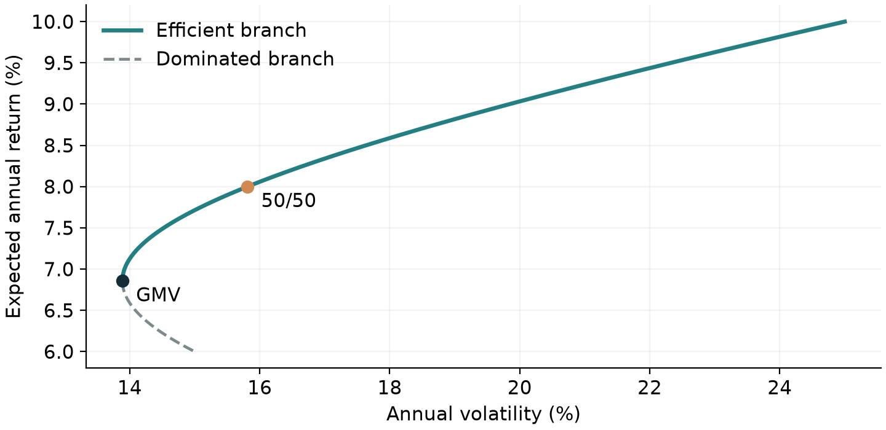
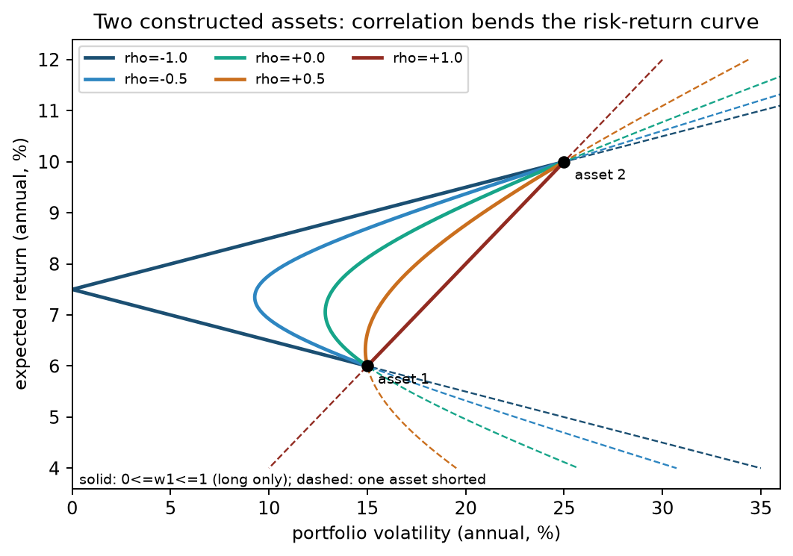
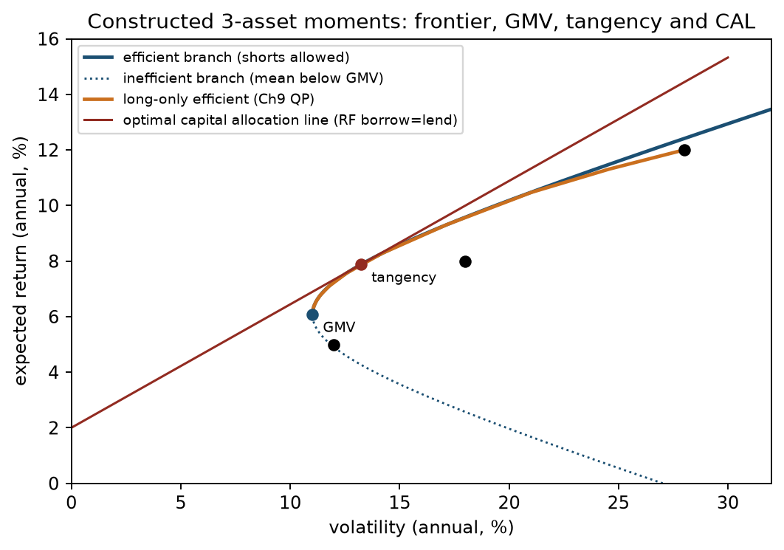
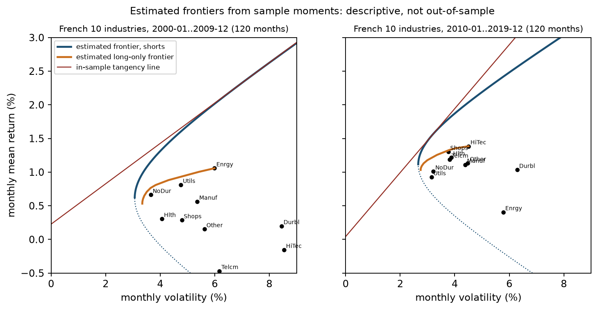

# 第20章 — 现代组合理论（Modern Portfolio Theory）

> 主线：组合风险由权重和协方差共同决定，均值—方差前沿是给定矩之后的精确数学对象；矩一旦来自估计，前沿上的“最优”就只是样本内描述。
> 先修：第 5 章矩阵与正定性、第 9 章拉格朗日与凸二次规划、第 11 章简单收益与超额收益、第 14 章 CML/SML、第 15 章协方差与因子风险。
> 完成本章后，你能把组合方差从双重求和写成 \(\mathbf{w}^\top\Sigma\mathbf{w}\) 并逐项说明维度与单位；手算两资产最小方差、目标收益组合和切点组合；用拉格朗日法推导全局最小方差组合与整条最小方差前沿；判断切点组合何时存在；区分总体矩与估计矩，并能说明为什么样本内前沿不证明样本外优势。

## 1. 本章目标

读完本章，你应能完成五件可核验的任务：

1. 对 \(n\) 个资产写出组合期望收益、组合方差及其矩阵形式，说明 \(\mathbf{w}\)、\(\boldsymbol{\mu}\)、\(\Sigma\) 的维度、单位、收益区间和时点。
2. 解释相关系数如何改变两资产风险—收益曲线，并找出“长仓组合风险能否低于最低风险单资产”的临界相关系数。
3. 用拉格朗日乘子推导全局最小方差（Global Minimum Variance, GMV）组合、精确目标收益最小方差组合和前沿双曲线，指出无效率分支。
4. 在单期、借贷利率相同的理想条件下推导切点组合（tangency portfolio）和最优资本配置线（Optimal Capital Allocation Line, CAL），并检验归一化分母为正这一存在条件。
5. 用冻结的 French 10 行业月收益估计两个历史窗口的前沿，读懂结果中的极端权重，并说明它们只能作样本内描述。

通过条件：第 8 节手算与第 9 节代码数值一致；原13道核心题、2道衔接题及本批新增20-B01在第18节都有完整答案；每张图的轴、单位和样本说清楚。

## 2. 为什么 Quant 需要它

第 11 章教你计算单个资产的收益与波动，第 14 章用 CAPM 解释系统风险的定价。真实的投资决策面对的是“把资金分给多个资产”。此时你需要回答三个问题：

- 组合收益的均值是多少？它是各资产均值的加权平均，计算不难。
- 组合风险是多少？它不是各资产波动的加权平均。两个资产各自波动 15% 和 25%，等权组合的波动可以是 5%，也可以是 20%，取决于它们一起涨跌的程度。
- 给定风险预算，哪些权重值得考虑？哪些权重无论投资者偏好如何都不该选？

现代组合理论（Modern Portfolio Theory, MPT）用协方差矩阵回答第二个问题，再用约束优化回答第三个问题。在量化研究的生命周期中，它位于“信号/预测”之后、“执行”之前：上游给出预期收益与风险估计，本章把它们映射成目标权重。

如果没有这套语言，你会犯两类常见错误：把波动加权平均当成组合风险，从而高估分散化之前的风险或低估集中头寸的风险；或者把优化器输出的权重当成“最优答案”，忘了它只对输入矩最优。第 21 章和 Project 3 会处理第二类问题；本章先把精确数学讲清楚。

## 3. 直觉：相关性决定风险能抵消多少

设资产 1 和资产 2 的年化期望收益为 6% 和 10%，年化波动为 15% 和 25%。你把比例 \(w_1\) 放在资产 1，其余 \(1-w_1\) 放在资产 2。期望收益沿两点之间的直线移动；风险则取决于相关系数 \(\rho\)：

**先算一个普通组合。** 固定相关系数 \(\rho=0.2\)，先不优化，只把资金各分一半。以下是年化小数的教学构造，权重在单期持有期间固定：
\[
\begin{aligned}
\sigma_{12}&=\rho\sigma_1\sigma_2=0.2(0.15)(0.25)=0.0075,\\
\Sigma&=\begin{pmatrix}0.0225&0.0075\\0.0075&0.0625\end{pmatrix},\qquad
\mathbf w=\begin{pmatrix}0.5\\0.5\end{pmatrix},\\
E[R_p]&=0.5(0.06)+0.5(0.10)=0.08,\\
\operatorname{Var}(R_p)&=0.5^2(0.0225)+0.5^2(0.0625)+2(0.5)(0.5)(0.0075)\\
&=0.005625+0.015625+0.003750=0.025,\\
\sigma_p&=\sqrt{0.025}=0.158114.
\end{aligned}
\]
前两项是各资产自身波动带来的方差，第三项是共同变动；它出现两次，是因为展开平方时有两个交叉乘积。组合均值为8%，波动为15.81%，并非加权平均波动20%。方差的小数平方不能直接标成2.5%的波动。这里的 \(\sigma_{12}\) 是协方差，\(\mathbf w\) 是两行一列的资金比例，\(\Sigma\) 的每个元素都是同频收益的平方单位；第6.1节把这次展开推广到任意资产数。



横轴为年化波动（%），纵轴为年化期望收益（%）。图只使用上述构造输入，权重限定在0到1。先找50/50点，再找最左端GMV；GMV以下的分支有同风险、更高收益的对应点。第8节将算出GMV权重，并核对目标8%的点。图上的最优只针对这组给定矩，不是收益预测。

接下来只改变相关系数，比较每条长仓曲线能达到的最低波动：

| 相关系数 | 长仓组合（\(0\le w_1\le 1\)）的最低波动 | 发生了什么 |
|---|---:|---|
| \(+1.0\) | 15.00%（全部持有资产 1） | 两资产同步涨跌，没有可抵消的部分 |
| \(+0.5\) | 14.90% | 只抵消了很少一部分 |
| \(0.0\) | 12.86% | 不相关部分降低组合方差 |
| \(-0.5\) | 9.28% | 一涨一跌更常见，抵消更多 |
| \(-1.0\) | 0.00% | 可以构造无风险组合（在这两种资产内） |

表中数字由第 9 节 CLI 计算，属于教学构造，不是市场估计。“只要 \(\rho<1\) 就一定比低风险资产更安全”这一说法是错的：\(\rho=0.5\) 时最低波动只降到 14.90%，而若 \(\rho\) 超过 \(\sigma_1/\sigma_2=0.6\)，最低风险的长仓组合就是全部持有资产 1。第 6.2 节推导这个临界值。



上方“随相关系数变化”图的横轴是组合年化波动（%），纵轴是年化期望收益（%），数据是第 8 节构造的两资产矩，只改变 \(\rho\)。实线是长仓区间 \(0\le w_1\le1\)，虚线延伸到卖空一方的区间。读法：沿实线从资产 1 走向资产 2，均值线性上升，波动先降后升；\(\rho\) 越低，曲线越向左弯。\(\rho=+1\) 时是直线，\(\rho=-1\) 时折线触及零波动。\(\rho=+0.5\) 的曲线最左点只比资产 1 偏左一点，说明临界值 0.6 附近分散化效果很弱。

类比的边界：相关系数描述的是线性共同变动，而且是在给定持有期上的总体参数。它不说明尾部同时暴跌的概率，也不保证下一期仍然成立。

## 4. 数学基础与符号约定

本章是单期模型。设持有期为 \([t,t+1]\)，时刻 \(t\) 决定权重，时刻 \(t+1\) 收到收益。

- \(n\)：风险资产数量。
- \(\mathbf{R}\in\mathbb{R}^{n\times1}\)：各资产在持有期内的简单收益（simple return），小数单位；\(R_i=0.02\) 表示 2%。
- \(\mathbf{w}\in\mathbb{R}^{n\times1}\)：时刻 \(t\) 按组合净值计的权重，\(w_i\) 是投入资产 \(i\) 的资金除以组合期初净值。\(w_i<0\) 表示卖空，所得资金计入其他头寸。
- \(\mathbf{1}\in\mathbb{R}^{n\times1}\)：全 1 列向量；预算约束 \(\mathbf{1}^\top\mathbf{w}=1\) 表示全部资金投在风险资产上。
- \(\boldsymbol{\mu}=E[\mathbf{R}]\in\mathbb{R}^{n\times1}\)：期望收益向量，单位是“每期小数收益”。
- \(\Sigma=\operatorname{Cov}(\mathbf{R})\in\mathbb{R}^{n\times n}\)：协方差矩阵，第 \(i,j\) 元素 \(\sigma_{ij}=\operatorname{Cov}(R_i,R_j)\)，单位是“收益平方”；对角元素 \(\sigma_{ii}=\sigma_i^2\) 是方差。
- \(r_f\)：同一持有期、同一货币的确定无风险收益。

\(\mathbf{w}^\top\) 是 \(1\times n\) 行向量，\(\mathbf{w}^\top\boldsymbol{\mu}\) 是 \(1\times1\) 标量，\(\Sigma\mathbf{w}\) 是 \(n\times1\) 列向量，\(\mathbf{w}^\top\Sigma\mathbf{w}\) 是标量。

::: {.body-conditions title="输入条件：统一持有期与频率"}

频率要一致。\(\boldsymbol{\mu}\)、\(\Sigma\) 和 \(r_f\) 必须对应同一持有期：月度均值配月度协方差和月度无风险收益。构造例使用年化数，French 实证使用月度数。把均值乘 12、协方差乘 12 的年化做法要求收益在各月独立且同分布，而且忽略复利，它只是一种报告约定。GMV 权重对这种比例缩放不敏感（第 6.3 节），切点权重则要求 \(r_f\) 与 \(\boldsymbol{\mu}\) 同频（第 12 节）。

:::

协方差矩阵对称且半正定（positive semidefinite, PSD）：对任何 \(\mathbf{w}\)，\(\mathbf{w}^\top\Sigma\mathbf{w}=\operatorname{Var}(\mathbf{w}^\top\mathbf{R})\ge0\)。本章闭式解要求正定（positive definite, PD）：除零向量外 \(\mathbf{w}^\top\Sigma\mathbf{w}>0\)，等价于没有任何非零组合的风险为零，此时 \(\Sigma^{-1}\) 存在。PSD 但不 PD 的矩阵是合法协方差（例如两资产完全负相关），只是解析式里的求逆不成立。

### 4.1 合法协方差为何仍可能不能求逆

设单期收益为 \(R_1=0.06+Z\)、\(R_2=0.10+Z\)，共同随机冲击 \(Z\) 满足 \(E[Z]=0\)、\(\operatorname{Var}(Z)=0.04\)。这是单期教学构造。协方差矩阵为
\[
\Sigma=\begin{pmatrix}0.04&0.04\\0.04&0.04\end{pmatrix}.
\]

它的特征值为0.08与0，因而半正定但不正定。任意预算为1的权重 \((w,1-w)\) 都有随机部分 \(Z\)、方差 \(0.04\)；均值却是 \(0.10-0.04w\)，其中 \(w\) 是资产1的资金比例。因此预算约束下最小方差值存在，但所有这些权重都最小，GMV并不唯一；协方差求逆失败不意味着组合均值或风险没有定义。

两腿以同一参照本金定义名义份额；下文的0.04是每单位参照本金的确定损益（收益贡献），不是以零净投入为分母的收益率。零预算方向 \((1,-1)\) 的随机部分抵消，收益恒为−0.04。反方向(−1,1)恒得0.04，故本例在无限制卖空、无成本的理想条件下还暴露出套利；若施加长仓限制就不能无限放大该方向。不要把这个退化算例当成真实可实施交易。加上一个小对角项可以令矩阵可逆，但那是在改变风险输入；需要说明估计/正则化依据，不能宣称还在求原问题的唯一解。

作为对照，若 \(R_1\) 与 \(R_2\) 完全相同，协方差仍相同，但上述零预算方向收益为0而非固定获利。这说明“奇异协方差”本身不充分证明套利；均值与可行集也必须核查。

## 5. 正式定义

::: {.body-definition title="定义：组合收益与期望收益"}

**组合收益与组合期望收益（expected portfolio return）。** 单期简单收益满足
\[
R_p=\sum_{i=1}^n w_iR_i=\mathbf{w}^\top\mathbf{R},\qquad
\mu_p=E[R_p]=\mathbf{w}^\top\boldsymbol{\mu}.
\]
第一式只在“期初定权重、期内不交易”时精确成立：期末财富 \(V_{t+1}=\sum_i w_iV_t(1+R_i)\)，除以 \(V_t\) 再减 1 即得。多期复利、期内再平衡或对数收益不能直接套用加权平均。

:::

**协方差（covariance）与组合方差（portfolio variance）。**
\[
\sigma_p^2=\operatorname{Var}(R_p)=\sum_{i=1}^n\sum_{j=1}^n w_iw_j\sigma_{ij}=\mathbf{w}^\top\Sigma\mathbf{w},\qquad\sigma_p=\sqrt{\sigma_p^2}.
\]
第 6.1 节逐行推导。

**分散化（diversification）。** 在保持预算不变的前提下，通过持有不完全同向变动的资产降低组合方差。它衡量的是方差下降，不是收益上升。

**可行集与最小方差前沿（minimum-variance frontier）。** 对每个目标均值 \(m\)，在 \(\mathbf{1}^\top\mathbf{w}=1\)、\(\boldsymbol{\mu}^\top\mathbf{w}=m\) 下方差最小的组合构成最小方差前沿。允许卖空时它在 \((\sigma_p,\mu_p)\) 平面上是一条双曲线的右支。

**全局最小方差组合（GMV）。** 只受预算约束时方差最小的组合，它是前沿的最左点。

**有效前沿（efficient frontier）。** 前沿上均值不低于 GMV 均值的那一段。均值低于 GMV 的下半支是无效率分支：同一波动下，上半支存在均值更高的组合。

**夏普比率（Sharpe ratio）。** 组合超额收益均值除以其标准差：\(S_p=(\mu_p-r_f)/\sigma_p\)。Sharpe（1994）强调分子应是“差额收益”，即一个零投资策略的收益；用固定 \(r_f\) 时，它就是组合收益减无风险收益。本章的 Sharpe 是总体参数（事前）；用历史均值和标准差计算的是事后估计，两者不能混为一谈。

**风险资产与无风险资产（risky assets and risk-free asset）。** 在本章理想模型中，投资者可以按同一 \(r_f\) 不限量借入和贷出，没有保证金、税、交易成本或卖空限制。持有 \(\mathbf{w}\) 风险资产和 \(1-\mathbf{1}^\top\mathbf{w}\) 的现金；后者为负表示借款。

**切点组合（tangency portfolio）。** 在只投风险资产、\(\mathbf{1}^\top\mathbf{w}=1\) 的组合中，Sharpe 比率最高且分子为正的那个组合。它与 \(r_f\) 的连线就是最优资本配置线。

**总体矩与估计矩。** \(\boldsymbol{\mu},\Sigma\) 是数据生成过程的参数；\(\hat{\boldsymbol{\mu}},\hat\Sigma\) 是用某个窗口的历史数据算出的估计。本章所有“最优”都相对于输入的矩。把 \(\hat{\boldsymbol{\mu}},\hat\Sigma\) 代入公式得到的前沿是样本内对象，第 11 节和第 21 章说明它与样本外表现之间的差距。

## 6. 推导

### 6.1 组合方差：从双重求和到二次型

由方差定义：
\[
\operatorname{Var}(R_p)=E\big[(R_p-\mu_p)^2\big].
\]
代入 \(R_p-\mu_p=\sum_iw_i(R_i-\mu_i)\)：
\[
(R_p-\mu_p)^2=\Big(\sum_iw_i(R_i-\mu_i)\Big)\Big(\sum_jw_j(R_j-\mu_j)\Big)=\sum_i\sum_jw_iw_j(R_i-\mu_i)(R_j-\mu_j).
\]
第二个等号把两个和式相乘、逐项展开。权重是期初确定的常数，期望可以穿过求和与权重：
\[
\operatorname{Var}(R_p)=\sum_i\sum_jw_iw_jE\big[(R_i-\mu_i)(R_j-\mu_j)\big]=\sum_i\sum_jw_iw_j\sigma_{ij}.
\]
这个双重和有 \(n^2\) 项：\(n\) 项是 \(w_i^2\sigma_i^2\)，其余 \(n(n-1)\) 项两两相等（\(\sigma_{ij}=\sigma_{ji}\)），所以 \(n(n-1)/2\) 个不同的协方差各出现两次。写成矩阵：\((\Sigma\mathbf{w})_i=\sum_j\sigma_{ij}w_j\)，再左乘 \(\mathbf{w}^\top\) 得 \(\sum_iw_i\sum_j\sigma_{ij}w_j\)，与上式相同。因此
\[
\sigma_p^2=\mathbf{w}^\top\Sigma\mathbf{w}.
\]
单位检查：权重无量纲，\(\sigma_{ij}\) 为收益平方，结果为收益平方。

两资产时展开为
\[
\sigma_p^2=w_1^2\sigma_1^2+w_2^2\sigma_2^2+2w_1w_2\rho\sigma_1\sigma_2,
\]
其中 \(\sigma_{12}=\rho\sigma_1\sigma_2\)。只有交叉项含 \(\rho\)，这是相关性改变曲线弯曲程度的唯一渠道。

**等权与资产数量。** 设 \(n\) 个资产波动都为 \(\sigma\)、两两相关都为 \(\rho\)，等权 \(w_i=1/n\)：
\[
\sigma_p^2=n\cdot\frac{\sigma^2}{n^2}+n(n-1)\frac{\rho\sigma^2}{n^2}=\frac{\sigma^2}{n}+\Big(1-\frac1n\Big)\rho\sigma^2\ \xrightarrow{n\to\infty}\ \rho\sigma^2.
\]
取 \(\sigma=20\%\)、\(\rho=0.3\)：\(n=1\) 时 20%；\(n=10\) 时 \(\sqrt{0.004+0.0108}=12.17\%\)；极限 \(\sqrt{0.012}=10.95\%\)。将方差重写为 \(\sigma^2(1-\rho)/n+\rho\sigma^2\)，可分散部分是第一项，共同变动部分是第二项。固定相关系数取无限资产极限还要求 \(\rho\ge0\)：有限等相关矩阵半正定的条件是 \(-1/(n-1)\le\rho\le1\)，固定负相关不能随着资产数无限增加保持有效。这就是第 14 章“系统风险不可分散”的组合层面计算。

### 6.2 两资产最小方差与临界相关系数

令 \(w_2=1-w_1\)，对 \(w_1\) 求导：
\[
\frac{d\sigma_p^2}{dw_1}=2w_1\sigma_1^2-2(1-w_1)\sigma_2^2+2(1-2w_1)\sigma_{12}.
\]
令其为零并整理 \(w_1\) 的系数：
\[
w_1^\ast=\frac{\sigma_2^2-\sigma_{12}}{\sigma_1^2+\sigma_2^2-2\sigma_{12}}.
\]
分母是 \(\operatorname{Var}(R_1-R_2)\)，只有收益差不是几乎处处常数时才为正（两资产可以均值不同而随机部分相同，此时分母仍为零），二阶导数为正，驻点是最小值。

设 \(\sigma_1<\sigma_2\)。\(w_1^\ast<1\) 等价于 \(\sigma_2^2-\sigma_{12}<\sigma_1^2+\sigma_2^2-2\sigma_{12}\)，即 \(\sigma_{12}<\sigma_1^2\)，也就是
\[
\rho<\frac{\sigma_1}{\sigma_2}.
\]
\(w_1^\ast>0\) 不需要额外条件：分子 \(\sigma_2^2-\sigma_{12}=\sigma_2(\sigma_2-\rho\sigma_1)\ge\sigma_2(\sigma_2-\sigma_1)>0\)。所以 \(\rho<\sigma_1/\sigma_2\) 时 \(0<w_1^\ast<1\)，最小方差组合同时持有两种资产。构造例中 \(\sigma_1/\sigma_2=0.15/0.25=0.6\)。\(\rho<0.6\) 时最小方差组合同时持有两种资产，波动低于 15%；\(\rho>0.6\) 时 \(w_1^\ast>1\)：要更低风险必须卖空资产 2，长仓约束下最优就是全部持有资产 1。这正是第 3 节表格中 \(\rho=0.5\) 只降到 14.90% 的原因。

### 6.3 GMV：拉格朗日推导

问题为
\[
\min_{\mathbf{w}}\ \tfrac12\mathbf{w}^\top\Sigma\mathbf{w}\quad\text{s.t.}\quad\mathbf{1}^\top\mathbf{w}=1.
\]
系数 \(\tfrac12\) 只为求导后消去 2，不改变最优解。拉格朗日函数（第 9 章）为 \(L=\tfrac12\mathbf{w}^\top\Sigma\mathbf{w}-\lambda(\mathbf{1}^\top\mathbf{w}-1)\)。

1. 对 \(\mathbf{w}\) 求梯度：\(\nabla_{\mathbf{w}}L=\Sigma\mathbf{w}-\lambda\mathbf{1}\)（\(\Sigma\) 对称，所以 \(\nabla\tfrac12\mathbf{w}^\top\Sigma\mathbf{w}=\Sigma\mathbf{w}\)）。
2. 令梯度为零：\(\Sigma\mathbf{w}=\lambda\mathbf{1}\)。经济含义：每个资产的“边际方差贡献” \((\Sigma\mathbf{w})_i\) 相等。若某资产的边际贡献更低，从别处挪一点资金给它就能降低方差。
3. \(\Sigma\) 正定，可逆：\(\mathbf{w}=\lambda\Sigma^{-1}\mathbf{1}\)。
4. 代入预算：\(\lambda\mathbf{1}^\top\Sigma^{-1}\mathbf{1}=1\)。记 \(A=\mathbf{1}^\top\Sigma^{-1}\mathbf{1}\)，则 \(\lambda=1/A\)。\(\Sigma^{-1}\) 也正定，所以 \(A>0\)。
5. 结果：
\[
\mathbf{w}_{\mathrm{GMV}}=\frac{\Sigma^{-1}\mathbf{1}}{\mathbf{1}^\top\Sigma^{-1}\mathbf{1}},\qquad
\sigma^2_{\mathrm{GMV}}=\mathbf{w}^\top\Sigma\mathbf{w}=\lambda^2\mathbf{1}^\top\Sigma^{-1}\mathbf{1}=\frac1A.
\]

目标函数在 \(\Sigma\) 正定时严格凸，约束是仿射的，所以驻点是唯一全局最小。\(\Sigma\) 整体乘以正数 \(c\) 时 \(\Sigma^{-1}\mathbf{1}\) 缩放 \(1/c\)，归一化后权重不变：用月度还是年化协方差、用小数还是百分数，GMV 权重都相同。

代码不用显式求逆：核心函数 global_minimum_variance_weights 解线性方程 \(\Sigma\mathbf{z}=\mathbf{1}\) 再归一化，数值上更稳。

### 6.4 精确目标收益与前沿双曲线

加入目标均值 \(m\)：
\[
\min_{\mathbf{w}}\ \tfrac12\mathbf{w}^\top\Sigma\mathbf{w}\quad\text{s.t.}\quad\mathbf{1}^\top\mathbf{w}=1,\ \ \boldsymbol{\mu}^\top\mathbf{w}=m.
\]
拉格朗日函数 \(L=\tfrac12\mathbf{w}^\top\Sigma\mathbf{w}-\lambda(\mathbf{1}^\top\mathbf{w}-1)-\gamma(\boldsymbol{\mu}^\top\mathbf{w}-m)\)，一阶条件 \(\Sigma\mathbf{w}=\lambda\mathbf{1}+\gamma\boldsymbol{\mu}\)，于是
\[
\mathbf{w}=\lambda\Sigma^{-1}\mathbf{1}+\gamma\Sigma^{-1}\boldsymbol{\mu}.
\]
定义四个标量
\[
A=\mathbf{1}^\top\Sigma^{-1}\mathbf{1},\quad B=\mathbf{1}^\top\Sigma^{-1}\boldsymbol{\mu},\quad C=\boldsymbol{\mu}^\top\Sigma^{-1}\boldsymbol{\mu},\quad D=AC-B^2.
\]
这里 \(A\) 的单位是收益平方的倒数，\(B\) 是收益的倒数，\(C\) 无量纲，\(D\) 是收益平方的倒数；\(m\) 为同频收益，乘子 \(\lambda\) 为收益平方、\(\gamma\) 为收益。这些量不是新增可观测数据，而是把同一组 \(\boldsymbol\mu,\Sigma\) 压缩成前沿的系数。

把 \(\mathbf{w}\) 代回两个约束：
\[
\lambda A+\gamma B=1,\qquad \lambda B+\gamma C=m.
\]
这是关于 \((\lambda,\gamma)\) 的 \(2\times2\) 线性方程组，行列式为 \(D\)。按克拉默法则：
\[
\lambda=\frac{C-Bm}{D},\qquad\gamma=\frac{Am-B}{D}.
\]
\(D>0\) 的理由：在内积 \(\langle\mathbf{x},\mathbf{y}\rangle=\mathbf{x}^\top\Sigma^{-1}\mathbf{y}\) 下，柯西—施瓦茨不等式给出 \(B^2\le AC\)，等号当且仅当 \(\boldsymbol{\mu}\) 与 \(\mathbf{1}\) 共线，即所有资产均值相同。均值都相同时两个约束重复，任何组合均值都一样，“目标收益”无从选择；核心函数遇到这种情况报错。

前沿方差利用一阶条件化简：
\[
\begin{aligned}
\sigma_p^2&=\mathbf{w}^\top\Sigma\mathbf{w}\\
&=\mathbf{w}^\top(\lambda\mathbf{1}+\gamma\boldsymbol{\mu})\quad\text{（代入一阶条件）}\\
&=\lambda+\gamma m\quad\text{（代入两个约束）}\\
&=\frac{Am^2-2Bm+C}{D}\quad\text{（代入乘子并合并）}.
\end{aligned}
\]
这是 \(m\) 的二次函数，在 \((\sigma_p,m)\) 平面上是双曲线。对 \(m\) 求最小：\(m=B/A\)，代入得 \(\sigma^2=(C-B^2/A)/D=1/A\)，与 GMV 一致。于是：

- \(m\ge B/A\) 的上半支是有效前沿；
- \(m<B/A\) 的下半支无效率。前沿方差关于 \(m=B/A\) 对称，下半支上目标为 \(m\) 的组合与上半支目标 \(2B/A-m\) 的组合风险相同而均值更低。目标收益权重函数（第9节导入列表）对两支都给出精确解，你需要自己判断是否在有效段。

**两基金分离（two-fund separation）。** \(\mathbf{w}(m)\) 对 \(m\) 是仿射函数，所以任意两个不同前沿组合按系数和为1作仿射组合，仍在最小方差前沿上；系数可超出0到1，因此能生成整条最小方差前沿。生成的目标均值低于B/A时，组合落在无效率下支，不能称为有效组合。

**两资产的特殊情况。** \(n=2\) 时两个等式约束已经唯一确定权重，“优化”退化为解方程。三资产以上，约束留下 \(n-2\) 维自由度，优化才在其中挑方差最小者。

### 6.5 加入无风险资产：切点组合与 CAL

投资者持有风险权重 \(\mathbf{w}\)（不要求和为 1），剩余 \(1-\mathbf{1}^\top\mathbf{w}\) 放在收益 \(r_f\) 的现金。组合收益为 \(r_f+\mathbf{w}^\top(\mathbf{R}-r_f\mathbf{1})\)。记超额均值向量 \(\mathbf{e}=\boldsymbol{\mu}-r_f\mathbf{1}\)。对目标超额收益 \(\epsilon>0\)：
\[
\min_{\mathbf{w}}\ \tfrac12\mathbf{w}^\top\Sigma\mathbf{w}\quad\text{s.t.}\quad\mathbf{e}^\top\mathbf{w}=\epsilon.
\]
先写拉格朗日函数，再求导：
\[
\begin{aligned}
L(\mathbf w,\kappa)&=\tfrac12\mathbf w^\top\Sigma\mathbf w-\kappa(\mathbf e^\top\mathbf w-\epsilon),\\
\nabla_{\mathbf w}L&=\Sigma\mathbf w-\kappa\mathbf e=\mathbf0.
\end{aligned}
\]
这里对称矩阵二次型的梯度是 \(\Sigma\mathbf w\)，约束的梯度是 \(\mathbf e\)。\(\epsilon\) 是目标超额收益，\(\kappa\) 是该约束的乘子，二者均为同频收益单位；以下 \(H\) 无量纲。
一阶条件 \(\Sigma\mathbf{w}=\kappa\mathbf{e}\)，故 \(\mathbf{w}=\kappa\Sigma^{-1}\mathbf{e}\)。代入约束：\(\kappa H=\epsilon\)，其中
\[
H=\mathbf{e}^\top\Sigma^{-1}\mathbf{e}=C-2r_fB+r_f^2A.
\]
\(\Sigma^{-1}\) 正定，只要 \(\mathbf{e}\neq\mathbf{0}\) 就有 \(H>0\)；配方得 \(H=A(r_f-B/A)^2+D/A\ge D/A>0\)，所以资产均值不全相同时，对任何 \(r_f\) 都有 \(H>0\)。于是 \(\sigma_p^2=\kappa^2H=\epsilon^2/H\)，即 \(\epsilon=\sqrt H\,\sigma_p\)。所有最优组合落在一条从 \((0,r_f)\) 出发、斜率 \(\sqrt H\) 的直线上，这就是给定输入矩的最优 CAL，斜率等于最大可达 Sharpe 比率。只有进一步满足第14章的 CAPM 均衡、市场清算且切点基金就是市场组合时，才把这条线称为资本市场线（Capital Market Line, CML）。本章给定任意矩的数值图没有验证市场均衡，因此标为 CAL。所有投资者持有同一个风险方向 \(\Sigma^{-1}\mathbf{e}\)，只按风险偏好调节其规模，这是 Tobin 式两基金分离。

把这个方向归一化成只含风险资产的组合：
\[
\mathbf{w}_T=\frac{\Sigma^{-1}(\boldsymbol{\mu}-r_f\mathbf{1})}{\mathbf{1}^\top\Sigma^{-1}(\boldsymbol{\mu}-r_f\mathbf{1})},\qquad
\mathbf{1}^\top\Sigma^{-1}(\boldsymbol{\mu}-r_f\mathbf{1})=B-r_fA.
\]
分母为正当且仅当 \(r_f<B/A\)，也就是无风险收益低于 GMV 均值。此时 \(\mathbf{w}_T\) 的超额均值 \(\mathbf{e}^\top\mathbf{w}_T=H/(B-r_fA)>0\)，它是上半支与 CAL 的切点。若 \(r_f>B/A\)，分母为负，归一化得到的组合超额均值为负，落在下半支，是 Sharpe 最低的方向；最优持仓变成卖空这个基金并把资金放在现金。若 \(r_f=B/A\)，分母恰为零：方向 \(\Sigma^{-1}\mathbf{e}\) 的元素和为零，是一个零净投资的多空组合，无法归一化成预算为 1 的风险基金，但 CAL 仍存在，斜率为 \(\sqrt{H}=\sqrt{D/A}\)。核心函数 tangency_weights 在分母不为正时报错，不悄悄返回一个“切点”。

直接最大化 Sharpe 比率也得到相同方向：\(S(\mathbf{w})=\mathbf{e}^\top\mathbf{w}/\sqrt{\mathbf{w}^\top\Sigma\mathbf{w}}\) 对 \(\mathbf{w}\) 是零次齐次的（同乘正数不变），驻点条件为 \(\mathbf{e}\sqrt{\mathbf{w}^\top\Sigma\mathbf{w}}-\mathbf{e}^\top\mathbf{w}\,\Sigma\mathbf{w}/\sqrt{\mathbf{w}^\top\Sigma\mathbf{w}}=\mathbf{0}\)，即 \(\Sigma\mathbf{w}\propto\mathbf{e}\)。比值函数本身不是凹函数，加入长仓约束时不能直接当作凸问题求解。第 9 章第 7 节与 9-C01 已经证明了变量替换 \(\mathbf{y}=\mathbf{w}/(\mathbf{e}^\top\mathbf{w})\) 把它化为凸二次规划的条件（正超额收益、权重上限要改写成齐次约束）；第 21 章把这一结果实现为可用于滚动组合的函数。

理想条件需要逐条列出：单期；借贷同利率且无限量；无交易成本、税、保证金和卖空限制；所有人用同一组 \(\boldsymbol{\mu},\Sigma\)；资产可无限分割。现实中借款利率高于存款利率时，一般要分别按贷出与借入利率寻找两个不同切点；借贷切点之间可能沿风险资产有效前沿走一段曲线，外侧分别接贷出和借入的直线。不能笼统画成在同一切点折断的两段直线；不同投资者可能持有不同风险基金。

### 6.6 长仓约束：KKT 条件与“剪掉负权重”为何不对

加入 \(\mathbf{w}\ge\mathbf{0}\) 后没有闭式解，要用二次规划（quadratic programming, QP）数值求解。第 9 章的 KKT 条件（Karush–Kuhn–Tucker conditions）给出最优性的刻画：存在 \(\lambda\) 和 \(\boldsymbol{\nu}\ge\mathbf{0}\)，使
\[
\Sigma\mathbf{w}=\lambda\mathbf{1}+\boldsymbol{\nu},\qquad \nu_iw_i=0.
\]
持仓为正的资产 \(\nu_i=0\)，边际方差 \((\Sigma\mathbf{w})_i\) 都等于 \(\lambda\)；权重为零的资产边际方差不低于 \(\lambda\)，买入它只会增加方差。

把无约束 GMV 的负权重设为零再按比例放大，通常不满足这个条件：剪掉负权重后，其余资产之间的对冲关系已经改变，留下的权重不再使边际方差相等。第 11 节的真实窗口中，这样做的月波动比正规长仓二次规划高（例如 2000–2009 窗口 3.42% 对 3.34%）。长仓前沿必须用约束优化计算，本章 CLI 调用第 9 章 solve_mean_variance。

## 7. 金融解释

**协方差决定组合方差对权重的边际影响。** 对一个已经持有组合 \(\mathbf{w}\) 的投资者，资产 \(i\) 的风险含义由 \((\Sigma\mathbf{w})_i=\operatorname{Cov}(R_i,R_p)\) 决定，而不是它自己的方差。上述等式描述当前组合的风险，尚未证明风险应获得多少收益补偿；在第14章的 CAPM 均衡中，资产与市场的协方差才与期望超额收益相联系。

**前沿不告诉你选哪一点。** 有效前沿只排除被占优的组合。在前沿上选哪一点取决于风险厌恶或风险预算，第 9 章的效用形式 \(\mathbf{w}^\top\boldsymbol{\mu}-\tfrac{\gamma}{2}\mathbf{w}^\top\Sigma\mathbf{w}\) 正是用一个参数在前沿上选点。

**Sharpe 比率的适用范围。** 它把均值和波动压成一个数，适合比较可以按比例加杠杆的组合：有了无风险借贷，Sharpe 高的组合加杠杆后在任意波动水平上都给出更高均值。若杠杆受限、收益分布厚尾或高度偏斜，单看 Sharpe 会漏掉回撤和尾部风险（第 32–33 章）。

**均值决定方向，协方差决定对冲。** 切点权重 \(\Sigma^{-1}\mathbf{e}\) 对 \(\mathbf{e}\) 线性，\(\Sigma^{-1}\) 会放大 \(\mathbf{e}\) 中与高相关资产差额对应的分量。两个高度相关的资产，均值估计差一点点，优化器就会大额做多一个、做空另一个。第 11 节两窗口的极端切点权重就是这一机制在真实数据上的表现。

**可实现性。** 理论组合假设可以无成本、无限量地借贷和卖空，并且期初知道真实矩。现实中这些条件都不成立：融资利差、借券费、保证金、换手成本和估计误差会侵蚀纸面上的 Sharpe。第 21 章逐项处理这些问题。

## 8. Numerical Example：两资产手算

::: {.body-example title="完整例题：两资产组合的五步计算"}

以下数字是教学构造（年化小数），不是市场估计：
\[
\boldsymbol{\mu}=\begin{bmatrix}0.06\\0.10\end{bmatrix},\quad
\sigma_1=0.15,\ \sigma_2=0.25,\ \rho=0.2,\quad
\Sigma=\begin{bmatrix}0.0225&0.0075\\0.0075&0.0625\end{bmatrix},\quad r_f=0.02.
\]
其中 \(\sigma_{12}=0.2\times0.15\times0.25=0.0075\)。

**第 1 步：GMV。** 由第 6.2 节：
\[
w_1=\frac{0.0625-0.0075}{0.0225+0.0625-2(0.0075)}=\frac{0.055}{0.070}=\frac{11}{14}=0.785714,\qquad w_2=\frac{3}{14}=0.214286.
\]
均值 \(0.06(11/14)+0.10(3/14)=0.068571\)。方差
\[
\begin{aligned}
&(11/14)^2(0.0225)+(3/14)^2(0.0625)+2(11/14)(3/14)(0.0075)\\
&\quad=0.013890+0.002870+0.002526=0.019286,
\end{aligned}
\]
波动 13.887%，低于资产 1 的 15%（因为 \(\rho=0.2<0.6\)）。

**第 2 步：\(A,B,C,D\)。** \(\det\Sigma=0.0225\times0.0625-0.0075^2=0.00135\)，
\[
\Sigma^{-1}=\frac{1}{0.00135}\begin{bmatrix}0.0625&-0.0075\\-0.0075&0.0225\end{bmatrix}.
\]
\(\Sigma^{-1}\mathbf{1}=[0.055,0.015]^\top/0.00135=[40.7407,11.1111]^\top\)，\(\Sigma^{-1}\boldsymbol{\mu}=[0.003,0.0018]^\top/0.00135=[2.2222,1.3333]^\top\)。于是
\[
\begin{aligned}
A&=51.8519,\qquad B=3.5556,\\
C&=0.06(2.2222)+0.10(1.3333)=0.26667,\qquad D=AC-B^2=1.18519.
\end{aligned}
\]
核对：\(B/A=0.068571\) 是 GMV 均值，\(1/A=0.019286\) 是 GMV 方差。

**第 3 步：目标收益 8%。** 两资产时预算和目标唯一确定权重：\(0.06w_1+0.10(1-w_1)=0.08\Rightarrow w_1=0.5\)。前沿公式给出同样的方差：
\[
\sigma^2=\frac{51.8519(0.0064)-2(3.5556)(0.08)+0.26667}{1.18519}=\frac{0.331852-0.568889+0.266667}{1.18519}=0.025.
\]
直接计算 \(0.25(0.0225)+0.25(0.0625)+2(0.25)(0.0075)=0.025\)，波动 15.81%。

**第 4 步：切点组合。** \(B-r_fA=3.5556-1.0370=2.5185>0\)，切点存在。方向
\[
\Sigma^{-1}(\boldsymbol{\mu}-0.02\cdot\mathbf{1})=[2.2222-0.8148,\ 1.3333-0.2222]^\top=[1.4074,\ 1.1111]^\top,
\]
归一化：\(\mathbf{w}_T=[1.4074,1.1111]/2.5185=[19/34,15/34]=[0.558824,0.441176]\)。均值 0.077647，方差 0.022889，波动 15.129%，Sharpe \((0.077647-0.02)/0.15129=0.38103\)。

**第 5 步：用 \(H\) 核对最大 Sharpe。** \(H=C-2r_fB+r_f^2A=0.26667-0.14222+0.02074=0.14519\)，\(\sqrt H=0.38103\)，与第 4 步一致。

CAL 上波动 10% 的组合：持有 \(0.10/0.15129=66.1\%\) 的切点基金和 33.9% 现金，期望收益 \(0.02+0.38103\times0.10=5.81\%\)。

:::



上方“三资产前沿”图用三资产构造矩（年化均值 5%、8%、12%，波动 12%、18%、28%，相关 0.3、0.1、0.4；\(r_f=2\%\)）。深蓝实线是允许卖空的有效前沿，点线是均值低于 GMV 的无效率分支；橙线是第 9 章 QP 计算的长仓有效前沿；红线是 CAL。读法：GMV 位于双曲线最左端（波动 11.02%、均值 6.07%）；CAL 与前沿只在切点（波动 13.24%、均值 7.88%、Sharpe 0.444）相切；长仓前沿在低风险段与无约束前沿重合，到某个资产权重降到零后开始分离并落在其内侧，它在右端止于均值最高的单个资产。

## 9. Python Implementation

### 本读者版的默认运行入口

本样章共享I3已接受读者包的实现。从`outputs/quant_course_reader_candidate_20261014/`读者包根建立环境，再运行：

```bash
.venv/bin/python run_notebook.py notebooks/ch20_portfolio_theory.ipynb
```

默认构造Notebook不读取未随包提供的French数据、不下载数据；新输出写入唯一`runs/`子目录。以下历史CLI、测试和数据路径以课程根为工作目录；其中French路线须自备符合授权与manifest契约的输入，本批未运行。I3可搬移CLI默认写入新UUID的runs目录、拒绝覆盖；已位于读者根时不再执行`cd quant_course`。安装与可选数据说明见[接受读者安装入口](../../editions/zh/README.md)和[可选数据契约](../../editions/zh/OPTIONAL_DATA.md)。构造检查通过不代表真实市场计算已重新执行。


解析计算由 [src/quant_course/portfolio_theory.py](../../src/quant_course/portfolio_theory.py) 提供四个函数：

- `portfolio_moments`：按给定权重算均值、方差与波动。
- `global_minimum_variance_weights`：求预算约束下的GMV。
- `minimum_variance_target_weights`：求精确目标收益前沿权重。
- `tangency_weights`：在分母为正的条件下求切点基金。

它们只施加预算约束（允许卖空和杠杆），用线性方程求解代替显式求逆，风险矩计算拒绝非对称、非半正定矩；解析权重函数另外要求数值正定，目标前沿还要求均值不全相同。单纯计算组合矩允许奇异半正定输入。长仓前沿复用第 9 章 [src/quant_course/optimization_tools.py](../../src/quant_course/optimization_tools.py) 的 solve_mean_variance。

章节脚本 [code/ch20_portfolio_theory.py](../../code/ch20_portfolio_theory.py) 复算第 8 节、绘制三张图，并对冻结 French 数据做描述性估计；它读取本地文件、核对 manifest 中的 SHA-256，不下载数据。I3可搬移CLI默认输出到新UUID的runs目录，已有目标拒绝覆盖；历史课程CLI的输出/覆盖说明属于旧实现，当前优先采用读者契约：

```bash
.venv/bin/python code/ch20_portfolio_theory.py --output-dir /tmp/ch20-out --figure-dir /tmp/ch20-fig
```

Notebook [notebooks/ch20_portfolio_theory.ipynb](../../notebooks/ch20_portfolio_theory.ipynb) 调用同一组函数并逐项断言。测试见 [tests/test_ch20_portfolio_theory.py](../../tests/test_ch20_portfolio_theory.py)（解析核心）与 [tests/test_ch20_workflow.py](../../tests/test_ch20_workflow.py)（CLI 与图）。

下面的代码复算第 8 节全部数字，单位为年化小数：

```python
import numpy as np
from quant_course.portfolio_theory import (
    global_minimum_variance_weights, minimum_variance_target_weights,
    portfolio_moments, tangency_weights,
)

mu = np.array([0.06, 0.10])
cov = np.array([[0.0225, 0.0075], [0.0075, 0.0625]])
rf = 0.02

gmv = global_minimum_variance_weights(cov)
assert np.allclose(gmv, [11 / 14, 3 / 14])
m = portfolio_moments(gmv, mu, cov)
assert np.isclose(m.expected_return, 0.068571428571) and np.isclose(m.variance, 0.019285714286)

ones = np.ones(2)
A = ones @ np.linalg.solve(cov, ones)
B = ones @ np.linalg.solve(cov, mu)
C = mu @ np.linalg.solve(cov, mu)
D = A * C - B ** 2
assert np.isclose(B / A, m.expected_return) and np.isclose(1 / A, m.variance)

target = minimum_variance_target_weights(mu, cov, target_return=0.08)
assert np.allclose(target, [0.5, 0.5])
assert np.isclose(target @ cov @ target, (A * 0.08 ** 2 - 2 * B * 0.08 + C) / D)

tangent = tangency_weights(mu, cov, risk_free_return=rf)
assert np.allclose(tangent, [19 / 34, 15 / 34])
t = portfolio_moments(tangent, mu, cov)
sharpe = (t.expected_return - rf) / t.volatility
assert np.isclose(sharpe ** 2, C - 2 * rf * B + rf ** 2 * A)
print(round(sharpe, 5))  # 0.38103
```

时点与区间：构造例是单期模型，权重在期初设定，\(\boldsymbol{\mu},\Sigma\) 描述同一持有期。French 部分的月份标签表示该日历月的收益区间；两个窗口的矩各用该窗口全部 120 个月估计，没有信号时间或交易时间，因而只描述历史。缺失值处理：读取器发现任何缺月、重复月或非有限值就报错，不删行。

## 10. Visualization

本章图按推导位置阅读：第3节比较相关系数，第8节比较三资产前沿和现金配置；下面用月度真实样本观察输入矩改变之后的前沿。



上方“French估计前沿”图的横轴是月度波动（%），纵轴是月度平均收益（%），左右分别用 2000-01 至 2009-12、2010-01 至 2019-12 各 120 个月估计。黑点是 10 个行业组合，深蓝线是用样本矩算出的允许卖空前沿，橙线是长仓前沿，红线是样本内切点线。读法：两个窗口的行业点位置差别很大（例如 HiTec 在第一个窗口月均值为负、第二个窗口最高），前沿形状随之改变；第一个窗口的切点位于图外（月波动远超 9%），对应总暴露约 5.8 倍的极端权重。这些曲线是“如果样本矩等于总体矩”的样本内描述，不能读成任何一个窗口对下一个窗口的预测。

## 11. Real Market Example：French 10 行业的估计前沿

数据：Kenneth R. French Data Library 的 10 Industry Portfolios（价值加权月度总收益，小数）与 FF3 文件中的 RF，2026-10-05 冻结下载，样本 1926-07 至 2026-08 共 1,202 个月。处理后行业 CSV 的 SHA-256 为 3b097d810c295d64eedfa1ece7067ff2a0707f5ca90e33935df9949251f70950，读取器 [src/quant_course/french_frozen.py](../../src/quant_course/french_frozen.py) 对 6 个原始、提取和处理文件逐一核对 manifest 哈希。这是当前修订历史，缺少历史版本和接收时间戳，不是点时（point-in-time, PIT）数据；行业组合是发布的研究组合，不是带成交记录的可交易产品。

方法：在每个窗口内用样本均值和样本协方差（除数 \(T-1\)）作为输入，\(r_f\) 取窗口内 RF 均值；计算 GMV、切点和长仓最小方差。结果（月度单位）：

| 窗口 | RF 均值 | GMV 波动 | 长仓最小方差波动 | 1/N 波动 | 样本内切点 Sharpe | 切点总暴露 \(\sum\lvert w_i\rvert\) | 协方差条件数 |
|---|---:|---:|---:|---:|---:|---:|---:|
| 2000-01..2009-12 | 0.227% | 3.07% | 3.34% | 4.45% | 0.300 | 5.84 | 86.8 |
| 2010-01..2019-12 | 0.043% | 2.66% | 2.75% | 3.58% | 0.475 | 2.80 | 101.1 |

两窗口权重（%，允许卖空的 GMV 与切点，以及长仓最小方差）：

| 窗口：组合 | NoDur | Durbl | Manuf | Enrgy | HiTec | Telcm | Shops | Hlth | Utils | Other |
|---|---:|---:|---:|---:|---:|---:|---:|---:|---:|---:|
| 2000s GMV | 48.2 | −5.5 | −18.5 | 9.5 | 0.6 | −1.1 | 43.2 | 34.3 | 14.0 | −24.7 |
| 2000s 切点 | 159.2 | 6.4 | 29.9 | 51.3 | 24.4 | −122.9 | 51.0 | −10.8 | 19.5 | −108.2 |
| 2000s 长仓最小方差 | 40.6 | 0.0 | 0.0 | 2.4 | 0.0 | 0.0 | 13.0 | 31.0 | 13.0 | 0.0 |
| 2010s GMV | 21.7 | −13.6 | −13.4 | −7.3 | 3.4 | 1.2 | 13.8 | 11.5 | 52.3 | 30.3 |
| 2010s 切点 | −20.0 | −26.3 | 12.6 | −43.4 | 23.4 | 28.8 | 39.2 | 7.0 | 49.0 | 29.7 |
| 2010s 长仓最小方差 | 23.4 | 0.0 | 0.0 | 0.0 | 0.0 | 0.0 | 11.1 | 15.2 | 49.7 | 0.6 |

对理论预期的检查：

- 两个窗口中 GMV 与长仓最小方差的月波动都明显低于等权 1/N（3.07%、3.34% 对 4.45%；2.66%、2.75% 对 3.58%），这是只用协方差、不用均值估计就能得到的样本内风险下降；它是否在样本外保持，要看 Project 3。
- GMV 与长仓最小方差都把权重集中在低波动、彼此相关较低的行业（NoDur、Hlth、Utils、Shops），符合第 6.3 节“边际方差相等”的条件。同一窗口内两者差别只来自长仓约束。
- 剪掉 GMV 的负权重再归一化，月波动分别是 3.42% 和 2.88%，都高于长仓 QP 的 3.34% 和 2.75%（第 6.6 节）。
- 切点权重在两个窗口之间几乎没有共同点：NoDur 从 +159% 变成 −20%，Enrgy 从 +51% 变成 −43%。两个窗口样本内 Sharpe 都比任何单个行业高，这是用同一批数据既估计又评价的结果。
- 第一个窗口 RF 均值 0.227%/月高于第二个窗口 0.043%/月；两个窗口的切点都满足 \(r_f<B/A\)（GMV 月均值分别为 0.612% 与 1.109%），所以切点存在。

结论的边界：这张表展示了“同一套公式在不同历史窗口得到什么”，没有回答“用前一窗口的权重在下一窗口表现如何”。后者需要预先固定的滚动训练/测试流程、换手和成本账本，见第 21 章与 Project 3。本节没有任何样本外、成本后或可交易性结论。

## 12. Common Mistakes

| 错误 | 后果 | 修正 |
|---|---|---|
| 把组合波动写成 \(\sum_iw_i\sigma_i\) | 忽略协方差；只有 \(\rho=1\) 且全为长仓时才相等，其他长仓情况通常高估风险；有空头时须另算 | 用 \(\sqrt{\mathbf{w}^\top\Sigma\mathbf{w}}\) |
| 以为 \(\rho<1\) 就一定能把长仓风险降到最低单资产以下 | \(\rho>\sigma_1/\sigma_2\) 时长仓最优是只持低风险资产 | 先算临界值 \(\sigma_1/\sigma_2\) |
| 把整条最小方差曲线叫“有效前沿” | 把无效率下半支组合当候选 | 只保留 \(m\ge B/A\) 的部分 |
| 月度 \(\boldsymbol{\mu},\Sigma\) 配年化 \(r_f\) | 超额均值错，切点方向错，甚至分母变号 | 统一持有期；\(r_f\) 用同月频率 |
| 无约束 GMV 剪掉负权重冒充长仓最优 | 违反 KKT，风险高于 QP 解（第 11 节 3.42% 对 3.34%） | 用约束 QP，检查求解状态和 KKT 残差 |
| \(r_f\ge B/A\) 时仍归一化 \(\Sigma^{-1}(\boldsymbol{\mu}-r_f\mathbf{1})\) | 得到超额均值为负的组合，把 Sharpe 最低方向当切点 | 先检查分母 \(B-r_fA>0\) |
| 直接把月度协方差（约 \(10^{-3}\)）传给求解器 | 本章 CLI 首次运行时，CLARABEL 报 optimal，但预算残差超过第 9 章核心的 \(10^{-6}\) 容差而被拒绝 | 零均值问题先把 \(\Sigma\) 除以 \(\max\lvert\sigma_{ij}\rvert\)，权重不变；仍要检查状态和残差 |
| 用全样本估计的前沿说明“策略可以获得 Sharpe 0.475” | 样本内拟合，估计与评价使用同一批数据 | 只在滚动样本外和计入成本后评价（Project 3） |

一段可运行的错误/修正对比：

```python
import numpy as np
from quant_course.portfolio_theory import global_minimum_variance_weights, tangency_weights

cov = np.array([[0.0225, 0.0075], [0.0075, 0.0625]])
w = np.array([0.5, 0.5])
wrong_vol = w @ np.sqrt(np.diag(cov))          # 加权平均波动
right_vol = np.sqrt(w @ cov @ w)               # 组合波动
print(round(wrong_vol, 4), round(right_vol, 4))  # 0.2 0.1581

mu_monthly = np.array([0.06, 0.10]) / 12
cov_monthly = cov / 12
annual_rf = 0.02
try:  # 月度均值配年化无风险收益：分母 B - rf*A 变为负
    tangency_weights(mu_monthly, cov_monthly, risk_free_return=annual_rf)
except ValueError as error:
    print("rejected:", error)
fixed = tangency_weights(mu_monthly, cov_monthly, risk_free_return=annual_rf / 12)
assert np.allclose(fixed, [19 / 34, 15 / 34])
assert np.allclose(global_minimum_variance_weights(cov_monthly), [11 / 14, 3 / 14])
```

## 13. Quant Research Application：检验“估计切点组合”是否值得使用

研究问题应写成可被推翻的形式：在预先固定的窗口、估计量和约束下，按月滚动估计的切点组合，计入成本后的样本外 Sharpe 是否高于等权和最小方差这两个不依赖均值估计的基准。

1. 数据：记录来源、版本、收益定义、样本区间、缺失规则和哈希。French 行业数据只能做描述性研究，因为它没有历史版本。
2. 时点：月 \(t-1\) 月末只用 \([t-W,t-1]\) 的数据估计 \(\hat{\boldsymbol{\mu}},\hat\Sigma\)，形成权重，持有月 \(t\)。若数据实际有发布滞后，再加一个月滞后做敏感性。
3. 方法：把窗口长度、协方差估计量、权重上限、成本率、回退规则写进配置后再看结果；样本外区间只评价，不用来调参。
4. 账本：漂移后的交易前权重、换手、成本、毛收益和净收益分列。
5. 基准：等权（1/N）与最小方差不使用均值估计，ERC另作风险贡献基准。比较同时涉及目标、估计输入和可行集，不能单凭收益差隔离均值估计的因果增量。
6. 推断：报告收益差和 Sharpe 差的区间（例如块自助法），保留负结果和零结果。
7. 反证条件：如果切点组合在成本后不优于基准，或优势只出现在个别窗口长度、个别成本设定下，就不能宣称它有用。

### 13.1 从矩到资金配置：四策略接口

预算把权重变成资金：净值100万元、目标权重10%表示该行业目标名义金额10万元。满仓风险资产满足 \(\mathbf1^\top w=1\)；允许现金则现金权重为 \(1-\mathbf1^\top w\)，为负表示融资。第6节闭式前沿允许卖空，第21章 BL/Kelly 无约束解允许融资；这些解不能直接当作 Project3 的长仓满仓权重。约束回答“允许承担哪些头寸”，目标回答“在这些头寸中偏好什么”。

Project3（Project 3）冻结主规格用十行业月度收益，四种接口为：

| 策略 | 为什么选择这个目标／输入 | 可行集及回退 |
|---|---|---|
| 等权（Equal Weight, EW） | 每项10%，不估计矩；观察估计与优化是否值得增加复杂度 | 长仓满仓；也是优化失败时的预定回退 |
| 最小方差（Minimum Variance, MinVar） | 最小化 \(w^\top\hat\Sigma w\)，不预测均值；检验风险压低后付出多少收益代价 | 长仓满仓、每项不超过40%；求解失败记原因并回退EW |
| 最大夏普（Maximum Sharpe, MaxSharpe） | 最大化训练窗超额均值除以预测波动；均值和协方差都需估计 | 同样40%上限；没有正超额可行组合或求解失败则回退EW |
| 等风险贡献（Equal Risk Contribution, ERC） | 只估计协方差，令十项波动贡献份额各10%；检验资金等分与风险等分的差别 | 正权重、满仓，无40%上限；Newton失败记原因并回退EW |

MinVar/MaxSharpe的共同上限便于比较这两个目标，但ERC可行集更宽；ERC在本样本没有触及40%不构成上限保证。四策略样本差异共同包含目标、输入及约束的影响，不能称为纯算法效果。评价同时看净均值、Sharpe、波动、回撤、换手与集中度：最小方差达到了样本风险目标，未必达到了收益目标；ERC风险份额相等，也未必提高净Sharpe。第21章分开给出描述结果和差值区间。

### 13.2 两条信息时间线：相同成交时点，不同训练截止

这里以持有月 \(t\) 命名收益。下表是回测时钟（information clock），不是历史接收日志：

| 规格 | 估计用W个月 | 决策／虚拟成交 | 持有收益 |
|---|---|---|---|
| Project3冻结lag0主规格 | \([t-W,t-1]\)，截止 \(t-1\) | \(t-1\) 月末，假定该月数据已到达 | \(t-1\) 月末至 \(t\) 月末 |
| 教学lag1参考／项目敏感性 | \([t-W-1,t-2]\)，截止 \(t-2\) | 仍在 \(t-1\) 月末；留出一个月信息间隔 | 同一持有月 \(t\) |

例如持有1990年1月、W=60：lag0用1985年1月至1989年12月；lag1用1984年12月至1989年11月。两者都在1989年12月末虚拟调仓，不是把收益评价也向后移一月。

第18节20-C02选择lag1作为保守的教学信息约定；Project3保留lag0作理想化月边界主规格，并用lag1作敏感性。当前French修订历史没有逐时发布版本和成交日志；lag1只改变可用窗口，不能证明当年数据已到达，更不能将行业收益组合变成可交易产品。它支持限定规格的滚动样本外比较，历史可得性与成交可实施性仍需另外取证。

## 14. 本章关系图

协方差矩阵把单资产风险连成组合风险：\(\sigma_p^2=\mathbf{w}^\top\Sigma\mathbf{w}\)。在预算约束下最小化它得到 GMV；再固定均值得到整条双曲线，上半支有效。加入同利率借贷后，有效组合沿最优风险方向与现金配置；当正Sharpe、预算1的切点基金存在时可写成“切点基金 + 现金”，CAL的斜率是最大Sharpe。这些闭式权重推导需要 \(\Sigma\) 正定；收益与风险定义本身只要求二阶矩存在，切点还需要 \(r_f<B/A\)。长仓等现实约束使闭式解失效，转为第 9 章的 QP。

决策规则：先确认输入矩的持有期和单位一致，再判断要用哪个组合；任何代入估计矩的前沿都只描述样本内关系，选择组合之前必须用样本外和成本后的证据检验（第 21 章、Project 3）。

## 15. Exercises

每题完整答案见第 18 节。

**20-E01（维度与单位）** 对 \(n=10\) 个资产的月度数据，写出 \(\mathbf{w},\boldsymbol{\mu},\Sigma,\Sigma\mathbf{w},\mathbf{w}^\top\Sigma\mathbf{w}\) 的维度和单位。\((\Sigma\mathbf{w})_i\) 的金融含义是什么？

**20-E02（展开方差）** 三资产 \(\mathbf{w}=(0.5,0.3,0.2)\)，波动 \((0.10,0.20,0.30)\)，相关 \(\rho_{12}=0.5,\rho_{13}=0,\rho_{23}=-0.2\)。写出双重求和的 9 项，计算组合方差与波动。

**20-E03（两资产 GMV）** \(\sigma_1=0.20,\sigma_2=0.30,\rho=0.5\)。求 GMV 权重、方差与波动，并判断它是否满足长仓。

**20-E04（临界相关）** 证明 \(\sigma_1<\sigma_2\) 时长仓最小方差组合同时持有两资产当且仅当 \(\rho<\sigma_1/\sigma_2\)。若允许卖空且 \(\rho>\sigma_1/\sigma_2\)，GMV 波动能否低于 \(\sigma_1\)？

**20-E05（分散化极限）** \(n\) 个资产波动均为 25%、两两相关 0.4，等权。求 \(n=1,5,20\) 与 \(n\to\infty\) 时的组合波动。可分散部分与不可分散部分各是什么？

**20-E06（无效率分支）** 用第 8 节的 \(A,B,C,D\)，求目标均值 5% 的最小方差组合权重与方差，并找出风险相同但均值更高的前沿组合。

**20-E07（切点存在条件）** 第 8 节资产在 \(r_f=0.08\) 时，计算 \(B-r_fA\) 与归一化后的“切点”权重及其均值。这个组合是什么？CAL 的斜率是多少？

**20-E08（总体矩与估计矩）** 假定收益独立同分布（IID），某行业月波动 4.5%，用 120 个月样本均值估计其期望收益。样本均值的标准误是多少？对比第 11 节行业之间约 0.1%–0.5% 的月均值差，说明为什么切点权重在两个窗口之间变化很大。

**20-B01（奇异性与均值）**：按第4.1节写出任意预算1权重的均值与方差、最小方差解集及零预算方向收益。将两资产均值都改成6%，奇异性是否仍能证明套利？

## 16. Programming Exercises

**20-P01（前沿常数）** 写函数 frontier_constants(mu, cov) 返回 \(A,B,C,D\)。对第8节三资产前沿图的构造矩，在目标 4%、7%、11% 下，断言 minimum_variance_target_weights 给出的方差等于 \((Am^2-2Bm+C)/D\)，并断言 GMV 均值等于 \(B/A\)。

**20-P02（剪裁与 QP）** 读取冻结 French 数据，取 2010-01 至 2019-12。计算无约束 GMV、剪掉负权重再归一化的组合、第 9 章长仓 QP 最小方差。断言 QP 波动 ≤ 剪裁组合波动，并报告两者月波动。

**20-P03（单位不变性与频率错配）** 用第 8 节矩，证明 GMV 和目标收益权重在“均值×100、协方差×10000、目标×100”下不变；再构造月度矩配年化 \(r_f\) 的错误输入，核对这组输入因归一化分母为负而报错。函数不能识别频率，另给一组分母为正的错配输入作为反例；修正后权重恢复为 \((19/34,15/34)\)。

## 17. Challenge Problems

**20-C01（前沿几何）** 证明 \(D>0\)（除非所有资产均值相同）；证明前沿上任意两点的仿射组合仍在前沿上；再证明切点组合在 \((\sigma,\mu)\) 平面上满足“与 \((0,r_f)\) 连线的斜率等于前沿在该点的切线斜率”。评分：三个证明各 2 分，用第8节三资产前沿图的数值核对 2 分。

**20-C02（研究设计）** 设计一个检验“滚动估计切点组合在成本后优于 1/N”的研究方案。写出数据、时点、窗口、估计量、约束、失败/回退规则、成本账本、推断方法和反证条件，并说明为什么样本内 Sharpe 不能作为证据。

### 17.1 C10衔接题（独立新号）

**20-R01（四目标与可行集）** 十行业满仓：说明EW、MinVar、MaxSharpe、ERC分别需要哪些矩、40%上限适用于谁。若ERC净Sharpe略高，为什么不能据此认定风险预算算法在共同约束下胜出？净值100万元时，等权各项金额是多少？

**20-R02（信息时钟）** 持有1990年1月，W=60。分别写lag0与lag1的首末训练月、成交时点和持有区间。lag1能否证明French快照当年可得、行业组合可成交？

\clearpage

## 18. Solutions / Solution Hints

### 20-E01

\(\mathbf{w}\) 为 \(10\times1\)，无量纲（净值比例）；\(\boldsymbol{\mu}\) 为 \(10\times1\)，单位“月度小数收益”；\(\Sigma\) 为 \(10\times10\)，单位“月度收益平方”；\(\Sigma\mathbf{w}\) 为 \(10\times1\)，单位收益平方；\(\mathbf{w}^\top\Sigma\mathbf{w}\) 为标量，月度收益平方，开方后是月度波动。\((\Sigma\mathbf{w})_i=\sum_j\sigma_{ij}w_j=\operatorname{Cov}(R_i,R_p)\)：资产 \(i\) 与当前组合的协方差，也等于组合方差对 \(w_i\) 的偏导数的一半，即边际方差贡献。

### 20-E02

\(\sigma_{12}=0.5(0.10)(0.20)=0.010\)，\(\sigma_{13}=0\)，\(\sigma_{23}=-0.2(0.20)(0.30)=-0.012\)。九项为：
\(w_1^2\sigma_1^2=0.25(0.01)=0.0025\)；\(w_2^2\sigma_2^2=0.09(0.04)=0.0036\)；\(w_3^2\sigma_3^2=0.04(0.09)=0.0036\)；
\(w_1w_2\sigma_{12}=0.15(0.010)=0.0015\)（出现两次，合计 0.0030）；\(w_1w_3\sigma_{13}=0\)（两次）；\(w_2w_3\sigma_{23}=0.06(-0.012)=-0.00072\)（两次，合计 −0.00144）。
方差 \(=0.0025+0.0036+0.0036+0.0030+0-0.00144=0.01126\)，波动 \(\sqrt{0.01126}=10.61\%\)。加权平均波动为 \(0.05+0.06+0.06=17\%\)，差别来自负相关项和不完全相关。

### 20-E03

\(\sigma_{12}=0.5(0.2)(0.3)=0.03\)。
\[
w_1=\frac{0.09-0.03}{0.04+0.09-0.06}=\frac{0.06}{0.07}=0.857143,\quad w_2=0.142857.
\]
方差 \(=0.734694(0.04)+0.020408(0.09)+2(0.857143)(0.142857)(0.03)=0.029388+0.001837+0.007347=0.038571\)，波动 19.64%，略低于 20%。两权重都为正，满足长仓；与 \(\rho=0.5<\sigma_1/\sigma_2=0.667\) 一致。

### 20-E04

由第 6.2 节，\(w_1^\ast<1\Leftrightarrow\sigma_{12}<\sigma_1^2\Leftrightarrow\rho<\sigma_1/\sigma_2\)。同时 \(w_1^\ast>0\Leftrightarrow\sigma_2^2>\sigma_{12}\)，在 \(\sigma_1<\sigma_2\) 时由 \(\rho\le1\) 自动成立（\(\sigma_{12}\le\sigma_1\sigma_2<\sigma_2^2\)）。所以无约束 GMV 落在 \((0,1)\) 内当且仅当 \(\rho<\sigma_1/\sigma_2\)；此时它就是长仓最优，且波动低于 \(\sigma_1\)。若 \(\rho>\sigma_1/\sigma_2\)，无约束 GMV 的 \(w_1^\ast>1\)，卖空资产 2：在 \(w_1=1\) 处导数 \(2(\sigma_1^2-\sigma_{12})<0\)，再增加 \(w_1\) 方差继续下降，所以 GMV 方差严格低于 \(\sigma_1^2\)。只有 \(\rho=\sigma_1/\sigma_2\) 时 GMV 恰为资产 1 本身。卖空带来借券、保证金和融资成本，这些不在单期模型里。

### 20-E05

\(\sigma^2=0.0625\)，\(\rho\sigma^2=0.025\)。\(\sigma_p^2=0.0625/n+(1-1/n)0.025\)。
\(n=1\)：0.0625，波动 25%；\(n=5\)：\(0.0125+0.02=0.0325\)，波动 18.03%；\(n=20\)：\(0.003125+0.02375=0.026875\)，波动 16.39%；\(n\to\infty\)：0.025，波动 15.81%。可分散部分 \(\sigma^2(1-\rho)/n\)（各资产的特异波动）随 \(n\) 消失；共同部分 \(\rho\sigma^2\) 不随 \(n\) 下降。

### 20-E06

两资产时由约束直接解：\(0.06w_1+0.10(1-w_1)=0.05\Rightarrow w_1=1.25,\ w_2=-0.25\)。方差
\[
\frac{51.8519(0.0025)-2(3.5556)(0.05)+0.26667}{1.18519}=\frac{0.12963-0.35556+0.26667}{1.18519}=0.034375,
\]
波动 18.54%。直接核对：\(1.5625(0.0225)+0.0625(0.0625)+2(1.25)(-0.25)(0.0075)=0.035156+0.003906-0.004688=0.034375\)。镜像目标 \(2B/A-0.05=0.137143-0.05=0.087143\)：\(w_1=0.32143\)，方差同为 0.034375，均值高 3.71 个百分点，所以 5% 目标组合无效率。

### 20-E07

\(B-r_fA=3.5556-0.08(51.8519)=3.5556-4.1481=-0.5926<0\)，正超额收益、预算为1的切点基金不存在；卖空风险方向的最优 CAL 仍存在。方向 \(\Sigma^{-1}(\boldsymbol{\mu}-0.08\mathbf{1})=[2.2222-3.2593,\ 1.3333-0.8889]=[-1.0370,0.4444]\)，归一化后 \(\mathbf{w}=[1.75,-0.75]\)，均值 \(0.06(1.75)-0.10(0.75)=0.03<0.08\)。它在前沿下半支上，超额均值为负，是 Sharpe 最低（最负）的风险资产组合。\(H=0.26667-2(0.08)(3.5556)+0.0064(51.8519)=0.26667-0.56889+0.33185=0.02963\)，CAL 斜率仍为 \(\sqrt H=0.1721\)：有效做法是卖空这一基金、资金存入现金，对应 \(\mathbf{w}=\kappa\Sigma^{-1}\mathbf{e}\) 中 \(\kappa>0\) 而该方向元素和为负。核心函数 tangency_weights 对此报错。

### 20-E08

IID 基准标准误 \(=0.045/\sqrt{120}=0.41\%\) 每月；若月收益存在自相关，应估计长期方差，例如采用 HAC 标准误，不能直接除以样本数的平方根。行业之间的真实月均值差若只有 0.1%–0.5%，单个行业均值估计的误差就与这些差同一量级，排序都不可靠。切点权重是 \(\Sigma^{-1}\hat{\mathbf{e}}\)：\(\Sigma^{-1}\) 放大相关资产间的均值差，于是均值估计的小变化变成权重的大变化。第 11 节两窗口切点权重符号翻转（NoDur +159% 到 −20%）就是这种不稳定的体现。协方差估计也有误差，但其相对误差通常比均值小得多（第 21 章）。

### 20-B01

权重 \((w,1-w)\) 均值0.10−0.04w，方差0.04，任意实数w均为预算约束最小方差解；Σ奇异、闭式逆不可用。(1,−1)收益−0.04，反向每单位共同参照本金确定损益0.04，不以零净投入算收益率；在无限制无成本卖空条件下构成固定获利方向。均值都为6%时该方向收益0，奇异协方差仍存在而不再给出这个套利。长仓约束限制w在[0,1]，不能沿方向无限放大。

### 20-P01

```python
import numpy as np
from quant_course.portfolio_theory import global_minimum_variance_weights, minimum_variance_target_weights

def frontier_constants(mu, cov):
    ones = np.ones(len(mu))
    inv_one, inv_mu = np.linalg.solve(cov, ones), np.linalg.solve(cov, mu)
    A, B, C = ones @ inv_one, ones @ inv_mu, mu @ inv_mu
    return A, B, C, A * C - B ** 2

sigma = np.array([0.12, 0.18, 0.28])
corr = np.array([[1, 0.3, 0.1], [0.3, 1, 0.4], [0.1, 0.4, 1]])
cov = np.outer(sigma, sigma) * corr
mu = np.array([0.05, 0.08, 0.12])
A, B, C, D = frontier_constants(mu, cov)
for m in (0.04, 0.07, 0.11):
    w = minimum_variance_target_weights(mu, cov, target_return=m)
    assert np.isclose(w @ cov @ w, (A * m * m - 2 * B * m + C) / D)
g = global_minimum_variance_weights(cov)
assert np.isclose(g @ mu, B / A) and np.isclose(g @ cov @ g, 1 / A)
print(np.round([B / A, np.sqrt(1 / A)], 4))  # [0.0607 0.1102]
```

### 20-P02

```python
import numpy as np
from quant_course.french_frozen import load_industries_and_rf
from quant_course.optimization_tools import solve_mean_variance
from quant_course.portfolio_theory import global_minimum_variance_weights

returns, rf, _ = load_industries_and_rf()
cov = returns.loc["2010-01":"2019-12"].cov().to_numpy()
gmv = global_minimum_variance_weights(cov)
clipped = np.clip(gmv, 0, None)
clipped /= clipped.sum()
qp = solve_mean_variance(np.zeros(10), cov / np.max(np.abs(cov))).weights
vol = lambda w: float(np.sqrt(w @ cov @ w))
assert vol(gmv) <= vol(qp) <= vol(clipped)
print(round(100 * vol(clipped), 3), round(100 * vol(qp), 3))  # 2.876 2.751
```

QP 结果满足 KKT：持仓为正的资产边际方差相等，剪裁组合不满足。允许卖空的 GMV 波动 2.661% 是三者最低，代价是做空 Durbl、Manuf、Enrgy。

### 20-P03

```python
import numpy as np
from quant_course.portfolio_theory import (
    global_minimum_variance_weights, minimum_variance_target_weights, tangency_weights)

mu = np.array([0.06, 0.10]); cov = np.array([[0.0225, 0.0075], [0.0075, 0.0625]])
assert np.allclose(global_minimum_variance_weights(cov), global_minimum_variance_weights(cov * 10000))
assert np.allclose(minimum_variance_target_weights(mu, cov, target_return=0.08),
                   minimum_variance_target_weights(mu * 100, cov * 10000, target_return=8.0))
try:
    tangency_weights(mu / 12, cov / 12, risk_free_return=0.02)
    raise AssertionError("this example has a negative normalization denominator")
except ValueError:
    pass
assert np.allclose(tangency_weights(mu / 12, cov / 12, risk_free_return=0.02 / 12), [19 / 34, 15 / 34])
# 数值函数没有频率元数据：另一组同样错配的输入仍可能返回权重。
wrong_but_accepted = tangency_weights(np.array([0.03, 0.04]), cov / 12, risk_free_return=0.02)
assert np.isfinite(wrong_but_accepted).all()
```

月度均值 \(0.06/12=0.005\)、\(0.10/12=0.00833\) 都低于年化 \(r_f=0.02\)，分母 \(B-r_fA\) 变负；只有把 \(r_f\) 换成 \(0.02/12\) 才对应同一持有期。这里把均值与协方差都除以 12，是为了演示频率一致性，不代表真实月度矩可以这样换算。

### 20-C01

（1）\(\Sigma^{-1}\) 正定，定义内积 \(\langle\mathbf{x},\mathbf{y}\rangle=\mathbf{x}^\top\Sigma^{-1}\mathbf{y}\)。柯西—施瓦茨：\(\langle\mathbf{1},\boldsymbol{\mu}\rangle^2\le\langle\mathbf{1},\mathbf{1}\rangle\langle\boldsymbol{\mu},\boldsymbol{\mu}\rangle\)，即 \(B^2\le AC\)；等号当且仅当 \(\boldsymbol{\mu}=c\mathbf{1}\)。故均值不全相同时 \(D>0\)。

（2）\(\mathbf{w}(m)=\lambda(m)\Sigma^{-1}\mathbf{1}+\gamma(m)\Sigma^{-1}\boldsymbol{\mu}\)，\(\lambda,\gamma\) 对 \(m\) 仿射。对 \(m_a\ne m_b\) 与 \(\alpha\in\mathbb{R}\)，\(\alpha\mathbf{w}(m_a)+(1-\alpha)\mathbf{w}(m_b)\) 中系数仍是 \(\alpha\lambda(m_a)+(1-\alpha)\lambda(m_b)=\lambda(\alpha m_a+(1-\alpha)m_b)\)，同理 \(\gamma\)，所以它等于 \(\mathbf{w}(\alpha m_a+(1-\alpha)m_b)\)，在前沿上。

（3）前沿 \(\sigma^2=(Am^2-2Bm+C)/D\)。隐函数求导：\(2\sigma\,d\sigma=(2Am-2B)dm/D\)，切线斜率 \(dm/d\sigma=D\sigma/(Am-B)\)。切点处 \(m_T=\mathbf{w}_T^\top\boldsymbol{\mu}\)。由第 6.5 节，\(\mathbf{w}_T=\Sigma^{-1}\mathbf{e}/(B-r_fA)\)，计算得 \(m_T=(C-r_fB)/(B-r_fA)\)，\(\sigma_T^2=H/(B-r_fA)^2\)。连线斜率 \((m_T-r_f)/\sigma_T=[H/(B-r_fA)]/[\sqrt H/(B-r_fA)]=\sqrt H\)。另一方面 \(Am_T-B=(AC-B^2)/(B-r_fA)=D/(B-r_fA)\)，切线斜率 \(=D\sigma_T(B-r_fA)/D=\sqrt H\)。两者相等。数值核对（第8节三资产前沿图）：CLI 输出 \(\sqrt H=0.4442\)，切点 \(m_T=7.879\%\)、\(\sigma_T=13.237\%\)，\((0.07879-0.02)/0.13237=0.4442\)。

评分：三段证明各 2 分；数值核对 2 分；未说明 \(\Sigma\) 正定或 \(B-r_fA>0\) 的条件各扣 1 分。

### 20-C02

合格方案要包含：

- **数据**：来源、版本、哈希、收益定义（总收益、币种）、样本区间、缺失与退市处理。French 行业数据只能得到描述性结论。
- **时点**：每月末只用截至当时可得的数据；若源数据有发布延迟，加滞后。Project3主规格估计窗口 \([t-W,t-1]\)，本题lag1参考窗口 \([t-W-1,t-2]\)，均持有月 \(t\)。
- **预设**：\(W\)、协方差估计量（样本/收缩）、均值估计量、卖空与权重上限、成本率、回退规则（例如所有资产超额均值为负时回退等权），全部在看结果前写入配置。
- **账本**：漂移后交易前权重、换手 \(\sum\lvert\Delta w\rvert\)、成本、毛收益与净收益。
- **评价**：样本外净 Sharpe、波动、回撤、换手、集中度；与 1/N、最小方差比较；用块自助法给出收益差与 Sharpe 差的区间；报告窗口与成本敏感性，但不从中挑最好的。
- **反证条件**：成本后不优于 1/N，或只在少数设定下优于，就拒绝。

**一个带信息滞后的教学参考设计。** 教学方案预设60个月滚动窗、月度再平衡、长仓且单项上限40%，均值用训练窗平均、协方差用收缩估计，比较等权、最小方差和最大Sharpe。评价月 \(t\) 只用至 \(t-2\) 的已接收数据；这一个月滞后是保守教学约定，不保证任意供应商都已发布。没有正超额可行组合则回退等权，并记录原因。每次用交易前漂移权重计算买卖合计换手，分别报告0、10、25、50bp成本；参数在看评价收益前固定，敏感性结果全部保留。评价期按时间向前推进，不用其收益重选参数；用成对块自助法比较净收益和Sharpe差，同时报告集中度与回撤。如果优势仅在零成本或单个窗长出现，则该设计的上线证据不足。French行业快照只能用来练习这一流程，不能填补历史发布日志、退市个股和成交可得性。

样本内 Sharpe 不能作证据，因为同一批数据既用来选权重又用来评价，估计误差恰好被优化器利用而表现为“高 Sharpe”。评分：时点与数据 2 分，预设与回退 2 分，账本与成本 2 分，推断与反证 2 分；出现全样本估计或 shuffled K-fold 的方案不通过。

### 20-R01

EW不使用估计矩，MinVar和ERC只用协方差，MaxSharpe还用超额均值。四者均长仓满仓，只有MinVar/MaxSharpe施加40%单项上限；ERC要求正预算及本实现的正定协方差，样本最大权重小于40%不等于有约束保证。目标、估计和可行集均可能解释差异，不能隔离纯算法优势；Sharpe差还需成对区间。100万元的等权目标每项10万元，涨跌后交易前金额会漂移。

### 20-R02

lag0：1985-01至1989-12；lag1：1984-12至1989-11。两者均1989-12月末虚拟决策与成交，持有1989-12月末至1990-01月末。lag1删去最近一期并向前补一期，窗口仍60个月；只给信息缓冲，不证明历史接收或成交资格。正式执行需当时版本、接收时间、历史成分及交易/容量记录，不能从当前修订快照补出这些证据。

## 19. Further Reading

- **Must Know**：Markowitz（1952）“Portfolio Selection”，读第 77–81 页的期望收益—方差（E–V）动机、协方差在分散化中的作用与“分散不能消除全部方差”的论证。原文禁止卖空，与本章允许卖空的解析式不同；本章 \(n\) 资产闭式解是标准推导，不归因于该文。
- **Must Know**：MOSEK Portfolio Optimization Cookbook 第 2 章 §2.1–2.2，均值—方差的几种等价写法与预算、杠杆、换手约束；用来连接第 9 章与第 21 章的约束组合。
- **Should Know**：Sharpe（1994）“The Sharpe Ratio”，读事前/事后定义与差额收益要求；理解为何比较 Sharpe 前要统一频率。
- **Should Know**：Boyd & Vandenberghe《Convex Optimization》中二次规划与 KKT 部分，配合第 9 章复习长仓约束的最优性条件。
- **Advanced**：Stanford CVX Short Course 的 portfolio optimization 示例，看风险—收益权衡曲线与约束组合的数值实现。
- **Optional**：本章 Notebook 与 CLI 源码，按“读取—核对哈希—估计—优化—绘图”的顺序复现第 10–11 节。

\clearpage

## 20. References

1. **CH20_MARKOWITZ1952**：Harry Markowitz, “Portfolio Selection,” *Journal of Finance*, 7(1), 77–91, 1952。阅读的[Berkeley 大学镜像 PDF](https://traders.berkeley.edu/papers/Markowitz.pdf)。读取范围与限制见 [来源读取记录](source_notes.md)。
2. **CH20_MOSEK_COOKBOOK**：MOSEK Portfolio Optimization Cookbook 1.6.0, [Chapter 2 “Markowitz portfolio optimization”](https://docs.mosek.com/portfolio-cookbook/markowitz.html)。
3. **SHARPE1994**：William F. Sharpe, “The Sharpe Ratio,” *Journal of Portfolio Management*, Fall 1994；[作者网页版](https://web.stanford.edu/~wfsharpe/art/sr/sr.htm)。
4. **BOYD**：Stephen Boyd and Lieven Vandenberghe, *Convex Optimization*，[作者主页](https://web.stanford.edu/~boyd/cvxbook/)（共享来源库已有键）。
5. **CVXPY**：[CVXPY 文档](https://www.cvxpy.org/)（共享来源库已有键；本章通过第 9 章核心间接使用 CLARABEL 求解器）。
6. **FRENCH**：Kenneth R. French Data Library，[10 Industry Portfolios](https://mba.tuck.dartmouth.edu/pages/faculty/ken.french/Data_Library/det_10_ind_port.html) 与 [Fama/French Factors](https://mba.tuck.dartmouth.edu/pages/faculty/ken.french/Data_Library/f-f_factors.html)；冻结快照与哈希见本地 manifest。
