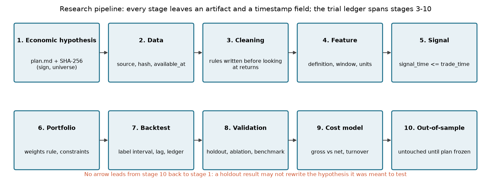
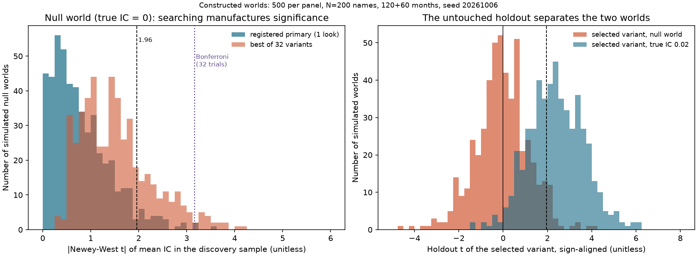
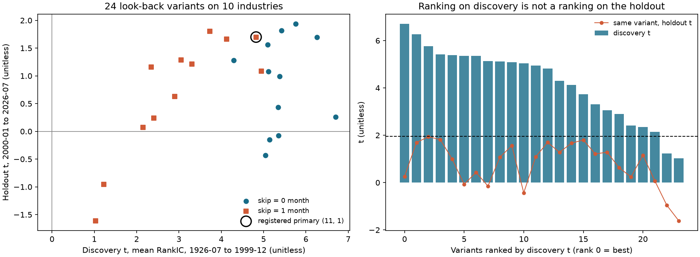

# 第22章 — 量化研究方法论（Quant Research Methodology）

> 主线：研究者在看到最终测试结果之前冻结假设、样本、评价方法，并记录每一次尝试；否则所有“显著”的数字都不能回答“这是真实规律还是搜索出来的噪声”。
> 先修：第3章（数据时点与清单）、第7章（均值推断与 Bootstrap）、第11章（收益复利）、第15章（回归与 HAC）、第21章（组合构造与换手）。完成后你能：写出一份含十个环节的冻结研究计划并给出哈希；维护试验账本（trial ledger）；手算 Bonferroni、Holm、Benjamini–Hochberg 调整；推出 $N$ 个零假设试验取最大值时的期望膨胀；区分“先写计划”和“事后挖掘”并说明本地哈希为什么证明不了先后；在真实 French 行业数据上完成一次含负结果的留出评价。

## 1. 本章目标

本章回答第22–28章共用的一个问题：当你声称“这个信号有效”时，别人凭什么相信你没有在二十个版本里挑了最好的那一个。

完成本章后，读者应能做到下列五件事：

1. 把“经济假设 → 数据 → 清洗 → 特征 → 信号 → 组合 → 回测 → 验证 → 成本模型 → 样本外”十个环节各自的输入、输出、留痕和典型失败写成一张表，并说明每个环节与第3、7、11、15、21章的接口。
2. 写一份冻结研究计划（research plan）：假设与符号方向、样本窗口、唯一的主指标、通过与失败的数值判据、成本假设、尝试预算；计算它的 SHA-256；说明这个哈希证明了什么、没有证明什么。
3. 维护试验账本：每个被评价过的变体都记录规格、指标、样本量和状态，包括已放弃的和未定义的结果。
4. 手算并解释 $1-(1-\alpha)^M$、Bonferroni、Holm、Benjamini–Hochberg；写出 $N$ 个独立标准正态变量最大值的期望并核对近似式；知道为什么相关的变体不等于独立的试验。
5. 读懂一次完整的“发现—留出”评价，包括真实数据上不通过判据的结果，并按预先写好的规则写结论。

“完成”的标准不是得到小 p 值，而是任何一位读者仅凭你的计划文件、账本、代码与数据哈希，就能复算你报告的每一个数，并看到你尝试过的全部变体。

## 2. 为什么 Quant 需要它

第14–21章给了你测量工具：回归与 HAC 标准误（第15章）、单位根与协整（第17章）、组合构造与成本（第21章）。Part IV 开始进入“系统化 alpha 研究”，也就是同一份历史数据要被反复用来检验许多种信号。工具变多以后，错误的方式也变多了：你可以换回看窗口、换去极值水平、换分组数、换样本起点、换标签期限，每换一次就得到一个新的 t 统计量。

两类事实说明这不是理论上的担忧。其一，Harvey、Liu 与 Zhu 在 2014 年的 NBER 工作稿摘要中写道：数百篇论文和数百个因子试图解释股票预期收益的横截面，鉴于这种广泛的数据挖掘，对新发现的因子继续用 t 比率大于 2.0 的通常标准“在经济上和统计上都说不通”；他们的多重检验框架建议新因子的 t 比率应大于 3.0（对应 p 值 0.27%），并指出真实尝试次数还包括从未发表的失败尝试，所以 3.0 很可能还偏低。其二，Gelman 与 Loken（2013 年未发表稿）指出：即便研究者只做了一次分析、事先持有研究假设，只要分析细节（剔除哪些观测、测哪个对比、控制哪些变量）依赖于数据长什么样，就存在“分岔路径”（forking paths）形式的多重比较问题；他们还强调，即使所选分析是观测数据的确定性函数，这也不能消除多重比较，因为 p 值回答的是“换一份可能的数据会发生什么”。

这两点合在一起，决定了本章的逻辑链：先定义“尝试”要被计数，再用冻结计划把能固定的选择固定住，再用留出样本评价，再把调整后的显著性阈值写进决策规则，最后决定报告什么。本章不教某个具体信号，也不替后面的 Value、Momentum、Quality 提供结论；它提供让那些章节的结论可被检查的流程。

## 3. 直觉

想象你要证明自己能连续猜中硬币。第一种做法：在抛硬币之前把规则写在纸上，“我只猜 10 次，猜中 9 次及以上才算我有能力”，然后抛币。第二种做法：先抛 10 次看结果，再决定“我到底想预测前 5 次还是奇数次”，再找出一个能描述这串结果的规则。两种做法都可能报告“猜中 9 次”，但只有第一种让这个数字携带信息。

金融研究里的“规则”对应一组选择：回看多少个月、跳过几个月、是否去极值、分几组、哪一段样本、是否剔除小盘股。你不会觉得自己在“钓鱼”，因为每个选择都有理由。问题在于如果数据换了模样，你会为另一套选择找到同样好的理由。这种“事后总能找到合理故事”的自由度，才是 Gelman 与 Loken 所说的分岔路径。

简化的边界要说清楚。若32次尝试各自使用全新、相互独立的一整批10次抛币，才有32个独立机会；同一批10次抛币上的不同事后子集或规则并不因此独立。金融变体不是这样：回看 11 个月和回看 12 个月的信号高度相关，它们的 t 统计量几乎同涨同跌。本章的蒙特卡洛实验会显示，32 个互相相关的变体对应的有效独立试验数只有 4 到 5 个左右。这里的“有效数”按最大绝对统计量的均值匹配，只描述一个矩，不等于检验族的大小，也不保证尾部概率相同。Bonferroni 仍按实际尝试数32计数；不能因为变体相关就假装只看了一次。

### 3.1 从一个经济问题到可交付的研究对象

先问“为什么账面市值比高的股票可能有更高的下月收益？”一种经济解释是投资者要求补偿困境风险；另一种是价格对信息反应不足。两者都导出正方向预测，却需要不同的反证与风险控制。因此先写机制，再写可测量的陈述：“在预先规定的股票池、财报可得规则和月份内，较高 B/M 对应较高下月收益”。下面每一步都交付一个具体对象。

| 步骤 | 本例操作与单位 | 产物交给谁 |
|---|---|---|
| 可观测输入 | 截止时点已公开且已入库的同版本账面权益、当时市值，均用同一货币单位 | 特征计算 |
| 特征（feature） | $B/M=\text{账面权益}/\text{市值}$，无量纲；非正权益按固定规则置缺失 | 同日预处理 |
| 信号（signal） | 同日有效 B/M 的百分位，范围 0–1；行业内版本若要比较须另记规格 | 预测评价与权重构造 |
| 预测（prediction） | 主预测是正方向的相对次序；若要预测收益数值，需在发现窗估计并冻结收益映射 | 留出期标签评价 |
| 组合（portfolio） | 买高桶卖低桶，各腿权重和为 $+1,-1$，毛暴露 2；约束与可交易集合另列 | 成交/持仓账本 |
| 评价（evaluation） | 每日期 IC、成本前后收益、基准差异及有效日期；按冻结规则判断 | 研究结论与下一次研究日志 |

“信号高”不是“预测收益为 8%”；百分位只给次序。IC 评价次序或线性关系，组合收益还依赖权重、成交时点与成本。第23章承接预测评价，第21/29章承接权重与账本。数据已被反复看过时，这条流程仍能约束本次选择，却不能把历史曝光抹去。

## 4. 数学基础

本章只用到：

- 单样本均值的 t 统计量。若 $x_1,\dots,x_T$ 是某个指标按月的取值，样本均值 $\bar x=\frac1T\sum_t x_t$，样本标准差 $s$，则 $t=\bar x/(s/\sqrt T)$。分母 $s/\sqrt T$ 是均值的标准误，单位与 $x_t$ 相同；$t$ 无量纲。本章的指标是每月的横截面信息系数（Information Coefficient, IC，定义见第23章，这里只当作一个无量纲的月度相关系数），$T$ 是月数。
- 长期方差与 Newey–West 修正：若 $x_t$ 序列相关，均值的方差不再是 $s^2/T$。Bartlett 核长期方差为 $\mathrm{LRV}=\gamma_0+2\sum_{\ell=1}^{L}\bigl(1-\tfrac{\ell}{L+1}\bigr)\gamma_\ell$，其中 $\gamma_\ell=\frac1T\sum_{t=\ell+1}^{T}(x_t-\bar x)(x_{t-\ell}-\bar x)$；均值方差估计取 $\mathrm{LRV}/T$。$L=0$ 即独立同分布的公式（除数为 $T$ 而非 $T-1$）。第15章已用于回归系数，这里直接用于一个常数回归。
- 概率论的联合界（Boole 不等式）：对任意事件 $A_1,\dots,A_m$，$\Pr(\cup_iA_i)\le\sum_i\Pr(A_i)$，不要求独立。
- 次序统计量：$N$ 个独立同分布变量的最大值 $M_N=\max_iZ_i$ 满足 $\Pr(M_N\le x)=F(x)^N$。
- 零假设下 p 值的性质：若检验对零假设有效，则 $\Pr(p\le u)\le u$，$u\in[0,1]$；由正确连续零分布精确校准时等号成立，此时p值在零假设下服从均匀分布。

频率约定：除非另说明，本章的 $t$ 是月频指标的均值检验，标签期限（label horizon）写成月数 $h$。重叠标签（$h>1$）使相邻月份的指标序列相关，$L$ 取 $h-1$ 是常见做法，但有限样本下仍可能低估方差；本章蒙特卡洛会显示这一点。

## 5. 正式定义

**研究假设（research hypothesis）**：一句含对象、方向和期限的可证伪陈述，例如“高账面市值比的股票在下一个月的收益高于低账面市值比的股票（符号为正）”。本章的经济方向性假说要求明确对象、方向和期限；“价值因子有效”没有具体判据，容易被事后任意解释。这不排除事前固定的双侧主要检验：它可以不预设效应符号，但必须预先说明对象、期限、零假设与双侧拒绝规则。

**研究计划（research plan）与冻结（freeze）**：研究计划是把下列项目写成文件：假设、股票池、数据来源、发现样本与留出样本的窗口、信号定义、标签定义、组合规则、基准、唯一的主指标、通过与失败的数值判据、成本假设、尝试预算（最多看多少个变体）。冻结指计算该文件规范化 JSON 的 SHA-256 并记录当时的本地时钟。哈希承接上一步“写下计划”，输出给后一步“评价留出样本”一个不可悄悄改动的参照；它的限制写在下一条。

**本地冻结与预注册（pre-registration）**：在抗碰撞等密码学假设下，本地冻结允许把当前规范化内容与受信保存的摘要比较；匹配支持它与该参照内容一致，摘要本身不记录写作或修改历史，时间戳来自你自己的机器。预注册需要研究者之外的、带独立时间戳的登记（例如公开登记库或第三方保管的文件）；只有这样才对“计划先于数据结果”提供外部证据。本章的 `ResearchPlan` 与 `freeze_plan` 只做本地冻结。Gelman 与 Loken 还指出，对已被许多人反复分析过的公共数据，预注册“几乎没有意义”，因为研究者无法假装对数据一无所知。本章使用的 French 行业数据正属于这一类，所以第11节的结论只能当作流程演示。

**试验（trial）与试验账本（trial ledger）**：一次试验是任何一次你为了判断假设成立与否而读取了结果的变体评价。账本是只增不删的表：试验编号、规格、指标、样本量、状态（primary / run / abandoned）和备注。重复运行同一规格仍记一行；结果未定义（NaN）的尝试也记一行，因为你仍然看过那个数据。账本行数是多重检验调整的下限输入。

**研究日志（research log）**：账本记录“做了什么得到了什么”，日志记录“为什么做、为什么改”。两者分开：账本是数据，日志是叙述。

**发现样本、留出样本与嵌入禁运（discovery, holdout, embargo）**：发现样本用于选择规格；留出样本只在规格确定之后评价一次。若标签跨 $h$ 个月，发现样本最后一个信号的标签会用到留出样本最初几个月的收益；在两段之间丢弃 $h$ 个月的信号（禁运）可以避免标签重叠泄漏，这是第30章 purging 的雏形。

**基准（benchmark）**：回答“没有这个信号会怎样”的参照。本章用三种：零信号（等权持有）、置换基准（placebo，在每个月把标签在资产间随机打乱，保留月内标签集合与时间顺序）、已发表的简单规则（例如固定的 12-1 动量）。

**消融（ablation）**：在固定其余步骤的前提下，逐一去掉一个组件（去极值、秩变换、滞后等），观察结果变化，以判断每个组件承担了什么。消融也是试验，必须记入账本。

**负结果（negative result）与复现（reproducibility）**：负结果指按预先判据不支持假设的结果，必须与正结果同等地报告。复现指任何人拿到代码、数据哈希、随机种子和账本，得到相同数字。

**家族错误率与错误发现率（family-wise error rate, FWER；false discovery rate, FDR）**：$M$ 个假设中真零假设被拒绝的个数记为 $V$，被拒绝的总个数记为 $R$。$\mathrm{FWER}=\Pr(V\ge1)$；$\mathrm{FDR}=\mathbb E[V/\max(R,1)]$，它是被拒绝者中错误比例的期望。HLZ（2014）把 FDR 界为不超过 FWER：若 $V\ge1$ 且 $R>0$ 则 $V/R\le1$，故 $\mathbb E[V/R\mid R>0]\Pr(R>0)\le\Pr(V\ge1)$。

**十环节研究链（pipeline）**：下表是本章的主结构。每个环节都有输入、输出、留痕和典型失败；读法是“左边一格的输出是右边一格的输入”，计划冻结位于第 1 环节，成本模型在第 9 环节，留出评价在第 10 环节。

| 环节 | 输入 | 输出与留痕 | 典型失败 | 相关章 |
|---|---|---|---|---|
| 1 经济假设 | 机制、文献、你的先验 | 含符号、对象、期限的一句话；计划文件与哈希 | 无符号、可事后任意解读 | 22 |
| 2 数据 | 来源、授权、版本 | 来源 URL、下载时间、SHA-256、`available_at` | 当前修订值冒充历史可得值 | 3、13 |
| 3 清洗 | 原始表 | 缺失与异常的书面规则；清洗日志 | 看到收益之后才决定剔除谁 | 3 |
| 4 特征 | 清洗后数据 | 带窗口、单位、可用时间的特征定义 | 用到 `signal_time` 之后的数据 | 11、12 |
| 5 信号 | 特征 | 同日截面变换后的信号 | 全样本标准化、未来均值入当期 | 23、28 |
| 6 组合 | 信号 | 目标权重、约束、换手 | 约束与信号混写 | 21、23 |
| 7 回测 | 权重、收益 | 标签区间、滞后、毛收益与账本 | 同一数据多次迭代不计数 | 22、29、30 |
| 8 验证 | 回测结果 | 留出评价、基准、消融、置换 | 用留出样本调参 | 22、31 |
| 9 成本模型 | 换手、费率 | 毛/净收益；容量假设 | 费率套用到错误的权重变动 | 21、35 |
| 10 样本外 | 冻结后的规格 | 一次性评价；负结果也报告 | 看结果后改假设再“样本外” | 22、31 |

时间字段贯穿所有环节：事件发生的 `event_time`；系统可获得的 `available_at`；本地入库的 `ingested_at`；决策的 `signal_time`；成交的 `trade_time`；收益区间与标签区间。可执行研究要求 `available_at` 与 `ingested_at` 均不晚于决策截止，且 `signal_time < trade_time`；收益测量从实际成交价起算。本章月收盘标签是虚拟月末成交的研究代理，不能因为标签的月份较晚就认定收益全部发生在真实成交之后。具体字段与时钟见第23章5.2节。

### 5.1 一个小账本：主假设、探索与留出怎样共存

以下五行是教学构造，不是本章旧市场结果。计划先规定主规格 B/M 正方向、发现窗 $D$、隔离窗及留出窗 $H$，并登记“发现阶段最多五次评价”；表中的 p 值只用于演示多重检验计算。

| ID | 规格与状态 | 读取哪段结果 | p 值 | 结论身份 |
|---|---|---|---:|---|
| D01 | 主规格，同日百分位 | $D$ | 0.01 | 主假设发现结果 |
| D02 | 见 D01 后改为行业内排名 | $D$ | 0.04 | 事后探索 |
| D03 | 见结果后改去极值门槛 | $D$ | 0.03 | 事后探索 |
| D04 | 常数信号，IC 未定义 | $D$ | 缺失 | 未定义尝试，保留原因与样本数 |
| D05 | 改标签期限后最优 | $D$ | 0.005 | 事后探索，不能追称主规格 |

这五次服务同一发现决策，按本章全尝试口径组成一个检验族（test family），$M=5$；D04 无有效 p 值，计算时补 $p=1$，它没有被“检验为不显著”。在原行顺序中 Bonferroni 调整为 $(0.05,0.20,0.15,1,0.025)$；Holm 为 $(0.04,0.09,0.09,1,0.025)$；BH 为 $(0.025,0.05,0.05,1,0.025)$。第6节解释乘数、累积最大/最小及各自错误率条件。补 1 保留尝试规模，不能修复原本无效的 p 值或依赖数据的检验设计。

留出评价另记 H01，链接“究竟评价 D01 还是发现窗选出的 D05”。若计划登记仅 D01 为主确认，D05 的留出结果只能按探索后验证报告；若计划事先登记发现窗选规格、留出确认的完整算法，则 H01 评价的是该选择算法选定的规格。两种计划都要在打开 $H$ 前固定，不可看 H01 后互换。留出既已读取，再调一次门槛就成为新的尝试；账本继续加行，原 H01 不删除。

本地哈希绑定计划内容；第三方保存的先后记录支持冻结时间；此前使用过 French 历史的事实记录曝光。三者分别回答“内容是什么”“何时写下”“知道过哪些历史”，不会相互替代。发现窗与留出窗隔离减少标签交叉，并不保证金融时间序列统计独立，推断仍须检查相依与样本量。

## 6. 推导

### 6.1 多次检验的家族错误率

设有 $M$ 个独立的检验，每个在零假设为真时以概率 $\alpha$ 拒绝。则所有零假设为真时至少有一次拒绝的概率为

\[
\mathrm{FWER}=1-(1-\alpha)^M .
\]

推导只用了独立性：不拒绝的概率是 $1-\alpha$，$M$ 个同时不拒绝是 $(1-\alpha)^M$，取补集。代入 $\alpha=0.05$：$M=1$ 时 $0.05$；$M=5$ 时 $0.226$；$M=10$ 时 $0.401$；$M=32$ 时 $0.806$；$M=100$ 时 $0.994$。若要把家族错误率压到 $\alpha$，独立情形下单次水平取 $1-(1-\alpha)^{1/M}\approx\alpha/M$（Šidák）。

读法：32 次独立尝试里至少有一次“显著”的概率是 81%，这是计划里写“尝试预算”的原因。条件是各检验独立；相关本身不保证该概率一定低于81%；第13节的特定构造实验测得23.6%，不能把它推广成任意相依结构下的界。

### 6.2 Bonferroni 校正与联合界

不要求独立。设 $I_0$ 是真零假设的下标集，$m_0=|I_0|\le M$。Bonferroni 的拒绝规则是 $p_i\le\alpha/M$。则

\[
\Pr(\text{存在 }i\in I_0:\ p_i\le\alpha/M)\ \le\ \sum_{i\in I_0}\Pr(p_i\le\alpha/M)\ \le\ m_0\cdot\frac{\alpha}{M}\ \le\ \alpha .
\]

第一步是联合界，第二步用零假设下 $\Pr(p\le u)\le u$，第三步用 $m_0\le M$。等价地，调整后 p 值 $p_i^{\mathrm{Bonf}}=\min(Mp_i,1)$ 与 $\alpha$ 比较。代价是功效低：它要求每个检验都达到 $\alpha/M$。

### 6.3 Holm 逐步下降程序为什么也控制 FWER

排序 $p_{(1)}\le\dots\le p_{(M)}$，对应假设 $H_{(1)},\dots,H_{(M)}$。Holm 程序：找到最小的 $k$ 使 $p_{(k)}>\alpha/(M+1-k)$，拒绝 $H_{(1)},\dots,H_{(k-1)}$，不拒绝其余。HLZ（2014，§4.4.2）给出这一步骤；下面的 FWER 证明由本书作者给出，不是该文的内容。

设 $j$ 为排序中第一个真零假设的位置。若 Holm 犯了至少一次错误拒绝，它必然拒绝了 $H_{(j)}$（程序按顺序拒绝，第一个真零假设一旦被越过就是错误拒绝）。拒绝 $H_{(j)}$ 意味着对所有 $k\le j$ 有 $p_{(k)}\le\alpha/(M+1-k)$，特别 $p_{(j)}\le\alpha/(M+1-j)$。排在它前面的 $j-1$ 个都是假零假设，所以 $j-1\le M-m_0$，即 $M+1-j\ge m_0$，于是 $p_{(j)}\le\alpha/m_0$。这个事件包含于“某个真零假设的 p 值 $\le\alpha/m_0$”，由联合界其概率不超过 $m_0\cdot\alpha/m_0=\alpha$。证毕。

比较：第 1 步 Holm 与 Bonferroni 的门槛相同（$\alpha/M$），之后门槛 $\alpha/(M+1-k)$ 逐步放宽，所以 Holm 拒绝的假设包含 Bonferroni 拒绝的全部，且同样不要求独立。调整后 p 值写成 $p^{\mathrm{Holm}}_{(i)}=\min\{\max_{j\le i}(M-j+1)p_{(j)},\,1\}$（取累积最大以保证单调）。

### 6.4 Benjamini–Hochberg 与错误发现率

BH 程序：找最大的 $k$ 使 $p_{(k)}\le\frac kMq$，拒绝 $H_{(1)},\dots,H_{(k)}$。调整后 p 值（“q 值”）$p^{\mathrm{BH}}_{(i)}=\min_{j\ge i}\{\min(\tfrac Mjp_{(j)},1)\}$。已知结论：当检验独立（或满足正相依条件）时，$\mathrm{FDR}\le\frac{m_0}{M}q$。本章不证明该结论，也没有读 Benjamini–Hochberg 原文；只使用程序本身，并把它当作“探索性发现”的筛选器，第17章已对协整配对用过它。FWER 要求几乎不犯一次错误，FDR 允许接受一小部分错误；探索阶段 FDR 合适，要声称一个因子时更接近 FWER 的要求。

### 6.5 $N$ 个零假设试验的最大值有多大

设 $Z_1,\dots,Z_N$ 独立同分布 $N(0,1)$，$\Phi,\varphi$ 为分布函数与密度。最大值的分布函数 $\Phi(x)^N$，密度 $N\varphi(x)\Phi(x)^{N-1}$，所以

\[
\mathbb E[\max_iZ_i]=\int_{-\infty}^{\infty}x\,N\varphi(x)\Phi(x)^{N-1}\,dx .
\]

$N=2$ 时可手算：$\max(Z_1,Z_2)=\tfrac{Z_1+Z_2}2+\tfrac{|Z_1-Z_2|}2$，前一项期望为零，$Z_1-Z_2\sim N(0,2)$，$\mathbb E|Z_1-Z_2|=2/\sqrt\pi$，所以期望是 $1/\sqrt\pi=0.5642$。

Bailey 与 López de Prado（2014，式 (1)，附录 A.1）给出大 $N$ 时的近似

\[
\mathbb E[\max_iZ_i]\approx(1-\gamma)\,\Phi^{-1}\!\Bigl(1-\frac1N\Bigr)+\gamma\,\Phi^{-1}\!\Bigl(1-\frac1{Ne}\Bigr),
\]

$\gamma\approx0.5772$ 是 Euler–Mascheroni 常数，$e$ 是自然对数的底。若各次试验的夏普估计值在零假设下服从均值 0、标准差 $\sigma$ 的正态分布，则最大值的期望是 $\sigma$ 乘以上式。本章用数值积分核对：

| $N$ | 近似式 | 数值积分 | 相对误差 |
|---|---|---|---|
| 2 | 0.520 | 0.564 | −7.9% |
| 5 | 1.193 | 1.163 | +2.5% |
| 10 | 1.575 | 1.539 | +2.3% |
| 32 | 2.100 | 2.070 | +1.5% |
| 100 | 2.531 | 2.508 | +0.9% |
| 1000 | 3.255 | 3.241 | +0.4% |

近似式对小 $N$ 不准，作者给的是“大 $N$ 近似”。一个数值含义：$T=120$ 个月的月度夏普估计在零假设下标准差约 $1/\sqrt{120}=0.0913$；32 个独立的零假设试验取最大值，期望约 $0.0913\times2.100=0.192$ 每月，年化乘 $\sqrt{12}$ 约 0.66。也就是说，什么都没有的策略族挑出最好的一个，平均看上去是年化夏普 0.66。这里假设试验独立、收益近似独立同分布。

### 6.6 选择之后的评价为什么需要新数据

设你在发现样本上选出 $t$ 最大的变体，记它的发现 $t$ 为 $t_D^{*}$。$t_D^{*}$ 是 $N$ 个量的最大值，所以它是向上偏的估计，6.5 节量化了偏多少。留出样本 $t_H$ 的分布取决于留出数据与发现数据之间的关系。若零假设为真且留出数据独立于选择过程，则 $t_H$ 的分布与选择无关：以发现样本的符号为方向，符号对齐后的 $\mathrm{sign}(t_D^{*})\,t_H$ 均值为零。若在最终固定的评价方向上真实IC为正，留出效应才朝该正方向；发现符号可能选错，不能仅凭原始IC为正保证任一符号对齐结果的条件均值为正。这是留出样本可以区分“搜索出的噪声”与“真实但被高估的效应”的根据。这里均值为零的论证要求留出数据与选择过程独立；禁运防止标签交叉，却不自动保证金融时间序列独立。还须避免反复读取留出结果并继续选规格。

### 6.7 从 $t$ 到夏普比率

若每月多空收益 $x_t$ 近似独立同分布，月度夏普 $\widehat{SR}_m=\bar x/s$，则 $t=\bar x/(s/\sqrt T)=\widehat{SR}_m\sqrt T$。例如 $\widehat{SR}_m=0.15$、$T=120$：$t=0.15\times\sqrt{120}=1.643$，双侧 p 值 0.100。年化夏普 $\widehat{SR}_m\sqrt{12}=0.52$ 看起来不错，但用 120 个月做检验，它与零没有可靠区别。这个换算依赖独立性；序列相关时要用 Newey–West。

## 7. 金融解释

**假设要先有经济机制。** 一个能写进计划的假设至少属于三类机制之一：风险补偿（该特征对应投资者要求更高回报的风险暴露）、行为或信息反应不足（价格对公开信息调整缓慢）、制度或融资约束（某类投资者被迫买入或卖出）。第24–27章分别给 Value、Momentum、Quality、Carry 各自的机制与反对意见。机制的作用不是证明信号有效，而是限制你可以合法尝试的变体：机制说“过去一年赢家继续赢”，就不该因为数据好看而改成“过去 7 周”。

**阈值随尝试数变化。** HLZ（2014）的建议 $t>3.0$ 是多重检验框架下的结论，不是一个自然常数。它们也承认：由第一性原理推出的因子可以有比纯经验发现更低的门槛，但 2.0 对两类因子都不再合适。本章实验里，32 个变体的 Bonferroni 双侧门槛是 $z=3.16$。这个问题并不新：Jegadeesh 与 Titman（1993，印刷页 69）报告 32 个动量策略时已写明，单个 $t=4.28$ 在 32 次检验下由 Bonferroni 不等式给出的概率小于 0.0006；他们的做法是把检验次数摆在结果旁边。若确实只有一个事前固定且校准有效的双侧正态检验，5%门槛约为1.96；因此“报告你做了几次”比“选哪个阈值”更根本。

**留出样本的含义有限。** 留出样本把“选择”与“评价”分开，但它不是新的世界：它来自同一市场、同一数据供应商、通常是同一代理（proxy）。一个在留出样本通过的信号仍可能是容量很小、成本之后为负、或在下一个体制失效。方法论在边际 p 值有效且满足指定选择与依赖条件时控制 FWER 或 FDR；单次研究仍可能误报。误差率控制也不证明成本后收益为正。

**负结果有信息。** 如果预先写好“留出 $t\ge2.0$ 才算支持”，结果是 1.70，那么按规则这是“未支持”。点估计为正、并且接近阈值，是值得继续研究的线索，但不能事后把阈值改成 1.5。改阈值等于再开一条分岔路径。

## 8. 数值例题：手算每一步

本节所有数字都可以用纸笔复核；第9节的代码用断言再核对一遍。

### 8.1 五次试验的账本与三种校正

::: {.body-example title="完整例题：五次检验的三种校正"}
假设账本里有 5 个变体，发现样本的 $t$ 统计量依次是 2.4、1.1、0.4、1.9、2.1。把它们当作标准正态的双侧检验：$p=2[1-\Phi(|t|)]$。

| 试验 | $t$ | 双侧 $p$ |
|---|---|---|
| a | 2.4 | 0.0164 |
| b | 1.1 | 0.2713 |
| c | 0.4 | 0.6892 |
| d | 1.9 | 0.0574 |
| e | 2.1 | 0.0357 |

只看试验 a，$p=0.0164<0.05$，似乎显著。但这是 5 次尝试里最好的那个。$M=5$：

- Bonferroni：$p^{\mathrm{Bonf}}=\min(5p,1)$：a 为 0.082；e 为 0.179；d 为 0.287；b、c 为 1。没有一个小于 0.05。
- Holm：排序 $p_{(1)}=0.0164$（a），$p_{(2)}=0.0357$（e），$p_{(3)}=0.0574$（d），$p_{(4)}=0.2713$（b），$p_{(5)}=0.6892$（c）。乘数 $5,4,3,2,1$：$0.082,\ 0.143,\ 0.172,\ 0.543,\ 0.689$，已单调不减，所以调整后 p 值就是这些（a 0.082、e 0.143、d 0.172、b 0.543、c 0.689）。没有一个小于 0.05。
- BH：$\tfrac{M}{\text{rank}}p$：$0.0164\times5/1=0.082$，$0.0357\times5/2=0.0893$，$0.0574\times5/3=0.0957$，$0.2713\times5/4=0.339$，$0.6892\times5/5=0.689$，从后向前取累积最小，仍是这些数；最小 q 值 0.082，不通过 5% 的 FDR 阈值。

结论：单独看 $t=2.4$ 像发现，把 5 次尝试算进去就不再是。这个结论只由账本行数决定，与你“其实只想看 a”的主观意图无关；若你冻结过只看 a 的计划并如实只评价了 a，则 $M=1$，$p=0.0164$ 是合法的。这正是冻结计划的价值。
:::

### 8.2 四个 p 值的另一个例子

::: {.body-example title="完整例题：四个 p 值的校正"}
$p=(0.01,\,0.04,\,0.03,\,0.005)$，$\alpha=5\%$，$M=4$。Bonferroni：$(0.04,\,0.16,\,0.12,\,0.02)$，两个通过（$p=0.005$ 与 $0.01$）。Holm：排序 $0.005,0.01,0.03,0.04$，乘数 $4,3,2,1$：$0.02,\,0.03,\,0.06,\,0.04$，累积最大 $0.02,\,0.03,\,0.06,\,0.06$，映射回输入顺序是 $(0.03,\,0.06,\,0.06,\,0.02)$，仍是两个通过。BH：$0.005\times4/1=0.02$，$0.01\times4/2=0.02$，$0.03\times4/3=0.04$，$0.04\times4/4=0.04$，从后取累积最小仍是这些，映射回 $(0.02,\,0.04,\,0.04,\,0.02)$，四个都在 5% 以内通过。三种方法的严格程度排序 Bonferroni $\ge$ Holm $\ge$ BH（对调整后 p 值），这个排序在本章的单元测试中对 50 个随机 p 值也成立。
:::

### 8.3 冻结文件的哈希

第9节代码把一份价值假设的计划写成 `ResearchPlan`，固定本地时钟为 2026-10-06 09:00 UTC 后得到 SHA-256 前 16 位 `40d38a74d67e0c08`。若只把判据从 “holdout $t\ge2.0$ and positive sign” 改为 “holdout $t\ge1.5$ and positive sign”，哈希变成 `e8ba36254e34603b…`，完全不同。若同事已受信保存原摘要，修改后的内容会在摘要比对中被识别（依赖抗碰撞假设）。只保存可同时替换的文件与摘要不提供防篡改历史；哈希也不能证明写计划之前没有看过数据。

### 8.4 32 个变体的家族错误率与 Bonferroni 门槛

32 个独立检验，水平 5%：$1-0.95^{32}=0.8063$。Bonferroni 单次水平 $0.05/32=0.0015625$，双侧对应 $z=\Phi^{-1}(1-0.05/64)=3.163$。第6.5节的对象是单侧 $\max Z$：其精确期望约2.070，近似式给2.100。这里是双侧 $\max|Z|$，32个独立变量的期望约2.347（数值积分），二者不能混用。所以 1.96 的门槛在多数情况下被越过，3.16 则只在少数情况下被越过。

## 9. Python 实现

本章的可复用代码在 [`research_protocol.py`](../../src/quant_course/research_protocol.py)，截面与 IC 工具在 [`factor_research.py`](../../src/quant_course/factor_research.py)（第23章详述），月频动量窗口在 [`factor_signals.py`](../../src/quant_course/factor_signals.py)。接口：

| 函数/类 | 输入 | 输出与边界 |
|---|---|---|
| `ResearchPlan` | 假设、股票池、数据来源、四个窗口端点、信号/标签/组合定义、基准、主指标、判据、成本假设、尝试预算 | 冻结数据类；任何必填项为空、预算不是正整数、发现窗口与留出窗口重叠都会报错 |
| `freeze_plan` | 计划与可选的本地时钟 | `FrozenPlan`，含规范化 JSON 的 SHA-256 与本地时间字符串；不是外部时间戳 |
| `TrialLedger.record` | 规格字典、指标、样本量、状态、备注 | 追加一行；指标须为有限实数或 NaN；无穷、布尔、未知状态拒绝；`n_trials` 数每一行 |
| `bonferroni_adjust`、`holm_adjust`、`benjamini_hochberg_adjust` | 一维 p 值数组 | 按输入顺序返回调整后 p 值；空数组、越界、NaN 拒绝 |
| `expected_max_standard_normal`、`..._exact` | 整数 $N$ | DSR 近似式（$N\ge2$）与数值积分 |
| `split_discovery_holdout` | 月频 `PeriodIndex` 与计划 | 两个互不相交的月份标签集合；窗口与样本无交集时报错 |

第一段代码冻结价值假设的计划并演示哈希：

```python
import dataclasses
from datetime import datetime, timezone

from quant_course.research_protocol import ResearchPlan, freeze_plan

plan = ResearchPlan(
    hypothesis="Cheap stocks (high B/M) earn higher next-month returns (sign +)",
    universe="constructed 200 names x 180 months",
    data_sources=("constructed panel, seed 20261006",),
    discovery_start="2000-01", discovery_end="2009-12",
    holdout_start="2010-01", holdout_end="2014-12",
    signal_definition="percentile rank of B/M within month, no lag",
    label_definition="next-month simple return",
    portfolio_rule="top quintile minus bottom quintile, equal weight",
    benchmark="equal-weight universe",
    primary_metric="t of mean IC: Pearson correlation of within-month signal ranks with next-month return, Newey-West lag 0, holdout",
    decision_rule="holdout t >= 2.0 and positive sign",
    cost_assumption="10 bp per unit traded", trial_budget=1,
)
clock = datetime(2026, 10, 6, 9, 0, tzinfo=timezone.utc)
frozen = freeze_plan(plan, now=clock)
edited = freeze_plan(dataclasses.replace(plan, decision_rule="holdout t >= 1.5 and positive sign"), now=clock)
assert frozen.sha256.startswith("40d38a74d67e0c08")
assert edited.sha256.startswith("e8ba36254e34603b") and edited.sha256 != frozen.sha256
print(frozen.sha256[:16], edited.sha256[:16])
```

第二段代码重复 8.1 的五次试验：账本计数，三种调整，并与手算值核对：

```python
import numpy as np
from scipy import stats

from quant_course.research_protocol import (
    TrialLedger, benjamini_hochberg_adjust, bonferroni_adjust, holm_adjust, pad_untested_attempts,
)

t = np.array([2.4, 1.1, 0.4, 1.9, 2.1])
ledger = TrialLedger()
for name, value in zip("abcde", t):
    ledger.record({"variant": name}, metric=float(value), n_obs=120, status="primary" if name == "a" else "run")
ledger.record({"variant": "f"}, metric=float("nan"), n_obs=0, status="abandoned", note="constant signal: IC undefined")
assert ledger.n_trials == 6          # the undefined attempt still counts as a look at the data

p = 2 * stats.norm.sf(t)
np.testing.assert_allclose(np.round(p, 4), [0.0164, 0.2713, 0.6892, 0.0574, 0.0357])
np.testing.assert_allclose(np.round(bonferroni_adjust(p), 3), [0.082, 1.0, 1.0, 0.287, 0.179], atol=1e-3)
np.testing.assert_allclose(np.round(holm_adjust(p), 3), [0.082, 0.543, 0.689, 0.172, 0.143], atol=1e-3)
np.testing.assert_allclose(np.round(benjamini_hochberg_adjust(p), 3), [0.082, 0.339, 0.689, 0.096, 0.089], atol=1e-3)
full = pad_untested_attempts(p, ledger.n_trials)            # the undefined attempt enters the family as p = 1: family size 6
np.testing.assert_allclose(np.round(bonferroni_adjust(full)[:5], 3), [0.098, 1.0, 1.0, 0.345, 0.214], atol=1e-3)
np.testing.assert_allclose(np.round(holm_adjust(full)[:5], 3), [0.098, 0.814, 1.0, 0.230, 0.179], atol=1e-3)
np.testing.assert_allclose(np.round(benjamini_hochberg_adjust(full)[:5], 3), [0.098, 0.407, 0.827, 0.115, 0.107], atol=1e-3)
print(ledger.to_frame()[["trial_id", "status", "metric"]])
```

注意 `ledger.n_trials` 是 6 而不是 5：第 6 个尝试结果未定义，但你为了得到它读取了数据。**应报告的主口径是全账本的家族大小 $M=6$**：用 `pad_untested_attempts` 把没有 $p$ 值的尝试按 $p=1$ 放进家族（它永远不能被拒绝，但进入乘数），得到 Bonferroni $(0.098,1,1,0.345,0.214)$、Holm $(0.098,0.814,1,0.230,0.179)$、BH $(0.098,0.407,0.827,0.115,0.107)$。上面前三个断言只对 5 个有效 $p$ 值校正（$M=5$）：那是另一个口径，只能作敏感度附注，不能代替全账本结果；两个口径同时给出时必须说明差别。8.1 的手算只取前 5 个，是教学简化。

第三段代码核对期望最大值近似式的精度（6.5 节表）：

```python
import numpy as np

from quant_course.research_protocol import expected_max_standard_normal, expected_max_standard_normal_exact

exact_two = expected_max_standard_normal_exact(2)
assert abs(exact_two - 1 / np.sqrt(np.pi)) < 1e-9                 # hand value 1/sqrt(pi) = 0.5642
for n, tol in ((10, 0.04), (100, 0.03), (1000, 0.02)):
    approx, exact = expected_max_standard_normal(n), expected_max_standard_normal_exact(n)
    assert abs(approx - exact) < tol
print(round(expected_max_standard_normal(32), 3), round(expected_max_standard_normal_exact(32), 3))   # 2.1 2.07
```

**默认离线入口与历史实验分开。** 在随书 I3 读者包根目录运行：

```bash
.venv/bin/python run_notebook.py notebooks/ch22_research_methodology.ipynb
```

默认 `RUN_FRENCH=False`。Notebook 展示冻结/哈希、六行账本与五个有效 p 值的两种族口径、最大值期望、单次32变体构造世界，以及60次零世界和60次备择世界模拟（不是第10/13节历史图表的各500次）。Notebook 只创建章级 `RUN_DIR`，不写CSV/PNG，也不生成历史图库。运行器另建 `runs/execution_ch22_research_methodology_<uuid>/`，保存执行副本与状态，不能与章级目录混称。默认五有效 p 值的演示不意味着有第六个有效 p 值；失败尝试的全族调整仍按前文补1的口径解释。

历史完整 CLI 为 `code/ch22_research_methodology.py`，包含 French 分支及各500次模拟，不能当作默认离线命令。其历史种子固定为20261006（零世界）和20261007（备择世界），并在计算留出数字前写本地冻结计划；本地时钟不提供外部先后证据。以上历史数字和图沿用原实验，本章不要求为阅读重新执行。

NaN策略：账本接受NaN指标并计数；`ic_summary`丢弃NaN日期并记入`n_missing`；丢弃后NW滞后按有效数组的位置计算，内部日期缺口须另查。有效日期少于三个时汇总报错。
数据频率为月频；信号时点 `signal_time` 是月末，标签是下一个月的简单收益，收益测量区间是该下一个月；French 行业月收益是已修订的历史快照，不是时点版本，所以 `available_at` 实际晚于月末，本章把月末当作信号时点是理想化假设。

## 10. 图形解读

**图 22-1：十环节研究链。** 两排各五个方框，从左到右、先上后下，每个框写环节名和它留下的痕迹。没有从第 10 环节指回第 1 环节的箭头：留出评价的结果不允许改写它本来要检验的假设。图是流程示意，不含数据。



**图 22-2：构造世界中搜索如何制造显著性，以及留出样本如何区分两种世界。** 两个世界各 500 次独立模拟，每次 200 只股票、发现样本 120 个月、禁运 3 个月、留出样本 60 个月，零世界种子20261006、备择世界种子20261007（原图共同大标题仅写20261006，不能据此把两世界种子混同）。左图是零世界（真实 IC 为零）：蓝色是预先登记的单一规格在发现样本上的 $|t|$，橙色是 32 个变体中最大的 $|t|$；虚线是 1.96，紫色点线是 32 次试验的 Bonferroni 门槛 3.16。读法：橙色整体右移，越过 1.96 的比例是 23.6%，蓝色是 5.4%。右图横轴是用发现样本选出的最优变体在留出样本上的 $t$，并按其发现符号对齐：橙色（零世界）围绕 0，蓝色（真实 IC 约 0.02）整体在 0 右侧。这是构造数据，用来说明机制，不是市场证据。



**图 22-3：French 行业动量的 24 个回看窗口变体。** 左图每个点是一个 (回看月数, 跳过月数) 组合，横轴是发现样本 1926-07 至 1999-12 的 $t$，纵轴是留出样本 2000-01 至 2026-07 的 $t$；黑圈是预先登记的主规格 (11, 1)。右图把变体按发现 $t$ 从高到低排序，橙线是同一变体在留出样本的 $t$。读法：发现样本里 24 个变体中 22 个 $t>2$；留出样本里没有一个超过 2；排名第一的变体 (1, 0) 留出 $t$ 只有 0.26。样本来自 10 个行业组合的已修订月收益，不是可交易成交。



## 11. 真实市场历史例

**数据。** 沿用 2026-10-05 冻结的 French 10 行业价值加权月收益：来源 [Ken French 数据库 10 Industry Portfolios](https://mba.tuck.dartmouth.edu/pages/faculty/ken.french/Data_Library/det_10_ind_port.html)，ZIP SHA-256 `ebd937a4b995d821867aeb956a96f09a666386f38fa82516b7d1767ee4a49ae5`，处理后 CSV SHA-256 `3b097d810c295d64eedfa1ece7067ff2a0707f5ca90e33935df9949251f70950`，1,202 个月（1926-07 至 2026-08），单位为小数月简单收益。公开可下载不等于可任意再分发。本章不下载新数据。

**计划（冻结）。** 假设：过去 12-1 收益较高的行业，下个月收益较高（符号为正）。信号：月末 $s$ 用 $s-11$ 至 $s-1$ 共 11 个月的复利收益，不含当月；标签：下一个月 $s+1$ 的简单收益；横截面 10 个行业；主指标：留出样本中每月斯皮尔曼秩相关（Rank IC）均值的 $t$ 统计量（Newey–West 滞后 0）；判据：留出 $t\ge2.0$ 且为正；成本假设 10 bp 每单位换手，只用于多空组合的演示；发现样本到 1999-12，留出样本 2000-01 至 2026-07；尝试预算 24 个变体（回看 1 到 12 个月，跳过 0 或 1 个月）。备注字段写着：这份计划是在读过相关文献、并在前面章节用过同一份数据之后写的，不是盲计划，也没有外部登记。

**结果。** 所有数字由 `code/ch22_research_methodology.py` 产生，并由 `qa/a5/claude/recompute/ch22_recompute.py`（不导入课程代码，用逐月循环和 `scipy.stats.spearmanr`）独立复算，两者一致。

| 变体（回看, 跳过） | 发现月数 | 发现平均 Rank IC | 发现 $t$ | 留出月数 | 留出平均 Rank IC | 留出 $t$ |
|---|---|---|---|---|---|---|
| 登记主规格 (11, 1) | 871 | 0.0688 | 4.82 | 319 | 0.0414 | 1.70 |
| 发现样本最优 (1, 0) | 882 | 0.0925 | 6.70 | 319 | 0.0061 | 0.26 |
| (12, 0) | 871 | 0.0877 | 6.26 | 319 | 0.0412 | 1.69 |
| (6, 1) | 876 | 0.0433 | 3.05 | 319 | 0.0304 | 1.28 |

24 个变体里发现样本 $t>2$ 的有 22 个，留出样本 $t>2$ 的有 0 个。账本共 24 行（登记的主规格是其中第 (11,1) 行）。

**按预先写好的判据。** 主规格留出 $t=1.70<2.0$，所以结论是“未被支持”。点估计为正（平均 Rank IC 0.041），而且发现样本的估计值（0.0688，标准误约 0.0143）与留出样本的估计值（0.0414，标准误约 0.0243）之差约 0.027，其标准误约 0.028，差异本身不显著：数据既不能证明动量在 2000 年之后“消失”，也不能证明它“没有衰减”。置换基准（把标签在 10 个行业间每月随机打乱 2000 次，保持每月标签集合）给出的单侧 p 值为 0.050，与 $1-\Phi(1.70)=0.045$ 接近，没有给出新信息。这些结论都只对这 10 个行业组合的已修订月收益成立。

**多重检验调整。** 对发现样本 24 个变体的双侧 p 值，最优变体的原始 p 值约 $2\times10^{-11}$，Bonferroni 调整后约 $5\times10^{-10}$，Holm 与 BH 相同。调整后仍极显著。这表明这些发现窗检验在所用近似 p 值和族定义下，经校正仍拒绝零假设；它不能识别留出估计较小的原因。多重检验调整控制拒绝决策的误差率，并不把所选效应大小校正为无偏，不能排除胜者诅咒（winner's curse）。效应变化、选择偏差与抽样波动都可能参与；前述差值0.027/标准误0.028不足以证明衰减。留出期较低的统计量也涉及估计精度，不能据此作原因判定。

**换成多空组合与成本（演示）。** 每月把 10 个行业按信号分为 5 组（每组 2 个），买最高组、卖最低组，各腿等权，毛暴露 2、净暴露 0。换手取相邻月份目标权重差的绝对值和（买卖合计，不折半，忽略漂移）。主规格 (11,1)：发现样本毛平均 0.561% 每月（$t=3.69$），换手均值 0.861，净（每单位 10 bp）0.475%；留出样本毛 0.403%（$t=1.21$），换手 1.019，净 0.301%。发现最优的 (1,0)：发现样本毛 0.861%（$t=6.33$），留出样本毛 0.405%（$t=1.25$），换手 3.056，净 0.099% 每月：换手高三倍，成本占去毛收益的约四分之三。10 bp 是假设，行业组合不是可交易的成交序列，所以这里的净收益只用于说明毛收益与成本相对大小的方向。

**这个例子证明了什么，没有证明什么。** 它演示了：登记的主规格、发现样本选出的最优规格、留出样本三者可以给出很不同的结论；“按判据未支持”与“估计量显著为零”不是一回事。它不证明行业动量不存在，不验证第25章的任何结论，也不是对 12-1 动量的独立检验：留出样本不是纯净的，作者读过动量文献，前面章节已用这份数据；10 个资产的截面很小；数据是修订历史。

## 12. 常见错误

**错误 1：只报告 N 个变体里最好的那个。** 零世界里 20 个独立变体取最大 $|z|$，超过 1.96 的概率是 $1-0.95^{20}=0.642$。

```python
import numpy as np

rng = np.random.default_rng(7)
z = rng.standard_normal((20000, 20))                       # 20 independent null z-statistics per "paper"
reported_best = (np.abs(z).max(axis=1) > 1.96).mean()      # report only the best of 20
single = (np.abs(z[:, 0]) > 1.96).mean()                   # report the one pre-committed test
bonferroni = (np.abs(z).max(axis=1) > 3.0).mean()          # hurdle for 20 looks: z = 3.02 two-sided at 5%
assert abs(reported_best - (1 - 0.95**20)) < 0.015 and abs(single - 0.05) < 0.01 and bonferroni < 0.06
print(round(reported_best, 3), round(single, 3), round(bonferroni, 3))
```

修复：报告全部变体，或在计划里只登记一个并写明预算；若搜索不可避免，用 Bonferroni 或 Holm 门槛。

**错误 2：看到结果后改判据。** 8.3 节哈希已显示：改判据一个字符，哈希整个变化。修复是把判据写进计划并哈希；若确需修改，新建版本并在账本与日志里记录“改于看到留出结果之后”。

**错误 3：反复用留出样本选择。** 若你在留出样本上评价 10 个独立变体并挑最好的一个，零世界里它至少一个“显著”的概率是 $1-0.95^{10}=0.401$，留出样本退化成第二个发现样本。修复：留出样本只评价发现样本最终选定的 1 个（最多几个并计数）规格。图 22-3 为了画图把 24 个变体的留出 $t$ 全算了出来，它只用于教学展示；真实研究里这相当于 24 次留出评价，我们在第11节表中仍只拿登记主规格作判据，并如实写出这一点。

**错误 4：标准化或去极值参数用到了未来。** 对时间序列做全样本标准化，早期信号就依赖晚期数据。

```python
import numpy as np

x = np.array([0.5, -0.2, 0.1, 0.4, -0.1, 3.0])        # pretend x[5] arrives later
full = (x - x.mean()) / x.std(ddof=0)                  # full-sample: uses the future
causal = np.array([(x[: i + 1] - x[: i + 1].mean())[-1] / (x[: i + 1].std(ddof=0) or 1.0) for i in range(len(x))])
x2 = x.copy(); x2[5] = -3.0                            # the future value changes ...
full2 = (x2 - x2.mean()) / x2.std(ddof=0)
causal2 = np.array([(x2[: i + 1] - x2[: i + 1].mean())[-1] / (x2[: i + 1].std(ddof=0) or 1.0) for i in range(len(x2))])
assert not np.allclose(full[:5], full2[:5])            # ... and rewrites earlier "signals"
assert np.allclose(causal[:5], causal2[:5])            # expanding-window version does not
print(np.round(full[0], 3), np.round(full2[0], 3))
```

截面标准化（同一天内对所有股票）不属于这个错误，因为同一天的所有数据都在 `signal_time` 之前可得；第28章专门区分这两类。

**错误 5：只数“成功”的试验。** 账本必须记已放弃和未定义的尝试（第9节第二段代码里 `n_trials` 为 6）。只数成功者等于把 $M$ 压低到最有利的数字。

**错误 6：重叠标签的朴素 $t$。** 三个月标签使相邻月份的 IC 序列相关。零世界里三月标签变体的 $t$ 的标准差是 1.26（单月标签 1.04），即便用了 Newey–West 滞后 2，对三月标签的 $|t|>1.96$ 拒绝率也有 11.8%，高于名义 5%。有限样本里 NW 低估了方差。修复：用更长的滞后、非重叠抽样，或对每一个 $h$ 单独校准阈值；第23章详述。

**错误 7：选择偏向偏差最大的统计量。** 同一个零世界里，选出的“最优变体”留出 $t>1.96$（方向与发现符号一致）的比率是 4.6%，而不是 2.5%：被选中的变体里有 61.8% 是三月标签（它们只占变体个数的一半），因为这类变体的 $t$ 在零假设下方差更大、更容易成为最大值，而它们在留出样本里同样方差偏大。选择过程会偏爱“标准误被低估的那一类”。

## 13. 量化研究应用：同一价值假设的事前固定研究计划与事后挖掘对照

本节把第 8.3 节的价值假设计划与一个“挖掘版”放在同一套构造数据上对照。数据是教学构造：200 只股票、发现样本 120 个月、禁运 3 个月、留出样本 60 个月；特征是一个月度自相关系数 0.9 的重尾（Student-$t$ 自由度 4，方差归一）数据，代表账面市值比排名；下期收益等于 $\text{slope}\times$ 特征加重尾噪声（月标准差 0.08）。零世界 slope 为 0，备择世界 slope 为 0.0016，对应总体 IC 约 0.020。除了 slope，两个世界完全相同。每个世界各模拟 500 次。

路径 A（事前固定规格）：只评价冻结计划里的变体 0（秩变换、滞后 0、标签一个月），按判据决定。模拟里每个月的统计量是“秩变换后的信号与原始收益的皮尔逊相关”（为便于向量化，没有对收益取秩），所以它与第23章的 Rank IC（两边都取秩）不同；其余变体取“变换后的信号与原始收益的皮尔逊相关”，计划里的主指标文字与此一致。第11节的真实数据才使用两边取秩的斯皮尔曼 Rank IC。路径 B（事后挖掘）：评价 32 个变体（秩/原值/1% 去极值/5% 去极值 × 信号滞后 0–3 个月 × 标签期限 1 或 3 个月），选发现样本 $|t|$ 最大的，再用留出样本评价它。

| 指标（500 次模拟） | 零世界：路径 A | 零世界：路径 B | 备择世界：路径 A | 备择世界：路径 B |
|---|---|---|---|---|
| 发现样本 $\lvert t\rvert>1.96$ 的比例 | 5.4% | 23.6% | 82.6% | 93.6% |
| 发现样本 $\lvert t\rvert>3.16$（32 次 Bonferroni 门槛）的比例 | — | 3.6% | — | 65.8% |
| 留出样本 $t>1.96$（路径 B 方向与发现符号对齐）的比例 | 2.8% | 4.6% | 57.6% | 61.8% |
| 路径 B 选出的恰是登记变体 0 的比例 | — | 5.8% | — | 5.0% |

读法。零世界里路径 B 把假阳性率从 5.4% 抬到 23.6%，不是 1−0.95³² = 81%：变体相关，用发现样本最大 $|t|$ 的均值 1.53 反推，等价独立试验数约 4.6 个，而不是 32 个。按实际32次使用Bonferroni门槛3.16，本次500次零世界中拒绝率为3.6%。这不是一般FWER保证：并合界要求每个边际 p 值有效，而本构造重叠标签下的NW近似检验可能失准。按最大绝对统计量均值匹配的4.6只匹配一个矩，不识别尾部阈值；第23章解释NW截断/核权重问题。备择世界里路径 A 的功效是 82.6%，路径 B 选择后的留出样本确认率不比 A 高多少（61.8% 对 57.6%）：搜索没有带来可靠的额外好处，只增加了错报的机会。留出样本只有 60 个月，所以备择世界里即使信号真实也只有约六成会通过。这是功效问题，不是方法失效。

对 Project 4 的含义：多因子项目开始前必须先写冻结计划，至少含本章第 5 节列出的十二项，并规定账本格式、禁运规则与留出样本只评价一次。没有这份计划，Project 4 的任何“显著”都不能写进结论。第28章会把预处理、合成和约束作为独立步骤写进计划。Project 5 的配对筛选同理：训练期做了多少次协整检验，要进账本（准备层见 `projects/project05/preparation/`）。

基准与反证条件：基准是等权持有（零信号）与置换基准；反证条件是“留出 $t<2.0$ 或符号为负则假设未被支持”，在运行之前写好。

## 14. 本章小结

本章把一次因子研究拆成十个环节，要求每个环节都留下可检查的痕迹。核心关系有四条。第一，冻结计划约束看结果前能固定的选择，账本记录实际读取过结果的全部尝试。第二，独立且校准有效的检验给出 $1-(1-\alpha)^M$；有效边际p值下，Bonferroni/Holm控制FWER而无需独立，BH还要求独立或适用正相依条件。特定构造中32变体的最大绝对统计量均值约匹配4.6个独立试验，这只是一个矩的描述，不能替代实际族大小或保证尾部阈值。第三，留出把选择与评价分开；禁止反复读取、禁运减少标签交叉，但不能自动保证金融数据与选择过程独立，推断仍须核查依赖与边际p值校准。第四，按预定判据未支持的结果必须保留：行业主规格留出 $t=1.70$ 未通过2.0门槛。任何一条都不自动证明成本后可获利。

适用边界：本地哈希不是预注册；French 行业数据是已修订历史且已被前面章节使用；10 个资产的截面检验功效低；成本是假设值；整章结论是方法论演示，不是对任何因子的实证判决。

## 15. 练习题

**22-E01（概念）** 说出本地冻结与外部预注册各能证明什么、不能证明什么。若同事问“你的哈希时间戳早于数据吗”，你该如何回答？

**22-E02（概念）** 举一个只做了一次回归、事先持有假设，但仍存在分岔路径的金融研究例子，指出分岔点。

**22-E03（手算）** 独立检验，水平 $\alpha=1\%$，$M=20$：家族错误率是多少？单次水平取多少可使 FWER 恰好是 1%（Šidák）？与 Bonferroni 相差多少？

**22-E04（手算）** $p=(0.002,\,0.011,\,0.020,\,0.040,\,0.300)$，$M=5$，$\alpha=5\%$。分别计算 Bonferroni、Holm 与 BH 调整后 p 值，写出三种方法各自通过的检验。

**22-E05（推导）** 用 $\max(Z_1,Z_2)=\tfrac{Z_1+Z_2}2+\tfrac{|Z_1-Z_2|}2$ 推出 $\mathbb E[\max(Z_1,Z_2)]=1/\sqrt\pi$；并说明 DSR 近似式在 $N=2$ 时为什么不准。

**22-E06（解释）** 零世界的 32 个变体，发现样本最大 $|t|$ 的均值是 1.53，等价独立试验数约 4.6。解释“等价独立试验数”的含义；比较按实际 $M=32$ 做Bonferroni与将其替换为 $M=4.6$ 的调整：各需要什么条件、有哪些功效代价或尾部错误率风险？是否两种方案都存在原则错误？

**22-E07（手算）** 你在留出样本上评价 10 个互相独立的零假设变体，并报告最好的一个。至少一个 $|z|>1.96$ 的概率是多少？这个数字对“留出样本只评价一次”的规则意味着什么？

**22-E08（手算）** 某多空策略 $T=60$ 个月，月度夏普估计 0.20。计算 $t$、年化夏普与双侧 p 值（正态近似）。如果把它放进一个有 5 个变体的账本，Bonferroni 后能否通过 5%？

**22-R01（账本诊断，延伸练习）** 对5.1节五行账本，写出计算族中的原始 p 向量、Holm 排序乘数、5% 下三种方法拒绝哪些 ID。若在 H01 后把标签期限改成最优值，该次评价还能称未曝光留出吗？说明文件哈希能否改变答案。

## 16. 编程练习

**22-P01** 写出你自己的 `ResearchPlan`（任一假设），冻结并存成 JSON；再改动一个字段，验证哈希不同；断言发现窗口与留出窗口重叠会报错。验收：三条断言通过。

**22-P02** 用账本记录 8 个变体（含 1 个未定义结果），计算双侧 p 值，用 `pad_untested_attempts` 补足全账本的家族大小 $M=8$，输出三种调整后 p 值的表格；验收：`n_trials==8`，家族大小为 8，Bonferroni $\ge$ Holm $\ge$ BH 对每个检验成立。

**22-P03** 模拟 32 个相关系数为 0.8 的零假设 $z$ 统计量（等相关），计算 20000 次中最大 $|z|$ 的均值及超过 1.96 的比例，并用数值积分反推等价独立试验数。验收：均值接近 1.65，等价试验数在 5 到 7 之间。

## 17. 挑战题

**22-C01（证明）** 证明 $\mathrm{FDR}\le\mathrm{FWER}$，并给出一个 $\mathrm{FDR}<\mathrm{FWER}$ 严格成立的例子（说明 $V,R$ 的取值）。额外先修：期望与条件概率。评分：证明 40 分，例子 40 分，说明实际意义 20 分。

**22-C02（开放）** 为第25章的 12-1 动量写一份完整的冻结计划：十二项全部填写，给出账本字段、禁运规则、留出样本只评价一次的流程，并列出至少三个会使你把假设判为“未被支持”的具体数值结果。评分：计划完整性 30 分，判据可证伪性 30 分，对已被他人反复分析数据的局限陈述 20 分，成本与基准设计 20 分。

\clearpage

## 18. 完整答案与参考实现

**22-E01** 本地冻结把规范化JSON绑定到摘要；在抗碰撞等密码学假设下，与受信保存摘要匹配支持当前内容与该参照一致。它不证明期间从未改动又改回，也不证明写作先后；可同时替换的文件/摘要不能自行建立可信历史。本地时钟可调，不能证明计划先于曝光。外部登记由第三方保存内容摘要并给时间，为登记先后提供证据，但仍须记录此前已见的数据。回答同事：“当前内容可与受信保存的摘要比对；本地时间不是外部先后证据，本章数据以前已用过，因此这只是流程演示。”

**22-E02** 例：研究“过去 12 个月收益能否预测下月收益”。你事先持有假设，只跑了一个回归；但你在看到结果之前没有固定：是否去掉最低价格的股票、是否使用价值加权、是否剔除金融股、样本起点。如果数据显示效应主要在小盘股，你会为“剔除微型股”找到合理理由；如果显示在大盘股，你会为“价值加权”找到理由。无论你实际上跑了多少个回归，这些依赖数据的选择就是分岔路径。

**22-E03** $\mathrm{FWER}=1-0.99^{20}=0.1821$。Šidák 单次水平 $1-(0.99)^{1/20}$：$\ln0.99=-0.0100503$，除以 20 得 $-0.00050251$，指数得 $0.99949762$，补集 $0.00050238$。Bonferroni $0.01/20=0.0005$。相差 $2.4\times10^{-6}$，相对约 0.5%：Šidák 略宽松，两者在这个范围几乎相同。

**22-E04** $M=5$，排序已按 $p$ 升序。Bonferroni $5p$：$0.010,\ 0.055,\ 0.100,\ 0.200,\ 1.000$；通过 5% 的只有第一个（$p=0.002$）。Holm 乘数 $5,4,3,2,1$：$0.010,\ 0.044,\ 0.060,\ 0.080,\ 0.300$，已单调；通过第一和第二个（$p=0.002,\,0.011$）。BH：$p\cdot5/\text{rank}$：$0.010,\ 0.0275,\ 0.0333,\ 0.050,\ 0.300$，从后向前取累积最小仍是这些；$\le0.05$ 的有前四个（第四个恰为 0.05，按 $\le$ 通过）。结论：Bonferroni 1 个、Holm 2 个、BH 4 个；越宽松的错误率定义通过越多。

**22-E05** $Z_1+Z_2$ 与 $Z_1-Z_2$ 都是中心正态，第一项期望为 0。$Z_1-Z_2\sim N(0,2)$，记 $W=Z_1-Z_2=\sqrt2\,G$，$G\sim N(0,1)$，$\mathbb E|G|=\sqrt{2/\pi}$，所以 $\mathbb E|W|=\sqrt2\sqrt{2/\pi}=2/\sqrt\pi$；$\mathbb E[\max]=\tfrac12\cdot2/\sqrt\pi=1/\sqrt\pi=0.5642$。近似式给 0.520，低估 7.9%。原因：作者把它称为大 $N$ 近似，$\Phi^{-1}(1-1/N)$ 在 $N=2$ 时取 $\Phi^{-1}(0.5)=0$，第二项 $\Phi^{-1}(1-1/(2e))=\Phi^{-1}(0.816)=0.90$，加权后 $0.5772\times0.90=0.52$；极值理论的渐近展开在小 $N$ 下的误差不可忽略。（读者可用 `expected_max_standard_normal(2)` 核对。）

**22-E06** $N_{\mathrm{eff}}$ 在这里按一个矩定义：独立的 $N_{\mathrm{eff}}$ 个 $|N(0,1)|$ 的期望最大值与本构造观测均值1.53相等，数值反推约4.6。这不表示整条最大值分布相同，也不提供尾部概率或FWER的保证。按实际 $M=32$ 的Bonferroni门槛约3.16，在边际 p 值有效时由并合界控制FWER，不要求独立；可能付出功效代价。本次零世界拒绝3.6%、备择世界65.8%只是该模拟的结果，重叠标签/NW校准限制仍在。把32替换成4.6会放宽门槛至约2.55，但均值匹配不足以证明该门槛控制5%FWER；相关结构未知或边际p失准时更不能据此保证。可保留全账本调整，或在零假设与依赖结构均保真的重采样设计中完整重做选择过程、估计最大值的尾部分布；重采样有效性须另论证。

**22-E07** $1-0.95^{10}=0.4013$。留出样本评价 10 个变体并选最好的，第一类错误率约 40%，留出样本等同于第二个发现样本。规则“留出样本只评价一次”的含义是：只评价你冻结之后选定的那个（或明确计数的少数几个）规格。

**22-E08** $t=0.20\sqrt{60}=1.549$；年化夏普 $0.20\sqrt{12}=0.693$；双侧 $p=2(1-\Phi(1.549))=0.121$。放进 5 个变体账本，Bonferroni 后 $p=\min(5\times0.121,1)=0.606$，不通过。这里 $t=\widehat{SR}_m\sqrt T$ 假设月收益近似独立同分布。

**22-R01** 计算向量为 $(0.01,0.04,0.03,1,0.005)$；升序 D05、D01、D03、D02、D04，Holm 乘数 $5,4,3,2,1$，乘积 $0.025,0.04,0.09,0.08,1$，累积最大 $0.025,0.04,0.09,0.09,1$。映回原行得到5.1节数值；按 $p_{\mathrm{adj}}\le0.05$，Bonferroni 与 Holm 拒绝 D01、D05，BH 拒绝 D01、D02、D03、D05（等号计入）。BH 的 FDR 保证另须独立或适用的正相依条件。H01 后调期限已使用留出信息，该数据不能再标未曝光；哈希只绑定文件内容，不能撤销读取历史。

**22-P01 参考实现**

```python
import dataclasses
import json
from datetime import datetime, timezone

import pytest

from quant_course.research_protocol import ResearchPlan, freeze_plan

plan = ResearchPlan(
    hypothesis="Higher past 12-1 return predicts higher next-month return (sign +)",
    universe="10 French industries", data_sources=("french_10_industries_monthly.csv",),
    discovery_start="1926-07", discovery_end="1999-12", holdout_start="2000-01", holdout_end="2026-07",
    signal_definition="12-1 compounded return", label_definition="next-month simple return",
    portfolio_rule="top 2 minus bottom 2, equal weight", benchmark="equal-weight 10 industries",
    primary_metric="t of mean RankIC in holdout", decision_rule="holdout t >= 2.0 and positive",
    cost_assumption="10 bp per unit traded", trial_budget=24,
)
clock = datetime(2026, 10, 6, 9, 0, tzinfo=timezone.utc)
first = freeze_plan(plan, now=clock)
second = freeze_plan(dataclasses.replace(plan, trial_budget=25), now=clock)
assert first.sha256 != second.sha256
saved = json.dumps({"sha256": first.sha256, "frozen_at_local": first.frozen_at_local}, indent=1)
assert json.loads(saved)["sha256"] == first.sha256
with pytest.raises(ValueError):
    dataclasses.replace(plan, holdout_start="1999-06")        # overlaps the discovery window
```

**22-P02 参考实现**

```python
import numpy as np
import pandas as pd
from scipy import stats

from quant_course.research_protocol import (
    TrialLedger, benjamini_hochberg_adjust, bonferroni_adjust, holm_adjust, pad_untested_attempts,
)

t_values = [2.8, 2.1, 1.7, 1.2, 0.9, 0.5, -0.4]
ledger = TrialLedger()
for i, value in enumerate(t_values):
    ledger.record({"variant": i}, metric=value, n_obs=120, status="primary" if i == 0 else "run")
ledger.record({"variant": 7}, metric=float("nan"), n_obs=0, status="abandoned", note="constant signal")
assert ledger.n_trials == 8
p = np.append(2 * stats.norm.sf(np.abs(np.array(t_values))), np.nan)          # the undefined attempt has no p-value
family = pad_untested_attempts(p[:-1], ledger.n_trials)                          # ... and enters the family as p = 1: M = 8
assert family.size == 8 and family[-1] == 1.0
table = pd.DataFrame({"t": t_values + [np.nan], "p": family, "bonf": bonferroni_adjust(family), "holm": holm_adjust(family),
                      "bh": benjamini_hochberg_adjust(family)})
assert (table["bonf"] >= table["holm"] - 1e-12).all() and (table["holm"] >= table["bh"] - 1e-12).all()
assert (table["bonf"].iloc[-1], table["holm"].iloc[-1], table["bh"].iloc[-1]) == (1.0, 1.0, 1.0)
print(table.round(4))
```

（这里的 7 个 $t$ 加上 1 个未定义的尝试，共 8 个账本行；未定义的尝试按 $p=1$ 补进家族，所以主口径是 $M=8$。若只对 7 个有效 $p$ 值校正（$M=7$），那是不同的口径，只能作敏感度附注。）

**22-P03 参考实现**

```python
import numpy as np
from scipy import integrate, optimize, stats


def mean_max_abs_normal(n):
    cdf = lambda x: 2 * stats.norm.cdf(x) - 1
    pdf = lambda x: 2 * stats.norm.pdf(x)
    return integrate.quad(lambda x: x * n * pdf(x) * cdf(x) ** (n - 1), 0, 12, limit=200)[0]


rng = np.random.default_rng(1)
m, rho, worlds = 32, 0.8, 20000
common = rng.standard_normal((worlds, 1))
z = np.sqrt(rho) * common + np.sqrt(1 - rho) * rng.standard_normal((worlds, m))
observed = np.abs(z).max(axis=1).mean()
n_eff = optimize.brentq(lambda n: mean_max_abs_normal(n) - observed, 1.0, 500.0)
assert 1.55 < observed < 1.75 and 5.0 < n_eff < 7.0
assert abs(mean_max_abs_normal(32) - 2.347) < 0.01
print(round(observed, 3), round(n_eff, 2), round((np.abs(z).max(axis=1) > 1.96).mean(), 3))
```

输出约为 1.648、5.92、0.258：相关系数0.8的32个变体在最大绝对值均值这个矩上约匹配6个独立试验；零假设下取最大后拒绝 1.96 的比例是 26%，远低于独立情形的 81%。

**22-C01** 设 $V$ 为错误拒绝数，$R$ 为拒绝总数。若 $V\ge1$ 则 $R\ge1$ 且 $V/R\le1$；若 $V=0$ 则 $V/\max(R,1)=0$。因此 $V/\max(R,1)\le\mathbf 1\{V\ge1\}$，两边取期望得 $\mathrm{FDR}\le\Pr(V\ge1)=\mathrm{FWER}$。严格不等例：$M=10$，其中 $m_0=5$ 个零假设为真，另 5 个为假且几乎必然被拒绝。若错误拒绝了 1 个真零假设，则 $V=1$，$R=6$，$V/R=1/6<1$，而 $\mathbf 1\{V\ge1\}=1$；若这种情形以正概率发生，则 $\mathrm{FDR}$ 严格小于 $\mathrm{FWER}$。意义：FDR 允许在大量真发现里夹带少数错误，探索阶段更实用；声称单个因子时要求更严的 FWER。评分按原稿三项。

**22-C02（评分依据与参考）** 参考计划（节选）：假设“过去 12-1 复利收益越高，下一个月收益越高，符号为正”；股票池须写明是否含小盘与金融股；数据须写明价格口径（总回报）和 `available_at`；发现样本与留出样本的端点；信号 12-1（11 个月窗口，跳过 1 个月）；标签下一个月；组合十分位多空、等权、月度再平衡；基准等权与置换；主指标留出 Rank IC 的 $t$；判据事前选定留出Rank IC的 $t\ge2.0$ 且方向为正作为唯一主要确认；成本后组合另列次要评价与风险约束。若要以多个指标联合确认，必须在开留出前写明“同时满足”或经多重校正的联合拒绝规则，不得事后任选显著者；成本假设给具体基点；尝试预算（如 12 个）；账本字段；禁运规则（标签 1 个月，禁运 1 个月）；留出样本只评价一次的流程。以下为假定教学数值，不是French历史估计。三个主要假说未支持的情形为：留出Rank IC均值0.02而 $t=1.70$；均值 $-0.01$、$t=-2.3$（方向错误）；均值0.001、$t=0.1$（精度不足）。另若事前规定净均值至少为零为经济可行门槛，净均值 $-0.002$ 意味着该次要门槛失败，不能自动推翻已通过的唯一IC统计假说；应分别报告统计确认与成本后经济可行性。若另立以净收益为主要假说的研究，须在开留出前单独固定其检验与多重规则。必须声明局限：数据已被前人反复使用、本地哈希不是外部预注册、成本是假设。评分按原稿四项；可接受的差异：十二项的写法与阈值，只要可证伪且在运行前固定。

## 19. 进一步阅读

- Must Know：Harvey–Liu–Zhu 工作稿 §4.3–4.4（FWER、FDR、Bonferroni、Holm 的定义与例子），先读摘要与引言，再读这两节。用途：理解为什么 $t>2$ 不再足够。
- Must Know：Gelman–Loken，读 §1.1–1.2 与 §4.3，理解分岔路径与预注册的限制。
- Should Know：Bailey–López de Prado 的 Deflated Sharpe Ratio 前半部分，读式 (1) 与附录 A.1；第32章再读完整构造。
- Should Know：Bailey 等的 PBO 论文 §2 定义，理解“选择过程”的过拟合；第30–32章使用。
- Advanced：Holm（1979）、Benjamini–Hochberg（1995）与 Benjamini–Yekutieli（2001）的原文，核对 6.3 与 6.4 的结论；本章未读这些原文。
- Optional：任何公开的预注册平台说明，了解外部时间戳如何运作。

## 20. 参考文献

引用键与读取范围见 [source_notes.md](source_notes.md)。

- CH22_HLZ2014：Harvey, C. R., Liu, Y., Zhu, H. (2014). “… and the Cross-Section of Expected Returns.” NBER Working Paper 20592。支持第 2、5、6.3、7 节；期刊版 RFS 2016 未读。
- CH22_DSR2014：Bailey, D. H., López de Prado, M. (2014). “The Deflated Sharpe Ratio.” 作者预印本 2014-07-31 版。支持第 6.5 节式 (1)。
- CH22_PBO2015：Bailey, D. H., Borwein, J. M., López de Prado, M., Zhu, Q. J. (2015). “The Probability of Backtest Overfitting.” 作者预印本。仅用于第 5、19 节的概念预告。
- CH22_GELMANLOKEN2013：Gelman, A., Loken, E. (2013). “The garden of forking paths.” 未发表工作稿。支持第 2、3、5 节。
- CH22_JT1993：Jegadeesh, N., Titman, S. (1993). “Returns to Buying Winners and Selling Losers.” *Journal of Finance* 48(1)，印刷页 68–69；支持第 7 节关于 32 个策略的 Bonferroni 说明。
- FRENCH：Kenneth R. French Data Library，10 Industry Portfolios（冻结快照与哈希见第11节与 `data/manifests/french_industries_2026-10-05.json`）。
