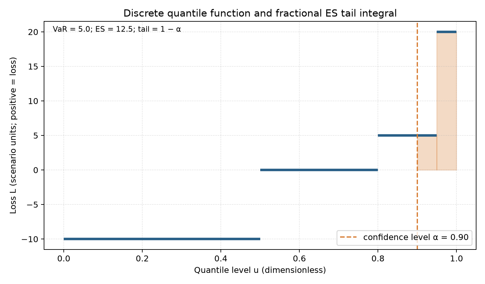
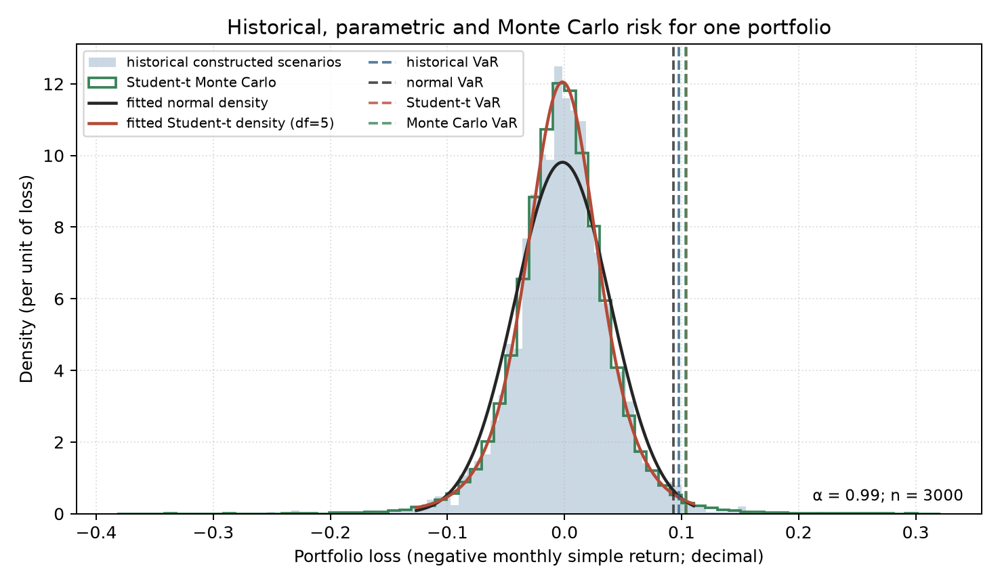
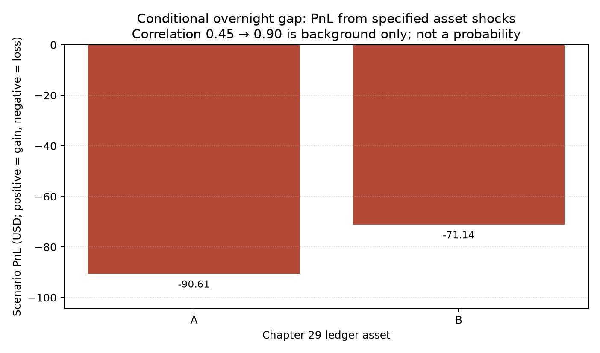
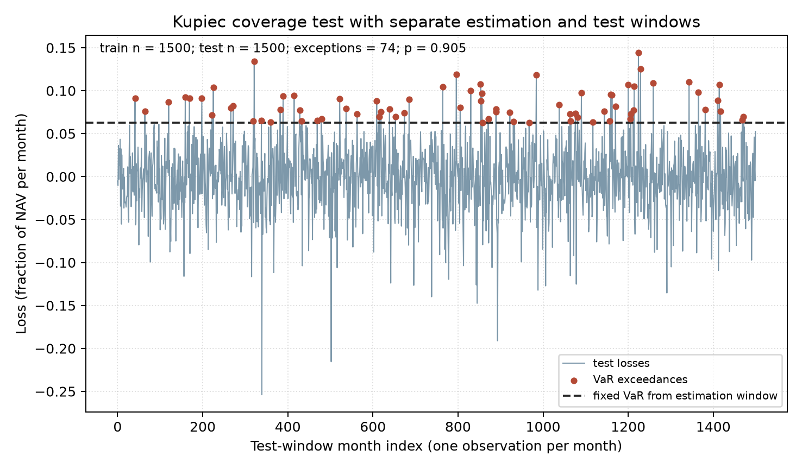

# 第33章 — 风险管理（Risk Management）

> 主线：把策略持仓变成带方向、单位、期限与条件的损失分布，找出损失由什么暴露产生、在什么情景下放大，并把风险约束传回下一次可执行的目标权重。
> 先修：第 15 章因子模型、第 18 章波动率、第 21 章组合暴露、第 29 章账本、第 30 章偏差、第 31 章验证、第 32 章推断；完成后你能定义 VaR 与 ES、复算离散尾部、区分不同风险来源、重估真实账本持仓、设置流动性与保证金约束，并正确解释一次 VaR 回测。

## 1. 本章目标

完成本章后，你应能从一个明确的持仓和收益频率出发，写出损失变量，并始终同时标注置信水平与持有期限；按分位数函数定义风险价值（Value-at-Risk，VaR），按分位积分和阈值原子概率定义预期尾部损失（Expected Shortfall，ES；原稿亦称预期损失，本章专指尾部均值，区别于信用风险的Expected Loss）；说明何时 ES 不等于严格尾部或包含阈值的条件均值；在同一组合上比较历史、正态、Student-t 与 Monte Carlo 估计；分开报告净暴露、总暴露、杠杆、集中度、因子暴露、可清算天数和保证金；将情景冲击施加到第 29 章的实际持仓；用训练窗之外的数据统计 VaR 超越并解释 Kupiec 无条件覆盖检验的能力边界；最后把风险限额转成第 29 章可以执行的下一期目标权重。

本章的完成标准不是记住一个“安全数字”。你应能从输入复算输出，指出参数来自何处，区分构造情景和经验数据，检查时间可得性，并说出指标不能回答的问题。正文算例数字都可以在 CLI 产物 ch33_results.json 中找到；每组算例后列出对应 JSON 键，便于逐项对账。

## 2. 为什么 Quant 需要它

第 29 章已经把目标权重转换成带有信号日期、延迟成交、费用、现金和持仓的净值账本。第 30 章说明，时间戳和成交假设写错时，净值可以在没有程序报错的情况下被抬高。第 31 章要求把模型选择和最终评估分开，第 32 章提醒我们不能把一条表现好的收益曲线直接当作未来表现的证据。本章承接这些结果，回答一个更具体的问题：已经生成的持仓，在一个明确的时间跨度内会损失多少？损失可能来自方向、集中、共同因子、尾部、流动性，还是融资约束？

研究者容易把风险简化成波动率，随后再乘以一个经验系数。这样做可能遗漏偏度、厚尾、跳跃、持仓集中、相关性变化、跳空、交易冲击和保证金。一个模型给出低 VaR，并不意味着极端损失轻微；两个组合有相同方差，也不意味着它们的 ES 或清算路径相同。风险管理也不能只留在报告里：如果压力情景损失超过限额，目标仓位要下降；而目标权重只能在信号产生后、允许的成交时点执行，不能回写到已经发生的价格上。

本章使用三类证据，不能混为一类。概率分布和参数模型是模型假设；固定输入和随机种子得到的模拟是可复现的教学构造；冻结行业收益是实际发布过的历史序列，但属于修订后回溯数据。本章没有把任何一种证据包装成完整风险答案。

## 3. 直觉

先只看一个离散损失变量。亏损记为正数，收益记为负损失。可能的结果是损失 −10、0、5、20，相应概率为 0.50、0.30、0.15、0.05。置信水平 \(\alpha\) 为 0.90。累积分布经过这些结果时依次达到 0.50、0.80、0.95、1.00，所以第一个使累积概率达到 \(\alpha\) 的损失是 5。这个值就是下侧经验定义下的 VaR。

ES 要回答更难的问题：最差的尾部区间平均损失有多大？尾部概率为 1−\(\alpha\)，即 0.10。阈值 5 本身占总概率质量 0.15，但最差尾部只需要其中 0.05；阈值 20 再贡献 0.05。尾部的加权平均是 (5×0.05+20×0.05)/0.10=12.5。直接计算严格超过 VaR 的条件均值只能得到 20；直接计算大于等于 VaR 的条件均值则把全部 5 的概率质量塞进分母，得到 8.75。两者都不是定义所需的 10% 尾部均值。

这个例子先给出本章的核心：VaR 是一个分位点，ES 是一段分位区间上的平均；分布在阈值处有原子概率时，必须只取阈值质量中构成尾部所需要的那一部分。CLI 把这组输入展开为 20 个等权观察，保存累积分布值、VaR、ES、严格阈值均值和包含阈值均值。完整的分位数阶梯与尾部面积见图 [ch33_discrete_quantile_es.png](../../figures/a6/ch33_discrete_quantile_es.png)。

JSON 对照：`pinned_discrete_case.loss_values`、`probabilities`、`alpha`、`scenario_count`、`cdf_at_var`、`var`、`es`、`strict_tail_conditional_mean`、`inclusive_tail_conditional_mean`。

## 4. 数学基础

令 \(V_t\) 表示时点 \(t\) 的组合市值，\(h\) 表示持有期限。货币损失定义为

\[
L_{t,h}=-(V_{t+h}-V_t).
\]

因此 \(L>0\) 表示亏损，\(L<0\) 表示盈利。若不直接使用货币，而用简单收益 \(R_{t,h}=(V_{t+h}-V_t)/V_t\)，就应明确写出损失收益 \(L^R_{t,h}=-R_{t,h}\)。货币损失的单位是账户计价货币；收益损失是无量纲比例。不要把一个 USD 数值和一个小数收益放在同一列比较。

本章计算都要同时注明 \(\alpha\) 和 \(h\)。例如“VaR 为 0.10”信息不够：读者仍不知道这是账户净值的 10%、USD 0.10，还是一个月或一天的损失。CLI 构造组合以一个月简单收益生成负收益损失；账本压力例的仓位以股数计，价格以 USD/股计，逐项冲击以同一声明的简单收益间隔计，成交发生在信号之后的下一个账本日期。实际应用应把这些频率和时点替换为策略真正交易的频率。

### 4.1 风险输入的量纲账

| 对象 | 单位或频率 | 代入前要固定的条件 |
| --- | --- | --- |
| $L_{t,h}$、货币VaR/ES | 账户货币，同一h | 正数为亏损，估值对象和持有期限相同 |
| $L^R=-R$、收益VaR/ES | 无量纲，同一h | 分母NAV明确；不能与货币值直接比较 |
| $\alpha$ | 无量纲置信水平 | 与h一起报告；99%日频不等于95%月频 |
| $q_i,P_i,r_i$ | 股、货币/股、无量纲 | $q_iP_ir_i$为货币PnL，损失另取负号 |
| $w_i=q_iP_i/NAV$、现金权重 | 无量纲 | 同一时点NAV归一，现金单列，不再除一次NAV |
| $ADV_i,\pi_i,D_i$ | 股/交易日、无量纲、交易日 | $\lvert q_i\rvert/(\pi_i ADV_i)$是固定容量近似 |

在NAV正且没有外部现金流的同一估值区间，$L_{t,h}=V_t L^R_{t,h}$；固定正数缩放下VaR和ES也乘 $V_t$。若净值分母或现金流定义不同，应先重建收益账，不能直接套这个转换。

记损失的累积分布函数为 \(F_L(\ell)=P(L\leq\ell)\)。在离散分布里，概率质量可能集中在单个损失点。分位数定义使用“至少达到”的条件，而不是线性插值。若样本含并列值，经验分位数也可能落在一个有质量的原子上。连续模型的分位点附近通常没有原子，但不能把连续性假设默默移植到离散账本或小样本经验分布上。

## 5. 正式定义

置信水平 \(\alpha\in(0,1)\) 下的 VaR 定义为损失分布的下侧分位数：

\[
\operatorname{VaR}_{\alpha}(L)=\inf\{\ell\in\mathbb R:F_L(\ell)\geq\alpha\}.
\]

这是一个损失阈值。它不描述阈值之后损失有多严重，也不表示这个损失“绝不会超过”。若某日损失超过 VaR，则发生一次超越；超越率用于回测时，只有在相应预测分布连续或对阈值原子采用了明确一致的随机化规则时，理论概率才直接等于 \(1-\alpha\)。

本章的 ES 定义为分位数函数在右尾置信区间上的平均：

\[
\operatorname{ES}_{\alpha}(L)=\frac{1}{1-\alpha}\int_{\alpha}^{1}\operatorname{VaR}_{u}(L)\,du.
\]

如果 \(v=\operatorname{VaR}_{\alpha}(L)\)，同一量也可以写为

\[
\operatorname{ES}_{\alpha}(L)=\frac{E[L\mathbf 1\{L>v\}]+v\,[P(L\leq v)-\alpha]}{1-\alpha}.
\]

右尾 ES 需要 \(L\) 的正部可积，即 \(E[L^+]<\infty\)，否则尾部均值可能不存在或为无穷。有限样本的有限值本身总有有限经验均值，但从有限样本推到总体 ES 仍依赖尾部假设和样本量。此处采用的分位积分和阈值原子修正与 Acerbi–Tasche 所讨论的定义相符；已读页码和符号转换记录在 [来源说明](source_notes.md)。

## 6. 推导

从分位积分看离散例子，分位数函数 \(u\mapsto\operatorname{VaR}_u\) 是阶梯函数。对尾部区间按损失值分段积分，再除以尾部长度 \(1-\alpha\)，即可得到 ES。对有质量点的分布，阈值处只积分实际覆盖的那段分位区间；因此不用额外假设阈值恰好落在概率网格边界。

再从概率质量看。严格超过阈值 \(v\) 的质量是 \(1-F_L(v)\)。尾部总质量需要 \(1-\alpha\)，阈值左侧和等于阈值的累计质量中有一部分不属于尾部。这个差额正是 \(F_L(v)-\alpha\)，它乘阈值 \(v\)，补齐所需尾部。把严格超过阈值的损失总贡献和这段阈值贡献相加，再除以尾部概率，便得到上节公式。若分布连续，\(P(L=v)=0\)，且在理想阈值下 \(F_L(v)=\alpha\)，修正项消失；若分布离散，修正项一般不能删掉。

对等权样本 \(L_1,\ldots,L_n\)，先排序 \(L_{(1)}\leq\cdots\leq L_{(n)}\)，令 \(k=\lceil n\alpha\rceil\)，经验 VaR 取 \(L_{(k)}\)。记 \(v=L_{(k)}\)，样本中严格大于 \(v\) 的损失和为 \(S_>\)，样本中小于等于 \(v\) 的个数为 \(m_{\leq}\)。则

数学中的上取整是在精确实数下定义的。实现时不要直接依赖浮点乘积 `alpha * n` 的上取整：`0.14 * 100` 会略大于14，而经验累积概率 `14 / 100` 已达到0.14。核心函数直接寻找首个满足 `k / n >= alpha` 的阶次，回归测试还检查紧邻0.14上方的概率应选择下一阶次。

\[
\widehat{\operatorname{ES}}_{\alpha}
=\frac{S_>/n+v(m_{\leq}/n-\alpha)}{1-\alpha}.
\]

这相当于对阈值处的样本质量作分数加权。实现时应先验证输入是非空有限实数向量，并验证 \(\alpha\) 严格位于 0 与 1 之间；否则排序、比例或分母没有目标意义。经验 ES 估计总体 ES 的收敛需要尾部可积和相应抽样条件；样本很少时，最坏观察的均值仍然噪声很大。Acerbi–Tasche 的 Proposition 4.1 讨论了独立同分布样本下尾部次序统计量平均的极限；这不消除有限样本误差，也不证明金融时间序列独立同分布。

### 6.1 连续模型的尾积分

对连续的 $L=\mu+sZ$、s>0，令z为Z的alpha分位点，则尾概率为1−alpha，
$$ES_\alpha=\frac1{1-\alpha}\int_z^\infty(\mu+sx)f_Z(x)dx=\mu+\frac{s}{1-\alpha}\int_z^\infty x f_Z(x)dx.$$
正态标准密度满足 $\phi'(x)=-x\phi(x)$，所以
$$\int_z^\infty x\phi(x)dx=[-\phi(x)]_z^\infty=\phi(z).$$

若 \(L\sim N(\mu,\sigma^2)\)，令 \(z_\alpha=\Phi^{-1}(\alpha)\)，则

\[
\operatorname{VaR}_{\alpha}=\mu+\sigma z_\alpha,\qquad
\operatorname{ES}_{\alpha}=\mu+\sigma\frac{\phi(z_\alpha)}{1-\alpha}.
\]

若改用位置0、尺度1（并非单位方差）的 Student-t 随机变量 \(T_\nu\)，其标准化密度为 \(f_\nu\)，分位点为 \(t_{\nu,\alpha}\)，用尺度 \(s\) 平移和缩放后，

\[
\operatorname{VaR}_{\alpha}=\mu+s t_{\nu,\alpha},\qquad
\operatorname{ES}_{\alpha}=\mu+s\frac{\nu+t_{\nu,\alpha}^2}{\nu-1}\frac{f_\nu(t_{\nu,\alpha})}{1-\alpha}.
\]

写 $f_\nu(x)=c_\nu(1+x^2/\nu)^{-(\nu+1)/2}$。对 $g(x)=(1+x^2/\nu)^{-(\nu-1)/2}$ 求导：
$$g'(x)=-\frac{\nu-1}{\nu}x(1+x^2/\nu)^{-(\nu+1)/2}.$$
当nu>1，g在正无穷趋于0，故
$$\int_z^\infty xf_\nu(x)dx=\frac{c_\nu\nu}{\nu-1}g(z)=\frac{\nu+z^2}{\nu-1}f_\nu(z).$$
代入连续尾积分即得上式；nu>1保证尾部均值可积。只有把输入sigma解释为标准差并匹配方差时才需nu>2，不能混同这两个条件。

Student-t 的均值和 ES 在自由度大于 1 时存在；方差仅在自由度大于 2 时有限。本章传入的是均值和标准差，因此实现要求 \(\nu>2\)，并用 \(s=\sigma\sqrt{(\nu-2)/\nu}\) 保持标准差一致。SciPy 的 loc、scale 参数描述位置和尺度；scale 本身不等于 Student-t 的标准差。不要把常见正态 ES 公式直接用于 t 分布。


### 6.2 Kupiec无条件覆盖：从似然到检验

令 $I_t=\mathbf1\{L_t>VaR_{t,\alpha}\}$，在原假设下假定这些指示独立同分布Bernoulli(q)，$q=1-\alpha\in(0,1)$。n期有x次超越，指定排序序列的似然为 $L(p)=p^x(1-p)^{n-x}$；若只看计数，则再乘二项系数，该系数在似然比中相消。

对0<x<n，$\ell'(p)=x/p-(n-x)/(1-p)=0$ 给出 $\hat p=x/n$；二阶导负，故是极大值。零次或全部超越时，最大值分别在p=0或1。比较固定q与自由p，
$$\Lambda=\frac{q^x(1-q)^{n-x}}{(x/n)^x(1-x/n)^{n-x}},$$
$$LR_{uc}=-2\log\Lambda=2\left[x\log\frac{x/n}{q}+(n-x)\log\frac{1-x/n}{1-q}\right].$$
用 $\lim_{u\downarrow0}u\log u=0$ 定义零次对数项。x=0时 $LR=-2n\log(1-q)$；x=n时 $LR=-2n\log q$，均有限。常用 $\chi^2_1$ 生存函数给的是渐近p值，少量超越/边界不保证精确小样本校准。独立Bernoulli、连续预测分布或原子随机化、阈值估计误差和重叠持有期都是应单独核对的条件；训练/测试分窗本身不证明独立性。正文1500期/74次、French1082期/5次及Loom250期/0次属于三个窗口。


## 7. 金融解释

组合风险不是一个数。令 \(w_i\) 是相对 NAV 的风险资产权重，则净暴露为 \(\sum_iw_i\)，总暴露为 \(\sum_i|w_i|\)。在没有其他负债的简化账本里，现金权重可以写成 \(1-\sum_iw_i\)。若用货币市值报告，净额与绝对总额各除以NAV得到净/总杠杆；这里已用NAV归一化权重，因此杠杆就是净权重和绝对权重之和，不能再除一次NAV。净暴露接近零只说明多空市场价值抵消，不表示没有持仓风险、融资成本或挤兑风险。

对单个市场因子，组合 beta 可写为 \(\beta_p=\sum_iw_i\beta_i\)。多因子暴露是 \(B^\top w\)，其中每行的因子载荷与资产对齐。美元中性条件是净美元暴露为零；beta 中性条件要求加权 beta 为零；行业中性要求每个行业的净权重符合约束。它们不是同一个条件。集中度可以用持仓在总风险资产中的归一化权重平方和 HHI，也可以报告最大风险资产占总风险暴露的比例。HHI 只描述权重分散，不代表资产之间相关性低。

杠杆还要连同融资规则读。现金收益、借券费、返佣、融资利率、抵押折扣、交易冲击和保证金会改变现金路径与可持有规模。示例账本明确把现金每期利率设为 0；借券费、返佣和超出现金利率的保证金融资没有建模。这个简化不能解释成真实融资成本为零。初始保证金是开仓时要求的资金，维持保证金是持仓继续存在时不能跌破的资金水平；参数若是构造值，必须明确标识，不能冒充券商规则。

压力情景是“如果指定条件发生，账面结果怎样”，不是“这种情况有多大概率”。对数量 \(q_i\)、当前标记价格 \(P_i\) 和简单收益冲击 \(r_i\)，逐项 PnL 为 \(q_iP_ir_i\)，组合损失为负的 PnL 总和。把多资产同时设置为逆向跳空，可构成共同冲击情景；改变情景依赖关系的假设不能让这组确定性 PnL 自动成为一个概率模型。若需要估计相关性带来的尾部概率，应另外指定联合分布并检验估计误差。

流动性可以先用一个透明近似：\(D_i=|q_i|/(\pi_i\,ADV_i)\)，其中 \(ADV_i\) 是每个交易日成交股数，参与率 \(\pi_i\) 是计划交易量占市场日均成交量的比例，\(D_i\) 的单位是交易日。这个公式假设每天都能按参与率成交，不建模排队、价格冲击、停牌和交易量内生性。它是容量筛查，不是成交保证。

## 8. Numerical Example

::: {.body-example title="完整例题：同组合的四种风险估计"}

下表先对同一个两资产组合使用历史、参数和模拟方法。输入为资产 A、B；权重 0.60、0.40；单月简单收益均值输入分别为 0.0015、0.0020；标准差输入分别为 0.04、0.06；构造相关系数 0.45；Student-t 自由度 5；历史构造样本量 3000；置信水平 0.99。历史与 Monte Carlo 有各自固定种子，故复跑同一版本会得到相同结果。这些数字来自 `same_portfolio_risk_methods` 和 `teaching_inputs.portfolio_dgp`，不是市场估计。

| 估计方法 | 均值损失 | 标准差 | VaR | ES |
| --- | ---: | ---: | ---: | ---: |
| 历史构造样本 | −0.00168209 | 0.04066389 | 0.09780078 | 0.12252880 |
| 正态参数模型 | −0.00168209 | 0.04066389 | 0.09291625 | 0.10669587 |
| Student-t 参数模型 | −0.00168209 | 0.04066389 | 0.10430684 | 0.13856101 |
| Student-t Monte Carlo | 由同一历史组合矩估计 | 同一标准差口径 | 0.10337409 | 0.13853132 |

对应的JSON键按表中行顺序为：

- `same_portfolio_risk_methods.historical`
- `same_portfolio_risk_methods.normal_fitted`
- `same_portfolio_risk_methods.student_t_fitted`
- `same_portfolio_risk_methods.monte_carlo`

模拟在同一损失均值和标准差下抽取 Student-t，样本 VaR 与 ES 接近参数 Student-t 结果；有限模拟样本与参数值不要求逐位一致。反例更关键：同一标准差下正态模型的 VaR 和 ES 都低于 t 模型。把正态标准差扩大到使正态 VaR 与 t VaR 相同，需要标准差 0.04556023，但扩大后的正态 ES 仍是 0.11974567，低于 t ES 0.13856101。由此可见，单纯放大正态波动率可以匹配一个分位点，却不能自动复制厚尾的尾部严重程度。图 [ch33_loss_model_comparison.png](../../figures/a6/ch33_loss_model_comparison.png) 显示了损失密度与 VaR 位置；横轴为每月简单收益的负值，纵轴为单位损失的密度。

:::

::: {.body-example title="完整例题：暴露、压力、退出与下一笔订单"}

下一步看暴露。构造目标权重 0.50 和 0.30，因子载荷分别为 A 的 Market 1.00、Value 0.40，B 的 Market 1.20、Value −0.20。市场 beta 暴露为 0.86，Market 因子暴露 0.86，Value 因子暴露 0.14。净与总杠杆都为 0.80，现金权重为 0.20。风险资产内的 HHI 是 0.53125，最大资产占总风险资产 0.625。另一个美元中性反例持有 0.50 的多头和 −0.50 的空头：净暴露为 0，总暴露为 1，beta 仍为 0.60；即使它们设为同一行业，行业净暴露抵消也不会消除 gross risk。数据均在 JSON 键 `exposures`。

接着把隔夜跳空作用于第 29 章账本。信号日期的净值为 USD 1088.2588，A 有 49.9201278 股、标记价格 USD 12.10/股；B 有 14.97603834 股、标记价格 USD 19.00/股。A 的情景简单收益为 −0.15，B 为 −0.25。A 的 PnL 是 −USD 90.6050，B 的 PnL 是 −USD 71.1362，合计条件损失 USD 161.7412，即当前 NAV 的 0.14862385。这里对的是已存在的数量和标记价，未用目标权重替代当前持仓。

同一个压力状态把依赖关系假设从 0.45 提高到 0.90，参与率设为 0.10，正常 ADV 为 A 每日 150 股、B 每日 60 股；压力 ADV 缩到正常的 0.25。按固定参与率公式，正常清算天数分别为 3.32800852 和 2.49600639 个交易日；压力下分别为 13.31203408 和 9.98402556。依赖关系值是构造的压力状态输入；确定性跳空 PnL 来自给定收益冲击，并没有通过一个估计相关矩阵生成概率。

初始/维持保证金率从构造的 0.55/0.35 提高到 0.85/0.75。压力后的总市值为 USD 726.8371，压力净值为 USD 926.5176；保证金要求增加，但这个例子的维持保证金余量仍为正 USD 381.3898，因此没有触发维持保证金追缴。不能把“未触发”写成“保证金安全”：这里的比率是教学设定，且没有建模盘中路径、跳空后追加保证金和被迫成交。

最后设条件跳空损失上限为当前 NAV 的 0.08。损失上限为 USD 87.0607，压力损失超过上限，因此按线性损失比例得到规模系数 0.5382716。目标权重从当前账面权重缩放为 A 0.29876543、B 0.14074074。通过第 29 章信号后隔一期成交的账本，执行日实际卖出 A 22.59777199 股、B 7.25352124 股，并承担相应费用；执行后权重与目标权重略有差异，因为价格、费用和成交时点都进入账本。下一步应按实际成交持仓重跑压力，而不是把“目标权重满足线性限额”当作已完成风险控制。完整输入和输出见 `ledger_stress_and_limit`，图 [ch33_ledger_stress.png](../../figures/a6/ch33_ledger_stress.png) 展示逐资产 USD PnL。

### 8.1 从风险触发到实际减仓的三个时刻

| 时刻 | 已知账本对象 | 风险判断或动作 |
| --- | --- | --- |
| 信号日t，尚未执行 | 实际股数q、标记价P、当前NAV | 算出USD161.7412条件损失及0.08NAV限额；生成缩放后目标 |
| 下一交易日允许的执行时点 | 目标权重、执行价、费用与可成交量 | 本例卖A22.59777199股、B7.25352124股；目标本身没有减少t时刻持仓 |
| 成交后重新标记 | 实际剩余股数、现金与新NAV | 重算暴露、退出时间、压力和保证金，再判断限额是否满足 |

该表沿用已保存账本结果，三个时刻不是三次新策略实验。固定冲击下仅按原标记价缩放的损失是线性的；价格移动、成本、拒绝或部分成交都会使实际风险偏离目标。0.45→0.90的构造相关状态没有进入这组固定 $qPr$ 算术，不能用它解释USD161.7412的数值来源。

:::

## 9. Python Implementation

核心函数在 [risk.py](../../src/quant_course/risk.py)，按用途分为：

- 分布与尾部：`empirical_var_es`、`normal_var_es`、`student_t_var_es`、`simulate_student_t_losses`。
- 重估与验证：`scenario_pnl`、`lagged_rolling_var`、`kupiec_pof`。
- 退出与融资：`liquidation_days`、`margin_requirements`。

本章 CLI 在 [ch33_risk_management.py](../../code/ch33_risk_management.py)，复用第29章账本、现有暴露报告函数和冻结French数据读取器。

默认读者从接受I3包根目录运行：

```sh
python run_notebook.py notebooks/ch33_risk_management.ipynb
```

I3的 `analyze(include_french=False)` 默认跳过French；Notebook fresh计算3000个构造历史观察与50000个Monte Carlo损失，写结果JSON并生成4图。它创建唯一 `runs/ch33_risk_management_<uuid>/`；I3 CLI使用自己的 `runs/cli_ch33_<uuid>/`。runner还保存执行副本、execution.json和失败状态到 `runs/execution_<stem>_<uuid>/`。因此不能把该Notebook称为不写实验文件的静态回放。本批只静态核入口，不执行完整Notebook/CLI。工作源 `code/ch33_risk_management.py` 的 `analyze()` 仍无include_french参数并总调用French，与I3包装不同；不能将两入口混称已完全同步。英语Notebook、装配和冷启动留BIL23。若另获运行授权，须指定新输出目录，不能覆盖冻结qa或图。

核心输入按函数分别检查。`scenario_pnl`（简单收益情景重估）拒绝非正价格和低于−100%的简单收益；经验损失向量和无界Student-t参数损失允许大于1，属于另一模型域，不对其硬裁剪。Student-t API按标准差输入要求nu>2。损失货币/比例、股数、USD/股、ADV股/交易日及持有期均需明确。相关测试入口是 `tests/test_ch33_risk.py` 和 `tests/test_ch33_workflow.py`；本批仅执行新显示小例的局部核验，历史完整workflow不重跑。

## 10. Visualization

本章 CLI 生成四张图，文件名由结果 JSON 的 `artifacts.figure_files` 给出。

### 离散分位数与 ES 尾部面积



横轴是无量纲分位水平 \(u\)，纵轴是场景损失单位；样本为正文固定的离散教学分布。阶梯表示分位函数，橙色区域只取置信阈值右侧的分位质量。可据此看出阈值 5 只贡献其满足尾部质量的那一部分。
### 同组合风险方法比较



横轴是组合每月简单收益的负值，纵轴是每单位损失的密度。样本包括构造历史损失和按拟合 Student-t 参数生成的 Monte Carlo 损失；曲线为同一组合拟合的正态与 Student-t 密度，竖虚线为四种方法的 VaR。观察尾部位置时要同时看 ES 表，密度图的横向范围不能证明模型外的尾部一定如何。
### 账本隔夜压力贡献



横轴为第 29 章教学账本资产，纵轴为 USD 情景 PnL，正数为收益、负数为损失。图内相关性文字是构造状态假设，不是事件概率。
### 分窗 VaR 回测



横轴为检验窗内月度观察序号，纵轴为 NAV 比例损失。VaR 水平只用前一段训练窗估计，红点显示严格超过阈值的观察。图注中的样本数、超越数与 p 值均由同一 JSON 结果生成。

图不能替代参数、样本范围、费用和时间戳说明；若需要改动输入，应使用新输出目录重新运行，避免静默覆盖已有图和数值。

## 11. Real Market Example

除构造样本外，CLI 读取项目中冻结的 Kenneth R. French Data Library 十行业月度价值加权组合。输入快照日期为 2026-10-05，样本从 1926-07 到 2026-08，共 1202 个月、十个行业组合；每个月对十个发布组合等权，使用简单月收益。第一个 120 个月（1926-07 至 1936-06）作为估计窗，余下 1082 个月（1936-07 至 2026-08）作为检验窗。训练期 95% VaR 为 0.14302，ES 为 0.20204833；检验期间有 5 次超过，Kupiec LR 统计量为 76.69493441，渐近 p 值为 1.995144691255254e−18。可复算字段见 JSON 的 `french_real_example`。

这是实际发布过、但现在按当前版本重修订的行业组合时间序列。它没有 point-in-time 版本、历史接收时间戳或投资者可交易成分组合的真实成交；月标签表示被衡量的日历区间，不代表当月收益在月末之前可知。数据也不是某个策略的交易账本。本例只能用于说明一套历史窗口 VaR 与检验窗超越计数在此序列上的行为，不能据此推导实时策略表现、交易能力或可交易回测结论。原始、抽取、处理行业数据以及 FF3 数据的六项 SHA-256 在 `french_real_example.sha256`，下载来源和转换记录在 data/manifests/french_industries_2026-10-05.json 与 FF3 manifest。下载和使用仍须遵守数据提供方条款；本章不把公开可下载等同于任意再分发许可。

## 12. Common Mistakes

**把正收益和正损失写反。** 组合收益为正意味着盈利，但本章的 \(L=-R\) 为负。若程序把组合收益直接传给“正数表示亏损”的 VaR 函数，亏损尾部方向会整体错位。账本 PnL 用 \(qPr\)，损失取负号；代码 `scenario_pnl` 返回的是货币 PnL，不是损失。

**把 VaR 当成最大损失，或把 ES 写成阈值条件均值。** VaR 不是保证上限。分布在阈值处有概率质量时，严格超过 VaR 和大于等于 VaR 的条件均值都不等于分位积分 ES。以下代码从结果 JSON 自动构造同一经验样本，打印正确值和两个错误替代值；它能从仓库根目录运行：

```python
import json
import sys
from pathlib import Path

import numpy as np

ROOT = Path.cwd()
sys.path.insert(0, str(ROOT / "src"))
from quant_course.risk import empirical_var_es

result = json.loads((ROOT / "qa/a6/codex_resume/ch33/results/ch33_results.json").read_text())
case = result["pinned_discrete_case"]
counts = np.rint(np.asarray(case["probabilities"]) * case["scenario_count"]).astype(int)
losses = np.repeat(case["loss_values"], counts)
var, es = empirical_var_es(losses, case["alpha"])
print(var, es, losses[losses > var].mean(), losses[losses >= var].mean())
```

输出分别是 VaR、分位积分 ES、严格尾均值和包含阈值的均值；它们的逐项结果在 `pinned_discrete_case`。实现错误通常不是排序本身，而是忽略了阈值点中只能取一部分概率质量。

**把高波动等同于厚尾。** 增加正态标准差会抬高所有尾部损失，但形状仍是正态。正文的方差匹配反例显示，即便把正态 VaR 拉到 Student-t VaR，正态 ES 仍偏低。报告模型时要写明分布、参数口径、估计窗和频率，不能只写“采用保守波动率”。

**把美元中性当成无风险，或把 gross 与 net 混成一个比例。** 多空市值可能抵消，但总敞口、beta、因子、行业、借券成本和挤兑风险仍存在。空头与多头在同一行业的净和为零，并不说明个别证券容易平仓。应同时报告有符号净额和绝对总量，并说明各自分母。

**把情景损失写成概率，把 ADV 公式写成执行保证。** 固定收益冲击只描述条件结果。相关性假设、跳空幅度和流动性折扣是构造输入；若未指定校准模型和事件频率，就不能声称“概率为某值”。

**把同一观察既用于估 VaR 又用于检查超越。** 这会让阈值适应已发生损失，产生向内看的偏差。固定历史 VaR 必须先用训练窗估值，再在后续独立检验窗数超越；滚动 VaR 在目标期 \(t\) 只能用目标期之前的回看数据，训练索引区间不含 \(t\)。

**把 POF 的不拒绝说成模型已被证明正确。** Kupiec 检验只检验无条件超越率是否与 \(q=1-\alpha\) 相容；它不识别超越是否成簇、尾部损失大小是否错估、预测是否稳定。自由度为 1 的卡方 p 值是渐近近似。零超越或少量超越时，似然比边界可以稳定计算，但小样本检验仍可能几乎没有识别能力。非拒绝不是准确性证明。

## 13. Quant Research Application

把风险工作放在研究流程里，首先冻结风险问题，而非先选统计包。写清研究组合、币种、损失符号、置信水平 \(\alpha\)、期限 \(h\)、资产范围、可用时点与要回答的决策。固定 VaR 是在某个训练窗里估计一个阈值，适合后续固定窗覆盖诊断；滚动历史 VaR 更接近逐期更新的预测，但每个预测都只能使用当时可用信息，计算和回测必须按目标时间向前移动。

其次检查收益输入和账本一致。可得时点应早于信号形成，信号形成早于成交；市场价格、公司行为、现金、费用、持仓数量和收益频率都要对齐。第 29 章账本的目标权重不等于当前实际权重，压力重估应取正确日期的实际股数和标记价。若组合有期权或非线性头寸，\(qPr\) 的线性冲击不足以刻画重新定价，必须用相应估值器逐情景重算。

然后安排互补但不同的问题：用净/总暴露、beta 和因子暴露定位风险源；用 VaR 报告给定置信水平的阈值；用 ES 观察尾部严重度；用集中度识别单一头寸支配；用 ADV 粗筛退出时间；用联合压力情景衡量条件下的账面损失；用保证金和融资假设检查现金约束。方法间差异不是让分析者挑最好看的结果，而是暴露模型风险的线索。厚尾参数模型更高的 ES，不等于它就是真实数据生成过程；历史样本给出的阈值，也不会自动覆盖从未出现的事件。

对模型回测，先分开估计窗和检验窗。示例用一段构造的月收益估 VaR，然后在不重叠的后续窗口统计严格超过次数。结果有 74 次超越，相对于原假设期望数 75 次，LR 统计量为 0.01409458、渐近 p 值为 0.9054967146341367。这只说明该特定检验窗内超越总数未提供强烈的无条件覆盖反证；它不证明尾部金额、独立性和稳定性正确。Kupiec 原文指出尾部验证功效有限；本章只采用 Bernoulli 次数似然，不照搬其关于检验性质的旧措辞。若业务关注成簇超越，需另设独立性检验并先核读相应原文和有限样本性质。

风险限额要落到下一期动作。示例中条件损失上限为当前 NAV 的 0.08，压力损失超过上限，故把当前仓位按线性情景损失比例缩小，再把目标送入账本按下一交易日价格成交。执行有一个账本间隔，并存在费用和价格差异；收盘实际权重不等于信号目标。研究报告应留存限额触发值、输入持仓、缩放系数、成交数量、费用和交易后复评结果。若成交成本使目标无法达到，或清算天数超过退出约束，需采用更保守的可成交目标，而不是只调整文字说明。

历史数据例使用 French 十行业发布组合，只用于方法演示。当前修订版的行业数据没有历史“何时收到”记录，训练与检验分窗也不能倒推投资者在早期实际能拿到现有版本。研究要作实时可交易结论时，需要 point-in-time 数据、资产构成和交易成本证据；这部分当前示例不提供。

### 13.1 零超越：点概率与检验p值分开

33-L04另设99%一日VaR与250个事先预测日。在独立且每天超越概率0.01的原假设下，$P(X=0)=0.99^{250}\approx0.08106$，这是恰零次超越的点概率。Kupiec的边界似然比为 $-500\log(0.99)\approx5.0252$，用渐近卡方一自由度校准得到p约0.025。两者使用不同统计量或拒绝域，8.1%不能直接称作任意双侧精确检验p值；精确检验须先明确单侧/双侧规则与离散端点。正文构造回测则为95%月频、1500期训练加1500期检验，不能与这道日频手算例混用。

## 14. Chapter Summary

风险报告应把“持仓是什么”“损失如何定义”“用什么信息估计”“在什么情景下重估”“阈值如何影响下一次交易”连成一条可复核链。先给方向、单位、置信水平和期限；再报告 VaR 与 ES，并在离散分布中保留阈值处的分数尾部权重；再拆分净/总杠杆、beta、因子、行业、集中、流动性、融资和保证金；随后用实际持仓而非理想目标做条件压力；接着用隔离的检验窗评估超越率；最后将限额转为可按信号与成交时间执行的目标，并按实际成交重评。

一个可读的风险句子至少包括：报告对象和时点、损失符号与单位、置信水平与期限、方法与训练数据、VaR 和 ES、主要因子与集中度、压力情景和其条件性质、流动性及保证金假设、样本外超越数和检验限制、限额触发后的目标与实际成交。只呈现 VaR 一个数，或只报告一个历史回测 p 值，均不足以描述策略可以承受的损失。

## 15. Exercises

**33-E01（离散阈值）** 使用 JSON 的 `pinned_discrete_case`。写出 VaR 所在损失点的累积分布，手算 ES 的两个尾部贡献，并解释为什么严格超越均值与包含阈值均值不是 ES。

**33-E02（分布形状）** 使用 `same_portfolio_risk_methods.variance_matched_tail_counterexample`。说明比较正态与 Student-t 时保持了什么，改变了什么；解释为什么提高正态标准差可以匹配 VaR，却仍无法匹配 ES。

**33-E03（暴露）** 使用 `exposures`。分别说明净杠杆、总杠杆、现金权重、Market 因子暴露、Value 因子暴露和 HHI 的含义。再用 `neutrality_counterexample` 说明净美元中性与 beta 中性、行业中性之间的区别。

**33-E04（压力与退出）** 使用 `ledger_stress_and_limit`。从股数和价格复算两个资产的情景 PnL；比较正常与压力 ADV 下的退出天数；解释保证金余量为正与风险限额已经触发并不矛盾。

**33-E05（覆盖检验）** 使用 `risk_model_backtest`。列出估计窗与检验窗边界，复述检验窗超越数、LR 和 p 值。说明不能由“未拒绝”推出的至少两项结论，并解释滚动预测第一期为何只能用其之前的观察。

## 16. Programming Exercises

**33-P01（分数尾部实现）** 从结果 JSON 读取离散输入，调用 `empirical_var_es`，动态重算 VaR、ES 和两个错误替代均值。用断言验证结果键。测试 NaN 与非法置信水平必须触发输入错误。

**33-P02（暴露复核）** 从 CLI 中读取 `teaching_inputs.ledger_stress` 和 JSON 输出，调用现有 `exposure_report`。复核净暴露、总暴露与 beta，并验证美元中性反例仍有非零 beta 和总暴露。

**33-P03（限额到成交）** 从 JSON 读取真实账本信号日股数、标记价、压力收益、NAV 和上限，调用 `scenario_pnl` 重算压力损失及限额缩放系数。复核 CLI 的执行卖单符号，并指出目标权重和成交后权重为何可以不同。

**33-P04（Kupiec 边界）** 从 `risk_model_backtest` 读取 \(\alpha\) 和检验期样本量，调用 `kupiec_pof` 重算已观测结果，并复算零次与全体超越的边界似然。所有统计量应有限；解释边界的 \(0\log 0=0\) 连续极限和 p 值仍属渐近校准。

**33-P05（滚动无泄漏）** 使用第18节给定的8项确定性小损失序列（不调用完整CLI或analyze），调用 `lagged_rolling_var`。核验第一项预测只接收紧邻目标期之前的窗口、预测长度正确，且任何预测都没有包含其目标期损失。

## 17. Challenge Problems

**33-C01（原子质量与风险测度）** 对 `pinned_discrete_case` 写出分位数阶梯函数并证明分数阈值公式等于分位积分。然后讨论 ES 的结论如何依赖损失正部可积。说明若把数据取负改成利润符号，哪个尾部积分和符号必须相应调整。

**33-C02（无条件覆盖的遗漏）** 以 `risk_model_backtest.test_window` 的超越数与样本量构造两种不同排序的超越序列，使其具有相同样本超越比例但呈现不同聚集程度。证明 Kupiec POF 对二者给出同一似然比统计量，并提出需要额外核读和实现的检验问题。

**33-C03（真实序列的可用时点）** 使用 `french_real_example` 写一个最小研究复核计划，分别标注现有数据可以支持和不能支持的结论。提出能够使历史模拟具有 point-in-time 解释所需的数据字段与成交证据，并给出继续、暂停或拒绝策略结论的标准。

## 18. Solutions / Solution Hints

**33-E01 解**：累积概率在损失 −10、0、5、20 处依次为 0.50、0.80、0.95、1.00，故达到 0.90 的最小损失点是 VaR=5。尾部区间长度为 0.10；阈值 5 的质量有 0.15，但在该尾部内只需取 0.05。超越阈值的 20 也有 0.05。因此 ES=(5×0.05+20×0.05)/0.10=12.5。严格大于 VaR 的条件均值只剩 20；大于等于 VaR 的均值把 0.15 的阈值质量全部纳入，得到 8.75。JSON 核验键是 `pinned_discrete_case`。

**33-E02 解**：比较维持了同一组合、同一损失均值和同一标准差，把尾部形状从正态换成自由度 5 的 Student-t。正态 VaR/ES 分别为 0.09291625 和 0.10669587，t 模型为 0.10430684 和 0.13856101。把正态标准差增至 0.04556023，可匹配 t 模型 VaR；相应正态 ES 只到 0.11974567，仍小于 t ES。原因是正态尾部衰减形状不变，单一尺度只能沿同一族分布伸缩，不能复制更厚尾分布的尾部形状。此反例不能证明所有样本都由 t 分布生成，构造规则和种子见 `teaching_inputs.portfolio_dgp`。

**33-E03 解**：目标风险权重净和与绝对值和均为 0.80，所以净杠杆和总杠杆分别为 0.80，现金权重为 0.20。Market 暴露计算为 \(0.50×1.00+0.30×1.20=0.86\)；Value 暴露为 \(0.50×0.40+0.30×(-0.20)=0.14\)。风险资产内的归一化权重平方和为 \((0.50/0.80)^2+(0.30/0.80)^2=0.53125\)。净值归一化权重不应与风险资产内部 HHI 混用。反例的权重和为零、绝对值和为 1，但 beta 为 0.60；同一行业的行业净额也为零。因此美元中性不能推出 beta 中性、总风险为零或流动性充足。

**33-E04 解**：PnL 公式为 \(q_iP_ir_i\)。A 的乘积为 \(49.9201278×12.1×(-0.15)=-90.6050\) USD；B 的乘积为 \(14.97603834×19×(-0.25)=-71.1362\) USD；负 PnL 对应合计条件损失 161.7412 USD。清算近似使用 \(D=|q|/(\text{参与率}×ADV)\)，正常与压力的天数差异见 `ledger_stress_and_limit.liquidity`；ADV 收缩会让退出周期按比例拉长。维持保证金余量为正是一个以构造比率和情景净值计算的局部结果，而损失上限单独比较条件损失和 NAV 比例；一个指标未超并不能抵消另一个限额已触发。此例维持保证金余量为正 381.3898 USD，风险限额仍被突破。

**33-E05 解**：训练窗索引为 [0,1500)，检验窗为 [1500,3000)，没有重叠。检验窗有 74 次超越；LR 为 0.01409458，p 值为 0.9054967146341367。非拒绝不证明尾部严重程度准确、不证明超越独立，也不证明分布稳定或极端压力已覆盖。滚动窗口目标索引为 250 时，允许的信息只有索引 0 到 249；将目标损失放进其自己的阈值估计会让预测利用未来结果，构成时间泄漏。所有字段位于 `risk_model_backtest`。

**33-P01 参考实现**（从仓库根目录执行）：

```python
import json
import sys
from pathlib import Path

import numpy as np

ROOT = Path.cwd()
sys.path.insert(0, str(ROOT / "src"))
from quant_course.risk import empirical_var_es

result = json.loads((ROOT / "qa/a6/codex_resume/ch33/results/ch33_results.json").read_text())
case = result["pinned_discrete_case"]
counts = np.rint(np.asarray(case["probabilities"]) * case["scenario_count"]).astype(int)
losses = np.repeat(case["loss_values"], counts)
var, es = empirical_var_es(losses, case["alpha"])
assert np.isclose(var, case["var"]) and np.isclose(es, case["es"])
assert losses[losses > var].mean() == case["strict_tail_conditional_mean"]
assert losses[losses >= var].mean() == case["inclusive_tail_conditional_mean"]
for bad_values, bad_alpha in (([np.nan], case["alpha"]), (losses, np.nan), (losses, 0.0), (losses, 1.0)):
    try:
        empirical_var_es(bad_values, bad_alpha)
    except (TypeError, ValueError):
        pass
    else:
        raise AssertionError("non-finite input must be rejected")
print(var, es)
```

断言覆盖原子阈值修正。测试另外验证 NaN 和 \(\alpha\) 边界被拒绝；不可把错误输入转换成静默填充值。

**33-P02 参考实现**（从仓库根目录执行）：

```python
import importlib.util
import json
from pathlib import Path

import numpy as np

ROOT = Path.cwd()
spec = importlib.util.spec_from_file_location("ch33", ROOT / "code/ch33_risk_management.py")
ch33 = importlib.util.module_from_spec(spec)
spec.loader.exec_module(ch33)
from quant_course.portfolio_construction import exposure_report

result = json.loads((ROOT / "qa/a6/codex_resume/ch33/results/ch33_results.json").read_text())
inputs = ch33.INPUTS["ledger_stress"]
weights = np.asarray(inputs["initial_target_weights"])
report = exposure_report(weights, inputs["betas"], inputs["sectors"])
saved = result["exposures"]
assert report.net == saved["net_exposure"]
assert report.gross == saved["gross_exposure"]
assert report.beta == saved["market_beta"]
neutral = saved["neutrality_counterexample"]
nw = np.asarray(inputs["neutrality_example_weights"], dtype=float)
nb = np.asarray(inputs["neutrality_example_betas"], dtype=float)
assert np.array_equal(nw, [0.5, -0.5]) and np.array_equal(nb, [1.5, 0.3])
net, gross, beta = float(nw.sum()), float(np.abs(nw).sum()), float(nw @ nb)
assert net == 0 and gross == 1 and np.isclose(beta, 0.6)
assert np.isclose(net, neutral["net_leverage_on_nav"])
assert np.isclose(gross, neutral["gross_leverage_on_nav"])
assert np.isclose(beta, neutral["beta"])
print(saved["factor_exposures"], saved["concentration_hhi_within_gross_risk_assets"])
```

此复核从已存在的暴露接口计算，不新增引擎；行业、beta 和 HHI 仍须分别解释。

**33-P03 参考实现**（从仓库根目录执行）：

```python
import json
import sys
from pathlib import Path

ROOT = Path.cwd()
sys.path.insert(0, str(ROOT / "src"))
from quant_course.risk import scenario_pnl

result = json.loads((ROOT / "qa/a6/codex_resume/ch33/results/ch33_results.json").read_text())
case = result["ledger_stress_and_limit"]
names = list(case["positions_at_signal_shares"])
pnl = scenario_pnl(
    [case["positions_at_signal_shares"][a] for a in names],
    [case["mark_prices_at_signal_currency_per_share"][a] for a in names],
    [case["overnight_gap_simple_returns"][a] for a in names],
)
loss = -float(pnl.sum())
risk = case["risk_limit"]
scale = risk["loss_cap_currency"] / loss
assert round(loss, 4) == case["conditional_stress_loss_currency"]
assert round(scale, 7) == risk["scale_factor"]
assert all(fill["quantity"] < 0 for fill in risk["actual_execution_fills"])
print(loss, scale, risk["target_weights_after_limit"], risk["actual_close_weights_after_execution"])
```

卖单数量为负。先按信号日的实际持仓股数、当前标记价和给定收益冲击计算当前压力损失，再用损失上限除以该损失求缩放系数，并据此生成新目标权重。随后成交的股数、执行价格、费用与时间间隔共同影响交易后权重，因此成交后权重可能偏离信号目标。

**33-P04 参考实现**（从仓库根目录执行）：

```python
import json
import sys
from pathlib import Path

ROOT = Path.cwd()
sys.path.insert(0, str(ROOT / "src"))
from quant_course.risk import kupiec_pof

result = json.loads((ROOT / "qa/a6/codex_resume/ch33/results/ch33_results.json").read_text())
backtest = result["risk_model_backtest"]
test = backtest["test_window"]
calculated = kupiec_pof(test["realized_exceedances"], test["observations"], backtest["alpha"])
for count in backtest["boundary_count_checks"].values():
    if isinstance(count, dict):
        edge = kupiec_pof(count["exceedances"], count["n_obs"], backtest["alpha"])
        assert edge["lr_uc"] == count["lr_uc"]
        assert edge["p_value"] == count["p_value"]
assert abs(calculated["lr_uc"] - test["lr_uc"]) < 1e-8
assert calculated["p_value"] == test["p_value"]
print(calculated)
```

kupiec_pof 对 \(x=0\) 或 \(x=n\) 的零次对数项用 \(0\log0=0\) 的连续似然极限处理，避免对零取对数。边界计数可以给出有限 LR，但渐近卡方 p 值在少量超越时仍不应解释成精确小样本概率。本例全部1500次超越时，卡方生存函数在双精度下输出0.0，这是数值下溢，不是精确零概率。

**33-P05 参考实现**（局部确定性输入，不调用完整analyze）：

```python
import numpy as np
from quant_course.risk import lagged_rolling_var

# 定义小构造器，替代完整3000观察/MC/French研究入口。
def constructed_losses():
    return np.array([0.0, 0.2, -0.1, 0.4, 0.1, 0.3, -0.2, 0.5])

losses = constructed_losses()
window, alpha = 3, 0.75
actual = lagged_rolling_var(losses, window, alpha)
expected = []
for t in range(window, len(losses)):
    past = sorted(float(v) for v in losses[t-window:t])
    # 独立次序统计量选择，不调用empirical_var_es重复实现。
    k = next(k for k in range(1, window+1) if k/window >= alpha)
    expected.append(past[k-1])
    changed = losses.copy()
    changed[t:] += 10.0
    altered = lagged_rolling_var(changed, window, alpha)
    np.testing.assert_array_equal(altered[:t-window+1], actual[:t-window+1])
np.testing.assert_allclose(actual, expected, rtol=0, atol=1e-14)
np.testing.assert_allclose(actual, [0.2, 0.4, 0.4, 0.4, 0.3], rtol=0, atol=1e-14)
assert len(actual) == len(losses)-window
assert expected[0] == max(losses[:3])
print(actual)
```

返回第j项对应目标位置t=window+j；每次独立只用[t−window,t)窗口。改变t及其后的损失不改变到t为止的预测。本例覆盖明确有限窗口，不证明任意数据/特征通道无泄漏；真实缺月日历仍须另定义合法月历。原题保留“确定性构造输入”目的，此处提供显式最小输入，避免调用会触发French与Monte Carlo的完整CLI。

**33-C01 参考论证**：经验分布的分位函数在每个概率质量区间保持常数。尾部积分把严格阈值上方的每段矩形面积相加，再加上阈值点右侧所覆盖的那一段面积；用阈值点值乘 \(F(v)-\alpha\) 正好得到第二项。除以尾部长度即为 ES 定义。因此原子点的分数权重不是修补经验，而是离散概率分位积分的直接结果。推广到总体需要右尾可积 \(E[L^+]<\infty\)。如改为利润 $X=-L$，用利润分位函数q_X，有
$$ES_\alpha(L)=-\frac1{1-\alpha}\int_0^{1-\alpha}q_X(u)du.$$
原子端点处，lower-quantile取负需要对应一侧约定，不能逐点直接等同；积分端点的零测度不改变这个ES等式。参考 Acerbi–Tasche 的 Definition 2.6、Proposition 3.2 和 Proposition 4.1（已读范围见来源说明）。

**33-C02 参考论证**：从检验窗构造两个长度为 JSON 中 `test_window.observations` 的 0/1 序列；二者都含 `test_window.realized_exceedances` 个 1，一个把 1 分散在全窗，一个把 1 连续放在一起。两序列的样本比例 \(x/n\) 相同。Kupiec POF 的似然只取决于总数 \(x\) 和样本量 \(n\)，所以两序列的 LR 和 p 值完全相同，不能区分聚集。独立性问题需要条件转移或其他序列检验；在引入前应核读原始方法、约束假设、零计数处理和有限样本性质。POF 的不拒绝不能替代独立性检验。

**33-C03 参考论证**：现有数据可支持对当前快照所含的发布月度行业回报进行样本切分、组合化和超越计数；不能支持历史时点的可得性、当时成分、执行价格、容量、费用、可交易策略收益或未来风险。point-in-time 复核至少需要每一版本的发布日期与接收时间、修订前后值、字段口径、发布日期时区、历史行业成员和权重、信号可得时点、下单/成交记录以及费用和市场容量证据。若版本不可追溯，应暂停实时结论；若仍以当前修订值回填信号，则拒绝把它称为无泄漏历史部署证据。此题不要求研究结论一定为正；评分应奖励对“描述历史序列”和“可交易部署”两种问题的明确区分。

## 19. Further Reading

- `Must Know`：Acerbi 与 Tasche，*On the Coherence of Expected Shortfall*，历史作者记录阅读 Definition 2.6、Proposition 3.2、式 (3.3) 和 Proposition 4.1 相关页。用途是理解分位积分和离散阈值处的 ES 定义；阅读范围不是全文。
- `Should Know`：Kupiec，*Techniques for Verifying the Accuracy of Risk Measurement Models*，FEDS 95-24，历史作者记录阅读单日监测、失败计数似然、二项似然以及历史模拟估计误差所对应的选页。用途是理解无条件覆盖检验的设定和尾部验证功效边界；应牢记这是 FEDS 讨论材料，所读不是期刊论文全文。
- **Advanced（未核读）**：Christoffersen 条件覆盖与超越独立性方法。正式使用其检验前，应核读原文并说明模型假设、校准和边界计数处理。
- `Optional`：SciPy scipy.stats.t 官方文档。用途是查 ppf、pdf、rvs、loc 和 scale 的接口语义；它不是 ES 理论推导来源。
- Basel 市场风险资本规则与监管 backtesting 指引在本次写作中**未核读**，正文不提出资本合规或监管阈值结论。

## 20. References

- `[AT2002-v5]` Carlo Acerbi and Dirk Tasche, “On the Coherence of Expected Shortfall,” arXiv:cond-mat/0104295v5, 2002. <https://arxiv.org/pdf/cond-mat/0104295v5>. 本章引用范围：离散尾部原子修正、分位积分、尾部样本平均的相关定义与论证；局部核读，具体页码见 [source_notes.md](source_notes.md#opened-source-documents)。
- `[KUPIEC1995-FEDS95-24]` Paul H. Kupiec, “Techniques for Verifying the Accuracy of Risk Measurement Models,” Finance and Economics Discussion Series 95-24, Federal Reserve Board, cover May 1995; interior title page April 1995. <https://fraser.stlouisfed.org/files/docs/publications/bog_feds/feds_1995-024.pdf>. 本章只采用所读选页中的监测设定和计数 likelihood，不把原文所有论断照搬为一般结论。
- `[SCIPY-T]` SciPy v1.18.0 Manual, scipy.stats.t. <https://docs.scipy.org/doc/scipy/reference/generated/scipy.stats.t.html>. 本章只据此确认 Student-t 分布 API 与位置/尺度参数化。
- `[FRENCH-FROZEN]` Kenneth R. French Data Library, 10 Industry Portfolios, value-weighted monthly block; FF3 risk-free series. Industry data: <https://mba.tuck.dartmouth.edu/pages/faculty/ken.french/ftp/10_Industry_Portfolios_CSV.zip>; details: <https://mba.tuck.dartmouth.edu/pages/faculty/ken.french/Data_Library/det_10_ind_port.html>. 课程冻结快照、下载时间、授权说明、处理字段和校验值见对应 data/manifests JSON；其历史值为当前修订版本。
- `[A6-33-PLAN]` 项目本地冻结计划 `qa/a6/claude/plan.md` 与 `A6_CONTRACT.md` 的第 33 章合同条款。用于课程接口、符号和教学边界，不作为外部实证证据。

以上每个公式或经验结果对应的实际读取范围、方法用途与限制集中记录在 [来源说明](source_notes.md)。
