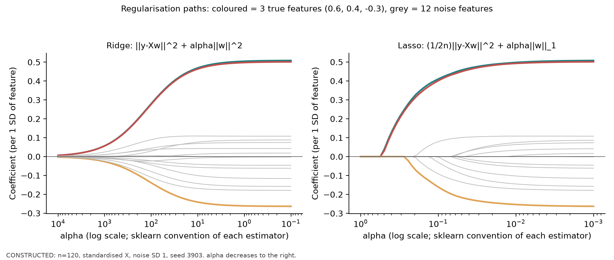
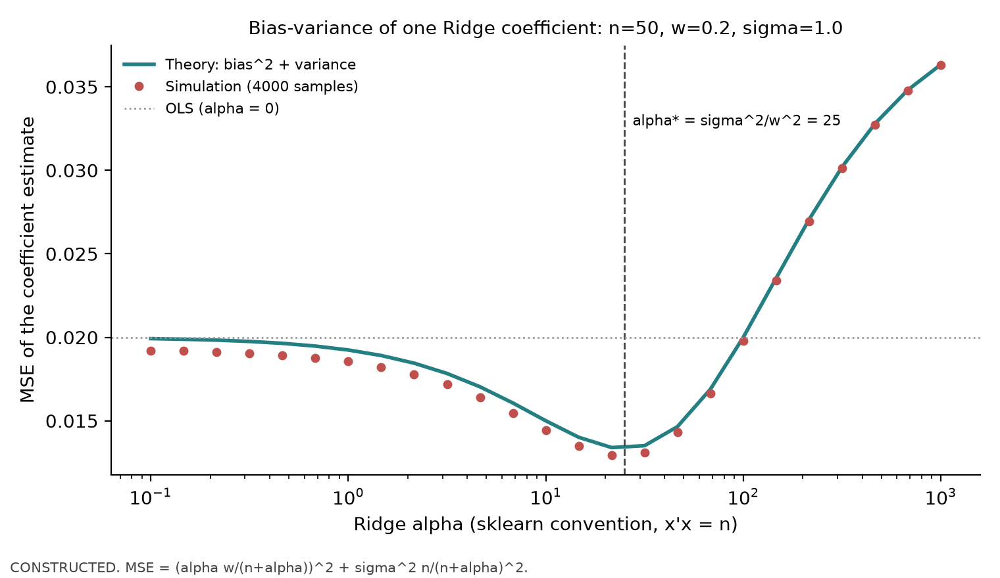

# 第39章 正则化线性模型（Regularized Linear Models）

> 历史展示沿用A8-R1冻结结果，旧A8-A接受版本保留；本章不重训、不补造历史预测。主线：特征多、信号弱时，OLS 的系数方差会吞掉样本外表现；Ridge、Lasso、Elastic Net 用可控的偏差换方差，但正则强度必须在训练内选，结果必须与零预测和训练均值比较，并在成本后评价。
> 先修：第8章回归（OLS、标准化、软件中的正则化入门）、第38章管线。完成后你能：写出 scikit-learn 中三种估计器的目标函数与缩放约定；在正交设计下手算四个估计量；推导 Ridge 单系数的偏差、方差与最优强度；解释 L1/L2 的几何与共线性下的行为；在第38章管线上比较六个模型的预测指标与成本后组合结果。

## 1. 本章目标

1. 写出 OLS、Ridge、Lasso、Elastic Net 的目标函数，说明 scikit-learn 1.9.1 中 Ridge 不除以 $2n$、Lasso 与 Elastic Net 除以 $2n$ 的约定，以及截距不受惩罚。
2. 在 $X^\top X=nI$ 的正交设计下，手算四个估计量；用代码核对。
3. 推导 Ridge 的闭式解、奇异值收缩因子，以及单系数的偏差、方差、均方误差和最优强度 $\alpha^\ast=\sigma^2/w^2$。
4. 推导 Lasso 软阈值与 Elastic Net 的正交解，用几何说明 L1 产生零系数、L2 不主动产生稀疏解。
5. 说明标准化为何必须在训练内拟合，且决定了“惩罚同等对待每个特征”是否成立。
6. 解释共线性下 OLS 的符号翻转、Ridge 的平分、Lasso 的二选一，以及系数不能直接解释为因果。
7. 用第38章的日期 walk-forward 与训练内调参，在“噪声特征多于有效信号”的构造面板上比较零预测、训练均值、OLS、Ridge、Lasso、Elastic Net 的样本外与成本后表现。

完成条件：第15–17节可独立完成；能追溯第8–10节冻结输入与输出，并解释第9节新运行与冻结回放的身份边界；本批不运行或重训。

## 2. 为什么 Quant 需要它

截面选股模型常常有几十到几百个候选特征，其中真正有用的只有少数几个，而且很弱。在固定设计、条件零均值误差等假设下，满秩OLS系数无偏，但可有很大的方差；当特征多、样本有效信息少（第37章：重叠标签、低信噪比）时，这些方差直接变成样本外误差。Gu、Kelly、Xiu（2020）在美国个股月度数据上报告：用全部特征的 OLS 样本外 $R^2$ 为 $-3.46\%$，只用三个变量的 OLS 为 0.16%，弹性网为 0.11%（见第11节与第20节的核读位置）。正则化不是让模型更“聪明”，而是让它少犯由噪声带来的错。

第8章已经在单序列上演示了训练内的正则化选择。本章补上三件事：目标函数的精确缩放（不同软件的 $\alpha$ 不能互换）；偏差—方差的定量推导；在面板管线里与基准和成本一起评价。

## 3. 直觉

一个只有两个特征、四个观测的例子：

$$
X=\begin{pmatrix}1&1\\1&-1\\-1&1\\-1&-1\end{pmatrix},\qquad y=\begin{pmatrix}3\\1\\-1\\-3\end{pmatrix}.
$$

两列均值为 0、总体标准差为 1、彼此正交，$X^\top X=4I$。OLS 系数为 $(2,1)$。

- Ridge 把两个系数按同一比例往 0 拉：$\alpha=4$ 时变成 $(1,0.5)$。
- Lasso 把两个系数各减去同一个量，减到 0 就停：$\alpha=1.5$ 时变成 $(0.5,0)$，第二个特征被删掉。
- Elastic Net 先减再按比例拉：$\alpha=1$、L1 比例 0.5 时变成 $(1,1/3)$。

“按比例拉”与“减去固定量”是 L2 与 L1 惩罚的区别，第6节推导。简化的边界：真实特征不正交，系数之间互相影响，闭式解只在正交时这么简单；但这个例子里每个数都能用 scikit-learn 原样复现（第9节）。

## 4. 数学基础

| 符号 | 含义 | 维度/单位 |
|---|---|---|
| $n$ | 训练样本行数 | — |
| $X\in\mathbb R^{n\times p}$ | 已在训练集上中心化并标准化的特征矩阵 | 每列单位为“训练集 1 个标准差” |
| $y\in\mathbb R^n$ | 已中心化的标签 | 小数收益 |
| $w\in\mathbb R^p$ | 系数 | 每单位标准化特征对应的收益（小数） |
| $\alpha\ge0$ | 正则强度（scikit-learn 记号） | 依估计器而异，见下 |
| $\rho\in(0,1)$ | Elastic Net 的 L1 比例（scikit-learn 的 `l1_ratio`） | — |
| $X=UDV^\top$ | 奇异值分解，$d_j$ 为奇异值 | — |
| $z=X^\top y/n$ | 正交设计下每个特征与标签的样本协方差 | 收益单位 |

截距：先在训练集上把 $X$ 与 $y$ 中心化，截距等于训练均值，不受惩罚。scikit-learn 在 `fit_intercept=True` 时做同样的事。先修：第8章 OLS 正规方程与投影，第9章凸优化中的次梯度（Lasso 推导用到）。

## 5. 正式定义

**OLS（普通最小二乘）。** $\hat w^{\text{OLS}}=\arg\min_w\|y-Xw\|_2^2$。任意有限设计矩阵都有最小二乘解，秩亏时系数一般不唯一，但训练投影唯一。$X^\top X$ 可逆是唯一系数与普通逆公式的条件（满列秩；中心化含截距设计还须留足自由度）。系数无偏另需固定设计/条件零均值误差等统计假设。

**Ridge（岭回归）。** scikit-learn 1.9.1：

$$
\hat w^{\text{R}}=\arg\min_w\;\|y-Xw\|_2^2+\alpha\|w\|_2^2 .
$$

目标中的残差平方和**不除以** $n$。引入 L2 惩罚，是为了在 $X^\top X$ 病态或 $p$ 较大时稳定系数。

**Lasso（最小绝对收缩与选择算子）。** scikit-learn 1.9.1：

$$
\hat w^{\text{L}}=\arg\min_w\;\frac1{2n}\|y-Xw\|_2^2+\alpha\|w\|_1 .
$$

残差平方和除以 $2n$。L1 惩罚能把系数压到恰好为 0，起特征选择作用。

**Elastic Net（弹性网）。** scikit-learn 1.9.1：

$$
\hat w^{\text{EN}}=\arg\min_w\;\frac1{2n}\|y-Xw\|_2^2+\alpha\rho\|w\|_1+\frac{\alpha(1-\rho)}2\|w\|_2^2 .
$$

它同时有选择（L1）和稳定（L2）作用，用于特征相关、又希望稀疏的情形。

**缩放约定的后果。** 把 Ridge 写成与 Lasso 同样的形式：$\|y-Xw\|^2+\alpha\|w\|^2=2n\big[\frac1{2n}\|y-Xw\|^2+\frac{\alpha}{2n}\|w\|^2\big]$。若另一软件写成 $\frac1{2n}\|y-Xw\|^2+\frac\lambda2\|w\|^2$，则 $\lambda/2=\alpha/(2n)$，即 $\lambda=\alpha/n$。同一个数值 $\alpha=1$ 在 Ridge 和 Lasso 中强度完全不同；训练样本数 $n$ 变了，Ridge 的同一个 $\alpha$ 的相对强度也变了。比较不同软件（如 glmnet）或不同样本长度时必须换算，不能照搬。

**正则化路径（regularization path）。** 把 $\alpha$ 从大到小取一组值，得到系数随 $\alpha$ 的变化曲线。坐标下降法沿 $\alpha$ 递减的网格求解，并用上一个 $\alpha$ 的解作为下一个的初值（热启动，Friedman、Hastie、Tibshirani 2010，侦察报告核读）。

**标准化（scaling）。** 用训练集的均值 $\mu_j$ 和标准差 $s_j$ 把特征变成 $(x_j-\mu_j)/s_j$。正则化惩罚 $\|w\|$ 依赖系数的单位，所以只有在标准化后，“惩罚同等对待每个特征”才有意义。$\mu,s$ 必须只在训练行上估计（第38章 Pipeline）。

### 尺度怎样进入惩罚：把系数换回原单位

令原特征为$x$、原单位斜率为$b$，训练标准差组成可逆对角矩阵$S$。标准化特征$u=S^{-1}(x-\mu)$的系数为$w$，由$w^\top u=b^\top(x-\mu)$得$b=S^{-1}w$、$w=Sb$；截距吸收中心化，不受惩罚。于是相同预测对应的标准化惩罚为

$$
\|w\|_2^2=\sum_j s_j^2b_j^2,\qquad
\|w\|_1=\sum_j s_j|b_j|.
$$

它惩罚的是“变动一个训练标准差的预测贡献”，不是把不同单位的原斜率直接等额相加。若不标准化，把$x_2$的记录单位放大100倍，为保同一预测就需把$b_2$除以100；其L2惩罚变为原来的$1/10^4$，L1惩罚变为$1/100$。标准化后$s_2$同时乘100，$s_2b_2$不变，单位变化才抵消。$s_j=0$的常数列不能按这个可逆证明处理，应按实际预处理规则处置。

还要检查标签单位。本章$y$是小数收益，标准化$x$无量纲，$w$仍是收益单位；Ridge的$\alpha$在此约定下无量纲，Lasso的$\alpha$有收益单位。Elastic Net共用一个数值$\alpha$控制L1和L2，必须固定标签单位理解，不能给它一个同时适合两项的物理单位。若$y$乘$c>0$且要求预测、系数也乘$c$：Ridge维持同一$\alpha$；Lasso需$\alpha'=c\alpha$；Elastic Net需同时保持$\alpha'\rho'=c\alpha\rho$和$\alpha'(1-\rho')=\alpha(1-\rho)$，故

$$
\alpha'=\alpha[(1-\rho)+c\rho],\qquad
\rho'=\frac{c\rho}{(1-\rho)+c\rho}.
$$

推导只需把变换后的目标除以$c^2$：残差项复原，L1项多一个$1/c$，L2项不变。固定$\rho$后仅机械地把EN的$\alpha$乘100不会同时保住两项；小数收益与百分数收益必须连同网格一起登记。这是目标函数的单位换算，不是本批重新调参。

**偏差—方差（bias-variance）。** 估计量 $\hat w$ 的均方误差 $E\|\hat w-w\|^2=\|E\hat w-w\|^2+\operatorname{tr}\operatorname{Var}(\hat w)$。正则化增加第一项、减少第二项。

**嵌套调参（nested tuning）。** $\alpha$（以及 $\rho$）只用外层训练行内的日期 walk-forward 选择，外层测试只评价一次（第38章）。

**基准（baseline）。** 零预测与训练均值预测，用同一折、同一组合规则和同一成本评价（第37章）。

**稀疏（sparsity）与共线性（collinearity）。** 稀疏指许多系数恰好为 0；共线性指特征之间高度相关，$X^\top X$ 的最小特征值接近 0。

## 6. 推导

### 6.1 OLS 与 Ridge 的闭式解

对 Ridge 目标求梯度并令其为 0：

$$
\nabla_w\big(\|y-Xw\|^2+\alpha\|w\|^2\big)=-2X^\top(y-Xw)+2\alpha w=0\;\Rightarrow\;\hat w^{\text{R}}=(X^\top X+\alpha I)^{-1}X^\top y .
$$

$\alpha>0$ 时 $X^\top X+\alpha I$ 正定，解唯一且总存在，即使 $p>n$。$\alpha=0$ 的优化问题是OLS；仅普通逆公式需要可逆，秩亏时可用伪逆选一个最小范数解。

**正交设计**（$X^\top X=nI$）：$\hat w^{\text{OLS}}=X^\top y/n=z$，$\hat w^{\text{R}}=X^\top y/(n+\alpha)=\frac{n}{n+\alpha}z$。每个系数乘以同一个收缩因子 $n/(n+\alpha)$。第3节例子：$n=4$、$z=(2,1)$、$\alpha=4$，因子 $1/2$，得 $(1,0.5)$。

**一般设计的奇异值形式**：代入 $X=UDV^\top$，

$$
X\hat w^{\text{R}}=\sum_{j}u_j\frac{d_j^2}{d_j^2+\alpha}u_j^\top y .
$$

推导：若用秩 $r$ 的紧SVD $X=U_rD_rV_r^\top$，$V_r$没有覆盖全部右空间，因此对 $\alpha>0$ 必须写

$$
(X^\top X+\alpha I)^{-1}=V_r(D_r^2+\alpha I_r)^{-1}V_r^\top+\frac{I-V_rV_r^\top}{\alpha}.
$$

后一项作用于零空间；左乘 $X$ 后为0，故帽矩阵仍为 $U_rD_r(D_r^2+\alpha I_r)^{-1}D_rU_r^\top$。也可用完整右奇异基并补零奇异值，但不能把紧SVD第一项单独称作整个逆矩阵。Ridge 对拟合值沿每个主成分方向 $u_j$ 乘 $d_j^2/(d_j^2+\alpha)$：方差小的方向（$d_j$ 小）收缩最多。共线时最小的 $d_j$ 很小，正是 OLS 不稳定的方向（ESL 第3.4.1节，侦察报告核读）。

### 6.2 Ridge 单系数的偏差、方差与最优强度

**假设**：一个标准化特征，$x^\top x=n$，$\sum x=0$；$y=wx+\varepsilon$，$\varepsilon_i$ 独立、均值 0、方差 $\sigma^2$。

$$
\hat w=\frac{x^\top y}{n+\alpha}=\frac{nw+x^\top\varepsilon}{n+\alpha}.
$$

期望：$E\hat w=\frac{n}{n+\alpha}w$，偏差 $-\frac{\alpha}{n+\alpha}w$。方差：$\operatorname{Var}(x^\top\varepsilon)=\sigma^2x^\top x=n\sigma^2$，故 $\operatorname{Var}\hat w=\frac{n\sigma^2}{(n+\alpha)^2}$。均方误差

$$
\mathrm{MSE}(\alpha)=\frac{\alpha^2w^2+n\sigma^2}{(n+\alpha)^2}.
$$

对 $\alpha$ 求导，分子为 $2\alpha w^2(n+\alpha)^2-2(n+\alpha)(\alpha^2w^2+n\sigma^2)$。令其为 0 并除以 $2(n+\alpha)$：$\alpha w^2(n+\alpha)-\alpha^2w^2-n\sigma^2=0$，即 $n\alpha w^2=n\sigma^2$，

$$
\alpha^\ast=\frac{\sigma^2}{w^2},\qquad \mathrm{MSE}(\alpha^\ast)=\frac{\sigma^2}{n+\alpha^\ast}<\frac{\sigma^2}{n}=\mathrm{MSE}(0).
$$

最后一步：把 $\alpha^\ast w^2=\sigma^2$ 代入，分子 $\alpha^\ast\sigma^2+n\sigma^2=\sigma^2(n+\alpha^\ast)$。

此最优式与严格改进要求 $w\ne0,\sigma^2>0$。若 $w=0,\sigma^2>0$，MSE为 $n\sigma^2/(n+\alpha)^2$，随强度增大趋于0，无有限 $\sigma^2/w^2$ 最优值；若噪声为0而信号非零，最优是 $\alpha=0$。期望、方差均条件于固定设计。

**金融含义**：信号越弱（$w$ 小）、噪声越大（$\sigma$ 大），最优收缩越强。$\alpha^\ast$ 与 $n$ 无关，是 scikit-learn Ridge 不除以 $n$ 的约定带来的。**不能用的情形**：$w$ 与 $\sigma$ 未知，$\alpha^\ast$ 不能直接算，只能在训练内用验证误差选；多特征且相关时没有这样简单的式子。

### 6.3 Lasso 的软阈值

**假设**：正交设计 $X^\top X=nI$，scikit-learn 的 $\frac1{2n}$ 约定。

展开目标：$\frac1{2n}\|y-Xw\|^2=\frac1{2n}y^\top y-z^\top w+\frac12\|w\|^2$（用 $X^\top X=nI$、$z=X^\top y/n$）。目标按坐标分离，每个系数解

$$
\min_{w_j}\;\tfrac12w_j^2-z_jw_j+\alpha|w_j| .
$$

次梯度条件 $0\in w_j-z_j+\alpha\,\partial|w_j|$。若 $w_j>0$，$w_j=z_j-\alpha$，要求 $z_j>\alpha$；若 $w_j<0$，$w_j=z_j+\alpha$，要求 $z_j<-\alpha$；若 $w_j=0$，需 $|z_j|\le\alpha$。合起来

$$
\hat w^{\text{L}}_j=S(z_j,\alpha)=\operatorname{sign}(z_j)\,(|z_j|-\alpha)_+ .
$$

第3节例子：$z=(2,1)$、$\alpha=1.5$：$S(2,1.5)=0.5$，$S(1,1.5)=0$。

### 6.4 Elastic Net 的正交解

同样展开，每个坐标

$$
\min_{w_j}\;\tfrac12w_j^2-z_jw_j+\alpha\rho|w_j|+\tfrac{\alpha(1-\rho)}2w_j^2
=\min_{w_j}\;\tfrac{1+\alpha(1-\rho)}2w_j^2-z_jw_j+\alpha\rho|w_j| .
$$

与 6.3 节同样的次梯度论证（二次项系数换成 $1+\alpha(1-\rho)$）得

$$
\hat w^{\text{EN}}_j=\frac{S(z_j,\alpha\rho)}{1+\alpha(1-\rho)} .
$$

先软阈值、再按比例收缩。例子：$\alpha=1$、$\rho=0.5$：$S(z,0.5)/1.5=(1.5/1.5,\;0.5/1.5)=(1,1/3)$。

### 6.5 几何：为什么 L1 产生零系数

Lasso 与约束形式等价：在 $\|w\|_1\le t$ 内最小化残差平方和（某个 $t$ 对应某个 $\alpha$，由拉格朗日对偶）。残差平方和的等高线是以 OLS 解为中心的椭圆。L1 约束域是菱形，有角点落在坐标轴上；从OLS中心向外扩大残差等高线，第一次碰到菱形时，常常碰在角点，此时某些坐标恰好为 0。L2 约束域是圆，没有角点，切点一般不在坐标轴上，所以Ridge不主动产生稀疏支持；这不表示任何坐标永不为0，正交设计 $z_j=0$ 时Ridge该坐标也为0。若OLS已在约束域内，约束不活跃。一般设计沿奇异方向收缩，不保证每个原始坐标绝对值都减小或排序恒定（ESL 图3.11 的经典示意，侦察报告核读）。正交情形里，这个几何就是 6.3 节的软阈值：$|z_j|\le\alpha$ 的坐标落进角点。

### 6.6 共线性：OLS、Ridge、Lasso 各自怎么做

**假设**：两个标准化特征，样本相关系数 $r$，$X^\top X/n=\begin{pmatrix}1&r\\r&1\end{pmatrix}$。

OLS 方差：$\operatorname{Var}(\hat w)=\sigma^2(X^\top X)^{-1}=\frac{\sigma^2}{n(1-r^2)}\begin{pmatrix}1&-r\\-r&1\end{pmatrix}$。每个系数的方差是正交情形的 $1/(1-r^2)$ 倍（方差膨胀因子 VIF）；$r=0.99$ 时 VIF $=50.25$，标准差放大约 7.1 倍。这里稳定的和方向与平分叙述针对 $r\approx+1$；若 $r\approx-1$，和/差的稳定方向互换。两个系数估计的相关为 $-r$：一个高估，另一个就低估，常常一正一负，但和 $\hat w_1+\hat w_2$ 估计得很准。

Ridge：$X^\top X$ 的特征值为 $n(1+r)$ 与 $n(1-r)$，特征向量 $(1,1)/\sqrt2$ 与 $(1,-1)/\sqrt2$。Ridge 在“和”方向收缩 $\frac{n(1+r)}{n(1+r)+\alpha}$，在“差”方向收缩 $\frac{n(1-r)}{n(1-r)+\alpha}$，后者小得多。所以 Ridge 几乎把差压成 0，两个系数趋于相等（平分）。两个特征完全相同（$r=1$）时，Ridge 解恰好平分（证明留作 39-C01）。

Lasso：固定 $(w_1,w_2)$ 的和且二者同号时，L1 惩罚 $|w_1|+|w_2|$ 不变。只有两列完全相同（$r=1$）、拟合也只依赖系数和时，整个目标才对分配无差别（39-C01）。高度但非完全相关时，残差项仍区别分配；设计满列秩时平方损失严格凸，Lasso 解唯一，但选择可能随样本变化，并有只留一个变量的倾向。例如 $X^\top X/n$ 的对角为1、非对角为0.99，$y=X_1+X_2$；$(1,1)$ 与 $(2,0)$ 的L1范数同为2，后者的归一化平方损失却高0.01。Zou、Hastie（2005）定理1 给出 Elastic Net 的“分组效应”：相关越高、L2 部分越大，两个系数越接近（侦察报告核读；本章只用其结论，第8.3节的模拟独立展示）。

### 6.7 当 $\alpha$ 很大时 Ridge 预测什么

当 $\alpha$ 相对 $X^\top X$ 的全部特征值足够大、截面投影方向非退化时，$\alpha\to\infty$ 有 $(X^\top X+\alpha I)^{-1}\approx I/\alpha$，$\hat w^{\text{R}}\approx X^\top y/\alpha$，预测 $\hat y=\bar y+x^\top X^\top y/\alpha$。预测的**水平**趋于训练均值，**截面差异**的方向趋于 $X^\top y$（每个特征与标签的样本协方差），只是整体缩小 $1/\alpha$。所以纯秩组合在秩稳定时可有近似相同的仓位；实际去均值/L1归一连续权重在主导项相同且非零时也趋于同一极限，但有限 $\alpha=10^5$ 与 $10^7$ 是否接近取决于实际特征值，不能无条件保证；MSE即使在排序不变时仍惩罚幅度与校准错误。低信噪比时，更强收缩可能降低估计噪声；网格边界是否最优须由实际内层验证判断，不能由极限推出水平误差占主导。收缩预测也不会消除真实标签的截面误差。例如三资产 $y=(-0.01,0,0.01)$、$p=(-0.02,0,0.02)$，预测为 $ap$、$a>0$：均值均为0，水平误差为0，Spearman IC恒为1，但截面SSE为 $2(0.01-0.02a)^2$，在 $a=0.5$ 为0、$a=1$ 为0.0002。这说明MSE与IC可偏好不同强度；第8.4节常选最大 $\alpha$ 是实际验证结果，不能只凭该结果认定误差来源。

## 7. 金融解释

**系数不是因果效应。** 标准化系数 $w_j$ 的含义是：在其他特征不变、在训练样本的联合分布里，特征 $j$ 每高 1 个训练标准差，标签的线性预测高 $w_j$。它不说明“提高这个特征会提高收益”：特征可能只是未纳入变量的代理；共线时其他特征“不变”的情形在数据里几乎不存在；正则化又按惩罚把系数往 0 拉，系数大小还取决于 $\alpha$。第8.3节的模拟中，两个特征真实系数都是 1，OLS 在 41.8% 的样本里给出一正一负的符号。

**为什么零系数不等于“无用”。** Lasso 把系数压到 0，可能因为特征真的无关，也可能因为它和另一个被选中的特征高度相关，或者信号弱于当前 $\alpha$。第8.4节中 Lasso 在 12 个折里有 5 个折一个特征都不选，这些折的组合空仓。

**正则化与组合。** 美元中性只消掉共同水平，实际连续权重还看去均值预测的相对幅度。共同正比例缩放会在L1归一后抵消；一般Ridge不是给全部原系数统一乘一个因子，可能改变排序与权重；Lasso 删除特征，会改变排序；OLS 在噪声特征上的大系数会把噪声加进排序。所以预测层的 $R^2_{\text{OS}}$ 差异很小时，组合层仍可能有差异，反过来也一样。

**成本把差距拉开。** 每 5 日调仓的组合年换手约 14–24 倍（第8.4节）。单边 10 个基点的成本每年吃掉约 1.4%–2.4% 的收益。换手低的模型在成本后占便宜。

## 8. Numerical Example

### 8.1 手算四个估计量（教学构造）

$X$、$y$ 如第3节。$n=4$，$X^\top y=(8,4)$，$z=(2,1)$。

| 估计量 | 公式 | 结果 |
|---|---|---|
| OLS | $z$ | $(2,\;1)$ |
| Ridge，$\alpha=4$ | $\frac{n}{n+\alpha}z=\frac48z$ | $(1,\;0.5)$ |
| Lasso，$\alpha=1.5$ | $S(z,1.5)$ | $(0.5,\;0)$ |
| Elastic Net，$\alpha=1,\rho=0.5$ | $S(z,0.5)/(1+0.5)$ | $(1,\;0.3333)$ |

scikit-learn 1.9.1 拟合结果与闭式解的最大差 $2.2\times10^{-16}$；对这个 $X$，`StandardScaler` 是恒等变换。

### 8.2 偏差与方差

$n=50$，$w=0.2$，$\sigma=1$。$\alpha^\ast=\sigma^2/w^2=25$。OLS：$\mathrm{MSE}=\sigma^2/n=0.02$。$\alpha^\ast$ 处：偏差 $-\frac{25}{75}\times0.2=-0.0667$，偏差平方 0.004444；方差 $50/75^2=0.008889$；合计 0.013333，比 OLS 低三分之一。4,000 次模拟的均方误差与公式曲线重合（图39-2）。

### 8.3 共线性模拟

$n=40$，两个特征相关 0.99，真实系数 $(1,1)$，噪声标准差 1，500 次重复（种子 3902）：

| 方法 | 系数均值 | 系数标准差 | 一个系数为 0 的比例 | 出现负号的比例 |
|---|---|---|---|---|
| OLS | (0.967, 0.982) | (1.211, 1.216) | 0 | 41.8% |
| Ridge，$\alpha=10$ | (0.866, 0.865) | (0.127, 0.126) | 0 | 0 |
| Lasso，$\alpha=0.1$ | (0.932, 0.920) | (0.745, 0.751) | 44.8% | 0 |

VIF $=1/(1-0.99^2)=50.25$。OLS 平均接近真实值（无偏）但单次结果符号不可靠；Ridge 有偏（约 0.87）而稳定；Lasso 近一半样本只保留一个特征。

### 8.4 噪声特征多于有效信号的面板

构造面板（种子 3904）：40 只资产、1,260 日；3 个真实特征（日预期收益载荷 0.04%、0.02%、0.01% 每单位）、40 个噪声特征、3 个价格特征，共 46 个特征。$\ell=1$，$h=5$；扩张窗日期 walk-forward，首个训练窗 504 日，测试块 63 日，12 折（首个拟合时点 2016-12-08）；内层 2 个 63 日验证块。网格：Ridge $\alpha\in\{10^2,\dots,10^7\}$；Lasso $\alpha\in\{3\times10^{-3},10^{-3},3\times10^{-4},10^{-4},3\times10^{-5}\}$；Elastic Net $\alpha\in\{3\times10^{-3},10^{-3},3\times10^{-4},10^{-4}\}\times\rho\in\{0.2,0.5,0.8\}$。组合：截面去均值、毛暴露 1、每 5 个信号日调仓、下一收盘成交、比例成本单边 0 或 10 个基点；NAV 逐日记账；初始 100 万。

| 模型 | $R^2_{\text{OS}}$ 相对零 | 相对训练均值 | IC 均值（自身有效日） | 自身有效日 / 候选标签日 | 成本前总收益 / 夏普 | 成本后总收益 / 夏普 | 年换手 | 成本后最大回撤 |
|---|---|---|---|---|---|---|---|---|
| 零预测 | 0 | +0.070% | — | 0/750 | 0 / — | 0 / — | 0 | 0 |
| 训练均值 | −0.070% | 0 | — | 0/750 | 0 / — | 0 / — | 0 | 0 |
| OLS | −0.699% | −0.629% | 0.0316 | 750/750 | +34.51% / 1.62 | +25.08% / 1.23 | 24.2 | −4.43% |
| Ridge | −0.001% | +0.069% | 0.0349 | 750/750 | +37.31% / 1.71 | +27.67% / 1.33 | 24.2 | −5.41% |
| Lasso | −0.037% | +0.033% | 0.0380 | 441/750 | +20.83% / 1.37 | +15.91% / 1.08 | 13.9 | −4.18% |
| Elastic Net | +0.025% | +0.095% | 0.0499 | 624/750 | +41.49% / 2.08 | +33.64% / 1.75 | 19.0 | −5.27% |

**日期与推断展示（A8-R1）**：上表IC是各模型自身有效日的冻结摘要均值，不是统一日期集上的排名。候选标签日期为750；Ridge有效750，Lasso441，Elastic Net624。零预测与训练均值是常数，IC未定义，不能以0充当观测IC。缺少第39章冻结逐行预测，Ridge–Lasso及Ridge–Elastic Net的共同日期、两方配对均值/均值差、逐日缺失成因均**未能复算**；有效日期少于750只能从摘要确认，不能由P06另一个实验的行数据补出。旧折记录支持部分Lasso折全零，但不等于已独立证明每个缺失日期的原因。

**先问在哪些日期取平均。** 对模型$m$定义$D_m=\{d:\mathrm{IC}_{m,d}\text{有定义}\}$，自身均值为$|D_m|^{-1}\sum_{d\in D_m}\mathrm{IC}_{m,d}$。若与Ridge配对，令$D_{mR}=D_m\cap D_R$，两方都限制到$D_{mR}$：

$$
\Delta_{mR}=\frac1{|D_{mR}|}\sum_{d\in D_{mR}}(\mathrm{IC}_{m,d}-\mathrm{IC}_{R,d}).
$$

共同集为空时该量未定义。先做交集、再做差，才是在同一市场日期比较。一个独立构造小例：Ridge在日期1、2、3的IC为0.1、0.9、0.2，模型m只在日期1、3有IC 0.2、0.3。自身均值分别为0.4与0.25，表面上m较低；共同集为{1,3}，Ridge均值0.15、m均值0.25，配对差反而为+0.10。这个例子只说明日期选择会改变问题，没有补出本章750/441/624日的任何历史配对数值。P06冻结行可展示P06自己的交集操作，不能充当本章的行记录。

旧共享实现先删除缺失IC，再按剩余观察下标计算NW(4)。第4个观察滞后可能跨越多于4个交易日，不能称为“四交易日HAC”。新候选撤下原表t值及其显著性判断，旧摘要/PDF仍保留历史t。此处没有新日历感知HAC估计，也不把未能复算写成已证明错误。若将来要重估，须另立协议及保有逐行冻结数据。


（测试期 750 个信号日、756 个日收益；夏普为年化、无风险利率 0。）

读表要点：

1. OLS 的 $R^2_{\text{OS}}$ 最差（$-0.70\%$），比训练均值还差；它的 IC 仍为正，组合仍赚钱。预测层与组合层给出不同排名。
2. Ridge 的 $R^2_{\text{OS}}$ 几乎等于 0：它在 4 个折里选了 $\alpha=10^7$、2 个折 $10^6$、6 个折 $10^5$（6.7 节机制）。预测的水平接近训练均值，排序信息仍在，自身IC均值与组合表现高于OLS；共同日期逐行对齐未复算。
3. Lasso 在 12 个折中有 5 个折（第1–4、12 折）选出的 $\alpha=3\times10^{-3}$ 把全部系数压成 0，预测为常数、组合空仓；其余折保留 4–25 个特征。它的 IC 只在 441 个有截面差异的日期上计算，不能把自身均值直接当成与Ridge在750日上的配对比较；Elastic Net自身也仅624日；总收益低主要来自空仓的折。
4. Elastic Net在该冻结账本上的成本后夏普为1.75；IC 0.050是自身624个有效日的描述均值，不支持未复算共同日期上的IC优势。这是**本构造**下的结果：真实特征彼此独立、信号强度由作者设定。它不说明 Elastic Net 在真实数据上更好。
5. 成本：单边 10 个基点使年化平均收益减少约 2.4 个百分点（OLS 10.08% → 7.65%），与年换手 24.2 倍 × 0.1% 一致。

## 9. Python Implementation

脚本 `code/ch39_regularized_models.py`；共享模块 `quant_course.ml_pipeline`（第38章），其中 `backtest_predictions` 把预测接到第29章账本 `run_backtest`（滞后成交、比例费用、$N$ 个收益对应 $N+1$ 个财富点）。历史工程入口可重训，但不能用重训补造3904历史缺失逐行预测；工作脚本也可能覆盖原图。接受I3默认Notebook只回放冻结摘要与展示图，不运行历史训练。本批未运行CLI/Notebook/API，Notebook英文语言层留BIL23。

种子 3901–3904；输出 `ch39_results.json` 与三张图。频率日频；signal_time 为收盘 $D_k$，trade_time 为 $D_{k+1}$ 收盘，标签区间 5 日；缺失值策略同第38章。借券费、融资利差、冲击与容量未建模。测试：`tests/test_ch39_regularized.py`（手算估计量、$\alpha^\ast$、软阈值）与 `tests/test_ml_pipeline.py`。

手算例子：

```python
import numpy as np
from sklearn.linear_model import ElasticNet, Lasso, LinearRegression, Ridge

X = np.array([[1.0, 1.0], [1.0, -1.0], [-1.0, 1.0], [-1.0, -1.0]])
y = np.array([3.0, 1.0, -1.0, -3.0])
for name, model in [("ols", LinearRegression()), ("ridge a=4", Ridge(alpha=4.0)),
                    ("lasso a=1.5", Lasso(alpha=1.5)), ("enet a=1 r=0.5", ElasticNet(alpha=1.0, l1_ratio=0.5))]:
    print(name, np.round(model.fit(X, y).coef_, 4))
```

预期：`ols [2. 1.]`、`ridge a=4 [1.  0.5]`、`lasso a=1.5 [0.5 0. ]`、`enet a=1 r=0.5 [1.     0.3333]`。

单系数偏差—方差：

```python
import numpy as np
n, w, sigma = 50, 0.2, 1.0
mse = lambda a: (a * w / (n + a)) ** 2 + sigma ** 2 * n / (n + a) ** 2
grid = np.logspace(-1, 3, 4001)
print(round(grid[np.argmin(mse(grid))], 2), round(mse(sigma ** 2 / w ** 2), 6), sigma ** 2 / n)
```

预期：`25.0 0.013333 0.02`。

## 10. Visualization



图39-1：横轴为 $\alpha$（对数刻度，向右递减，各自按 scikit-learn 约定），纵轴为每个标准化特征的系数。彩色线为三个真实特征（真实系数 0.6、0.4、−0.3），灰线为 12 个噪声特征；$n=120$，种子 3903。观察点：Ridge 的系数随 $\alpha$ 平滑地离开 0，所有特征同时进入；Lasso 的系数逐个从 0 进入，前两个真实特征在 $\alpha\approx0.50$ 进入，第三个在 $0.25$，部分噪声特征在 0.19 以下进入。$\alpha\to0$ 时前两个真实特征的估计都约为 0.50（真实值 0.6 与 0.4）：$n=120$ 时单个 OLS 系数的标准误约 $1/\sqrt{120}\approx0.09$，这是抽样误差。构造数据。



图39-2：横轴为 Ridge $\alpha$（对数刻度），纵轴为系数估计的均方误差；实线为公式 $(\alpha w/(n+\alpha))^2+\sigma^2n/(n+\alpha)^2$，点为 4,000 次模拟，点线为 OLS，竖虚线为 $\alpha^\ast=25$。观察点：曲线在 $\alpha^\ast$ 处最低（0.0133），$\alpha$ 过大时偏差主导，均方误差回升并超过 OLS。构造数据，种子 3901。


图39-3：三个面板的横轴均为六个模型。左：相对零预测的 $R^2_{\text{OS}}$（%）；中：逐日Spearman IC自身有效日均值，逐柱标n；零与训练均值IC未定义，留空并标n=0。日期不同，不作配对优势推断；右：美元中性组合的年化夏普，浅色为成本前、深色为单边10个基点后；零与训练均值空仓，夏普未定义，留空。观察点：左图与中、右两图的排名不一致；成本把所有模型的夏普压低 0.3–0.4。构造面板，种子 3904。

## 11. Real Market Example

本章不报告真实市场的实测数字：Project6 真实数据为 blocked（见 `projects/project06/data_manifest.json`）。作者实际读到的文献结果（Gu、Kelly、Xiu 2020，表1，第2250页；美国个股、月度、成本前）：全部特征的 OLS $R^2_{\text{OS}}=-3.46\%$，只用规模、价值、动量的 OLS 为 0.16%，带 Huber 损失的弹性网为 0.11%，且基准为零预测（式19，第2249页）。这与第8.4节的方向一致：无约束 OLS 在多特征下样本外很差，正则化或降维把 $R^2$ 拉回到小的正数。数量级与本书构造不可比：样本、频率、特征、基准都不同。

获得数据后，应在同一份冻结的股票池与样本期上，按第8.4节表格的全部列报告六个模型，并加报各折的 $\alpha$、Lasso 支持集大小与系数符号稳定性。

## 12. Common Mistakes

### 12.1 不标准化就正则化

```python
import numpy as np
from sklearn.linear_model import Lasso
rng = np.random.default_rng(0)
x1 = rng.normal(size=200); x2 = rng.normal(size=200)
y = 0.5 * x1 + 0.5 * x2 + rng.normal(size=200)
X_pct = np.column_stack([x1, x2 * 100])           # x2 recorded in percent instead of decimal
coef = Lasso(alpha=0.3).fit(X_pct, y).coef_        # WRONG: penalty treats a 1-unit change equally
print(np.round(coef, 4))
X_std = (X_pct - X_pct.mean(0)) / X_pct.std(0)    # fit mean/sd on training rows only
print(np.round(Lasso(alpha=0.3).fit(X_std, y).coef_, 4))
```

本书运行输出 `[0.2408 0.0054]` 与 `[0.2243 0.2528]`。错误：同一个信息，用百分数记录的 $x_2$ 系数缩小 100 倍，惩罚却不变。第一行里 $x_2$ 的系数 0.0054 换回小数单位是 0.54，几乎没被收缩，$x_1$ 却从约 0.5 压到 0.24；标准化后两者受到同样的收缩（第二行）。修复：在训练行上标准化后再正则化（Pipeline）；报告系数时注明是“每个训练标准差”。

### 12.2 直接比较 Ridge 与 Lasso 的 $\alpha$

错误：“两个模型都用 $\alpha=1$，所以惩罚相同。”原因：scikit-learn Ridge 不除以 $2n$，Lasso 除以（第5节）。修复：各自独立调参；比较时换算成同一约定。

### 12.3 用全样本选 $\alpha$

错误：`RidgeCV` 或 `LassoCV` 在全部样本上用随机 K 折选 $\alpha$，再在其中某段报告样本外。原因：选择用了测试期，且随机折带来重叠泄漏（第38章）。修复：外层日期 walk-forward，内层日期 walk-forward 选参（`ml_pipeline.fit_select_predict`）。

### 12.4 把系数当因果或当重要性排名

错误：“Lasso 选中了特征 A、没选 B，所以 A 驱动收益，B 无关。”原因：共线下 Lasso 二选一（第8.3节 44.8% 的样本只留一个），选择随样本与 $\alpha$ 变化（第8.4节各折支持集 0–25 个）。修复：报告各折的选择频率与符号稳定性；因果问题需要另外的识别设计。

### 12.5 只看 $R^2$ 或只看夏普

错误：选 $R^2_{\text{OS}}$ 最高的模型，或只报告成本前夏普。原因：第8.4节中 Ridge 的 $R^2$ 接近 0，却在组合层优于 OLS；成本使夏普下降 0.3–0.4。修复：同时报告两层指标与两个成本水平，并对照零与训练均值。

### 12.6 在面板上用 `StandardScaler` 拟合全部日期

错误：先 `StandardScaler().fit(X_all)`，再 walk-forward。训练设计满列秩时对 OLS 预测无影响；有精确共线（秩亏）时 OLS 的新点预测也会随标准化改变（第38章 6.3 节反例：2.20 对 1.75）；对 Ridge、Lasso 通常可能影响：惩罚基于全样本标准差，含测试期信息。修复：Pipeline 内拟合。

## 13. Quant Research Application

**假设**：在收盘可得的 46 个特征中，少数几个对未来 5 日截面收益有弱预测力；正则化线性模型在成本后能产生正的美元中性收益，且优于零预测与训练均值。

**设计（冻结）**：第8.4节的面板、折、网格、组合规则与成本；每折记录选出的超参数与 Lasso 支持集。

**检验**：预测层（两种基准的$R^2_{\text{OS}}$、各模型自身有效日与共同配对日期上的IC；本历史案例t值停止推断展示）、组合层（成本前后收益、夏普、换手、回撤）、稳定性（逐折 IC 与选择）、两档成本。

**反证条件**：成本后夏普不为正；预先冻结共同日期的配对检验后未见优势（本章历史逐行数据缺失，未能评估）；结论只在少数折成立；最优模型随网格边界变化（如 Ridge 总选到最大 $\alpha$，提示检查内层曲线与边界，不能在看外层结果后改用IC调参；目标与比较协议须预先冻结，见 39-C02）。

**调参判断**：选择网格边界或更换评价准则需在训练内按预先冻结协议比较，不能从外层表现倒推“必须改IC目标”。

**结论写法**：本章冻结账本中Elastic Net成本后夏普较高；不同有效日IC均值不能单独证明配对预测优势，在真实数据上，要用同样的协议重新比较，并保留负结果。

## 14. Chapter Summary

在固定设计/条件零均值误差等假设下OLS无偏，但方差可大；Ridge 按 $n/(n+\alpha)$（正交）或 $d_j^2/(d_j^2+\alpha)$（一般）收缩，Lasso 软阈值 $S(z,\alpha)$ 产生零系数，Elastic Net 先阈值再收缩。scikit-learn 中 Ridge 的残差平方和不除以 $2n$，Lasso 与 Elastic Net 除以，$\alpha$ 不能跨估计器比较。单系数在 $w\ne0,\sigma^2>0$ 下Ridge最优强度 $\alpha^\ast=\sigma^2/w^2$；零信号最优在无限强收缩极限，信号越弱收缩越强。共线时 OLS 符号不稳，Ridge 平分，Lasso 二选一；系数不是因果。在面板管线里，标准化与调参都在训练内完成；预测层与组合层的排名可以不同，MSE 调参会偏好重度收缩，成本按换手拉开差距；零预测与训练均值始终要列在同一张表里。

## 15. Exercises

### 39-E01（OLS）
$X$ 同第3节，$y=(2,0,2,-4)$。计算 $X^\top y$、$z$ 与 OLS 系数；截距是多少？

### 39-E02（Ridge 与缩放约定）
沿用 39-E01。(a) 求 scikit-learn Ridge 在 $\alpha=2$ 与 $\alpha=12$ 时的系数。(b) 若另一软件把 Ridge 写成 $\frac1{2n}\|y-Xw\|^2+\frac{\lambda}2\|w\|^2$，与 scikit-learn $\alpha=12$ 等价的 $\lambda$ 是多少？

### 39-E03（偏差—方差）
$n=250$，$w=0.05$，$\sigma=1$。求 $\alpha^\ast$、$\alpha^\ast$ 处的偏差、方差、均方误差，与 OLS 比较。

### 39-E04（Lasso 软阈值）
沿用 39-E01 的 $z$，求 Lasso 在 $\alpha=0.5$、$1$、$2$ 时的系数；哪个 $\alpha$ 起全部系数为 0？

### 39-E05（Elastic Net）
沿用 39-E01，$\alpha=1$、$\rho=0.8$ 与 $\rho=0.2$ 的 Elastic Net 系数各是多少？

### 39-E06（标准化）
特征 $x_2$ 以百分数记录（数值是小数记录的 100 倍）。若不标准化，OLS 系数、Ridge 系数、Lasso 是否选中 $x_2$ 会如何变化？说明哪个不受影响。

### 39-E07（共线性）
两个标准化特征相关 $r=0.95$，$n=100$，$\sigma=1$。求 OLS 单个系数的标准差、VIF，以及 Ridge 在“和”“差”方向的收缩因子（$\alpha=10$）。

### 39-E08（系数解释）
Ridge 在训练集上给出标准化特征“账面市值比”的系数 0.002（5 日收益，每个训练标准差）。训练集该特征的标准差为 0.4。(a) 换算成每单位账面市值比的系数。(b) 写出两条理由，说明不能据此说“提高账面市值比 0.4 会让 5 日收益提高 0.2%”。

### 39-T01（新增：两种单位与两项惩罚）

(a) 未标准化特征$x_2$乘100，维持同一预测时其L1、L2惩罚各变为多少？训练内标准化为何抵消？(b) 把小数收益$y$乘100，Ridge、Lasso各如何换$\alpha$才保住预测缩放？(c) EN原$\alpha=0.01,\rho=0.5$，写出同时保住两项惩罚的$\alpha',\rho'$。

### 39-T02（新增：自身均值与配对差）

用第8.4节的三日独立构造例，写出$D_R,D_m,D_{mR}$，计算两方自身均值与共同集配对差。只知道有效日数量能否完成这项计算？

## 16. Programming Exercises

### 39-P01（正则化路径）
在 $n=120$、15 个标准化特征（3 个真实、12 个噪声）的构造数据上画 Ridge 与 Lasso 路径。验收：(1) Lasso 在最大 $\alpha$ 处全部系数为 0；(2) 最小 $\alpha$ 处 Lasso 系数与 OLS 的差小于 0.01；(3) 对每个特征报告首次非零的 $\alpha$；(4) 种子固定、图轴注明约定。

### 39-P02（面板比较）
用 `ml_pipeline` 复现第8.4节表格。验收：(1) 每折的训练行满足 label_available_at $\le$ fit_time（读取 `DateFold`）；(2) 零与训练均值的组合总收益为 0；(3) 相同预测下成本后NAV不高于成本前，发生正费用且财富因子为正的路径终点应严格较低；零/均值空仓基准两者相等；(4) 输出各折超参数；(5) 在不改变任何设定的前提下，把种子换成 3905 重跑，并报告结论是否改变（保留结果，不挑种子）。

## 17. Challenge Problems

### 39-C01（完全共线时的 Ridge 与 Lasso）
两个特征完全相同（$x_1=x_2=x$，$x^\top x=n$）。设 $\alpha>0$。(1) 证明 Ridge 解唯一且 $\hat w_1=\hat w_2=\frac{x^\top y}{2n+\alpha}$。(2) 证明 Lasso 的解集是一条线段，并写出它。(3) Elastic Net在 $\alpha(1-\rho)>0$ 时的解是否唯一；若 $\alpha=0$ 呢？额外先修：第9章凸性。评分：(1)(2)(3) 各三分之一。

### 39-C02（用 MSE 还是用 IC 调参）
第8.4节中 Ridge 用内层验证 MSE 选 $\alpha$，常选到最大值。设计一个以内层验证集上**逐日 Spearman IC 均值**为准则的调参方案。(a) 写出它与 MSE 准则在 6.7 节机制下的差别；(b) 指出新准则可能带来的风险（如更多的选择次数、对少数日期敏感）；(c) 说明如何在不看外层测试的前提下比较两种准则。开放题，评分见第18节。

### 39-C03（日期与旧t展示诊断）
Ridge/Lasso/Elastic Net分别有750/441/624个有效日，但只有摘要。能否直接比较三者IC均值？能否把P06预测补作本章配对证据？若有效日交易序号为0、2、3、5、8，删除缺失后的NW第4个观察滞后连哪两天？

\newpage

## 18. Solutions / Solution Hints

### 39-E01
$X^\top y$：第一列 $2+0-2+4=4$，第二列 $2-0+2+4=8$；$z=(1,2)$；OLS $=(1,2)$。$\bar y=0$，截距 0。

### 39-E02
(a) $\frac{4}{4+\alpha}z$：$\alpha=2$ 得 $(0.6667,1.3333)$；$\alpha=12$ 得 $(0.25,0.5)$。(b) $\frac1{2n}\|y-Xw\|^2+\frac\lambda2\|w\|^2$ 乘以 $2n$ 得 $\|y-Xw\|^2+n\lambda\|w\|^2$，故 $n\lambda=\alpha$，$\lambda=12/4=3$。

### 39-E03
$\alpha^\ast=1/0.0025=400$。偏差 $-\frac{400}{650}\times0.05=-0.03077$，偏差平方 0.000947；方差 $250/650^2=0.000592$；均方误差 0.001538 $=1/650$。OLS $1/250=0.004$。收缩把均方误差降到 OLS 的 38%；代价是估计值平均只有真实值的 38%（$250/650$）。

### 39-E04
$z=(1,2)$。$\alpha=0.5$：$(0.5,1.5)$；$\alpha=1$：$(0,1)$；$\alpha=2$：$(0,0)$。$\alpha\ge\max|z_j|=2$ 时全部为 0。

### 39-E05
$\rho=0.8$：$S(z,0.8)/(1+0.2)=(0.2,1.2)/1.2=(0.1667,1)$。$\rho=0.2$：$S(z,0.2)/(1+0.8)=(0.8,1.8)/1.8=(0.4444,1)$。

### 39-E06
OLS：在训练设计满列秩时，$x_2$ 的系数缩为 1/100，预测不变（第38章 6.3 节）；若存在精确共线（秩亏），软件默认的最小范数解会随单位改变，新点预测可能不同。Ridge：$x_2$ 的系数惩罚相对变弱（同样的预测贡献只需 1/100 的系数），$x_2$ 被收缩得更少，预测改变。Lasso：同理，$x_2$ 更容易被选中，$x_1$ 相对更容易被删。只有满列秩时的 OLS 不受影响；在训练行上标准化后，三者的结果都与记录单位无关。

### 39-E07
VIF $=1/(1-0.9025)=10.26$；OLS 单系数标准差 $\sqrt{10.26/100}=0.320$（正交时 0.1）。“和”方向 $\frac{n(1+r)}{n(1+r)+\alpha}=\frac{195}{205}=0.951$；“差”方向 $\frac{5}{15}=0.333$。

### 39-E08
(a) $0.002/0.4=0.005$ 每单位。(b) 任两条：系数是训练分布中的条件线性预测，不是干预效应；账面市值比可能代表遗漏的风险或其他特征（共线）；Ridge 已把系数向 0 收缩，大小依赖 $\alpha$；“提高 0.4”在数据中可能伴随其他特征同时变化。

### 39-P01
参考实现 `code/ch39_regularized_models.py::path_data`。本书运行：Lasso 首次进入的 $\alpha$，前三个真实特征为 0.4954、0.4954、0.2454；最小 $\alpha$ 处前三个系数 0.508、0.501、−0.263。完整参考方法：固定3903生成器，先产生120×15独立正态特征并在此训练集标准化，设前三个载荷为(0.6,0.4,−0.3)、其余0，加入标准差1噪声并中心化y。Lasso用递减60点网格 $10^0\ldots10^{-3}$，Ridge用60点 $10^{-1}\ldots10^4$；每个网格只拟合相同X/y，画各列系数。Lasso坐标更新可写为 $w_j\leftarrow S(x_j^\top(y-Xw+x_jw_j)/n,\alpha)/(x_j^\top x_j/n)$，循环至系数变化及KKT残差达容差；亦可调用 `lasso_path`。断言与输出：

```python
assert np.max(np.abs(lasso_coefs[:, 0])) < 1e-8
ols = LinearRegression(fit_intercept=False).fit(X, y).coef_
assert np.max(np.abs(lasso_coefs[:, -1] - ols)) < 0.01
for j in range(X.shape[1]):
    nz = np.flatnonzero(np.abs(lasso_coefs[j]) > 1e-8)
    print(j, None if len(nz) == 0 else alphas_l[nz[0]])
```

图例区分3真实与12噪声，横轴分别注明估计器约定；最大/最小网格端点与非零容差都要保存。这里提供方法，未重新运行历史路径。

### 39-P02
参考实现 `panel_case` 与 `backtest_predictions`。完整执行方法如下，供后续明确授权的新实验使用，本批不运行3904重训或3905：

1. 固定第8.4节全部构造参数，`simulate_return_panel`→`make_forward_labels(horizon=5,execution_lag=1)`→`price_features`与characteristics合并→`stack_features`，核46列。
2. 对同一标签表调用 `date_walk_forward`（504/63日期），保存每折fit_time、train_rows/test_rows；断言每个训练标签成熟、训练信号日期小于fit日期、训练与当前测试跨集合的真实标签区间无重叠（训练内部及测试内部的五日标签允许重叠）。
3. 按第8.4节固定六模型网格，分别 `walk_forward_predict(...,inner_val_dates=63,inner_folds=2,inner_min_train_dates=252)`；保存逐行预测与每折 `chosen_params`，再计算两基准R2、每个模型有效IC日期集和共同集。
4. 每个模型同一预测分别 `backtest_predictions(close,pred,rebalance_every=5,fee_rate=0.0)` 与费用0.001；比较相同日期NAV、成本和换手。零与训练均值空仓应总收益0；非零费用且实际交易路径成本后终点较低，无交易应相等。每路径 $N$ 日收益须有 $N+1$ 财富点。
5. 将完整参数原样封存后仅把seed改3905，另存唯一新目录，保留正负结果及参数选择，不回头选有利种子。新运行是新身份，不能填作3904历史缺失行。若未获运行授权，应像本批一样写“未执行”，不填想象数值。

测试见 `tests/test_ml_pipeline.py` 中以 `test_host_backtest` 开头的用例。展示数值见第8.4节；IC自身日数750/441/624来自冻结摘要。共同日期与配对均值未能复算，旧压缩NW t不作四交易日HAC推断；不能重训补造这次历史证据。各折超参数存于 `ch39_results.json`。(5) 的结果无论好坏都写进报告。

### 39-C01 参考证明
(1) 目标 $\|y-(w_1+w_2)x\|^2+\alpha(w_1^2+w_2^2)$。令 $s=w_1+w_2$，固定 $s$ 时 $w_1^2+w_2^2$ 在 $w_1=w_2=s/2$ 最小，故最优解平分；再对 $s$ 最小化 $\|y-sx\|^2+\alpha s^2/2$，得 $s=\frac{2x^\top y}{2n+\alpha}$，$\hat w_j=\frac{x^\top y}{2n+\alpha}$。严格凸，唯一。(2) Lasso 目标只依赖 $s$ 与 $|w_1|+|w_2|$；同号时 $|w_1|+|w_2|=|s|$，最优 $s^\ast=S(x^\top y/n,\alpha)$；解集为 $\{(w_1,w_2):w_1+w_2=s^\ast,\ w_1w_2\ge0\}$，一条线段；$s^\ast=0$时退化为单点。此处 $\alpha>0$ 保证异号分配增加L1成本；$\alpha=0$ 时所有和为 $x^\top y/n$ 的解都最优，包括异号分配，是整条直线。(3) $\alpha(1-\rho)>0$ 时L2项使目标严格凸，解唯一且平分；仅 $\rho<1$ 但 $\alpha=0$ 不能保证唯一。

### 39-C02 评分准则
满分 10 分。(a) 指出 MSE 惩罚预测幅度与校准错误，IC 只看截面排序；即使共同正比例缩放不改秩，两种准则也可能偏好不同的 $\alpha$，3 分。(b) 至少两条风险：IC 的日间噪声大、选择次数增加带来选择偏差、IC 对强度不敏感时选择不唯一（平局规则），3 分。(c) 在内层折上对两个准则做同样的“选择—再评价”（例如在外层训练的最后一段做第二层留出），不看外层测试；或预先冻结准则，4 分。用外层测试比较两种准则扣 4 分。

### 39-C03 完整解答
不能将不同日期集上的自身IC均值当成共同日期的配对优势。应定义有效集$D_m$、共同集$D_m\cap D_R$，并在共同集同时计算两方均值与差；只有摘要时这些配对量未能复算。P06数据属于另一个实验，不能替代本章。压缩第4个观察滞后将交易序号8与0相连，相差8个交易日；不是4交易日HAC。旧t留在旧接受摘要，不展示为新推断；不重训补造历史行。

### 39-T01 完整解答

(a) 原斜率$b_2$除100，L1变为1/100、L2变为1/10000；训练标准差$s_2$乘100，标准化系数$w_2=s_2b_2$不变，惩罚不变。(b) Ridge的目标与惩罚都乘10000，$\alpha$不变；Lasso损失乘10000而$|w|$只乘100，故$\alpha'=100\alpha$。(c) EN：$\alpha'=0.01(0.5+100\times0.5)=0.505$，$\rho'=50/50.5=100/101$。核对$\alpha'\rho'=0.5=100\alpha\rho$、$\alpha'(1-\rho')=0.005=\alpha(1-\rho)$。原单位L1系数与L2系数在缩放后分别满足所需等价，不需拟合新模型。

### 39-T02 完整解答

$D_R=\{1,2,3\}$、$D_m=\{1,3\}$、$D_{mR}=\{1,3\}$。Ridge自身均值$(0.1+0.9+0.2)/3=0.4$，m自身均值$(0.2+0.3)/2=0.25$。共同集上的Ridge均值0.15，m均值0.25，$\Delta_{mR}=[(0.2-0.1)+(0.3-0.2)]/2=0.10$。数量既没有给出日期成员，也没有给出这些日期上的值，不能算配对差；本章历史逐行缺口保持未能复算，P06不能替代。

## 19. Further Reading

- Must Know：第8章（OLS、标准化、单序列正则化选择）与第38章（管线）。
- Must Know：scikit-learn 1.9.1 的 `Ridge`、`Lasso`、`ElasticNet` 文档（`CH08_DOC_08`–`CH08_DOC_10`），读目标函数与 `alpha`、`l1_ratio` 的说明。
- Should Know：Hastie、Tibshirani、Friedman《The Elements of Statistical Learning》第2版第3.4节（`ESL_2ND_ED`）：岭回归的奇异值收缩、Lasso、L1/L2 几何。
- Should Know：Zou、Hastie（2005）定理1 的分组效应（`CH08_DOC_17`）；Friedman、Hastie、Tibshirani（2010）坐标下降与正则化路径（`CH39_FHT2010`）。
- Should Know：Gu、Kelly、Xiu（2020）第2.2节与表1（`CH37_GKX2020`）：大规模个股预测中线性模型、正则化与非线性方法的样本外比较。
- Optional：Hoerl、Kennard（1970）与 Tibshirani（1996）原始论文（`CH08_DOC_15`、`CH08_DOC_16`，第8章登记为出版商记录）。

## 20. References

- `CH08_DOC_08`、`CH08_DOC_09`、`CH08_DOC_10`：scikit-learn `Ridge`、`Lasso`、`ElasticNet`。作者在本机 scikit-learn 1.9.1 的 docstring 中核对第5节三个目标函数（见 source_notes）。
- `ESL_2ND_ED`：Hastie, T., Tibshirani, R., Friedman, J. (2009). The Elements of Statistical Learning, 2nd ed. 第3.4节；侦察报告读到式(3.41)(3.44)(3.47)、表3.4、图3.11；作者未重新打开（下载页需要浏览器交互），本章第6.1–6.5节的推导自洽，并由第8.1节代码核对。
- `CH08_DOC_17`：Zou, H., Hastie, T. (2005). Regularization and variable selection via the elastic net. JRSS-B 67(2), 301–320。定理1 分组效应，侦察报告核读。
- `CH39_FHT2010`：Friedman, J., Hastie, T., Tibshirani, R. (2010). Regularization Paths for Generalized Linear Models via Coordinate Descent. Journal of Statistical Software 33(1), 1–22。侦察报告核读第1–2节。
- `CH37_GKX2020`：Gu, Kelly, Xiu (2020)，作者核读式（19）第2249页与表1第2250页。
- 核读记录：`part07/chapter39/source_notes.md`。
