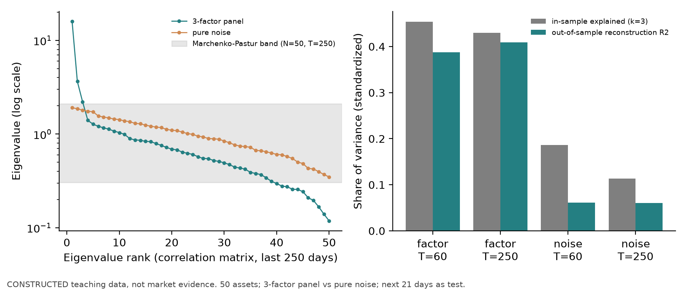
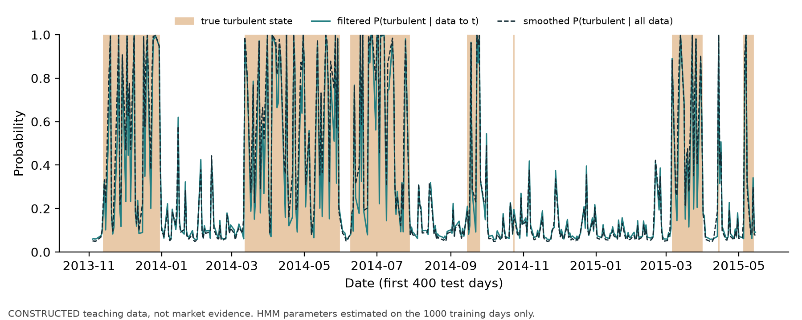
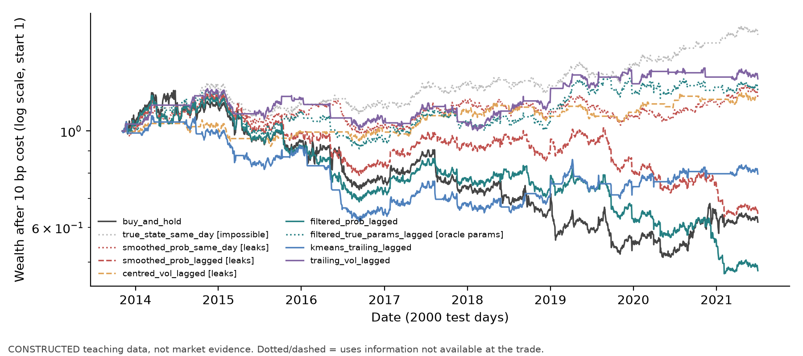

# 第41章 无监督学习（Unsupervised Learning）

> 作者：Yuxiao Ma。既有A8-B构造实现已获限定接受、待正式整合，不等于真实研究完成。主线：PCA 与聚类不看标签，压缩的是方差和距离结构；解释方差高不等于预测力强，聚类得到的状态不等于经济机制。只有在训练窗内拟合缩放、主成分和簇中心，再对之后的日期投影或分配，它们才能进入可交易的研究；全样本 PCA、事后状态标签和用未来数据平滑的状态概率都会泄漏。
> 先修：第5章线性代数（特征值分解、正交投影）、第15章因子模型（协方差、因子暴露）、第16章时间序列 I（滚动窗口与自相关）、第38章管线（训练内拟合、日期 walk-forward）。完成后你能：手算 2×2 协方差的主成分和解释方差比例；说明缩放如何改变主成分；计算训练内 PCA 的样本外重构 $R^2$ 并解释本例为何低于样本内，而非把此大小关系当成逐窗口定理；用 k-means 在滚动的市场状态特征上做在线分配并检验簇稳定性；手算一步隐马尔可夫滤波，区分滤波概率与平滑概率；用构造数据展示事后状态标签使策略看起来更好的程度。

## 1. 本章目标

1. 写出 PCA 的目标（最大方差方向 = 协方差矩阵特征向量），手算 2×2 例子的特征值、载荷与解释方差比例，说明符号不确定性与本书的符号约定。
2. 说明协方差 PCA 与相关系数 PCA（先标准化）的区别，以及标准化参数只能在训练行上估计。
3. 在训练窗拟合 PCA、对之后日期投影，计算样本外重构 $R^2$；用随机矩阵的噪声上界说明样本内解释方差为何偏高。
4. 用构造例子说明高解释方差本身不保证对未来收益的预测力，并在 Project 6 v2 的 PCA+Ridge 消融中检验。
5. 写出 k-means 目标与 Lloyd 迭代，说明距离依赖缩放、簇编号任意、簇数需要选择；计算行自助抽样下的调整兰德指数（ARI），并说明它只反映对行扰动的敏感性，时间上的稳定性需要区块抽样或滚动重拟合。
6. 用只依赖过去数据的市场状态特征做在线状态分配；写出两状态隐马尔可夫模型的滤波递推并手算一步；说明平滑概率使用未来观测。
7. 在构造的两状态市场上比较：事后真实状态、平滑概率、居中滚动波动率（用未来数据）、滤波概率（滞后一日交易）、训练内 k-means 在线分配五种择时规则的成本后结果。

完成条件：第15–17节可独立完成；`code/ch41_unsupervised.py` 复现第8–10节数字。

## 2. 为什么 Quant 需要它

两类常见任务不依赖标签。第一类是风险压缩：几百只股票的收益协方差矩阵需要估计几万个参数，而收益的大部分共同波动可以由少数几个方向解释（市场、行业、风格）。统计因子模型用 PCA 找这些方向，用于风险估计、残差收益构造或对冲。第二类是状态识别（regime detection）：研究员想知道"现在是平静市还是动荡市"，以便调整仓位、杠杆或模型。

两类任务都容易在时间上作弊。PCA 用整段样本估计协方差时，早期日期的主成分已经包含了后期的波动结构；状态模型用整段样本平滑时，某一天被标为"动荡"，部分原因是之后几天跌了。研究报告里这两种做法都会让结果更好看，而它们在实盘中都不可得。本章在每个工具旁边放一个"训练内拟合、样本外使用"的版本，并用构造数据量化差距。

## 3. 直觉

**PCA。** 两只股票日收益以百分数点记录，其协方差单位为平方百分点，矩阵为 $\begin{pmatrix}2&1\\1&2\end{pmatrix}$：各自方差 2，协方差 1。沿 $(1,1)/\sqrt2$ 方向（同涨同跌）的方差是 3，沿 $(1,-1)/\sqrt2$ 方向（一涨一跌）的方差是 1。第一主成分解释 $3/4=75\%$ 的总方差。直觉：PCA 找的是"数据摊得最开的方向"，在股票收益中通常就是大家一起动的方向。

**聚类。** 把每天的"过去一个月年化波动率"和"过去三个月累计收益"画成散点，平静上涨的日子聚在低波动、正收益一角，危机日子聚在高波动、负收益一角。k-means 把点分给最近的中心。直觉：聚类在找"彼此相近的日子"。

**边界。** 两个例子都不涉及未来收益。PCA 的第一方向解释了最多的波动，不说明它能预测下一期的任何东西；聚类给出的"簇 1"只是一组距离相近的日子，叫它"危机状态"是研究员加的名字。第8节用数字说明这两点。

## 4. 数学基础

| 符号 | 含义 | 维度/单位 |
|---|---|---|
| $X\in\mathbb R^{T\times N}$ | 训练窗的数据矩阵：$T$ 个日期、$N$ 列（资产收益或特征） | 收益为小数或 %；特征为原单位 |
| $\mu,\ s$ | 训练窗列均值、列样本标准差（`ddof=1`） | 与列同单位 |
| $\tilde X=(X-\mathbf 1\mu^\top)D_s^{-1}$ | 训练窗中心化（并可选标准化）后的数据，$D_s=\operatorname{diag}(s)$ 或 $I$ | — |
| $\Sigma=\tilde X^\top\tilde X/(T-1)$ | 样本协方差（标准化后为相关系数矩阵） | 单位平方 |
| $\lambda_1\ge\dots\ge\lambda_N$，$v_1,\dots,v_N$ | $\Sigma$ 的特征值与单位特征向量（载荷） | 单位平方；无量纲 |
| $V_k=[v_1,\dots,v_k]$ | 前 $k$ 个载荷 | $N\times k$ |
| $z_t=V_k^\top\tilde x_t$ | 日期 $t$ 的主成分得分 | 与 $\tilde x$ 同单位 |
| $K$、$c_1,\dots,c_K$ | 簇数与簇中心 | — |
| $s_t\in\{0,\dots,K-1\}$ | 日期 $t$ 的（隐）状态 | — |
| $P_{ij}=\Pr(s_t=j\mid s_{t-1}=i)$ | 转移矩阵 | 行和为 1 |
| $\phi(x;\mu_j,\sigma_j)$ | 状态 $j$ 下观测的正态密度 | 1/单位 |

时点约定：状态特征与主成分在收盘 $t$ 用 $\le t$ 的数据计算；交易规则在 $t$ 收盘形成信号，$t+1$ 收盘成交（滞后 1 日，与第29章账本一致）；收益区间为 $t+1$ 收盘至 $t+2$ 收盘。先修：第5章特征分解与谱定理（对称矩阵有正交特征向量），第15章因子模型中的协方差与因子暴露；第16章时间序列 I（滚动窗口、自相关）用于状态特征。

## 5. 正式定义

**主成分分析（PCA, principal component analysis）。** 第一主成分载荷 $v_1=\arg\max_{\|v\|=1}v^\top\Sigma v$，第 $j$ 个在与前 $j-1$ 个正交的约束下最大化同一目标。解是 $\Sigma$ 的特征向量，$v_j^\top\Sigma v_j=\lambda_j$。它解决"用少数几个正交方向概括多列数据的共同波动"；输入是训练窗数据，输出是载荷、特征值和得分。

**解释方差比例（explained variance ratio）。** $\lambda_j/\sum_i\lambda_i$。它度量训练窗内该方向占总方差的份额，与标签无关。

**样本外重构 $R^2$。** 用训练窗的 $\mu,s,V_k$ 处理之后日期的数据 $\tilde x_t$：

$$
R^2_{\text{rec}}=1-\frac{\sum_t\|\tilde x_t-V_kV_k^\top\tilde x_t\|^2}{\sum_t\|\tilde x_t\|^2}.
$$

在训练窗上计算它恰好等于前 $k$ 个解释方差比例之和（训练矩阵非零时，分子与分母中的 $1/(T-1)$ 相消），在之后日期计算则是“训练得到的方向在新数据上还能解释多少”。固定训练中心和正尺度、$V_k^\top V_k=I$ 且分母正时，由正交分解有 $0\le R^2_{\text{rec}}\le1$；它不是可为负的预测 $R^2$。分母为0时数学式为0/0、未定义，本书API返回1只是约定。标准化要求每列训练SD正、样本数足以定义SD；全零训练方差的解释份额也无数学定义。样本外可低于或高于训练份额，没有逐窗口必然不等式。

**符号不确定性（sign indeterminacy）。** $v$ 与 $-v$ 都是特征向量。本书约定：载荷元素之和为正；和为 0 时第一个非零元素为正。不同软件、不同窗口可能给出相反符号，比较得分前须先统一。此约定只能消除符号，不能消除相等特征值对应子空间内的任意旋转；此时应比较子空间。

**缩放（scaling）。** 协方差 PCA 让方差大的列主导；相关系数 PCA 先把每列除以训练 SD。选择取决于用途：风险压缩通常用协方差（大波动资产确实贡献更多风险），特征降维通常先标准化（单位不同的特征不可直接比较方差）。

**k-means。** 给定 $K$，最小化簇内平方距离 $\sum_t\|x_t-c_{k(t)}\|^2$（sklearn 称 inertia）。Lloyd 算法交替执行：把每点分给最近中心；把中心更新为簇内均值。目标单调不增；理想迭代在一致且避免循环的确定性tie与空簇处理、划分变化时严格降目标的条件下，可有限步达到Lloyd固定点，通常称局部解而非全局最优。工程上因容差或迭代上限提前返回，不一定是精确固定点；结果依赖初值（sklearn 的 `n_init` 多次初始化取最好）。距离依赖每列的单位，所以先在训练行上标准化。

**簇编号任意（label switching）。** 簇 0 与簇 1 的编号没有含义，重新拟合可能互换。本书在训练后把簇按训练窗中"波动率"列的簇中心升序重编号；若要逐元素比较状态编号，可用匈牙利算法匹配；ARI本身对编号置换不变，无需先匹配。

**簇稳定性（cluster stability）。** 对数据做扰动（自助抽样、换窗口），重新聚类，比较分配的一致性。调整兰德指数（ARI, adjusted Rand index）对两种划分的一致性做随机基准校正：完全一致为 1，随机划分期望约为 0。扰动方式决定结论的含义：对日期做独立同分布的行自助抽样，只度量划分对"换掉一些行"的敏感性；状态特征由 21 日、63 日重叠窗口计算，相邻日期高度相关，行抽样不能说明划分在时间上稳定，那需要区块自助抽样或滚动窗口重新拟合。

**状态识别（regime detection）。** 把日期分到少数几个"状态"，用于条件决策。本章区分三类标签：**在线标签**（$t$ 时只用 $\le t$ 的数据给出）、**滤波概率** $\Pr(s_t=j\mid x_{1:t})$、**平滑概率** $\Pr(s_t=j\mid x_{1:T})$。后者用到 $t$ 之后的观测，是事后标签。

**隐马尔可夫模型（HMM, hidden Markov model）。** 状态 $s_t$ 是马尔可夫链，转移矩阵 $P$；给定整条隐状态路径，观测在各时点条件独立，且 $x_t\mid s_t\sim N(\mu_{s_t},\sigma_{s_t}^2)$；只给某一个时点状态不意味着整段观测相互独立。Hamilton（1989）的马尔可夫转换模型是其在宏观与金融时间序列中的经典形式（核读状态见第20节）。

**因子解释（factor interpretation）。** 给主成分起名字（"市场""规模""价值"）是把载荷与已知特征对照后的解释，载荷会随窗口旋转，名字不自动成立。

## 6. 推导

### 6.1 最大方差方向是特征向量

最大化 $v^\top\Sigma v$ 受 $v^\top v=1$。拉格朗日函数 $v^\top\Sigma v-\lambda(v^\top v-1)$，对 $v$ 求导：$2\Sigma v-2\lambda v=0\Rightarrow\Sigma v=\lambda v$。目标值 $v^\top\Sigma v=\lambda v^\top v=\lambda$，所以取最大特征值对应的特征向量。$\Sigma$ 对称，谱定理保证特征向量可取为正交，后续主成分在正交约束下依次取下一个特征值。成立条件：$\Sigma$ 由训练数据估计；特征值相等时方向不唯一（第3节若协方差为 0、方差相等，任何方向都一样）。

**2×2 例子。** $\Sigma=\begin{pmatrix}2&1\\1&2\end{pmatrix}$：特征方程 $(2-\lambda)^2-1=0$，$\lambda=3,1$。$\lambda=3$：$(2-3)a+b=0\Rightarrow a=b$，单位化 $(1,1)/\sqrt2$。解释比例 $3/(3+1)=75\%$。

### 6.2 缩放改变主成分

两列方差 4 与 1、相关系数 0.5，协方差 $\begin{pmatrix}4&1\\1&1\end{pmatrix}$。特征方程 $\lambda^2-5\lambda+3=0$，$\lambda=\frac{5\pm\sqrt{13}}2=4.303,\ 0.697$；第一载荷约 $(0.957,0.290)$，解释 86.1%：主要由方差大的那列决定。标准化后是相关系数矩阵 $\begin{pmatrix}1&0.5\\0.5&1\end{pmatrix}$，$\lambda=1.5,0.5$，载荷 $(1,1)/\sqrt2$，解释 75%。同样的数据，换一种缩放，"第一主成分"指向不同方向。缩放参数 $s$ 若用全样本估计，训练窗的主成分就带上了测试期的波动信息。

### 6.3 样本内解释方差偏高：噪声特征值的上界

设 $N$ 列相互独立、方差 $\sigma^2$、无任何共同因子，样本 $T$ 行。总体协方差的特征值全为 $\sigma^2$，样本协方差的特征值却会散开。在元素独立同分布、适当有限矩条件下，$N,T\to\infty$、$q=N/T\in(0,1)$ 固定时，样本特征值的分布收敛到 Marchenko–Pastur 分布，支撑区间为

$$
\lambda_{\pm}=\sigma^2\big(1\pm\sqrt q\big)^2 .
$$

Laloux 等（1999）把它用于金融相关系数矩阵（核读状态见第20节）。$N=50,T=60$ 时 $\lambda_+\approx3.66\sigma^2$：纯噪声的第一主成分在样本内看起来解释了 $3.66/50\approx7\%$ 的方差，而真实值是 $1/50=2\%$。该结论依赖独立同分布与大样本极限；金融收益有厚尾和波动聚集，所以它只是渐近参照线，不是有限样本最大特征值的硬上界或现成检验。若扩展到$q>1$还须计入零特征值的点质量，本例不在该情形。决策用途：样本内解释方差要和这条线比；更直接的做法是计算样本外重构 $R^2$（第8.2节）。

### 6.4 高解释方差不保证预测力

设两列特征独立，$\operatorname{Var}x_1=10$，$\operatorname{Var}x_2=0.1$，标签 $y=\beta x_2+\varepsilon$，并假设误差均值为0、与$x_1,x_2$不相关且方差有限。协方差 PCA 的第一主成分就是 $x_1$ 方向，解释 $10/10.1\approx99\%$ 的特征方差；用第一主成分回归（主成分回归 PCR，$k=1$）总体最优线性预测的 $R^2$ 为0（标签方差正），因为 $y$ 只依赖 $x_2$。PCA 排序的依据是 $\operatorname{Var}(v^\top x)$，不含 $\operatorname{Cov}(v^\top x,y)$。股票收益中第一主成分通常是市场，它解释了大部分共同波动，但美元中性 $\sum w_i=0$ 并不等于市场beta中性 $\sum w_i\beta_i=0$。例如权重$(0.5,-0.5)$、beta$(2,1)$净美元0，市场载荷仍0.5。只有权重与市场载荷正交才对冲该方向；对截面预测有用的信息可能藏在方差很小的方向。

### 6.5 k-means 的单调下降

固定中心时，把每点分到最近中心使目标不增（逐点取最小）；固定分配时，簇内均值使簇内平方和最小（与第40章6.1节相同：平方损失的最优常数是均值）。两步交替，目标单调不增且有下界 0，有下界只保证目标值收敛，不能单凭它推出有限步。结合有限划分、无循环的确定性tie规则、固定空簇处理，若划分变化时目标严格下降，就能有限步终止；实际实现也可按容差或迭代上限停止。它一般只给出局部固定点，不同初值可能停在不同划分，这是簇稳定性需要单独检验的原因之一。

### 6.6 滤波递推与平滑

记 $\alpha_t(j)=\Pr(s_t=j\mid x_{1:t})$。

1. 预测：$\Pr(s_t=j\mid x_{1:t-1})=\sum_i\alpha_{t-1}(i)P_{ij}$（全概率公式，马尔可夫性）。
2. 更新：$\alpha_t(j)=\dfrac{\phi(x_t;\mu_j,\sigma_j)\Pr(s_t=j\mid x_{1:t-1})}{\sum_k\phi(x_t;\mu_k,\sigma_k)\Pr(s_t=k\mid x_{1:t-1})}$（贝叶斯公式，给定状态观测独立）。

固定在训练窗估计的参数时，$\alpha_t$ 只依赖 $x_1,\dots,x_t$，可在 $t$ 收盘计算；若参数由全样本拟合，参数本身已含未来信息。平滑概率 $\Pr(s_t=j\mid x_{1:T})$ 还要用后向递推 $\beta_t(i)\propto\sum_jP_{ij}\phi(x_{t+1};\mu_j,\sigma_j)\beta_{t+1}(j)$，乘上 $\alpha_t(i)$ 归一化，所以包含 $x_{t+1},\dots,x_T$。在研究报告中用平滑概率标出"历史上的危机期"可以；把它当作当时可交易的信号就是用未来数据。

第8.3节的手算会用到这组参数：转移矩阵 $P=\begin{pmatrix}0.98&0.02\\0.05&0.95\end{pmatrix}$ 下的平稳分布为 $(5/7,2/7)\approx(0.714,0.286)$，平均停留 $1/(1-0.98)=50$ 天与 $1/(1-0.95)=20$ 天。

## 7. 金融解释

**统计因子与经济因子。** PCA 给出的方向使训练窗内方差最大，经济因子（市场、规模、价值）来自理论或排序构造。两者可能相近（第一主成分常与等权市场高度相关），也可能不同。统计因子的好处是不用预先指定，代价是载荷随窗口旋转、符号任意、名字需要事后对照；用于风险模型时还要检验它们在样本外是否仍解释同样多的方差。

**风险压缩的用途。** 前 $k$ 个主成分对应的低秩协方差加对角残差（第15章因子模型的统计版本）可以降低估计误差；残差收益（去掉前几个主成分）可用于统计套利信号。两种用途都必须在每个调仓日用当时的训练窗重新估计。

**状态与机制。** 聚类或 HMM 把"高波动、负收益"的日子归为一类，这是描述。把它称为"危机状态"并据此减仓，隐含了"这一类日子之后收益仍然较差"的预测假设，需要用样本外数据检验，而且状态的持续性、识别的延迟（滤波概率要等几天下跌后才转向）都会吃掉收益。

**可交易性。** 任何状态规则都要回答：$t$ 收盘时你知道什么？滤波概率、过去窗口的特征、训练窗拟合的簇中心可以用；平滑概率、居中滚动窗口、全样本拟合后再标注的状态不能用。即使用对了，状态切换引起的仓位变化也有成本，第8.4节用同一简化扣费代理比较。

## 8. 完整数值例题

本节所有数字均为教学构造：8.1、8.3 为手算并由代码核对；8.2、8.4 来自 `code/ch41_unsupervised.py` 的模拟（种子在脚本文档串登记），不是市场数据。

### 8.1 手算主成分与缩放

**协方差 $\begin{pmatrix}2&1\\1&2\end{pmatrix}$。** 由 6.1 节，$\lambda=(3,1)$。第一载荷 $(0.7071,0.7071)$，元素和为正，保留。第二载荷是 $\pm(0.7071,-0.7071)$，元素和为 0，按约定取首个元素为正：$(0.7071,-0.7071)$。解释比例 $(0.75,0.25)$。代码中 `loadings[:, j]` 是第 $j$ 个载荷（一列），第 $i$ 行是第 $i$ 个变量在各主成分上的载荷。

**协方差 $\begin{pmatrix}4&1\\1&1\end{pmatrix}$。** $\lambda=(4.3028,0.6972)$，第一载荷 $(0.9571,0.2898)$，解释 86.06%。**相关系数 $\begin{pmatrix}1&0.5\\0.5&1\end{pmatrix}$。** $\lambda=(1.5,0.5)$，第一载荷 $(0.7071,0.7071)$，解释 75%。三组数字由脚本用"样本协方差恰好等于给定矩阵"的构造数据经 `unsupervised_tools.pca_fit` 复现（`results.json` 的 `hand.pca`）。

```python
import numpy as np
for S in ([[2, 1], [1, 2]], [[4, 1], [1, 1]], [[1, 0.5], [0.5, 1]]):
    w, v = np.linalg.eigh(np.array(S, float))
    w, v = w[::-1], v[:, ::-1]
    v = v * np.where(v.sum(axis=0) < 0, -1, 1)  # sign convention: loadings sum > 0
    print(np.round(w, 4), np.round(v[:, 0], 4), np.round(w / w.sum(), 4))
```

输出三行：

```text
[3. 1.] [0.7071 0.7071] [0.75 0.25]
[4.3028 0.6972] [0.9571 0.2898] [0.8606 0.1394]
[1.5 0.5] [0.7071 0.7071] [0.75 0.25]
```


### 8.2 样本内与样本外：因子面板与纯噪声面板

两组构造收益：50 只资产、1000 日。**因子面板**：三个因子日波动 1.0%、0.5%、0.3%，特质波动 1.5%，载荷 $N(0,1)$（第一列加 1，使市场因子平均暴露为正）。**噪声面板**：50 列独立 $N(0,1.5\%^2)$，没有任何共同因子。每 21 日在过去 $T$ 日上标准化并拟合 $k=3$ 的 PCA，再对之后 21 日计算样本外重构 $R^2$；另一种做法用全部 1000 日拟合一次 PCA（"全样本"），同样在各测试窗上计算。

| 面板 | $T$ | 样本内解释（前3个） | 样本外重构 $R^2$ | 全样本 PCA 测试窗 $R^2$ | 子空间主角余弦$^{\mathrm b}$ |
|------|----|--------|--------|--------|------------------------|
| 因子 | 60 | 0.454 | 0.388 | 0.420 | 0.993 / 0.944 / 0.736 |
| 因子 | 250 | 0.429 | 0.409 | 0.419 | 1.000 / 0.997 / 0.988 |
| 噪声 | 60 | 0.186 | 0.061 | 0.085 | 0.867 / 0.659 / 0.286 |
| 噪声 | 250 | 0.113 | 0.060 | 0.085 | 0.971 / 0.919 / 0.627 |

$^{\mathrm b}$ 相邻两个训练窗前三维主成分子空间之间的三个主角余弦，降序，对所有相邻窗口取平均。

读法。(1) 噪声面板里三个方向的真实份额是 $3/50=6\%$；样本外重构正好约 6.0%，样本内却是 18.6%（$T=60$）和 11.3%（$T=250$），这是 6.3 节噪声上界的直接体现。(2) 全样本 PCA 在测试窗上得到 8.5%，高于诚实的 6.0%：它在拟合时已经见过测试窗的数据。因子面板中同样的差距较小（0.420 对 0.388），因为真实结构强。(3) 最后一列是相邻两个窗口前三维主成分子空间之间的三个主角余弦（`subspace_cosines`，对 $V_{\text{old}}^\top V_{\text{new}}$ 做奇异值分解，降序），再对所有相邻窗口取平均。$T=60$ 时最小的一个平均为 0.736：两个三维子空间中存在一个方向对得很差，子空间本身在变。主角描述的是子空间之间的关系，不对应某一根具体的主成分轴：同一个子空间只交换 PC1 与 PC3 两根轴，三个主角余弦仍全为 1，而对应轴的余弦是 0、1、0。所以不能据此说"第三主成分转了多少度"；平均余弦也不等于平均角度（$\arccos$ 是非线性函数），$\arccos 0.736$ 不是平均旋转角。$T=250$ 时三个平均余弦都在 0.988 以上。最后 250 日的样本相关矩阵特征值：因子面板前三个为 15.92、3.64、2.21，噪声面板最大为 1.91；Marchenko–Pastur 上界 $(1+\sqrt{50/250})^2=2.094$。因子面板的第三个特征值只略高于上界，在真实数据中这样的方向很难与噪声分开。



### 8.3 手算一步滤波

两状态：平静（0）日收益 $N(0.05\%,0.7\%^2)$，动荡（1）$N(-0.1\%,2\%^2)$；$P=\begin{pmatrix}0.98&0.02\\0.05&0.95\end{pmatrix}$。昨天收盘的滤波概率 $\alpha_{t-1}=(0.9,0.1)$，今天收益 $x_t=-2.5\%$。

1. 预测：$(0.9\times0.98+0.1\times0.05,\ 0.9\times0.02+0.1\times0.95)=(0.887,0.113)$。
2. 密度（单位 1/小数收益）：$\phi(-0.025;0.0005,0.007)=0.0749$（偏离 3.64 个标准差），$\phi(-0.025;-0.001,0.02)=9.709$（偏离 1.2 个标准差）。
3. 更新：$0.887\times0.0749=0.0664$，$0.113\times9.709=1.0972$；归一化得 $\alpha_t=(0.0664,1.0972)/1.1636=(0.057,0.943)$。

一天 −2.5% 的下跌把"动荡"概率从 11.3% 推到 94.3%。若今天是 −1.0%：两个密度为 18.50 与 18.03，几乎相同，$\alpha_t=(0.890,0.110)$，概率基本只由先验决定。若是 +0.3%：$(0.955,0.045)$。脚本以 `hmm_filter_smooth(x=[x_t], init=预测概率)` 复现这三个数（`hand.hmm`）。平稳分布 $(5/7,2/7)$，平均停留 50 天与 20 天。

\needspace{9\baselineskip}

```python
import numpy as np
from scipy.stats import norm
P = np.array([[0.98, 0.02], [0.05, 0.95]])
pred = np.array([0.9, 0.1]) @ P
for x in (-0.025, -0.010, 0.003):
    lik = np.array([norm.pdf(x, 0.0005, 0.007), norm.pdf(x, -0.001, 0.02)])
    print(x, np.round(pred, 3), np.round(pred * lik / (pred * lik).sum(), 4))
```

### 8.4 状态择时：事后标签、在线标签与成本

构造市场：3000 日，状态按上面的马尔可夫链生成（种子 4102）；前 1000 日为训练窗，后 2000 日为测试窗。规则只有两档仓位：判为平静时持有市场（权重 1），否则持现金（0）。表中"滞后"指按第4节的信息时钟执行：$t$ 收盘的信号在 $t+1$ 收盘成交（成交滞后 1 日），赚取第 $t+2$ 日的收益；在日收益序列上相当于把信号右移 2 期。"当日"指把 $t$ 日的标签直接与第 $t$ 日收益对齐，只作泄漏对照。合法规则在 $t$ 收盘形成信号、$t+1$ 收盘成交、赚取 $t+2$ 的收益；换仓单边 10 个基点。HMM 参数只在训练窗估计：两成分高斯混合给出两个状态的均值与标准差，转移矩阵按训练期逐日硬分类计数（加一平滑）。这是高斯混合硬分类加转移计数的近似，不是Baum–Welch对HMM联合似然的EM极大似然估计。k-means 用过去 21 日年化波动率与过去 63 日累计收益两个特征，在训练窗标准化并拟合 $K=2$。"过去波动率"规则的阈值取训练窗波动率中位数。

| 规则（测试 2000 日） | 何时可得 | 年化收益 | 夏普 | 最大回撤 | 年换手 | 状态命中率 |
|----------------------------|----------|--------|------|--------|------|------|
| 买入持有 | 可得 | −5.89% | −0.22 | −58.6% | 0.1 | 0.747 |
| 真实状态，当日 | 不可得 | +6.61% | 0.71 | −17.8% | 8.7 | 1.000 |
| 平滑概率，当日 | 泄漏 | +2.27% | 0.28 | −19.5% | 33.9 | 0.871 |
| 平滑概率，滞后成交 | 泄漏 | −5.38% | −0.28 | −47.6% | 33.9 | 0.871 |
| 居中 21 日波动率，滞后 | 泄漏 | +2.21% | 0.33 | −13.1% | 12.9 | 0.704 |
| 滤波概率（训练估计参数），滞后 | 可得 | −8.89% | −0.51 | −61.0% | 39.4 | 0.856 |
| 滤波概率（真参数），滞后 | 参数不可得 | +2.73% | 0.28 | −26.8% | 11.5 | 0.940 |
| k-means 在线状态，滞后 | 可得 | −2.83% | −0.15 | −42.7% | 5.9 | 0.792 |
| 过去 21 日波动率，滞后 | 可得 | +3.54% | 0.41 | −19.9% | 12.7 | 0.689 |

以 $u_d$ 表示收盘信号（与隐状态 $s_d$ 区分）。按结束日记收益时，$r_d=C_d/C_{d-1}-1$。用两个相邻信号日核对（以下日期仅演示交易日时钟）：

| 信号形成（收盘） | 成交（下一收盘） | 持有收益区间 | 收益序列位置 |
|---|---|---|---|
| 10月12日 | 10月13日 | 10月13日收盘至10月14日收盘 | $r_{14}$ 乘 $u_{12}$ |
| 10月13日 | 10月14日 | 10月14日收盘至10月15日收盘 | $r_{15}$ 乘 $u_{13}$ |

本章实际数值使用固定权重变化代理：$w_d=u_{d-2}$、$\mathrm{turn}_d=|w_d-w_{d-1}|$、$r_d^{net}=w_dr_d-c\mathrm{turn}_d$。费用记在收益结束行，未处理持仓市值漂移后的再平衡金额、成交前后现金与费用的事件顺序，不能等同于第29章事件式自融资账本。以下保留该历史代理的数值与未建模事项，不用教学修订悄改工程实现。

因此收益结束日 $d$ 的权重来自 $u_{d-2}$；只右移一期会把刚形成的信号配到成交前已经发生的收益区间。表中“当日”对照使用 $u_d r_d$，也不遵守这个时钟。

单条路径上的数字受偶然性影响很大。作为事后加的稳健性诊断（D11，不是登记主结果或确认性证据），同一设计在另外 50 个种子上重复，夏普的中位数与"夏普高于同一路径买入持有"的比例：

| 规则 | 中位夏普 | 胜过买入持有的比例 | 中位年换手 |
|------------------------------|------|------|------|
| 买入持有 | 0.02 | — | 0.1 |
| 真实状态，当日（不可得） | 0.86 | 1.00 | 7.2 |
| 平滑概率，当日（泄漏） | 0.76 | 0.98 | 32.3 |
| 平滑概率，滞后（泄漏） | 0.05 | 0.54 | 32.3 |
| 居中波动率，滞后（泄漏） | 0.63 | 1.00 | 8.8 |
| 滤波概率（训练估计参数） | −0.03 | 0.38 | 38.3 |
| 滤波概率（真参数，不可得） | 0.38 | 0.90 | 12.2 |
| k-means 在线状态 | 0.29 | 0.90 | 6.1 |
| 过去波动率 | 0.35 | 0.78 | 8.8 |

结论分四点。(1) 当日对齐的事后标签收益最高，因为标签用到了当天的收益：平滑概率在一天大跌后把这一天判为动荡，规则就"恰好"在这一天空仓。同一个平滑概率改为按合法时钟执行（$t+1$ 成交、赚 $t+2$ 的收益），中位夏普从 0.76 降到 0.05。(2) 居中窗口用到之后 10 天的波动，按合法时钟执行后仍然领先（中位 0.63、50 条路径全部胜过买入持有），所以"滞后了"不等于"没泄漏"。(3) 合法的在线规则保留了一部分价值（中位 0.29–0.35），远低于泄漏版本。(4) 训练窗估计的 HMM 表现最差，原因是参数：逐日硬分类把大量平静日的普通波动判为动荡，估出的转移矩阵为 $\begin{pmatrix}0.874&0.126\\0.629&0.371\end{pmatrix}$（真值对角线 0.98、0.95），滤波概率频繁跳动，换手 38–39 次/年，成本吃掉收益；同一滤波用真参数则中位夏普 0.38。状态命中率与收益不同步：训练参数滤波的命中率 0.856 高于过去波动率规则的 0.689，收益却低得多。

簇稳定性（训练窗特征，20 次独立同分布行自助抽样；只反映对行扰动的敏感性，不是时间稳定性检验）：$K=2$ 时 ARI 均值 0.943、最小 0.723；$K=3$ 均值 0.971、最小 0.815；$K=4$ 均值 0.722、最小 0.364。$K=4$ 的划分在重抽样下明显不稳。平静状态的滤波概率 $P(\text{平静}\mid x_{1:t})$ 在真实“平静→动荡”切换后首次低于0.5 的延迟中位数为 1 天（29 次切换），图2画的是其补集 $P(\text{动荡}\mid x_{1:t})$，对应首次高于0.5。这个快速反应同时伴随大量误报，是换手高的来源。



## 9. Python Implementation

- 核心模块：`src/quant_course/unsupervised_tools.py`。
- 接口契约：`qa/a8/ch40_ch41_batch/INTERFACE_CONTRACT.md` 第2节。公开函数：pca_fit、pca_project、pca_reconstruction_r2、subspace_cosines、trailing_state_features、fit_kmeans_states、assign_states、align_labels、cluster_stability、hmm_filter_smooth、simulate_markov_regimes、simulate_factor_panel。测试 `tests/test_unsupervised_tools.py`。
- 章节脚本，约 7 秒。复现时只传 `--out`；`--figures-dir part07/chapter41/figures` 会覆盖本章源图，只在有意刷新时使用：

  ```bash
  .venv/bin/python code/ch41_unsupervised.py --out <新目录>
  ```

  输出 `results.json` 与三张图，目录已存在则拒绝。
- 环境：Python 3.14.7、numpy 2.5.3、pandas 3.0.6、scikit-learn 1.9.1、scipy 1.18.1（`.venv`）。
- 种子：因子面板 4101、噪声面板 4103、状态市场 4102、方差与预测力例 4104、稳健性诊断 4200–4249；KMeans 与高斯混合的 `random_state` 等于对应种子。
- 缺失值：`pca_fit` 与 `pca_project` 遇到 NaN 报错（调用方先处理）；`trailing_state_features` 在窗口不足时为 NaN；`assign_states` 对含 NaN 的行返回 NaN，规则把 NaN 视为空仓。
- 时点：日频；信号时点 = $t$ 收盘；成交 = $t+1$ 收盘；收益区间 = $t+1$ 收盘到 $t+2$ 收盘。泄漏对照规则的名称带 `[leaks]`、`[impossible]`、`[oracle params]`。

训练内 PCA 与样本外投影的最小用法：

```python
import numpy as np, pandas as pd
from quant_course import unsupervised_tools as ut
R, B = ut.simulate_factor_panel(300, 20, factor_vols=(0.01, 0.005), idio_vol=0.015, seed=1)
fit = ut.pca_fit(R.iloc[:250], 2, standardize=True)  # mean, SD, loadings: training rows only
scores = ut.pca_project(R.iloc[250:], fit)           # later dates use the training mean/SD
r2 = ut.pca_reconstruction_r2(R.iloc[250:], fit)
print(fit.explained_ratio.round(3), round(r2, 3), scores.shape)
```

## 10. Visualization

- 图1（`figures/fig41_1_pca_in_vs_out.png`，第8.2节）：左图横轴为特征值排名，纵轴为特征值（对数）；右图横轴为四种面板/窗口组合，纵轴为方差份额。观察噪声特征值与 MP 区间、样本内与样本外的差距。
- 图2（`figures/fig41_2_filtered_vs_smoothed.png`，第8.4节）：横轴为日期，纵轴为概率；观察平滑概率的"预知"。
- 图3（`figures/fig41_3_regime_rules.png`）：测试期 2000 日、扣 10 个基点后的财富路径（对数纵轴，起点 1）。虚线和点线为使用了交易时不可得信息的规则。



## 11. Real Market Example

**状态：尚待实验。** 本课程没有获得授权的日频个股或指数收益面板（`projects/project06/data_manifest.json`，`real_data.status = blocked`），本章不报告任何真实市场的主成分、状态或择时结果。补做所需：(1) 至少 8 年、按日期固定成分的个股日收益（含退市），用于训练内 PCA、样本外重构 $R^2$ 与特征值上界比较；(2) 一个可交易指数的日收益与成交成本假设，用于状态规则；(3) 授权允许内部培训材料中展示派生统计。拿到数据后，按本章第13节的协议预先固定窗口、$k$、$K$、参数估计方法与成本，再看结果。

文献中的对照（不是本书证据）：Laloux 等（1999）用 S&P 500 成分股日收益的相关矩阵，发现大部分特征值落在 Marchenko–Pastur 区间内，只有少数（最大者对应市场）明显在外；Ang 与 Timmermann（2012）综述了状态转换模型在资产定价中的应用。两者的核读状态见第20节。

## 12. Common Mistakes

### 12.1 全样本标准化与 PCA

错误：`StandardScaler().fit(R)`, `PCA().fit(R)` 用了全部日期，再把得分当作每天的风险因子或特征。原因：测试期的均值、波动和相关结构进入了训练期的变换。差异（第8.2节噪声面板）：全样本 PCA 在测试窗的重构 $R^2$ 为 8.5%，训练内拟合为 6.0%；样本内报告的 11.3%–18.6% 更高。修复：每个调仓日只用之前的窗口拟合 `pca_fit`，之后的日期用 `pca_project`。

```python
import numpy as np, pandas as pd
from quant_course import unsupervised_tools as ut
noise = pd.DataFrame(np.random.default_rng(4103).normal(0, 0.015, (1000, 50)))
noise.columns = [f"A{i:02d}" for i in range(50)]
full = ut.pca_fit(noise, 3, standardize=True)               # WRONG: sees the test window
train = ut.pca_fit(noise.iloc[:250], 3, standardize=True)   # right: training window only
test = noise.iloc[250:271]
print(round(ut.pca_reconstruction_r2(test, full), 3),
      round(ut.pca_reconstruction_r2(test, train), 3),
      round(float(train.explained_ratio.sum()), 3))
```

输出 `0.115 0.077 0.112`：同一个 21 日测试窗上，全样本 PCA 的重构 $R^2$ 为 11.5%，训练内 PCA 为 7.7%，训练窗样本内份额为 11.2%。这是单个窗口；第8.2节表格是全部窗口的平均（8.5%、6.0%、11.3%）。

### 12.2 把平滑概率或事后标签当作交易信号

错误：用整段样本拟合 HMM，取平滑概率，或者用"事后确认的危机期"给每天打标签，再与当天收益对齐。原因：标签用到了未来观测，当日对齐还用到了被评价的那天收益。差异（第8.4节，50 个种子中位数）：当日对齐的平滑概率夏普 0.76，按合法时钟（$t+1$ 成交、赚 $t+2$ 的收益）执行后 0.05。修复：只用滤波概率 $\Pr(s_t\mid x_{1:t})$，参数只在训练窗估计，信号滞后一日成交。

### 12.3 居中滚动窗口

错误：`ret.rolling(21, center=True).std()`。原因：日期 $t$ 的值用到了 $t+1,\dots,t+10$。即使信号在 $t+1$ 收盘才成交、赚取 $t+2$ 的收益，$t+3,\dots,t+10$ 的数据仍晚于所赚的收益。差异：50 个种子中位夏普 0.63，过去窗口版本 0.35。修复：`rolling(21)`（默认右对齐），并在测试中检查"改变 $t$ 之后的数据不改变 $t$ 及之前的特征"。

### 12.4 簇编号不对齐

错误：每个窗口重新拟合 k-means 后直接比较"簇 1"。原因：编号任意，两次拟合可能互换。差异：两组划分 $[0,0,1,1,2,2]$ 与 $[1,1,0,0,2,2]$ 完全相同（ARI = 1），逐元素比较却只有 1/3 一致。修复：按一个有含义的中心特征重新编号（本书按波动率），或用 `align_labels` 做匈牙利匹配；ARI 本身不依赖编号。

### 12.5 用解释方差挑选主成分作预测特征

错误：主成分回归只保留"解释 99% 方差"的成分。原因：PCA 排序不看标签。差异（6.4 节构造例，前一半训练、后一半测试）：协方差 PCA 第一主成分解释 98.96% 的特征方差，只用它的样本外 $R^2$ 为 −0.07%；用两个成分为 69.6%。标准化后第一主成分载荷为 $(0.707,0.707)$，样本外 $R^2$ 为 31.2%。修复：把 $k$ 当作超参数，用训练内的日期验证按预测误差选择（Project 6 v2 的 PCA+Ridge 消融就是这样做的，第13节）。

### 12.6 用状态命中率评价择时

错误：报告"状态识别准确率 85.6%"作为策略有效的证据。原因：命中率对每天等权，不看错判那几天的收益大小和换仓成本。差异：第8.4节训练参数滤波命中率 0.856、夏普 −0.51；过去波动率规则命中率 0.689、夏普 0.41。修复：同时报告成本后收益、换手和回撤。

## 13. Quant Research Application

**假设。** 截面特征的高方差方向（主成分）是否携带对未来 5 日收益的预测信息；作为 Project 6 v2 预先登记的辅助消融（`configs/p06_trees_v2.json` 的 `pca_ridge`），不单独构成策略项目。

**方法。** 在第38章的日期 walk-forward 上，每个外层折只用训练行拟合 StandardScaler、PCA(k)、Ridge(alpha) 三步；$k\in\{5,15,30\}$、$\alpha\in\{10^4,10^6\}$ 由内层日期验证的 MSE 选择；预测、美元中性组合、滞后成交与成本账本与 Ridge 完全相同。基准为零预测、训练均值与原始特征上的 Ridge。

**对照与解释边界。** 43个`q/noise`序列跨序列独立、单位边际方差，但各自为AR(1)、系数0.98；另外3个价格特征来自收益路径且与q有间接联系。全46维不是独立同方差总体，有限样本的主方向也不是预定信号方向。截断PCA可能丢信号或减少估计方差，谁占主导需验证，不能把改善自动判成泄漏。必要控制是保留全部 $k=46$ 成分、同一训练Scaler、同一alpha且不whiten：正交旋转 $V$ 下 $\|y-XVb\|^2+\alpha\|b\|^2=\|y-X\beta\|^2+\alpha\|\beta\|^2$，其中 $\beta=Vb$，所以理论预测与原Ridge相同（数值误差除外）。截断后此等价不成立，也不保证降噪有利。历史结果应逐指标读：PCA+Ridge相对训练均值R²两景好于Ridge，IC两景较低；基础10/20bp夏普更低，反号−0.14/−0.52却略好于Ridge的−0.15/−0.53。结果见第40章第13节的 Project 6 v2 表格与 `projects/project06/research_report/v2_trees.md`。

**聚类与状态。** 本批不把聚类状态加入 Project 6：构造的"载荷反号"情景改变的是截面特征与收益的关系，市场层面的波动与收益不受影响，基于市场状态特征的聚类没有可识别的对象。状态规则的研究应另立协议（第17节 41-C02）。

## 14. Chapter Summary

PCA 和聚类回答"数据怎样分布"，不回答"之后会怎样"。PCA 的特征值告诉你训练窗内各方向的方差份额；样本内份额包含噪声带来的上偏，样本外重构 $R^2$ 与噪声上界给出更诚实的度量；缩放决定方向，缩放参数和主成分都只能在训练窗估计。聚类的结果依赖缩放、簇数和初值，编号没有含义；行重抽样只检验对行扰动的敏感性，时间上的稳定性要用区块抽样或滚动重拟合检验。状态标签分为三类：在线标签与滤波概率可交易；平滑概率与居中窗口用到未来；与当天收益对齐的事后标签同时用到了被评价的收益。合法的状态规则还要面对参数估计误差、识别延迟、误报和换手成本，用成本后收益而不是命中率评价。

## 15. Exercises

**41-E01**（手算）$\Sigma=\begin{pmatrix}3&1\\1&3\end{pmatrix}$。求特征值、单位载荷（按本书符号约定）与第一主成分解释比例。

**41-E02**（缩放）两列不相关，方差 9 与 1。(a) 协方差 PCA 的第一载荷与解释比例？(b) 标准化后的相关系数 PCA 有什么特殊之处？(c) 结合 (a)(b) 说明"第一主成分"在什么情形下由单位决定。

**41-E03**（噪声上界）$N=100$ 只独立资产、$T=400$ 日，求 Marchenko–Pastur 区间；在没有任何共同因子时，样本内第一主成分大约"解释"多少比例？真实比例是多少？

**41-E04**（解释）一个美元中性、市场暴露为 0 的组合，为什么几乎不受收益第一主成分（近似市场）的影响？这说明解释方差与组合预测力之间是什么关系？

**41-E05**（k-means）一维数据 $\{0.10,0.12,0.15,0.30,0.35,0.40\}$，$K=2$，初始中心 0.10、0.15。手算 Lloyd 迭代直到收敛，写出每步的分配、中心和目标值（inertia）。

**41-E06**（滤波）沿用第8.3节参数，密度计算统一用小数收益（$-1\%=-0.010$、$0.7\%=0.007$），昨天滤波概率 $(0.6,0.4)$，今天收益 $-1.0\%$。求预测概率、两个密度与今天的滤波概率。

**41-E07**（时点）判断以下哪些可以在 $t$ 收盘用于 $t+1$ 成交：(a) 过去 21 日波动率；(b) `rolling(21, center=True)` 的波动率；(c) 训练窗估计参数的滤波概率；(d) 全样本拟合 HMM 的滤波概率；(e) 全样本拟合 HMM 的平滑概率；(f) 训练窗拟合 k-means、对 $t$ 的过去特征做最近中心分配。

**41-E08**（簇编号）两次聚类结果 $[0,0,1,1,2,2]$ 与 $[1,1,0,0,2,2]$ 的 ARI 是多少？与 $[0,1,0,1,2,2]$ 的 ARI 呢？逐元素一致率分别是多少？

## 16. Programming Exercises

**41-P01**（训练内 PCA）输入：`simulate_factor_panel` 生成 500 日、30 只资产，factor_vols=(0.01, 0.004)、idio_vol=0.015、seed=7。实现滚动窗口（$T=120$、测试 20 日、步长 20）的 $k=2$ 训练内 PCA，返回每个窗口的样本内解释份额与样本外重构 $R^2$。验收断言：(1) 对本题指定构造与seed，平均样本内份额 $\ge$ 平均样本外 $R^2$，这不是任意数据或窗口的定理；(2) 把某个测试窗之后的数据全部乘以 10，该窗口及之前所有窗口的结果不变；(3) 函数从不在测试窗上重新估计均值或标准差（构造测试：测试窗整体加常数，样本外 $R^2$ 改变）。

**41-P02**（滤波不看未来）用 `hmm_filter_smooth` 在 `simulate_markov_regimes` 生成的 500 日序列（p_stay=(0.97, 0.9)、mus=(0.0005, -0.001)、sigmas=(0.008, 0.02)、seed=3）上计算滤波与平滑概率。验收断言：(1) 改变 $x_{t+1..T}$，`filtered[:t+1]` 不变、`smoothed[:t+1]` 改变；(2) 每行和为 1；(3) 用第8.3节数字检查一步更新。边界：$T=1$ 时两者相等。

**41-P03**（状态规则回测）给定日收益序列与 0/1 信号，实现"$t$ 收盘信号、$t+1$ 收盘成交、赚 $t+2$ 收益、单边成本 $c$"的简化固定权重代理（费用在收益结束行扣除），返回年化收益、夏普、换手与最大回撤（财富点 $N+1$ 个）。验收断言：(1) 信号恒为 1 且 $c=0$ 时等于买入持有（从第3日起）；(2) 用当日真实状态做信号的"当日对齐"版本收益高于滞后两日版本（第8.4节数据）；(3) $c>0$、至少一次非零换手且每步财富乘子为正时，成本后终值严格低于 $c=0$；全程空仓零换手时两者相等。

## 17. Challenge Problems

**41-C01**（Project 6 v2 PCA 消融）阅读第40章第13节与 `projects/project06/research_report/v2_trees.md` 中 `pca_ridge` 的结果与每折所选 $k$。(a) 对照第13节的解释边界，逐指标比较结果，并给出所选成分数；是否存在一致优势？(b) 写出一种构造数据，使 PCA+Ridge 优于原始特征 Ridge，并说明这对应现实中的什么情形；(c) 说明你为何不能在看到 v2 结果后把 $k$ 网格改成"恰好最好的那个值"再报告。额外先修：第39章。

**41-C02**（诚实的状态研究设计）为一只可交易指数设计一个状态择时研究：状态数选择、参数估计（例如只在训练窗用 Baum–Welch EM）、在线信号、成交时点、成本、评价指标、基准、样本外期间与反证条件。说明你如何防止第12.2、12.3 节的泄漏，以及如何报告参数估计误差（第8.4节真参数对照）的影响。额外先修：第35章交易成本、第31章验证、第32章绩效评价。

## 18. 完整答案

**41-E01.** $(3-\lambda)^2-1=0\Rightarrow\lambda=4,2$。$\lambda=4$：$a=b$，载荷 $(0.7071,0.7071)$（和为正）；$\lambda=2$：$a=-b$，和为 0，首元素取正，$(0.7071,-0.7071)$。解释比例 $4/6=66.7\%$。

**41-E02.** (a) 协方差 $\operatorname{diag}(9,1)$，第一载荷 $(1,0)$，解释 90%。(b) 相关系数矩阵为单位阵，两个特征值都是 1，任何单位方向都是特征向量，主成分不唯一，每个解释 50%。(c) 列之间相关性弱、方差差异大时，协方差 PCA 的第一主成分就是方差最大的那列；改变那列的单位（例如百分比改小数）就改变了 PCA 的结果。用于预测特征时应先在训练行上标准化。

**41-E03.** $q=100/400=0.25$，$\lambda_\pm=(1\pm0.5)^2=2.25,\ 0.25$（$\sigma^2=1$ 的相关矩阵）。样本内第一主成分约 $2.25/100=2.25\%$，真实为 $1/100=1\%$。该数是大样本极限下的上界位置，有限样本中最大特征值会在其附近波动。

**41-E04.** 若第 $i$ 只股票收益 $r_i=\beta_if+e_i$，组合 $\sum_iw_ir_i=f\sum_iw_i\beta_i+\sum_iw_ie_i$。美元中性且 $\sum w_i\beta_i=0$ 时市场项消失。第一主成分解释了大量的共同方差，这部分方差被组合构造本身对冲；组合收益来自其余方向（特质部分或小方差的因子），所以“第一主成分解释了多少”本身不能决定能否预测截面收益差。

**41-E05.** 第 0 步：以 0.10、0.15 为中心，中点 0.125，分配 $\{0.10,0.12\}$ 与 $\{0.15,0.30,0.35,0.40\}$；目标值 $0+0.02^2+0+0.15^2+0.2^2+0.25^2=0.1254$。更新中心 0.11、0.30。第 1 步：中点 0.205，分配 $\{0.10,0.12,0.15\}$ 与 $\{0.30,0.35,0.40\}$；目标值（新分配、旧中心）$0.01^2+0.01^2+0.04^2+0+0.05^2+0.1^2=0.0143$。更新中心 $0.1233,0.35$。第 2 步：中点 0.2367，分配不变，目标值 $0.0233^2+0.0033^2+0.0267^2+0.05^2+0+0.05^2=0.006267$。中心不再改变，收敛。目标值单调下降：0.1254 → 0.0143 → 0.006267。

**41-E06.** 先把收益、均值、标准差都换成小数收益；密度单位是“每单位小数收益”，归一化后的状态概率才无量纲。预测 $(0.6\times0.98+0.4\times0.05,\ 0.6\times0.02+0.4\times0.95)=(0.608,0.392)$。密度 $\phi(-0.01;0.0005,0.007)=18.50$，$\phi(-0.01;-0.001,0.02)=18.03$。滤波 $(0.608\times18.50,\ 0.392\times18.03)$ 归一化为 $(0.614,0.386)$。−1% 在两个状态下几乎同样可能，后验基本等于先验。

**41-E07.** 可以：(a)、(c)、(f)。不可以：(b) 用到 $t$ 之后 10 天；(d) 滤波递推本身只用到 $x_{1:t}$，但参数用全样本估计，参数里含有测试期信息（属于较隐蔽的泄漏，影响通常小于 (e)，仍不合规）；(e) 平滑概率用到 $x_{t+1:T}$。

**41-E08.** 第一对：两划分把同样的点放在一起，只是编号互换，ARI = 1；逐元素一致率 2/6 = 1/3。第二对：$[0,0,1,1,2,2]$ 与 $[0,1,0,1,2,2]$，ARI = 1/6 $\approx$ 0.167；逐元素一致率 4/6。ARI 衡量划分的一致性，不受编号影响；逐元素一致率依赖编号，需先对齐。

**41-P01 参考实现。**

```python
import numpy as np
from quant_course import unsupervised_tools as ut


def rolling_in_out(R, window=120, test=20, k=2):
    rows = []
    for s in range(window, len(R) - test + 1, test):
        fit = ut.pca_fit(R.iloc[s - window:s], k, standardize=True)
        oos = ut.pca_reconstruction_r2(R.iloc[s:s + test], fit)
        rows.append((float(fit.explained_ratio.sum()), oos))
    return np.array(rows)


R, _ = ut.simulate_factor_panel(500, 30, factor_vols=(0.01, 0.004), idio_vol=0.015, seed=7)
a = rolling_in_out(R)
assert a[:, 0].mean() >= a[:, 1].mean()
R2 = R.copy()
R2.iloc[300:] *= 10                 # change only data from row 300 on
b = rolling_in_out(R2)
assert np.allclose(a[:8], b[:8])    # windows whose test ends by row 300 are unchanged
R3 = R.copy()
R3.iloc[120:140] += 0.05
assert not np.isclose(rolling_in_out(R3)[0, 1], a[0, 1])  # shifting the test changes R2
print(a.mean(axis=0).round(3))
```

第一个窗口测试区间为第 120–139 行；前 8 个窗口的测试区间在第 300 行之前结束，因此不受影响。输出两列平均值；此固定构造的断言不能推广成样本外总低于样本内。

**41-P02 参考实现。**

```python
import numpy as np
from quant_course import unsupervised_tools as ut
m = ut.simulate_markov_regimes(500, p_stay=(0.97, 0.9), mus=(0.0005, -0.001),
                               sigmas=(0.008, 0.02), seed=3)
x = m["ret"].to_numpy()
kw = dict(means=[0.0005, -0.001], sds=[0.008, 0.02],
          transition=np.array([[0.97, 0.03], [0.1, 0.9]]), init=[1.0, 0.0])
f1, s1 = ut.hmm_filter_smooth(x, **kw)
x2 = x.copy()
x2[301:] = -0.05
f2, s2 = ut.hmm_filter_smooth(x2, **kw)
assert np.allclose(f1[:301], f2[:301]) and not np.allclose(s1[:301], s2[:301])
assert np.allclose(f1.sum(axis=1), 1) and np.allclose(s1.sum(axis=1), 1)
P = np.array([[0.98, 0.02], [0.05, 0.95]])
one, _ = ut.hmm_filter_smooth(np.array([-0.025]), means=[0.0005, -0.001], sds=[0.007, 0.02],
                              transition=P, init=np.array([0.9, 0.1]) @ P)
assert np.allclose(one[0], [0.057059, 0.942941], atol=1e-6)
print("ok")
```

年化口径：令 $n$ 为参与评价的日收益行数，含本题前两天空仓；年化收益为终值的 $252/n$ 次幂减1（CAGR），夏普为 $\sqrt{252}$ 乘日净简单收益算术均值/样本标准差（ddof=1），不是CAGR除年化波动率；年换手为 $252\sum\mathrm{turn}/n$，回撤包含初始财富1。标准差为0时夏普未定义。

**41-P03 参考实现**（与 `code/ch41_unsupervised.py` 中 `book` 相同的信息时钟和扣费代理；补齐题面全部指标并检查三条断言。第8.4节先对完整 3000 日序列移位再截取测试段，此处先截取再移位，测试段前两天空仓，所以数字与第8.4节不同）：

```python
import numpy as np, pandas as pd
from quant_course import unsupervised_tools as ut


def book(ret, signal, cost, lag=2):
    w = signal.shift(lag).fillna(0.0)
    turn = w.diff().abs().fillna(w.abs())
    net = w * ret - cost * turn
    wealth = np.concatenate([[1.0], np.cumprod(1 + net.to_numpy())])
    n = len(net)
    if n == 0 or np.any(1 + net.to_numpy() <= 0):
        raise ValueError("Require observations and positive wealth multipliers")
    sd = float(net.std(ddof=1)) if n > 1 else float("nan")
    ann_return = float(wealth[-1] ** (252 / n) - 1)
    sharpe = float(np.sqrt(252) * net.mean() / sd) if sd > 0 else float("nan")
    return {"wealth": wealth, "annual_return": ann_return, "sharpe": sharpe,
            "turnover": float(turn.sum()), "annual_turnover": float(turn.sum() * 252 / n),
            "mdd": float((wealth / np.maximum.accumulate(wealth) - 1).min())}


m = ut.simulate_markov_regimes(3000, p_stay=(0.98, 0.95), mus=(0.0005, -0.001),
                               sigmas=(0.007, 0.02), seed=4102)
# The signal is sliced to the test window before shifting, so the first two test days are
# flat; code/ch41_unsupervised.py shifts the full series first (its §8.4 numbers differ).
ret, calm = m["ret"].iloc[1000:], (m["state"].iloc[1000:] == 0).astype(float)
bh = book(ret, pd.Series(1.0, index=ret.index), 0.0)
assert np.isclose(bh["wealth"][-1], np.prod(1 + ret.iloc[2:]))
same_day, lagged = book(ret, calm, 0.001, lag=0), book(ret, calm, 0.001, lag=2)
assert same_day["wealth"][-1] > lagged["wealth"][-1]
assert book(ret, calm, 0.001)["wealth"][-1] < book(ret, calm, 0.0)["wealth"][-1]
print(round(same_day["wealth"][-1], 3), round(lagged["wealth"][-1], 3))
```

**41-C01 完整参考答案。** 基础情景PCA+Ridge相对训练均值R²为−0.008%，Ridge为−0.113%；IC为0.0135对0.0198，配对ΔIC −0.0063、描述性t −0.86。10/20bp夏普0.25/−0.13低于Ridge 0.45/0.07。反号情景R²为−0.053%对−0.161%，IC为0.0063对0.0087、配对差−0.0023、t −0.31；10/20bp夏普−0.14/−0.52却略好于Ridge −0.15/−0.53。不能用“PCA全指标更差”概括。基础16折中10折选择30个成分、5折选择5个、1折选择15个；两情景按冻结摘要外层折1–16的k序列相同：$(30,30,30,30,5,5,15,5,5,30,30,5,30,30,30,30)$。该摘要没有fitdate字段，不补造日期；不能从平均指标推断逐折k。两情景R²改善但IC较低，也说明水平误差与截面排序/组合不是一件事。

一种可检验的新构造是令多列共同度量潜变量z、每列含独立测量噪声，标签由z加标签噪声生成。若训练样本有限且z对应强公共方向，少数PC可汇聚测量并丢弃不预测的低方差方向，可能比同一有限网格Ridge更好，但不是必然；须保留全k正交等价控制、相同的标准化器和 alpha，并且不做 whitening，用训练内验证比较。它对应“许多相关指标共同测量同一经济量”的情形，并非本项目已验证的机制。

看到测试结果后把k网格改成最佳值，是把外层测试转成选择集。新想法可以另立版本、披露已看结果，保留原网格和负结果，并需要独立后续日期评价；不能重新把旧测试称为未见数据。PCA是压缩工具，当前构造结果不支持市场Alpha结论。

**41-C02 完整协议示例。** 先确认指数、总回报、可成交工具及数据许可，固定训练期和未见测试日期；状态特征仅过去21日波动率与63日收益，训练内估计Scaler。K固定为2，或只在训练内日期验证比较2/3、以似然及稳定性选择，不以测试收益挑K。HMM在每个训练窗多初值Baum–Welch EM，记录初值、收敛、似然与转移矩阵，不将高斯混合硬分类冒称联合HMM极大似然。参数冻结后向前滤波，t收盘信号、t+1收盘成交、赚t+2结束收益；用未来扰动不影响早期特征/滤波的断言检查信息集。

实际策略用第29章事件账本、0/10/20bp单边费用并解释冲击/融资假设；若教学代理另列，则明确收益结束行扣费及其与事件账本差别。基准买入持有和过去波动率规则，报告年化收益/夏普/回撤/换手、危机段与平静段、不同初值和滚动窗结果。全样本平滑及居中窗口只作不可交易诊断，不能选入策略。状态编号按训练中心解释，ARI不必先对齐，时间稳定性用区块扰动或滚动重拟合。

在查看测试结果前固定采用标准，例如成本后不高于过去波动率、优势仅一子期或对初值极敏感即不采用。构造诊断可用真参数作不可得的oracle参照，而非成本后收益或夏普的保证上界：比较估计参数与真参数的转移矩阵、误报/延迟、换手与费用损失；第8.4节真参数中位夏普0.38而训练估计−0.03，说明估计误差值得检验，但不能保证EM会向真参数改善。真实市场没有真状态/真参数，不能把该模拟差当成市场效果。冻结版本、SHA与已看结果清单后才研究，未获授权仍blocked。

## 19. Further Reading

- **Must Know**：Jolliffe 与 Cadima（2016），第2节：协方差与相关系数 PCA 的选择、解释方差。用于第5–6节。
- **Should Know**：Laloux、Cizeau、Bouchaud、Potters（1999）：随机矩阵上界在金融相关矩阵中的用法，用于判断样本内特征值是否超出噪声。Hamilton（1989）第3–4节：马尔可夫转换模型、滤波与平滑概率。
- **Advanced**：Ang 与 Timmermann（2012）：状态转换在资产定价中的应用综述，读第2节与第4节。Connor 与 Korajczyk（1986）：渐近主成分统计因子模型。von Luxburg（2010）：聚类稳定性的理论与局限。
- **Optional**：scikit-learn 1.9.1 的 PCA、KMeans、adjusted_rand_score 文档，用于核对实现细节。

## 20. References

完整链接与核读位置见 `references.md`, `references/sources.json` 与本章 `source_notes.md`。

- `NUMPY`：NumPy 文档（`linalg.eigh`）。用于第6.1节、第8.1节特征分解。核读：本机 2.5.3 实现即依据。
- `SK_PITFALLS`：scikit-learn "Common pitfalls"（数据泄漏、训练内预处理）。用于第5节缩放、第12.1节。核读：沿用 A8-A 登记。
- `CH41_JC2016`：Jolliffe, I. T., & Cadima, J. (2016). Principal component analysis: a review and recent developments. *Phil. Trans. R. Soc. A*, 374, 20150202。用于第5节、第6.2节缩放。核读：AMC 侦察报告读过第2(c)节；作者未重读。
- `CH41_LCBP1999`：Laloux, L., Cizeau, P., Bouchaud, J.-P., & Potters, M. (1999). Noise dressing of financial correlation matrices. *Physical Review Letters*, 83, 1467–1470。用于第6.3节上界公式与假设、第11节。核读：见 `source_notes.md`。
- `CH41_HAMILTON1989`：Hamilton, J. D. (1989). A new approach to the economic analysis of nonstationary time series and the business cycle. *Econometrica*, 57(2), 357–384。用于第5节 HMM、第6.6节滤波与平滑。核读：侦察报告（R）；作者未读全文。
- `CH41_AT2012`：Ang, A., & Timmermann, A. (2012). Regime changes and financial markets. *Annual Review of Financial Economics*, 4, 313–337。用于第11节、第19节。核读：侦察报告（R）；作者未读全文。
- `CH41_CK1986`：Connor, G., & Korajczyk, R. A. (1986). Performance measurement with the arbitrage pricing theory. *Journal of Financial Economics*, 15(3), 373–394。用于第19节。核读：仅摘要级。
- `CH41_VL2010`：von Luxburg, U. (2010). Clustering stability: an overview. *Foundations and Trends in Machine Learning*, 2(3), 235–274。用于第5节簇稳定性、第19节。核读：侦察报告（R）；作者未读全文。
- `SK_KMEANS_DOC`：scikit-learn 1.9.1 `KMeans`, `adjusted_rand_score`（本机源码文档串）。用于第5节 k-means、ARI。核读：作者在本机源码核对。

具体读到的位置、谁读的、哪些仅为摘要，见 `part07/chapter41/source_notes.md`。

## Notebook读者入口

I3第41章Notebook有12格、6代码格，会fresh计算手算、四组合PCA、方差与预测力、3000日状态路径及D11事后50种子4200–4249，写新RUN_DIR两图；不能称冻结回放。该诊断不升级为预注册主结果。Notebook两语投影由BIL23处理，本批未运行或修改Notebook。
