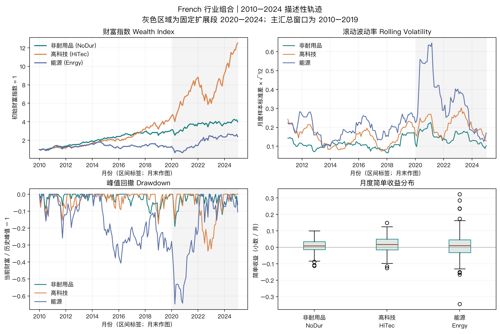

# Project 1 研究报告：行业组合的收益与风险描述

## 结论先行

在固定的 2010 年 1 月至 2019 年 12 月月度窗口，三类行业组合都取得正累计收益。高科技组合期末财富指数（Wealth Index）最高，为 4.627；非耐用品组合为 3.141；能源组合为 1.331。增长较高不等于路径风险较低：能源组合在该窗口的约定年化波动率（Volatility）为 20.03%，最大回撤（Maximum Drawdown）为 40.70%，两者均为三者最高。三类组合的同月无风险收益代理（Risk-free Return Proxy, RF）年化夏普比率（Sharpe Ratio）约为 1.039、1.032、0.217。增长、波动和相对 RF 表现各自刻画不同方面，不能把单个排序当作总体投资结论。

这是一项对当前发布数据的历史描述。样本不是可实施策略，也不是历史点时数据库。收益不能反推出实际价格、价格路径、公告时间、当时可用的信息、交易、融资或交易成本；报告不声称阿尔法（Alpha）、可实现超额收益或未来收益。

## 问题与窗口

主问题是：用同一套月度口径复利后，非耐用品、高科技和能源行业组合在 2010–2019 年的增长、收益离散程度、相对同月无风险收益表现及峰谷损失有何区别？三个行业分属消费品、技术和能源类别，提供业务来源不同的比较对象；这只是小型教学样本，不代表全部行业，也不据此挑选赢家。

第二个问题是：主窗口中观察到的排序会不会随固定历史切片变化？为此，对三组资产另报 2010–2014、2015–2019 和 2020–2024 三段。每段有 60 个连续月度观测。后 2020–2024 段只是固定的较晚描述区间；它是在当期资料更新后观察的历史段，不能称为训练外、留出或样本外检验。

主窗口固定为 120 个月，不纳入 2020–2024；图形为了显示路径变化覆盖到 2024 年 12 月，并以灰色标出扩展段。所用三个行业和所有时间段由 [配置](../configs/analysis.json) 固定。项目未搜索更多行业、窗口或参数来最大化收益、夏普或其他指标。

## 来源、快照与样本

输入来自 Kenneth R. French Data Library 的美国 10 行业组合月度表和 Fama/French 3 因子月度表。研究读取其中 `NoDur`、`HiTec`、`Enrgy` 与 `RF` 四列。行业组合按美国上市公司的行业分类形成；来源详情说明组合在 6 月末依行业代码分类，并计算随后 7 月至次年 6 月的收益。[10 行业组合说明](https://mba.tuck.dartmouth.edu/pages/faculty/ken.french/Data_Library/det_10_ind_port.html)；[French Data Library](https://mba.tuck.dartmouth.edu/pages/faculty/ken.french/data_library.html)。

2026 年 10 月 5 日下载并冻结了输入快照。数据清单逐一列出来源 ZIP、解压 CSV 和处理后 CSV 的 SHA-256；分析运行时再次核对实际读取的两个处理文件哈希，并与课程来源清单比对。行业收益文件选取 “Average Value Weighted Returns — Monthly” 区块，来源以百分数为单位，处理文件除以 100 一次后以小数保存。RF 从因子文件月度区块读取，同样由百分数转换为小数；读取时不再重复换算。

两份处理快照都包含 1,202 行，从 1926 年 7 月到 2026 年 8 月。研究期实际使用 2010 年 1 月至 2024 年 12 月，共 180 个月，所选四个字段在该范围内均连续、无缺失；主窗口是其中前 120 个月。源文件的缺失哨兵 −99.99 和 −999 已在处理步骤中转换为空字段。共享读取器检查哈希、列类型、有限值、月份升序、月份唯一和无断月；本项目不填零、不向前填 RF，也不静默删除缺口。行业与 RF 的完整月度索引必须完全相同，按 `month` 一对一连接后再按配置取窗。

数据版本、精确文件路径和哈希链见 [数据清单](../data_manifest.json)；字段、数值单位和时钟边界见 [数据字典](../data_dictionary.md)。数据以当前修订版本取得，而非逐月保存的历史快照。French 说明会在数据库更新时重建完整历史，历史收益可能因此改变。[Data Library 更新说明](https://mba.tuck.dartmouth.edu/pages/faculty/ken.french/data_library.html)。因子文件头注明 CRSP 数据版本 202608；来源还说明 2024 年 6 月起一月期国库券序列由 Ibbotson Associates 切换为 ICE BofA 一月期美国国库券指数。[因子说明](https://mba.tuck.dartmouth.edu/pages/faculty/ken.french/Data_Library/f-f_factors.html)。因此，较长历史不能被解释为同一冻结方法当年实时产生的数据。

## 时间与单位

`month` 是月度收益区间标签，`2010-01` 代表 2010 年 1 月区间，不给出某日或日内观察时刻。来源没有提供每个历史月的发布或入库时间（`available_at`）、策略信号时间（`signal_time`）或成交时间（`trade_time`）；本分析也没有信号和订单。结果因此不能回答收盘后能否下单或下单能否成交。

行业收益是每月已发布的含股息简单组合总回报，单位无量纲；例如 `0.01` 表示一个月收益 1%。项目使用标准行业组合文件，而 French 另有 “ex. Dividends” 版本。[Data Library 行业组合列表](https://mba.tuck.dartmouth.edu/pages/faculty/ken.french/data_library.html)。行业数据来自价值加权行业组合，不是逐股价格、开高低收成交量（OHLCV）、现有股票池或交易标的成交价。它可用于描述该发布组合的历史收益路径，不足以重构一位投资者的价格、持仓、资金流或成本账本。

`RF` 是 Fama/French 因子文件中的一月期美国国库券收益代理（Treasury-bill Return Proxy），作为同月无风险机会成本的参照；它不保证等于每位投资者实际可获得的无摩擦现金利率。Sharpe 用该月行业收益减去该月 RF。没有从年度利率换算或套用一个全年常数。因子来源说明该代理的输入序列截至 2024 年 5 月来自 Ibbotson Associates，自 2024 年 6 月起来自 ICE BofA 一月期美国国库券指数。[Fama/French 因子说明](https://mba.tuck.dartmouth.edu/pages/faculty/ken.french/Data_Library/f-f_factors.html)。

## 从收益到风险：方法与理由

### 1. 用简单收益把实际月度序列接成财富

简单收益（Simple Return）`R_t` 是来源直接提供的每月组合收益。无外部入金的账户按

\[
W_t=W_{t-1}(1+R_t),\qquad W_0=1.
\]

递推。这样做是因为收益以连续变化资本为分母；逐月相加会丢掉复利。`W_0=1` 是分析者选择的初始财富单位，不是观测到的证券价格。图中每条财富线都由发布的收益乘积计算，因此称为财富指数，不称价格。

### 2. 用对数收益解释时间上的乘积

对数收益（Log Return）定义为 `g_t = ln(1+R_t)`。本样本所有三组收益都大于 −100%，公式有定义。

\[
\sum_{t=1}^{T}g_t=\ln\!\left(\prod_{t=1}^{T}(1+R_t)\right).
\]

这个等式说明对数收益为什么适合解释跨时间复利：累计对数收益可相加，再指数化可还原财富的增长因子。它不能据此替代组合的简单收益加权；本项目没有将不同资产的对数收益相加。表中同时报月度简单收益算术均值与月度对数收益均值，让读者看到“典型单月幅度”与“时间复合增长”相关但不是同一统计量。累计财富仍由简单收益调用共享 `wealth_index` 生成。

### 3. 将离散程度放到年度尺度，并说明约定

波动率使用月简单收益的样本标准差 `s(R)`，自由度为 1；报告月度样本标准差乘 `√12`。这一步把单月离散程度表达成常见的年度尺度，便于和其他年度风险数值阅读。它是约定年化，不是对复利年度收益标准差的恒等式；序列相关、波动变化和分布非平稳都可能使平方根时间近似失真。绘图中的滚动风险也用每 12 个连续月份的样本标准差乘 `√12`，首 11 个月因窗口不足而留空。

### 4. 用同月 RF 衡量机会成本

夏普比率基于简单超额收益 `e_t=R_t-RF_t`。本项目采用

\[
\widehat{SR}_{ann}=\sqrt{12}\,\frac{\overline{(R-RF)}}{s(R-RF)}.
\]

分子减掉同月 RF，回答组合在该月份相对无风险替代收益的算术差额；分母是这些月度差额的样本标准差，衡量该超额序列的离散程度。这样把分子、分母的时间单位保持一致，再按明示的 `√12` 约定年化。它不是交易策略有效性检验，也没有校正序列相关、样本选择或多重比较。RF 只扣除一次；这不是风险因子回归，也不是阿尔法估计。

### 5. 以历史峰值为基准定位跌幅

回撤定义为

\[
D_t=\frac{W_t}{\max_{0\leq s\leq t}W_s}-1.
\]

先追踪财富此前最高点，再计算当前财富离该峰值的比例，才能呈现累计终值和路径中承受的最大下跌不是一回事。表格用 `−min(D_t)` 报为正数的最大回撤损失，并列出峰值月与谷底月。计算包含窗口开始前的初始财富 1；图上的起点是初始资本约定，不是市场价格。

### 6. 用 CAGR 压缩初末财富与时间

年复合增长率（Compound Annual Growth Rate, CAGR）用于把初始与末期财富比压缩成单一年度复合率：

\[
\mathrm{CAGR}=(W_T/W_0)^{1/(T/12)}-1.
\]

每个报告窗口都是整月，`T/12` 年是清楚可复现的月区间约定。CAGR便于和整年增长口径阅读，但隐藏了路径波动与峰谷；所以它与波动率、回撤并列，而不替代它们。

## 主窗口结果：2010–2019

表中总收益、CAGR、波动率和回撤均以百分比展示；财富指数以初值 1 表示。Sharpe 无量纲。RF 平均值是三者共同的月度样本均值，约 0.0427% / 月。

| 行业组合 | 期末财富指数 | 累计简单收益 | CAGR | 年化波动率 `s(R)√12` | 年化 Sharpe `√12` 约定 | 最大回撤损失（峰值 → 谷底） |
|---|---:|---:|---:|---:|---:|---:|
| 非耐用品（NoDur） | 3.1412 | 214.12% | 12.13% | 11.14% | 1.039 | 15.84%（2018-01 → 2018-12） |
| 高科技（HiTec） | 4.6270 | 362.70% | 16.55% | 15.61% | 1.032 | 17.68%（2018-08 → 2018-12） |
| 能源（Enrgy） | 1.3313 | 33.13% | 2.90% | 20.03% | 0.217 | 40.70%（2014-06 → 2016-02） |

两种月均收益体现复利差异。算术简单收益均值分别为：NoDur 1.0099%、HiTec 1.3848%、Enrgy 0.4053% / 月。对数收益均值依次为 0.9538%、1.2766%、0.2384% / 月。能源组合的两者差距尤其明显，反映正负月收益复合后的增长率低于只看单月算术平均所暗示的数值；它不是另一条可加权行业组合收益。

HiTec 期末财富最高，能源的收益离散程度与峰谷损失最大。NoDur 与 HiTec 的 Sharpe 数值接近；只按 Sharpe 的小差异给行业排名会忽略估计误差、区间选择和风险路径。本报告没有构造置信区间或显著性检验，不把小数差异解释为统计上稳定的优劣。

## 固定区间比较：描述排序是否随时间改变

将同一指标按预定固定区间重算，目的在于看单一十年样本的描述性排序是否依赖所处阶段；不是为了选择最佳区间。表中 CAGR、约定年化波动率和最大回撤是百分比，Sharpe 无量纲。所有行均为每个行业的等长、连续 60 个月。每个窗口各自以窗口开始前的财富 1 归一化，因此分段最大回撤仅在该 60 个月窗口内追踪历史峰值，不把上个窗口的财富峰值带入。

| 固定区间 | 行业 | CAGR | 年化波动率 | 年化 Sharpe | 最大回撤 |
|---|---|---:|---:|---:|---:|
| 2010–2014 | NoDur | 17.05% | 11.08% | 1.481 | 8.47% |
| 2010–2014 | HiTec | 14.84% | 15.79% | 0.956 | 15.39% |
| 2010–2014 | Enrgy | 7.88% | 19.25% | 0.488 | 25.88% |
| 2015–2019 | NoDur | 7.41% | 11.16% | 0.609 | 15.84% |
| 2015–2019 | HiTec | 18.30% | 15.55% | 1.102 | 17.68% |
| 2015–2019 | Enrgy | −1.84% | 20.86% | −0.033 | 28.18% |
| 2020–2024 | NoDur | 4.93% | 15.25% | 0.235 | 19.03% |
| 2020–2024 | HiTec | 22.04% | 21.84% | 0.920 | 33.60% |
| 2020–2024 | Enrgy | 12.44% | 37.50% | 0.435 | 51.16% |

NoDur 在前五年 CAGR 最高，HiTec 在之后两段最高。能源在 2015–2019 的累计收益为 −8.88%、Sharpe 为 −0.033，随后在 2020–2024 转为正累计收益；同一较晚时期它也有 37.50% 的最高年化波动率和 51.16% 的最大回撤。这个结果说明收益排序、超额收益与路径风险会随区间变化，不能从主窗口宣称固定优胜者。所有窗口均来自当前快照且事后分析，不构成可迁移到下一期的稳健性或样本外证据。机器可读的完整均值与峰谷月份见 [窗口结果 CSV](../qa/metrics_by_window.csv)。

## 图形：读坐标，不把收益画成价格



左上图横轴是月度收益区间的月末作图标签，纵轴是从 1 开始复利形成的财富指数。第一点为所选的 2009 年 12 月初始资本，不是 2009 年 12 月真实价格。实线展示 2010–2024 全部固定图形窗口；灰色区域提示读者 2020–2024 是主窗口后的描述性扩展段。右上图横轴仍为月份，纵轴是向后滚动 12 个月收益样本标准差乘 `√12` 的约定值，短时尖峰代表局部收益分散扩大，不能直接称为模型预测的未来风险。

左下图纵轴是 `财富 / 迄今最高财富 − 1`：0 表示接近历史峰值，−0.5 表示比此前峰值低一半。横轴与财富路径相同，保留初始资本点。右下箱线图横轴是三类行业组合，纵轴是 2010–2024 月度简单收益小数；中线为中位数，箱体为四分位范围，单独标出的点是较远的样本月。极端点是实际输入样本的一部分，不因其不利或突出而删除。各图显示的是月度区间标签，不给出月内事件或成交时点。

## 局限与结论

当前 French 行业组合数据适合教授复利路径和样本统计。它并未提供逐股价格、OHLCV、组成证券历史清单、逐月当时版本、每月精确发布日期、信号、成交或交易成本。序列历史值在下载更新时可能修订，2026-10-05 下载时间不能被倒推为每个历史月的数据可用时间。RF 的国库券构造来源在 2024 年 6 月更换，也应在跨时期比较时保留这项说明。

平方根 12 年化是报告约定；序列相关和条件波动会影响年度聚合。Sharpe 是窗口均值和标准差的比率，未经不确定性或序列相关调整，不是 Alpha 估计。没有建仓规则，因此没有交易成本、融资、借券或净策略收益可以估算；为“扣成本后 Alpha”制造一个数字会超出输入数据能支持的范围。

此证据最多支持如下描述：在这些当前修订的月度价值加权发布行业组合收益中，2010–2019 年高科技组合的历史复合增长最高，而能源组合承担的历史波动与峰值跌幅较大；固定历史切片中各行业的收益排序会改变。不能外推至未来个股或可交易投资，也不能据此证明任何资产定价解释或因果关系。

## 再现方式

```bash
.venv/bin/python projects/project01/run_project01.py
.venv/bin/python -m pytest tests/test_project01_analysis.py -q
```

CLI 从冻结文件读取并生成图、JSON 指标和窗口 CSV；测试检查冻结哈希、连续时间范围、RF 一对一对齐以及财富和回撤的可手算边界。完整项目验收记录见 [QA](../qa/acceptance.md)，教学推导与表格可在 [Notebook](../notebooks/project01_financial_data_analysis.ipynb) 从干净内核运行。
