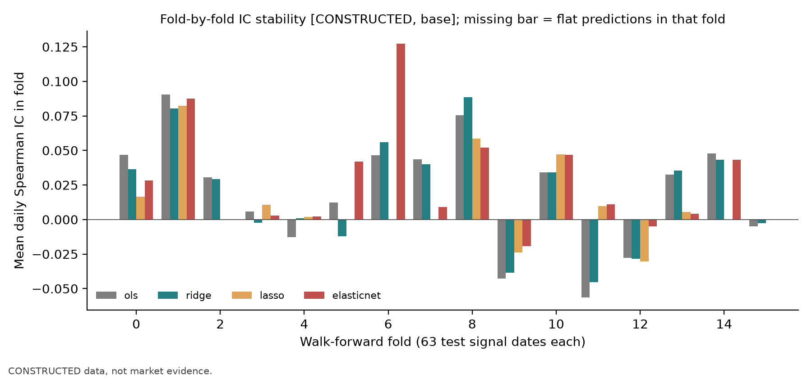
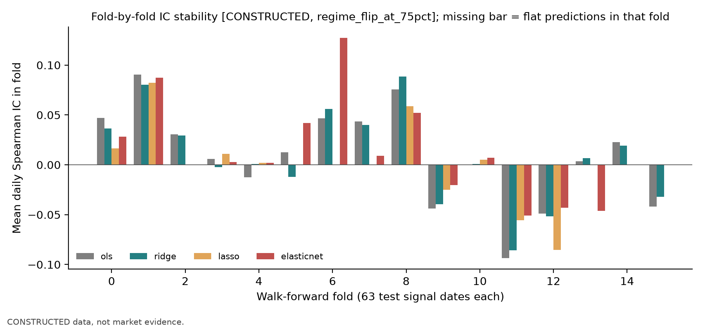
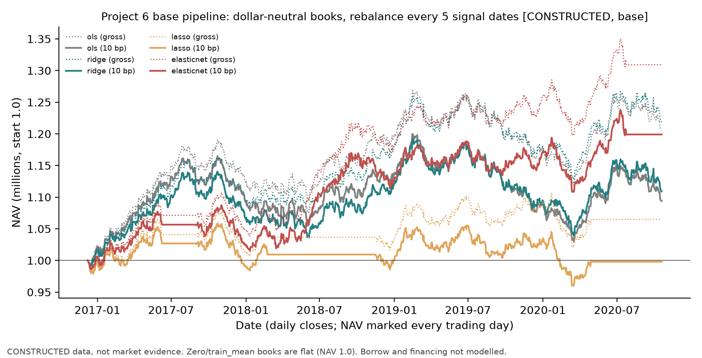
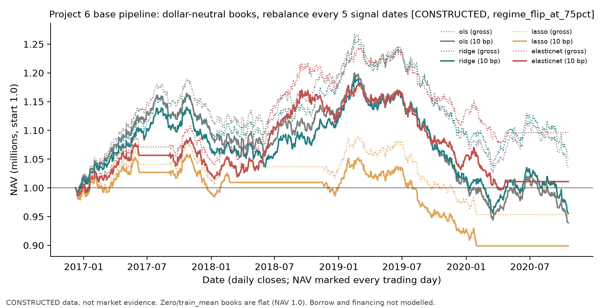

# Project 6 基础管线报告（A8-R1 冻结展示）

> 这不是实证研究报告。真实数据仍 **blocked**；下列数字全部来自构造面板（`data_class = CONSTRUCTED`），用于说明基础管线的时间契约、划分、训练内调参、仓位规则、滞后执行与成本账本。构造面板里的“信号”由作者设定，任何收益或排名都不构成市场证据。A8-A 基础实现与 A8-R1 展示修订有各自的限定范围接受入口；树模型扩展 A8-B 也已有单独的限定范围接受入口。本报告只讲基础层，不能据此登记完整 Project 6 或真实研究已完成。

## 1. 问题与假设（机制层面）

收盘可得的 46 个特征（3 个信号特征、40 个噪声特征、3 个价格特征）能否经训练内选择的正则化线性模型，产生成本后为正的美元中性组合，并优于零预测与训练均值。构造中三个信号特征的日预期收益载荷分别为每单位 0.03%、0.015%、0.0075%，信噪比低于第 39 章的构造。

## 2. 冻结设计

配置 `configs/p06_base_v1.json`（只读，SHA256 `62f49e1cab11b6992a9c391180df5d6827f9c5c12bf34f94acde5134ee4c39f7`），在任何 Project 6 运行之前冻结；冻结前看过的构造结果（第38、39章）登记在配置的 `seen_before_freeze`。

- 数据：40 只资产、1,512 个交易日（2015-01-02 起），种子 6061；预设情景 `regime_flip_at_75pct`（真实载荷在第 75% 日期处反号）。
- 时间：signal_time = $D_k$ 收盘；trade_time = label_start = $D_{k+1}$ 收盘；label_end = label_available_at = $D_{k+6}$ 收盘；$h=5$。
- 验证：按日期分组的扩张窗 walk-forward，首个训练窗 504 日、测试块 63 日，16 折（首个拟合时点 2016-12-08）；每折排除 $(\ell+h-1)\times N=200$ 行标签未知的训练行；内层 2 个 63 日验证块，内层最少 252 日。禁止随机打乱 K 折。
- 模型：零、训练均值、OLS、Ridge（$\alpha\in10^2..10^7$）、Lasso（5 档）、Elastic Net（4×3 档）；内层平均验证 MSE 最小者入选。
- 组合：截面去均值、绝对权重和为 1、美元中性；每 5 个信号日调仓；信号日后下一交易日收盘成交；单边比例成本 0、10、20 个基点；初始现金 100 万；NAV 按每日收盘逐日记账（第29章 `run_backtest`）。5 日标签不等同于逐日组合持有收益。借券费、融资利差、冲击、容量和保证金成本未建模。

## 3. 结果（历史构造运行）

下表 3.1 和 3.2 保留历史 `build/batches/A8-A/r1/runs/qa_r3/cli/p06_base` 与 `p06_regime` 的构造结果。I3 阅读包的两个冻结摘要与 `qa/a8/ch37_ch39_batch/rework_r2/evidence/rw_qa2/` 中的 `rw_qa2` 摘要逐字节一致；和 `qa_r3` 摘要逐项比较时，只有 `/seconds` 运行时间字段不同，其他摘要字段一致。`rw_qa2` 和 `qa_r3` 是不同运行身份，这一比较不证明未检查的 CSV、权重或账本相同。每份摘要中 13 对对应的 NaN 字段仍表示未定义，不能改读成 0。

I3 阅读包中的默认 P6 Notebook 读取冻结摘要、展示审计和 NAV 图片；实际代码不调用 `p06_pipeline.run`，不重训，也不重新计算逐日 IC 或配对日期。Notebook 中称其“从冻结配置冷启动运行”的旧句与当前代码模式不符，读者模式标签和实际代码界定其为展示回放。命令行 `run_project06.py --data constructed ...` 则会重建构造面板、训练模型并写出预测、权重、账本和摘要，是一次身份独立的新运行。不得将新运行与 I3 回放混称为同一次结果。

第 3.4 节的共同日期审计来自另一组冻结逐日行及其 A8-R1 `display_02` 证据，不是从摘要推导出的数字，也不能与未检查的运行文件合并成一个运行身份。

### 3.1 基础情景

| 模型 | $R^2_{\text{OS}}$ 相对零 | 相对训练均值 | IC均值（自身有效日） | t值展示 | 自身有效日 | 成本前总收益 / 夏普 | 10 bp 后 | 20 bp 后 | 10 bp 后最大回撤 | 年换手 |
|---|---|---|---|---|---|---|---|---|---|---|
| 零 | 0 | +0.861% | — | — | 0 | 0 / — | 0 / — | 0 / — | 0 | 0 |
| 训练均值 | −0.868% | 0 | — | — | 0 | 0 / — | 0 / — | 0 / — | 0 | 0 |
| OLS | −1.715% | −0.839% | 0.0203 | — | 1,002 | +20.57% / 0.79 | +9.39% / 0.39 | −0.76% / 0.00 | −14.2% | 24.3 |
| Ridge | −0.982% | −0.113% | 0.0198 | — | 1,002 | +21.88% / 0.84 | +10.90% / 0.45 | +0.91% / 0.07 | −12.9% | 23.6 |
| Lasso | −0.952% | −0.083% | 0.0179 | — | 630 | +6.51% / 0.36 | −0.20% / 0.01 | −6.50% / −0.33 | −9.3% | 16.3 |
| Elastic Net | −0.879% | −0.010% | 0.0309 | — | 882 | +30.92% / 1.19 | +19.90% / 0.81 | +9.81% / 0.43 | −7.2% | 22.0 |

测试期 16 折 × 63 = 1,008 个信号日（约 4 年），其中最后 6 个信号日标签超出样本，计入预测指标的为 1,002 日。

### 3.2 情景：真实载荷在 75% 处反号

| 模型 | IC均值（自身有效日） | t值展示 | 成本前 | 10 bp 后 | 20 bp 后 |
|---|---|---|---|---|---|
| OLS | 0.0089 | — | +3.52% / 0.17 | −6.09% / −0.22 | −14.80% / −0.61 |
| Ridge | 0.0087 | — | +5.05% / 0.23 | −4.44% / −0.15 | −13.08% / −0.53 |
| Lasso | 0.0010 | — | −4.66% / −0.25 | −10.10% / −0.57 | −15.23% / −0.89 |
| Elastic Net | 0.0152 | — | +9.61% / 0.45 | +1.09% / 0.08 | −6.77% / −0.29 |

### 3.3 读法

1. **零预测优于训练均值**：相对零的 $R^2$，训练均值为 $-0.868\%$。个股层面的历史均值噪声很大，与 Gu–Kelly–Xiu（2020）式（19）后的说明一致（第37章第11节）；四个拟合模型（OLS、Ridge、Lasso、Elastic Net）相对零的 $R^2$ 都为负。
2. **预测层与组合层分开**：上述四个拟合模型相对零的 $R^2$ 均为负，但截面IC为正，美元中性组合在成本前为正。这与第38章 6.5 节的水平—截面分解一致。
3. **成本**：年换手约 16–24 倍，单边 20 bp 时 OLS、Lasso 已为负，Ridge 接近 0。
4. **负结果保留**：Lasso 在 10 bp 后为 $-0.20\%$；状态反转情景下 OLS、Ridge、Lasso 在 10 bp 后全为负，Elastic Net 接近 0。逐折 IC（`p06_fold_ic_regime.png`）显示反转后多数折 IC 为负。
5. **调参不稳定**：Ridge 各折 $\alpha$ 在 $10^4$ 与 $10^7$ 之间跳动（第39章 6.7 节机制）；Lasso 在部分折把全部系数压为 0（IC 只覆盖 630 日）。
6. 构造中 Elastic Net 最好，只说明这一组设定；真实数据上需要同一协议重跑。

## 3.4 IC 日期与共同配对口径（A8-R1 从现存冻结行复算）

每情景 1,002 个候选标签日期。各模型自身有效集为 $D_m$；与 Ridge 的共同集为 $D_m\cap D_R$。配对两方均值与差只在共同集计算，不能把自身稀疏均值直接减 Ridge 全 1,002 日均值。常数预测 IC 未定义，既不填 0 也不补出观测。

| 情景/模型 | 自身有效/候选日 | 常数预测缺失日 | Ridge共同日 | 模型配对均值 | Ridge配对均值 | 配对均值差 |
|---|---:|---:|---:|---:|---:|---:|
| 基础/Ridge | 1002/1002 | 0 | 1002 | 0.01982995 | 0.01982995 | +0.00000000 |
| 基础/Lasso | 630/1002 | 372 | 630 | 0.01785759 | 0.01613330 | +0.00172429 |
| 基础/弹性网 | 882/1002 | 120 | 882 | 0.03087240 | 0.02060216 | +0.01027024 |
| 反号/Ridge | 1002/1002 | 0 | 1002 | 0.00865399 | 0.00865399 | +0.00000000 |
| 反号/Lasso | 567/1002 | 435 | 567 | 0.00100360 | 0.00308692 | -0.00208331 |
| 反号/弹性网 | 819/1002 | 183 | 819 | 0.01521028 | 0.00909016 | +0.00612013 |

基础 `Lasso/EN` 有效 630/882 日、反号情景 567/819 日；缺失分别为 372/120 与 435/183 日。A8-R1 的冻结行核对确认这些缺失日均为常数预测日。Ridge 两情景均有 1,002 日；OLS 两情景均有 1,002 日，零预测与训练均值均有 0 日。全模型逐日和配对 CSV、源 hash 及验证记录保存在 `qa/a8/limited_revision_ch39_ch43_p06_v1/evidence/display_02/`；这份展示审计不修改旧 summary。

A8-R1 展示不报告旧 IC t 值。旧 `ic_summary` 先 dropna，再按有效观察下标计算 NW(4)；稀疏日序列中的第 4 个观察间隔不等于 4 个交易日。旧值只保留在旧接受报告/summary；A8-R1 没有计算新 HAC，也不据此宣称统计显著优势。无缺失模型的日序列经当时读取可确认连续，但展示仍统一撤下旧 t 推断以避免混淆。P6 v1 与第 39 章是不同实验，不能用这些行复算第 39 章的历史配对量。

**完整问答**

- **P6-L01 · 问：**基础 Lasso 的 IC 0.01785759 能直接和 Ridge 的 0.01982995 比较并判定更弱吗？**答：**不能据此作配对优势推断，因为两者自身有效日期集不同。共同 630 日上 Ridge 的均值为 0.01613330，配对均值差为 +0.00172429；该差仍是描述量，本次展示没有有效推断 $t$ 值。
- **P6-L02 · 问：**压缩后的 NW(4) 是否代表四个交易日的 HAC？**答：**不是。例如有效交易序号为 0/2/3/5/8 时，按有效观察序号计算的第 4 阶滞后会连接 0 与 8，相距 8 个交易日。
- **P6-L03 · 问：**第 39 章能复用这些 P6 配对结果吗？**答：**不能。第 39 章缺少可用的冻结逐行预测，配对量明确无法复算；不能重训来补造历史观测。

## 4. 历史执行记录

- 历史接受流程检查了 `tests/test_p06_pipeline.py`（6 项）与共享模块 `tests/test_ml_pipeline.py`（c2 时 26 项；A8-A 返修 r2 增加标签时间契约测试后 34 项；变异检查 11/11 杀死）。
- 历史 `run_project06.py --data real` 返回退出码 3，未写文件。
- A8-A 基础 Notebook 曾有从干净内核执行的历史记录；`A8-R1/I3` 读者 Notebook 是冻结展示回放，不会重做上述训练。
- 历史检查确认每折训练行满足 `label_available_at <= fit_time`，零预测与训练均值组合换手为 0。以上均是历史接受证据，不是本次双语修订新跑出的结果。

## 5. 限制与待办

- 真实数据：需获准用于内部培训并可持久保存的日频个股面板（字段与授权要求见 `data_manifest.json`）；不继承 Project 5 的资产池或购买候选。当前仍 blocked。
- 树模型、训练内特征重要性、稳定性和消融已有单独的 A8-B 构造教学实现及限定接受入口，见 `ACCEPTED_VERSION_v2.md` 与 `research_report/v2_trees.md`；本基础报告不替代其独立结果。
- 完整 Project 6 尚未 verified；BIL19 的双语教学整合、PCA 扩展与全套题目答案现有候选，仍待独立审阅。
- 成本模型只有比例费用；借券、融资、冲击与容量未建模（第35–36章模块可在完整项目中接入）。

本双语修订候选只说明既有冻结展示与历史接受证据，不是新训练、模拟、Notebook 执行或真实数据验收。Project 6 真实数据仍 blocked，完整项目未 verified；旧接受版本、回执与冻结配置不变。BIL19 候选新增树/PCA 教学、稳定题号 P6-L04–P6-L08、完整答案与 Loom，见 [v2 指南](../V2_TREES.md) 与项目级 [solutions.md](../solutions.md)；本报告原三题的固定编号为 P6-L01–P6-L03。

## 冻结构造图的阅读

以下四幅冻结PNG逐字节沿用，只描述构造结果，不提供新的显著性检验，也不补第39章缺失行。

横轴为外层折（每折63个测试信号日），纵轴为日Spearman IC均值。四种颜色对应四个模型；缺柱表示该折预测为常数。各折结果明显变化。

轴与颜色同基础图。载荷反号后多折IC为负；末尾正值不能证明模型具有一般状态适应能力。

横轴为账本日期，纵轴为以百万计的NAV、初值1.0。图例配对各模型毛收益与10基点费用路径；比例费用降低财富。

轴与费用口径同基础NAV图。载荷反号后多个模型的财富回落，必须保留包含亏损的完整路径。
